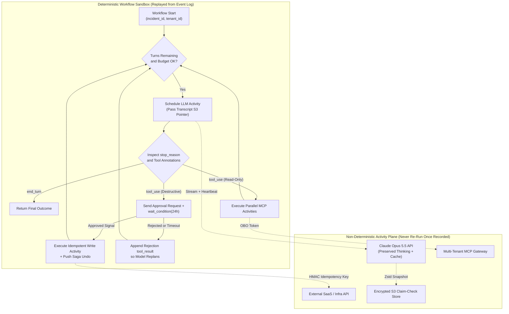
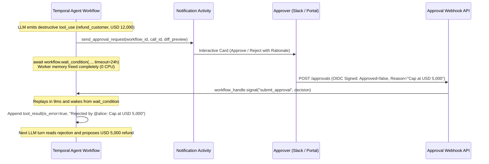

# Durable Execution for Long-Running Agents: Temporal, Restate & Checkpointing

A standard agent loop (`while stop_reason == "tool_use":`) running inside an HTTP handler or background thread holds its entire execution state—conversation history, preserved `thinking` blocks, loop counters, partial tool results, and pending human approvals—in **volatile process memory**. For a 3-second single-turn Q&A call, volatile memory is acceptable. For an autonomous software engineering, incident remediation, or financial operations agent spanning **15 to 200 turns** over **minutes to days**, volatile execution guarantees catastrophic production failures.

**Durable Execution** transforms the agent harness into a crash-proof state machine: every non-deterministic boundary (LLM generation, MCP tool invocation, sandbox run, human approval) is journaled to persistent storage before advancing. If a Kubernetes pod is `SIGKILL`-evicted on step 19 of 20, a replacement worker reconstructs steps 1 through 18 in milliseconds **without re-calling the LLM or re-executing external side effects**, and resumes seamlessly at step 19.

---

## 1. Why Naive Queues Fail Where Durable Execution Succeeds

Teams often try to bolt reliability onto in-memory agents by wrapping the entire `run_agent()` function inside a background job queue (`Celery`, `Sidekiq`, `BullMQ`, `AWS SQS`). When the worker crashes at step 14, the queue redelivers the original job message from scratch.

| Failure Scenario at Turn 14 of 20 | In-Memory HTTP / WebSocket | Standard Job Queue (`SQS` / `BullMQ`) | Durable Execution (`Temporal` / `Restate`) |
| :--- | :--- | :--- | :--- |
| **Kubernetes Rolling Deploy / Spot Preemption** | Connection drops; user sees `502 Bad Gateway`; all progress lost | Retries from Turn 1; re-bills 13 LLM turns; duplicates external writes | Replays cached history in ~8 ms on new pod; resumes exact Turn 14 |
| **LLM Provider `529 Overloaded` for 4 Minutes** | Exceeds 60s load-balancer timeout; trajectory lost | Exhausts worker thread pool sleeping; retries whole run | Activity backs off exponentially across minutes; Workflow holds zero threads |
| **Human Approval Takes 18 Hours** | Impossible to hold socket open | Requires custom DB state machine + cron pollers + webhook glue | Native `wait_condition` suspends workflow to disk at zero compute cost |
| **Preserved Thinking Block Continuity** | Lost on process exit | Re-generated differently on retry, altering entire trajectory | Exact serialized `response.content` restored byte-for-byte via Claim-Check |
| **Partial Multi-System Mutation Rollback** | Leaves orphaned Jira tickets / half-applied config | Leaves orphaned mutations + creates duplicates on retry | Deterministic **Saga compensation** unwinds completed steps in reverse order |

---

## 2. Comparing Durable Agent Runtimes

Four architectural approaches dominate production agent durability in 2026–2027. Choose based on your latency sensitivity, multi-language requirements, and operational footprint.

| Dimension | Temporal | Restate | LangGraph Checkpointer (Postgres) | DBOS / Inngest |
| :--- | :--- | :--- | :--- | :--- |
| **Core Abstraction** | Event-sourced deterministic Workflows + stateless Activities | Journaled RPC over Virtual Objects & Workflows (Rust engine) | Graph super-step state snapshots (`CheckpointTuple`) | Decorator/step-function journal backed by Postgres or serverless events |
| **Step Transition Overhead** | 8–35 ms per Activity | **1–5 ms** per journaled step | 5–20 ms per graph node write | 10–50 ms per step |
| **Determinism Requirement** | **Strict** inside `@workflow.defn` (sandbox-enforced) | Strict up to journal tail inside handler replay | Node functions re-run from last super-step checkpoint | Step closures skipped if step ID already recorded |
| **Multi-Day HITL Signals** | Native (`@workflow.signal` + `wait_condition` + timers) | Native (`ctx.awakeable()` / durable promises) | Supported via `interrupt()` + external resume API call | Native (`step.waitForEvent`) |
| **Max Single-Event Payload** | 2 MB (use S3 Claim-Check for larger) | 10 MB+ configurable | Bounded by Postgres `BYTEA` / `JSONB` (~1 GB theoretical, keep < 5 MB) | 512 KB–4 MB depending on tier |
| **Polyglot SDK Support** | Python, TypeScript, Go, Java, C#, Ruby, PHP | TypeScript, Python, Go, Java, Kotlin, Rust | Python, TypeScript | Python, TypeScript, Go |
| **Best Production Fit** | Enterprise multi-agent orchestration, long-horizon ops, strict SLAs | Low-latency stateful per-session agents & serverless RPC | Rapid Python/TS graph prototyping with moderate durability needs | Lightweight Postgres-only stacks avoiding a separate cluster |

---

## 3. Deterministic Orchestration vs. Non-Deterministic Activities

The foundational mental model of Temporal and Restate is splitting agent code across an impermeable boundary:

1. **The Workflow (Deterministic Orchestrator)**: Pure control flow—`while` loops, tool-routing `if/else` branches, turn/token budget counters, human-approval state machines, timers, and Saga compensation stacks. When recovering from a crash, the engine **re-executes the Workflow function from line 1**, feeding recorded outputs from the Event History whenever it hits an `await workflow.execute_activity(...)` statement.
2. **Activities (Non-Deterministic Side-Effect Boundary)**: Every operation whose output can vary across runs or touch the outside world—LLM API calls, MCP Gateway invocations, Firecracker sandbox runs, S3 blob uploads, database queries, and Slack notifications. Activities **never re-execute during replay** once their `ActivityTaskCompleted` event is persisted.



### The Five Replay Rules (Violating Any One Causes `NonDeterministicError`)

Inside a Workflow definition, **never**:
1. Call `datetime.now()` or `time.time()` -> Use `workflow.now()`.
2. Call `uuid.uuid4()` or `random.random()` -> Use `workflow.uuid4()` or `workflow.random()`.
3. Make direct network, filesystem, Redis, or LLM SDK calls -> Wrap them in `@activity.defn`.
4. Iterate over unordered sets/dicts whose iteration order depends on hash randomization -> Sort keys deterministically (`sorted(...)`).
5. Branch directly on mutable environment variables (`os.getenv("FEATURE_X")`) -> Pass configuration explicitly in the Workflow input dataclass or read via a Side Effect / Activity.

---

## 4. Solving Event-History Bloat & Preserved Thinking Continuity

Long-running frontier agents encounter a subtle clash between **LLM API requirements** and **Durable Engine storage limits**:
- **Preserved Thinking & Compaction Invariant**: Models like `claude-opus-5-5` and `claude-fable-5-2` cryptographically bind `thinking` blocks to the conversation history. Editing, stripping, or re-serializing earlier message blocks invalidates thinking continuity (or fails the history-editing check with a `400`). Furthermore, server-side `compaction` blocks in `response.content` must be appended verbatim.
- **Temporal History Limits**: Temporal enforces a **2 MB limit per gRPC payload** and a **50 MB / 51,200-event limit per Workflow run**. Passing a 400,000-token `messages[]` array into and out of 30 consecutive LLM Activities writes $30 \times 1.5\text{ MB} = 45\text{ MB}$ into the Temporal event log, crashing the workflow mid-task.

### Solution: Immutable S3 Claim-Check + `continue_as_new`

Store the exact append-only `messages[]` list as Zstandard-compressed, KMS-encrypted snapshots in object storage (`s3://agent-state/{tenant_id}/{workflow_id}/turn-{turn:04d}.json.zst`). Pass **only a 200-byte immutable `TranscriptRef`** through Temporal:

```python
from dataclasses import dataclass

@dataclass(frozen=True)
class TranscriptRef:
    s3_uri: str
    sha256: str
    turn_index: int
    cumulative_output_tokens: int
    last_stop_reason: str
    pending_tool_calls: list[dict]  # Lightweight metadata (< 8 KB) for Workflow routing
```

When `workflow.info().is_continue_as_new_suggested()` returns `True` (typically around 10,000 events or 100+ turns), the Workflow calls `workflow.continue_as_new(AgentWorkflowInput(transcript_ref=current_ref, ...))`, rolling over to a fresh 0-byte Temporal event log while retaining 100% of the S3-backed LLM conversation history!

---

## 5. Human-in-the-Loop (HITL) Signals & Cryptographic Idempotency

### 5.1 Zero-Compute Multi-Day Pause & Resume

When an agent proposes a high-blast-radius action (e.g., terminating production EC2 instances, issuing a USD 12,000 customer credit, merging a database migration), polling a database in a `while` loop wastes worker slots. Durable Signals suspend the workflow cleanly to persistent storage:



Notice the critical agentic UX detail: **a human rejection should rarely throw an unhandled exception that kills the entire run**. Returning the human's rationale inside a structured `tool_result` (`is_error: True`) allows the LLM to adjust its plan (e.g., capping the refund or choosing a read-only diagnostic fallback) while preserving every prior turn's context.

### 5.2 Deterministic Idempotency Keys for At-Least-Once Activities

Temporal and Restate guarantee **at-least-once** execution of Activities. Suppose your worker sends `POST /v1/refunds` to Stripe, Stripe commits the refund, and the worker's network socket drops 5 milliseconds before receiving the `200 OK`. Temporal marks the Activity timed out and schedules Attempt #2.

To achieve **effective exactly-once external mutations**, derive a deterministic cryptographic idempotency key from immutable workflow coordinates:

$$K_{\text{idem}} = \text{Hex}\!\left(\text{HMAC-SHA256}\!\left(\text{Secret}_{\text{tenant}},\; \text{workflow\_id} \parallel \text{":"} \parallel \text{turn\_index} \parallel \text{":"} \parallel \text{tool\_use\_id}\right)\right)$$

> **Fatal Pitfall — Never Include `activity.info().attempt` in $K_{\text{idem}}$!**
> If you hash `attempt=1` on the first try and `attempt=2` on the retry, you generate two distinct idempotency keys, guaranteeing a double-charge on network timeout. Hash **only** the logical coordinate `(workflow_id, turn_index, tool_use_id)`.

For legacy internal APIs or databases that do not support an `Idempotency-Key` HTTP header, wrap the Activity in a **Postgres Deduplication Lease**:
1. `INSERT INTO tool_idempotency_ledger (idem_key, status, expires_at) VALUES ($1, 'IN_FLIGHT', now() + interval '10 minutes') ON CONFLICT (idem_key) DO NOTHING RETURNING idem_key;`
2. If 0 rows returned: read existing row—if `'COMPLETED'`, return stored `response_json` immediately without calling the downstream API; if `'IN_FLIGHT'` (concurrent zombie worker), raise retryable error to wait out the lease.
3. Execute external mutation, then `UPDATE tool_idempotency_ledger SET status = 'COMPLETED', response_json = $2 WHERE idem_key = $1`.

---

## 6. Reference Implementation: Temporal + Claude Opus 5.5 Agent

The implementation below demonstrates production-grade Activity heartbeating during LLM streaming, non-retryable vs. retryable error classification, Claim-Check transcript persistence, HITL Signal handling, and HMAC idempotency keys.

```python
import asyncio
import hashlib
import hmac
from dataclasses import dataclass, field
from datetime import timedelta
import anthropic
from temporalio import activity, workflow
from temporalio.common import RetryPolicy
from temporalio.exceptions import ApplicationError

# --- Data Contracts ---

@dataclass
class ApprovalDecision:
    tool_use_id: str
    approved: bool
    reviewer_id: str
    reason: str = ""

@dataclass
class AgentRunInput:
    tenant_id: str
    user_sub: str
    initial_prompt: str
    transcript_s3_uri: str | None = None
    turn_index: int = 0
    remaining_task_tokens: int = 96_000

@dataclass
class LLMTurnOutput:
    next_transcript_s3_uri: str
    stop_reason: str
    final_text: str
    tool_calls: list[dict]
    turn_tokens_spent: int

# --- Non-Deterministic Activities ---

@activity.defn
async def run_claude_streaming_turn(
    tenant_id: str,
    transcript_s3_uri: str | None,
    initial_prompt: str,
    appended_tool_results: list[dict],
    remaining_budget: int,
) -> LLMTurnOutput:
    """
    Streams Claude Opus 5.5 while emitting Temporal heartbeats every 2 seconds.
    If a worker dies mid-stream, Temporal detects missed heartbeats within 15s
    instead of waiting out a 10-minute full-generation timeout.
    """
    messages = await load_transcript_from_s3(transcript_s3_uri) if transcript_s3_uri else [
        {"role": "user", "content": initial_prompt}
    ]
    if appended_tool_results:
        messages.append({"role": "user", "content": appended_tool_results})

    client = anthropic.AsyncAnthropic()
    last_heartbeat = asyncio.get_running_loop().time()

    try:
        async with client.beta.messages.stream(
            model="claude-opus-5-5",
            max_tokens=32_000,
            thinking={"type": "adaptive"},
            output_config={
                "effort": "high",
                "task_budget": {
                    "type": "tokens",
                    "total": 96_000,
                    "remaining": max(20_000, remaining_budget),
                },
            },
            betas=["task-budgets-2026-03-13", "server-side-fallback-2026-07-01"],
            fallbacks="default",
            cache_control={"type": "ephemeral"},
            tools=get_frozen_enterprise_tools(),
            messages=messages,
        ) as stream:
            async for _event in stream:
                now = asyncio.get_running_loop().time()
                if now - last_heartbeat >= 2.0:
                    activity.heartbeat("streaming_tokens")
                    last_heartbeat = now

            response = await stream.get_final_message()

    except anthropic.BadRequestError as exc:
        # 400 schema / prompt errors will never succeed on blind retry — fail fast!
        raise ApplicationError(f"Non-retryable Claude 400: {exc.message}", non_retryable=True) from exc
    except anthropic.AuthenticationError as exc:
        raise ApplicationError("Invalid Anthropic credentials", non_retryable=True) from exc
    # RateLimitError (429), InternalServerError (5xx), APIConnectionError propagate
    # naturally so Temporal's RetryPolicy applies exponential backoff.

    if response.stop_reason == "refusal":
        category = response.stop_details.category if response.stop_details else "unknown"
        raise ApplicationError(f"Safety refusal ({category})", non_retryable=True)

    # CRITICAL: Append full response.content verbatim to preserve thinking & compaction blocks!
    messages.append({"role": "assistant", "content": [block.model_dump() for block in response.content]})
    next_uri = await save_transcript_to_s3(tenant_id, activity.info().workflow_id, messages)

    tool_calls = [
        {"id": b.id, "name": b.name, "input": b.input, "destructive": is_destructive_tool(b.name)}
        for b in response.content
        if b.type == "tool_use"
    ]
    final_text = "\n".join(b.text for b in response.content if b.type == "text")

    return LLMTurnOutput(
        next_transcript_s3_uri=next_uri,
        stop_reason=response.stop_reason,
        final_text=final_text,
        tool_calls=tool_calls,
        turn_tokens_spent=response.usage.output_tokens,
    )

@activity.defn
async def invoke_mcp_tool_idempotent(
    tenant_id: str,
    workflow_id: str,
    turn_index: int,
    tool_call: dict,
) -> dict:
    secret = await get_tenant_hmac_key(tenant_id)
    coord = f"{workflow_id}:{turn_index}:{tool_call['id']}".encode("utf-8")
    idem_key = hmac.new(secret, coord, hashlib.sha256).hexdigest()

    result_text, is_err = await dispatch_to_mcp_gateway(
        tenant_id=tenant_id,
        tool_name=tool_call["name"],
        arguments=tool_call["input"],
        idempotency_key=idem_key,
    )
    return {
        "type": "tool_result",
        "tool_use_id": tool_call["id"],
        "is_error": is_err,
        "content": result_text,
    }

# --- Deterministic Workflow ---

@workflow.defn
class HardenedEnterpriseAgentWorkflow:
    def __init__(self) -> None:
        self._approvals: dict[str, ApprovalDecision] = {}

    @workflow.signal
    async def submit_approval(self, decision: ApprovalDecision) -> None:
        self._approvals[decision.tool_use_id] = decision

    @workflow.run
    async def run(self, params: AgentRunInput) -> str:
        transcript_uri = params.transcript_s3_uri
        turn = params.turn_index
        remaining_tokens = params.remaining_task_tokens
        pending_results: list[dict] = []

        llm_retry = RetryPolicy(
            initial_interval=timedelta(seconds=2),
            backoff_coefficient=2.0,
            maximum_interval=timedelta(seconds=90),
            maximum_attempts=6,
        )

        while turn < 40:
            if workflow.info().is_continue_as_new_suggested():
                workflow.continue_as_new(
                    AgentRunInput(
                        tenant_id=params.tenant_id,
                        user_sub=params.user_sub,
                        initial_prompt=params.initial_prompt,
                        transcript_s3_uri=transcript_uri,
                        turn_index=turn,
                        remaining_task_tokens=remaining_tokens,
                    )
                )

            llm_out = await workflow.execute_activity(
                run_claude_streaming_turn,
                args=[params.tenant_id, transcript_uri, params.initial_prompt, pending_results, remaining_tokens],
                start_to_close_timeout=timedelta(minutes=10),
                heartbeat_timeout=timedelta(seconds=15),
                retry_policy=llm_retry,
            )

            transcript_uri = llm_out.next_transcript_s3_uri
            remaining_tokens = max(20_000, remaining_tokens - llm_out.turn_tokens_spent)
            pending_results = []
            turn += 1

            if llm_out.stop_reason == "end_turn" or not llm_out.tool_calls:
                return llm_out.final_text

            # Execute approved / read-only tools and collect all tool_results for single user turn
            tasks = []
            immediate_rejections: list[dict] = []

            for call in llm_out.tool_calls:
                if call["destructive"]:
                    await workflow.execute_activity(
                        notify_human_approver,
                        args=[workflow.info().workflow_id, call],
                        start_to_close_timeout=timedelta(seconds=20),
                    )
                    try:
                        await workflow.wait_condition(
                            lambda cid=call["id"]: cid in self._approvals,
                            timeout=timedelta(hours=24),
                        )
                        decision = self._approvals[call["id"]]
                    except asyncio.TimeoutError:
                        decision = ApprovalDecision(
                            tool_use_id=call["id"],
                            approved=False,
                            reviewer_id="system-timeout",
                            reason="Approval timed out after 24 hours; propose a non-destructive alternative.",
                        )

                    if not decision.approved:
                        immediate_rejections.append({
                            "type": "tool_result",
                            "tool_use_id": call["id"],
                            "is_error": True,
                            "content": f"Action denied by {decision.reviewer_id}: {decision.reason}",
                        })
                        continue

                tasks.append(
                    workflow.execute_activity(
                        invoke_mcp_tool_idempotent,
                        args=[params.tenant_id, workflow.info().workflow_id, turn, call],
                        start_to_close_timeout=timedelta(minutes=3),
                        retry_policy=llm_retry,
                    )
                )

            executed_results = await asyncio.gather(*tasks) if tasks else []
            # Preserve all parallel tool_results inside a single user turn!
            pending_results = list(executed_results) + immediate_rejections

        raise ApplicationError("Agent exceeded 40-turn hard safety cap", non_retryable=True)
```

---

## 7. Safe Deployment Versioning & Saga Compensations

### 7.1 Versioning Live Sleeping Workflows

Suppose 1,200 agent workflows are currently sleeping inside `wait_condition` awaiting Monday-morning manager approval, and on Sunday night you deploy a code change adding an extra pre-flight validation Activity inside the loop. When a sleeping workflow wakes up on Monday and replays its Friday history against Sunday's code, the Activity sequence no longer matches Friday's recorded history—triggering `NonDeterministicError`!

Production teams prevent replay divergence via two mechanisms:
1. **Worker Versioning (Build ID Pinning — Preferred)**: Pin running workflows to the container image Build ID (`v2026.11.24`) that started them while routing *new* workflow executions to `v2026.11.25`, draining old workers once in-flight trajectories complete.
2. **Explicit Patch Gates (`workflow.patched`)**: When migrating ultra-long-lived workflows onto new workers, guard control-flow changes explicitly:
   ```python
   if workflow.patched("add-preflight-compliance-check-v1"):
       await workflow.execute_activity(
           run_compliance_check,
           args=[params.tenant_id],
           start_to_close_timeout=timedelta(seconds=15),
       )
   ```

### 7.2 Saga Compensations for Partial Multi-System Mutations

When an agent executes a composite business transaction across heterogeneous APIs—Step A reserves cloud quota, Step B provisions an RDS instance, and Step C fails permanently on IAM policy validation—durable execution alone cannot magically "undo" Steps A and B. Implement a deterministic **Saga Compensation Stack**:

- Maintain `compensations: list[CompensationAction] = []` inside Workflow state.
- Immediately after each mutating Activity succeeds, push its inverse Activity (`release_cloud_quota`, `delete_rds_instance`) with its deterministic rollback idempotency key onto `compensations`.
- If an unrecoverable `ApplicationError` or human abort fires, iterate `reversed(compensations)` inside `try ... except` compensation blocks before marking the workflow failed.

With crash-proof orchestration and exactly-once external tool invocation established, the next critical gap is **what happens when the tool itself executes untrusted code, shell commands, or SQL generated by the model**. Proceed to **[03-SECURE-CODE-SANDBOXES-MICROVMS.md](03-SECURE-CODE-SANDBOXES-MICROVMS.md)**.
