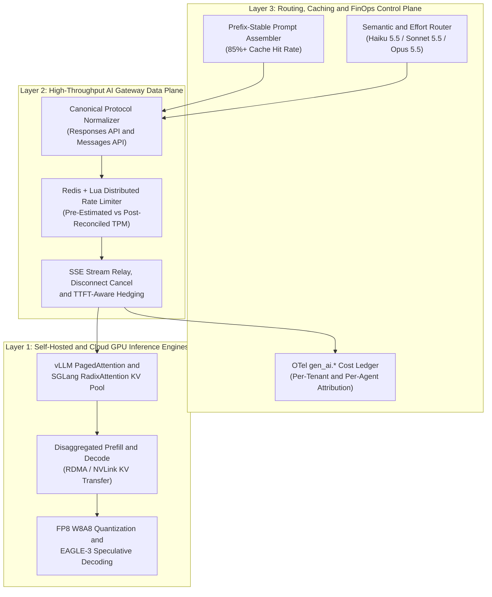
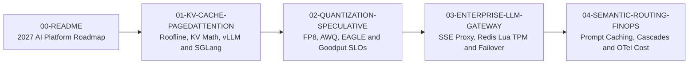

# LLM Inference, AI Gateways & FinOps Mastery

## Why Inference and Gateway Economics Is the Top Salary Multiplier in 2027

Between 2023 and 2025, software engineers could command a premium simply by wiring an LLM API into a web backend with a prompt template and a vector database. By 2027, basic agent orchestration is table stakes: coding assistants generate CRUD wrappers, basic LangGraph loops, and naive RAG pipelines in minutes.

The real bottleneck—and the highest-leverage career moat for backend and platform engineers—has shifted decisively downward into **AI Data Plane Engineering, GPU Inference Systems, and Token FinOps**. When an enterprise scales from a 50-user internal prototype to 50,000 autonomous multi-turn agent workflows per hour, three systemic failures occur simultaneously:

1. **Latency Collapse**: Tail Time-to-First-Token (P99 TTFT) spikes past 12 seconds and Inter-Token Latency (ITL) jitters violently because engineers treat Stateful KV-Cached GPU clusters like stateless REST microservices.
2. **Gateway Cascading Outages**: Standard HTTP proxies (vanilla NGINX, Envoy, or naive FastAPI wrappers) drop long-lived Server-Sent Events (SSE) streams, fail to propagate client disconnects to upstream GPUs, or get throttled globally by `429 RateLimitError` bursts due to missing pre-flight token reservation.
3. **Runaway Unit Economics**: Uncached quadratic agent loops ($O(N^2)$ input token growth over $N$ tool turns) and flat frontier-model routing turn a projected USD 8,000 monthly bill into USD 140,000 per month—killing product gross margins before launch.

Engineers who can bridge **GPU serving physics** (vLLM, SGLang, KV cache math, FP8 quantization, speculative decoding) with **distributed systems rigor** (Go/Python SSE gateways, Redis Lua token buckets, prefix-stable prompt caching, semantic cascading, and OpenTelemetry `gen_ai.*` cost ledgers) sit in the scarcest talent bracket in tech. Across Tier-1 AI labs, hyperscalers, and global enterprises in 2027, Staff AI Platform and Inference Infrastructure roles routinely command **USD 280k to 500k+** total compensation (and top-percentile packages globally) because a single architectural optimization directly saves hundreds of thousands of dollars in annual GPU/API spend while halving user-facing latency.

If you already possess strong production fundamentals in **Golang, Python (FastAPI), Kubernetes, Redis, Kafka, and OpenTelemetry**, you already own 70% of the required systems foundation. This vault builds the remaining 30%—giving you end-to-end mastery from HBM memory bandwidth up to enterprise FinOps governance.

---

## The Three-Layer AI Infrastructure Stack

Modern enterprise AI platforms separate concerns across three tightly coupled layers. Mastering how state, backpressure, and token accounting flow across these layers is what distinguishes an AI Platform Architect from an application developer.

---

## Curriculum Roadmap & Table of Contents

Work through the four technical modules sequentially. Each module builds directly on the mathematical models and systems invariants established in the preceding chapter.

### Complete Module Index

| Module | Core Focus | Key Engineering Artifacts Covered |
| :--- | :--- | :--- |
| **[01-KV-CACHE-PAGEDATTENTION-VLLM-SGLANG.md](01-KV-CACHE-PAGEDATTENTION-VLLM-SGLANG.md)** | **GPU Serving Internals & KV Cache Physics** | Prefill (compute-bound GEMM) vs Decode (bandwidth-bound GEMV); H100/B200 Roofline ridge points; exact MHA/GQA/MLA KV cache byte formulas; Continuous Batching & Chunked Prefill; vLLM PagedAttention block tables; SGLang RadixAttention prefix trees; Disaggregated Prefill/Decode over RDMA. |
| **[02-QUANTIZATION-SPECULATIVE-DECODING.md](02-QUANTIZATION-SPECULATIVE-DECODING.md)** | **Numerical Precision, Speculation & Benchmarking** | FP8 (E4M3/E5M2), NVFP4, SmoothQuant INT8 math, GPTQ Hessian compensation, and AWQ salient-channel scaling; lossless rejection sampling math for Speculative Decoding; Prompt Lookup, Medusa, and EAGLE-3; high-batch speculation degradation; benchmarking TTFT, ITL, TPOT, and SLO Goodput. |
| **[03-ENTERPRISE-LLM-GATEWAY-ARCHITECTURE.md](03-ENTERPRISE-LLM-GATEWAY-ARCHITECTURE.md)** | **High-Throughput AI Gateway Engineering (Go & Python)** | Canonical IR bridging OpenAI Responses API and Anthropic Messages API; zero-buffering SSE framing, heartbeats, and upstream disconnect cancellation in Go; atomic two-phase Redis + Lua token-bucket rate limiting (pre-flight reservation + post-stream reconciliation); TTFT-aware hedged requests and multi-provider circuit breaking. |
| **[04-SEMANTIC-ROUTING-PROMPT-CACHING-FINOPS.md](04-SEMANTIC-ROUTING-PROMPT-CACHING-FINOPS.md)** | **Prompt Caching, Model Cascading & AI FinOps** | Prefix-match invariants (`tools` -> `system` -> `messages`); 4-layer prompt architecture for $>85\%$ cache hit rates; mid-conversation `role: "system"` operator injection; 5m vs 1h TTL break-even math & `max_tokens: 0` keep-alives; effort sweeps vs Haiku/Sonnet/Opus semantic cascades; OpenTelemetry `gen_ai.*` span accounting & cutting spend by 60-80%. |

---

## End-to-End Request Lifecycle in a Production AI Data Plane

Before diving into individual chapters, anchor your mental model on what actually happens during a single 15-second streaming agent turn in a well-engineered enterprise gateway:

| Stage | Target Latency Budget | Critical Mechanism | What Goes Wrong in Naive Systems |
| :--- | :--- | :--- | :--- |
| **1. Auth & Context Extraction** | $< 2\text{ ms}$ | Extract tenant, workspace, RBAC scope, and W3C `traceparent` / `baggage` headers. | Missing tenant attribution makes chargeback and noisy-neighbor isolation impossible. |
| **2. Prefix-Stable Normalization** | $< 3\text{ ms}$ | Deterministic JSON key sorting (`sort_keys=True`), frozen tool ordering, explicit `cache_control` placement. | Injecting `datetime.now()` or unsorted tool schemas invalidates 50K cached prefix tokens on every call. |
| **3. Two-Phase Token Reservation** | $< 1.5\text{ ms}$ | Single-RTT Redis Lua script reserves estimated input + P90 output budget against tenant TPM/RPM buckets. | Checking RPM only lets 10 concurrent 120K-context requests exhaust org-wide upstream TPM limits immediately. |
| **4. Tier & Locality Routing** | $< 5\text{ ms}$ | Route to sticky workspace/prefix shard (SGLang Radix router or consistent-hashed provider key) and select effort/model tier. | Round-robin load balancing scatters identical prefixes across isolated KV caches, halving cache hit rates. |
| **5. Upstream Prefill & TTFT Guard** | $150\text{--}800\text{ ms}$ | Monitor upstream TTFT timer; trigger hedged fallback only *before* first delta flushes downstream; emit `: ping` SSE comments. | Waiting 60s on a wedged upstream node or retrying mid-stream after partial JSON has already reached the client. |
| **6. Streaming Decode & Abort Sync** | $2\text{--}45\text{ s}$ | Flush SSE chunks immediately (`X-Accel-Buffering: no`); bind `req.Context().Done()` to cancel upstream HTTP stream on client abort. | User closes browser tab after 1s, but gateway keeps reading 32K thinking + output tokens from upstream. |
| **7. Reconciliation & OTel Sink** | Async ($< 1\text{ ms}$ inline) | Refund unused reserved tokens to Redis Lua bucket; emit deduplicated `gen_ai.usage.*` cost ledger entry to ClickHouse/OTLP. | Double-counting `gen_ai.usage.input_tokens` alongside `cache_read` tokens, inflating reported FinOps spend by 80%. |

---

## The 2027 AI Engineering Competency Matrix

Use this rubric to benchmark your current architectural depth and prepare for Staff/Principal system design interviews:

| Dimension | Level 1: Application Wrapper Engineer | Level 2: Senior AI Backend Engineer | Level 3: Staff AI Platform / Inference Engineer |
| :--- | :--- | :--- | :--- |
| **GPU Bottlenecks** | Treats LLM latency as a black-box network call ("the model is slow"). | Understands prefill vs decode and chooses smaller models for lower latency. | Computes exact HBM bandwidth roofline, KV bytes/token for GQA/MLA, and tunes `max_num_batched_tokens` + chunked prefill for Goodput SLOs. |
| **Quantization & Speedup** | Uses default hosted precision or downloads random GGUF files locally. | Deploys AWQ/GPTQ 4-bit models to fit smaller GPUs. | Selects FP8 W8A8 + FP8 KV cache on Hopper/Blackwell, deploys EAGLE-3 speculative decoding, and gates speculation off above batch-size crossover. |
| **Gateway Streaming** | Buffers full response or uses basic FastAPI `StreamingResponse` without backpressure. | Streams SSE end-to-end with Nginx buffering disabled and custom error events. | Implements zero-alloc Go SSE framing, SSE keep-alive comments during adaptive thinking pauses, and instant upstream context cancellation on client disconnect. |
| **Rate Limiting** | Uses fixed-window requests-per-minute (RPM) middleware per IP/user. | Tracks cumulative tokens in Postgres/Redis after responses finish. | Runs atomic Redis + Lua two-phase token-bucket reservation (pre-estimated input + P90 output) with post-stream refund/overdraft reconciliation. |
| **Prompt Caching** | Never sets `cache_control`, or puts timestamps in the system prompt. | Adds basic prompt caching on static system prompts. | Architects 4-layer stability prefixes, uses mid-conversation `role: "system"` updates to protect Preserved Thinking + KV caches, and monitors `cache_read` hit ratios $>85\%$. |
| **Model Routing** | Hardcodes a single frontier model across every call and subagent. | Manually routes chat to a small model and coding to a large model. | Sweeps `output_config.effort` inside one cache namespace first, then deploys calibrated embedding/classifier routers + verifier-gated escalation cascades. |
| **Observability & FinOps** | Checks the monthly provider invoice at the end of the billing cycle. | Logs `input_tokens` and `output_tokens` in application stdout logs. | Propagates W3C `traceparent` + `baggage` (`tenant.id`, `agent.name`), reconciles OTel `gen_ai.usage.*` vs provider billing schemas, and enforces per-tenant task budgets. |

---

## Self-Hosted GPUs vs Managed Cloud APIs: The 2027 Break-Even Model

One of the most common executive questions a Staff AI Platform Engineer must answer is: *"When should we keep calling Anthropic / OpenAI / Bedrock APIs via our AI Gateway versus spinning up our own Kubernetes vLLM / SGLang H200 GPU pools?"*

Never answer this ideologically. Compute the **Utilization-Adjusted Cost per Million Effective Tokens**:

$$\text{Self-Hosted Cost per 1M Out Tok} = \frac{\text{Hourly Node Cost (USD/hr)}}{\text{Goodput}_{\text{out}} \text{ (tok/s)} \times 3600 \times u_{\text{diurnal}}} \times 10^6$$

Where $u_{\text{diurnal}} \in [0.20, 0.85]$ is your real 24-hour average cluster utilization (accounting for night/weekend troughs and headroom reserved for traffic spikes).

### Worked Break-Even Comparison (70B-Class Dense / MoE Open-Weight vs Managed Tier)

Assume a reserved 2x NVIDIA H200 (141GB) node costs **USD 6.80 / hour** (~USD 4,960 / month) running `Qwen3-72B-FP8` on SGLang with chunked prefill, achieving a sustainable **SLO Goodput** of `1,850 output tok/s` + `7,400 input tok/s` at peak:

| Traffic Profile | Sustained Utilization ($u_{\text{diurnal}}$) | Effective Self-Hosted Cost (per 1M Out Tok) | Managed `claude-haiku-5-5` / `sonnet-5-5` Equivalent | Architectural Recommendation |
| :--- | :--- | :--- | :--- | :--- |
| **Spiky Internal Tools** (<5M tok/day, 9am-6pm only) | $8\%$ | **USD 12.76 / 1M** (+ DevOps on-call overhead) | **USD 0.50 to USD 10.00 / 1M** (with 85%+ prompt cache hits) | **100% Managed API via Gateway**. Self-hosting loses money on idle night/weekend GPU hours. |
| **Steady B2B SaaS** (80M tok/day, multi-region) | $42\%$ | **USD 2.43 / 1M** | **USD 0.50 (Haiku) / USD 10.00 (Sonnet)** | **Hybrid Gateway Split**: Self-host high-volume open-weight extraction/RAG; route complex reasoning to `claude-sonnet-5-5` / `claude-opus-5-5`. |
| **24/7 Async Batch + High-Scale Agent Fleet** (>400M tok/day) | $78\%$ | **USD 1.31 / 1M** | Batch API at 50% off or committed throughput | **Base-Load + Burst Architecture**: Size self-hosted GPU base pool for P40 diurnal trough ($u \approx 85\%$); burst peak traffic above P40 through the AI Gateway to cloud APIs! |

> **The Base-Load + Cloud-Burst Pattern**: Because your AI Gateway normalizes protocols ([Module 03](03-ENTERPRISE-LLM-GATEWAY-ARCHITECTURE.md)), you never have to choose 100% self-hosted or 100% cloud API. Provision fixed-size self-hosted SGLang/vLLM nodes for your predictable 24/7 baseline (keeping GPUs 85% saturated) and automatically spill burst concurrency over to managed cloud endpoints whenever queue depth or P95 TTFT approaches SLO thresholds.

---

## Core Formulas & Production SLO Quick-Reference Card

Keep these five equations and target thresholds at your fingertips during design reviews and Staff interviews:

### Essential Inference & Gateway Equations

1. **Hardware Roofline Ridge Point**:
   $$I_{\text{ridge}} = \frac{\text{Peak Tensor TFLOPS}}{\text{Peak HBM Bandwidth (TB/s)}} \quad (\approx 295\text{ FLOPs/B on H100 BF16}, \approx 591\text{ on H100 FP8})$$
2. **GQA KV Cache Footprint per Token**:
   $$\text{Bytes/Token} = 2 \times L \times n_{\text{kv\_heads}} \times d_{\text{head}} \times b_{\text{dtype}}$$
3. **Lossless Speculative Decoding Net Speedup**:
   $$\text{Speedup} = \frac{1 - \alpha^{\gamma + 1}}{(1 - \alpha)(1 + \gamma \cdot c)}$$
4. **Two-Phase Gateway Pre-Flight Token Reservation**:
   $$R_{\text{est}} = T_{\text{in, est}} + \min\left(\text{max\_tokens}, \hat{O}_{P90}^{\text{tenant, route}}\right), \qquad \text{Refund} = R_{\text{est}} - T_{\text{actual}}$$
5. **Effective Input Multiplier Under Prompt Caching** (hit ratio $h \in [0,1]$, write fraction $w$, read multiplier $r = 0.05$):
   $$M_{\text{input}} = (1 - h - w) \cdot 1.0 + w \cdot 1.25 + h \cdot r \quad (\text{at } h=0.88, w=0.06 \implies M_{\text{input}} = \mathbf{0.179\times}\text{ base price!})$$

### Production Alerting & SLO Reference Thresholds (2027)

| Subsystem Metric | Healthy Target | Warning Threshold | Page / Sev-2 Threshold | Primary Remediation |
| :--- | :--- | :--- | :--- | :--- |
| **Interactive Chat P95 TTFT** | $< 450\text{ ms}$ | $650\text{ ms}$ | $> 1,200\text{ ms}$ | Check prefix cache hit rate, chunked prefill size, or trigger pre-token hedging. |
| **Streaming Decode P95 ITL** | $< 30\text{ ms}$ | $45\text{ ms}$ | $> 80\text{ ms}$ | Check `num_preemptions_total`, batch-size speculation crossover, or disaggregate P/D. |
| **vLLM / SGLang KV Pool Usage** | $55\%\text{--}80\%$ | $> 85\%$ | $> 95\%$ | Enable FP8 KV cache, tighten gateway max-concurrency semaphore, or autoscale replicas. |
| **Gateway Added Proxy Overhead** | $< 2.0\text{ ms}$ | $8.0\text{ ms}$ | $> 25.0\text{ ms}$ | Profile JSON re-serialization or Redis RTT; move SSE hot path to zero-alloc Go. |
| **Agent Loop Prompt Cache Hit %** | $> 85\%$ | $< 70\%$ | $< 40\%$ | Diff adjacent request JSON payloads to catch silent prefix invalidators ([Module 04](04-SEMANTIC-ROUTING-PROMPT-CACHING-FINOPS.md)). |
| **Orphaned Upstream Stream Ratio** | $< 0.1\%$ | $> 1.0\%$ | $> 3.0\%$ | Verify client `Context.Canceled` propagates `RST_STREAM` to upstream HTTP client. |

---

## Six-Week Deliberate Practice Execution Plan

To turn this curriculum into muscle memory and portfolio-grade proof of competence, execute the following build sequence:

1. **Week 1 — KV Cache Math & Serving Internals ([Module 01](01-KV-CACHE-PAGEDATTENTION-VLLM-SGLANG.md))**
   - Write a 100-line Python CLI calculator that takes any HuggingFace `config.json` (`num_hidden_layers`, `num_key_value_heads`, `head_dim`, `hidden_size`) and target GPU SKU (A100 80GB, H100 80GB, H200 141GB) and outputs exact weight footprint, per-token KV bytes, max concurrent 32K sequences, and theoretical decode tok/s ceiling.
   - Deploy both `vllm` (with `--enable-prefix-caching --enable-chunked-prefill`) and `sglang` on an ephemeral cloud GPU (RunPod / Modal / AWS `g6e` or `p5`) and inspect prefix cache hit metrics under multi-turn agent load.
2. **Week 2 — Quantization & Speculative Goodput ([Module 02](02-QUANTIZATION-SPECULATIVE-DECODING.md))**
   - Benchmark a BF16 baseline vs `W8A8-FP8` (with `--kv-cache-dtype fp8`) vs `W4A16-AWQ` using `vllm bench serve` across concurrency levels $c \in \{1, 8, 32, 128\}$.
   - Enable EAGLE-3 or N-gram prompt-lookup speculative decoding, plot P95 TPOT vs total output tok/s, and empirically observe the batch-size crossover point where speculation stops helping.
3. **Week 3 — Protocol Normalization & SSE Hot Path ([Module 03](03-ENTERPRISE-LLM-GATEWAY-ARCHITECTURE.md))**
   - Build a unified Go or FastAPI gateway endpoint that accepts a canonical request schema and translates seamlessly between OpenAI's `/v1/responses` stream events and Anthropic's `/v1/messages` SSE stream events (`thinking_delta`, `text_delta`, `input_json_delta`).
   - Verify with `curl --no-buffer` and simulated `kill -9` client disconnects that upstream streams terminate within 5ms of client socket closure.
4. **Week 4 — Redis Lua Token Buckets & Multi-Provider Resilience ([Module 03](03-ENTERPRISE-LLM-GATEWAY-ARCHITECTURE.md))**
   - Implement the atomic Redis Lua two-phase reserve-and-reconcile rate limiter and load-test it with 500 concurrent requests to verify zero race-condition overdrafts.
   - Add a sliding-window circuit breaker and TTFT-hedged failover from primary first-party API to secondary cloud provider (Bedrock Mantle / Vertex AI).
5. **Week 5 — Prefix-Stable Caching & Semantic Cascades ([Module 04](04-SEMANTIC-ROUTING-PROMPT-CACHING-FINOPS.md))**
   - Build a `PromptAssembler` with automated silent-invalidator unit tests (asserting byte-identical overlap across consecutive turns and $>85\%$ `cache_read_input_tokens` on a 20-turn tool loop).
   - Run a systematic `output_config.effort` sweep (`low`, `medium`, `high`, `xhigh`) on a 30-case golden evaluation set and plot the accuracy-vs-cost Pareto frontier.
6. **Week 6 — OpenTelemetry Cost Ledger & FinOps Dashboard ([Module 04](04-SEMANTIC-ROUTING-PROMPT-CACHING-FINOPS.md))**
   - Wire OpenTelemetry `gen_ai.*` span collection with W3C `baggage` propagation into ClickHouse or PostgreSQL and build a SQL view tracking cost per completed task, cache savings ratio, and P95 TTFT per tenant and agent workflow.

---

## High-Signal Staff Interview Diagnostic Questions

When interviewing for Senior/Staff AI Infrastructure, Platform, or Agentic Systems roles, expect questions framed around production trade-offs rather than textbook definitions. By completing all four modules in this vault, you will be able to answer each of these from first principles:

- *"Our multi-turn coding agent p99 TTFT jumped from 600ms to 9 seconds when we enabled RAG context injection in the system prompt, and our monthly API bill tripled. Walk me through how you diagnose and fix both issues."* (Prefix invalidation + KV cache recomputation — covered in Modules 01 and 04).
- *"Why does doubling GPU FLOPs barely change single-user streaming token generation speed, while FP8 weight quantization nearly doubles it?"* (Roofline memory-bandwidth bound GEMV vs compute-bound GEMM — covered in Modules 01 and 02).
- *"How do you enforce strict per-tenant tokens-per-minute (TPM) limits on streaming LLM calls when you don't know how many output or thinking tokens the model will generate until the stream ends?"* (Two-phase Redis Lua pre-reservation and post-stream settlement — covered in Module 03).
- *"When an upstream LLM provider stalls silently before emitting the first token versus mid-way through streaming a tool-call JSON payload, how must your gateway's retry and hedging logic differ?"* (Pre-first-byte hedging vs post-flush stream state irreversibility — covered in Module 03).
- *"Why can routing turns inside a single conversation between Sonnet and Haiku actually cost more and degrade reasoning compared to keeping the conversation on Opus/Sonnet with dynamic effort?"* (Model-scoped prompt caches and Preserved Thinking invalidation — covered in Module 04).
