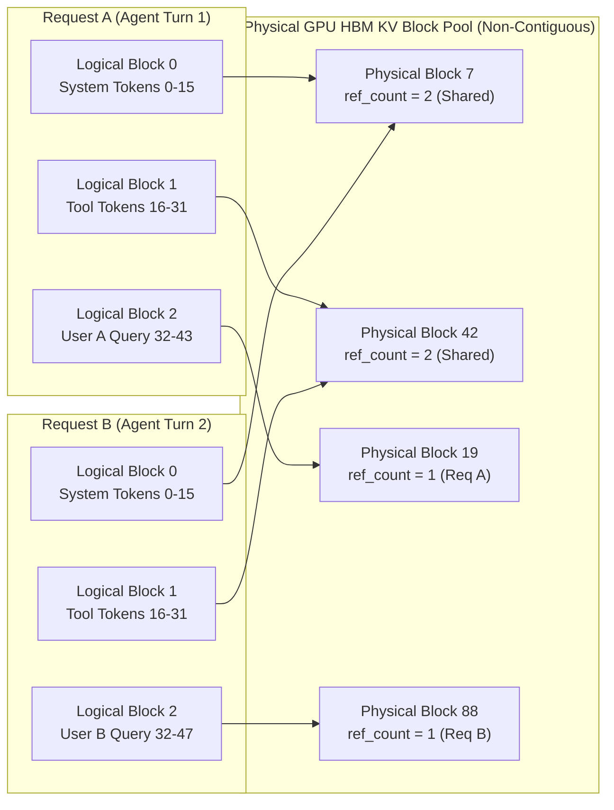
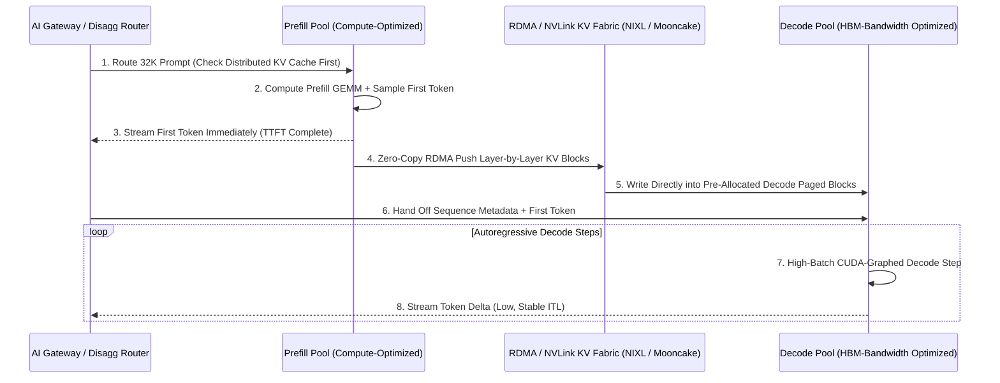

# LLM Inference Internals: KV Cache, PagedAttention, vLLM & SGLang

Understanding how GPU memory hierarchy, matrix multiplication shapes, and KV cache schedulers interact is the foundational skill of modern AI infrastructure engineering. Without this mental model, every gateway timeout, batch-size configuration, and cost anomaly looks mysterious; with it, serving performance becomes deterministic arithmetic.

---

## 1. Prefill vs Decode: Two Completely Different Hardware Regimes

Autoregressive Transformer inference executes in two distinct phases for every request. Although both phases execute the exact same model weights, they stress completely different hardware subsystems on a GPU.

### Phase 1: Prefill (Prompt Processing — Compute-Bound)

Given an input prompt of length $S$ tokens across a batch of $B$ sequences, all $S$ input tokens are known simultaneously. Every linear projection ($W_Q, W_K, W_V, W_O$ and the SwiGLU MLP matrices $W_{\text{gate}}, W_{\text{up}}, W_{\text{down}}$) multiplies an activation matrix of shape $[B \cdot S, d_{\text{model}}]$ against a weight matrix of shape $[d_{\text{model}}, d_{\text{out}}]$.

- **Operation Type**: General Matrix-Matrix Multiplication (**GEMM**).
- **Hardware Bottleneck**: Tensor Core compute throughput (**TFLOPS**). Weights are loaded once from High-Bandwidth Memory (HBM) into SRAM registers and reused across thousands of input tokens ($B \cdot S \gg 1$).
- **Primary Metric**: **TTFT** (Time to First Token). Scales linearly with prompt length $S$ for linear layers and quadratically $O(S^2)$ for self-attention once $S$ grows very large ($>32\text{K}$).

### Phase 2: Decode (Token Generation — Memory-Bandwidth-Bound)

Once the first output token is sampled, generation proceeds strictly sequentially: token $t+1$ depends on token $t$. Because prior keys and values are cached in the **KV Cache**, only **1 new token per sequence** passes through the model per step. The activation tensor collapses to $[B \cdot 1, d_{\text{model}}]$.

- **Operation Type**: At $B=1$, General Matrix-Vector Multiplication (**GEMV**); at moderate $B$, a skinny GEMM.
- **Hardware Bottleneck**: **HBM Memory Bandwidth (TB/s)**. To generate just *one* token for one user, the GPU must stream **100% of the model weights** plus **100% of that sequence's historical KV cache** from HBM into compute units, perform a tiny handful of multiply-adds per byte, and discard the streamed weights immediately before the next step.
- **Primary Metric**: **ITL** (Inter-Token Latency) / **TPOT** (Time Per Output Token).

---

## 2. Roofline Model & Arithmetic Intensity Math

The **Roofline Model** quantifies exactly when a kernel transitions from memory-bandwidth-bound to compute-bound. Define **Arithmetic Intensity** $I$ as:

$$I = \frac{\text{Total FLOPs Executed}}{\text{Total Bytes Transferred from HBM}} \quad \left[\frac{\text{FLOPs}}{\text{Byte}}\right]$$

Every GPU has a hardware **Ridge Point** $I_{\text{ridge}}$ determined by dividing peak Tensor Core throughput by peak HBM bandwidth:

$$I_{\text{ridge}} = \frac{\text{Peak Compute (FLOPs/s)}}{\text{Peak Memory Bandwidth (Bytes/s)}}$$

| GPU Architecture | HBM Capacity | Peak BF16 Tensor Compute | Peak FP8 Tensor Compute | HBM Bandwidth | BF16 Ridge Point ($I_{\text{ridge}}$) | FP8 Ridge Point ($I_{\text{ridge}}$) |
| :--- | :--- | :--- | :--- | :--- | :--- | :--- |
| **NVIDIA A100 SXM (80GB)** | 80 GB HBM2e | 312 TFLOPS | N/A | 2.04 TB/s | ~153 FLOPs/Byte | N/A |
| **NVIDIA H100 SXM5 (80GB)** | 80 GB HBM3 | 989 TFLOPS | 1,979 TFLOPS | 3.35 TB/s | ~295 FLOPs/Byte | ~591 FLOPs/Byte |
| **NVIDIA H200 SXM (141GB)** | 141 GB HBM3e | 989 TFLOPS | 1,979 TFLOPS | 4.80 TB/s | ~206 FLOPs/Byte | ~412 FLOPs/Byte |
| **NVIDIA B200 SXM (192GB)** | 192 GB HBM3e | 2,250 TFLOPS | 4,500 TFLOPS | 8.00 TB/s | ~281 FLOPs/Byte | ~563 FLOPs/Byte |

### Why Single-Stream Decode Achieves Under 1% MFU

Consider a single linear layer $Y = X W$ where $X \in \mathbb{R}^{M \times K}$ ($M = B \cdot S_{\text{step}}$ tokens in the current forward pass) and $W \in \mathbb{R}^{K \times N}$ stored in BF16 (2 bytes per parameter).

- **FLOPs**: $2 M K N$ (one multiply + one add per element).
- **HBM Bytes**: Assuming $K, N \gg M$ (e.g., $K = 8192, N = 8192$), weight bytes $2 K N$ dominate activation reads/writes $2(MK + MN)$:

$$I_{\text{linear}} \approx \frac{2 M K N}{2 K N + 2 M K + 2 M N} \approx M \text{ FLOPs/Byte} \quad (\text{when } M \ll K, N)$$

Look at the profound implication of $I_{\text{linear}} \approx M$:

1. **Single-User Decode ($B=1, S_{\text{step}}=1 \implies M=1$)**: Arithmetic intensity is **1 FLOP/Byte**. On an H100 SXM5 ($I_{\text{ridge}} = 295$), Model FLOPs Utilization (MFU) is $1 / 295 \approx \mathbf{0.34\%}$! Over 99.6% of the H100's compute silicon sits idle waiting on HBM3 memory channels.
2. **Theoretical Single-Stream Latency Floor**: For a 70B dense model in BF16 ($\text{Weights} = 70 \times 10^9 \times 2 = 140\text{ GB}$), even at 100% HBM bandwidth efficiency on a single H200 ($4.8\text{ TB/s}$):
   $$T_{\text{step, min}} = \frac{140\text{ GB}}{4800\text{ GB/s}} \approx 29.2\text{ ms/token} \implies \text{Max } 34.2\text{ tokens/sec}$$
3. **Batching & Speculation Leverage**: To saturate H100 BF16 Tensor Cores during decode, you need $M \ge 295$ concurrent tokens per step—achieved either by **Continuous Batching** ($B \approx 256+$ concurrent users) or **Speculative Decoding** (verifying $\gamma+1$ tokens per user per step). Notice also why FP8 raises $I_{\text{ridge}}$ to ~591: Tensor Core FLOPs double while HBM bandwidth stays fixed, making modern GPUs *even more* memory-bandwidth hungry!

---

## 3. Exact KV Cache Byte Math (MHA, GQA, and MLA)

Without caching, decoding token $t$ would recompute $K$ and $V$ projections for all $t-1$ preceding tokens, turning $N$-token generation into an $O(N^2)$ compute disaster. Caching $K$ and $V$ vectors converts decode compute per step to $O(t)$ attention + $O(1)$ MLP—at the cost of massive HBM capacity and HBM read bandwidth on every decode step.

### Universal KV Cache Sizing Formula

For a standard Transformer using Multi-Head Attention (MHA) or Grouped-Query Attention (GQA):

$$\text{Bytes per Token} = 2 \times L \times n_{\text{kv\_heads}} \times d_{\text{head}} \times b_{\text{dtype}}$$

Where:
- $2$: one tensor for **Key ($K$)** and one tensor for **Value ($V$)**.
- $L$: number of Transformer layers (`num_hidden_layers`).
- $n_{\text{kv\_heads}}$: number of Key/Value heads (`num_key_value_heads`). In MHA, $n_{\text{kv\_heads}} = n_{\text{q\_heads}}$; in GQA (e.g., 8:1 group ratio), $n_{\text{kv\_heads}} = n_{\text{q\_heads}} / 8$; in MQA, $n_{\text{kv\_heads}} = 1$.
- $d_{\text{head}}$: dimension per attention head (`head_dim`, typically $128$).
- $b_{\text{dtype}}$: bytes per element ($2$ for BF16/FP16, $1$ for FP8 KV cache).

For **Multi-Head Latent Attention (MLA)** (pioneered by DeepSeek-V2/V3/R1), instead of caching full $K$ and $V$ heads, each layer projects activations into a shared compressed low-rank latent vector $c_t^{KV} \in \mathbb{R}^{d_c}$ plus a decoupled RoPE key vector $k_t^R \in \mathbb{R}^{d_r}$:

$$\text{Bytes per Token (MLA)} = L \times (d_c + d_r) \times b_{\text{dtype}}$$

### Worked KV Cache Footprint Across Production Models

| Model Architecture | Attention Type | Layers ($L$) | KV Spec ($n_{\text{kv}} \times d_{\text{head}}$ or $d_c + d_r$) | BF16 Bytes / Token | FP8 Bytes / Token | 1 Seq @ 128K Context (BF16) | 32 Seqs @ 32K Context (FP8) |
| :--- | :--- | :--- | :--- | :--- | :--- | :--- | :--- |
| **Llama-2-70B (Legacy)** | MHA | 80 | $64 \times 128 = 8192$ | 2,621,440 B (~2.50 MiB) | 1.25 MiB | **320.0 GiB** | 1,280.0 GiB |
| **Llama-3.3-70B** | GQA (8:1) | 80 | $8 \times 128 = 1024$ | 327,680 B (**320 KiB**) | **160 KiB** | **40.0 GiB** | **160.0 GiB** |
| **Qwen-2.5 / Qwen-3-72B** | GQA (8:1) | 80 | $8 \times 128 = 1024$ | 327,680 B (**320 KiB**) | **160 KiB** | **40.0 GiB** | **160.0 GiB** |
| **Qwen-2.5-32B** | GQA (5:1) | 64 | $8 \times 128 = 1024$ | 262,144 B (**256 KiB**) | **128 KiB** | **32.0 GiB** | **128.0 GiB** |
| **DeepSeek-V3 / R1 (671B MoE)** | MLA | 61 | $512 + 64 = 576$ | 70,272 B (**68.6 KiB**) | **34.3 KiB** | **8.58 GiB** | **34.3 GiB** |

Look closely at the Llama-3.3-70B and DeepSeek-V3 rows:
- GQA (8:1) cuts KV cache memory by **8x** compared to MHA (40 GiB vs 320 GiB at 128K context).
- MLA cuts KV cache by **another 4.6x** beyond GQA—a 671B parameter MoE uses nearly **5x less KV memory per token** than a 70B GQA model!

### GPU HBM Memory Budget Equation

When deploying a model across Tensor Parallelism degree $TP$ GPUs, the available KV cache pool per GPU is:

$$M_{\text{KV\_pool}} = \left( M_{\text{HBM}} \times u_{\text{gpu}} \right) - \frac{M_{\text{weights}}}{TP} - M_{\text{activations}} - M_{\text{cuda\_graphs}} - M_{\text{nccl\_runtime}}$$

**Worked Example (Llama-3.3-70B in BF16 across $TP=2$ H100-80GB GPUs, `gpu_memory_utilization=0.92`)**:
1. Usable HBM per GPU: $80\text{ GiB} \times 0.92 = 73.6\text{ GiB}$.
2. Weight shard per GPU: $(70 \times 2\text{ GiB}) / 2 \approx 65.2\text{ GiB}$ (130.4 GiB binary GiB). Wait—at $TP=2$ in BF16, weights alone take ~65.2 GiB per GPU, leaving only $73.6 - 65.2 - 3.4\text{ (activations + CUDA graphs)} = \mathbf{5.0\text{ GiB}}$ per GPU (10 GiB total across both GPUs)!
3. At $320\text{ KiB/token}$, 10 GiB holds only $\frac{10 \times 1024 \times 1024\text{ KiB}}{320\text{ KiB}} = \mathbf{32,768\text{ tokens total}}$ across the entire server—literally **one single 32K request**!
4. Now switch weights + KV cache to **FP8** (`W8A8` + `--kv-cache-dtype fp8`) on the exact same $TP=2$ H100 node:
   - Weight shard per GPU drops to ~32.6 GiB.
   - Available KV pool per GPU jumps to $73.6 - 32.6 - 3.0 = \mathbf{38.0\text{ GiB}}$ (76 GiB total across both GPUs).
   - KV cost per token halves to $160\text{ KiB}$ ($80\text{ KiB}$ per GPU shard).
   - Total KV capacity jumps to $\frac{76 \times 1024 \times 1024}{160} = \mathbf{498,073\text{ tokens}}$—a **15.2x increase in concurrent sequence capacity** on identical hardware!

---

## 4. Continuous Batching & Chunked Prefill

### Static Batching vs Iteration-Level Continuous Batching

In naive static batching, $B$ requests enter together, padded to the longest prompt, and no request returns or frees its slot until the *longest* generation emits `<EOS>`. If 7 requests generate 80 tokens and 1 request generates 4,096 tokens, 87.5% of batch slots sit idle for 4,000 steps.

**Continuous Batching** (introduced by Orca and made universal in vLLM/SGLang/TRT-LLM) schedules at the **single-iteration (token) boundary**:
- As soon as sequence $i$ emits `<EOS>` at step $t$, its KV blocks are freed immediately, and a waiting request from the queue is injected at step $t+1$.

### The Prefill-Decode Interference Problem & Chunked Prefill

Even with continuous batching, a naive "prefill-first" scheduler creates severe ITL spikes. Suppose 32 users are smoothly decoding at $22\text{ ms/tok}$, and a new request arrives with a 24,000-token RAG prompt. Running that 24K prefill atomically stalls the GPU for ~850 ms—every active streaming user experiences a jarring ~1-second freeze mid-sentence!

**Chunked Prefill** (Sarathi-Serve; default in vLLM V1 and SGLang) solves this via unified token-budget scheduling:
1. Set a per-iteration token ceiling, e.g., `max_num_batched_tokens = 2048`.
2. At each step, prioritize active decode tokens first (e.g., 64 active decodes = 64 tokens).
3. Fill the remaining budget ($2048 - 64 = 1984$ tokens) with a **1,984-token chunk** of the incoming 24K prefill!
4. Both the 64 decode tokens and the 1,984 prefill tokens execute **together in a single fused forward pass**:
   - The prefill chunk stays fast, while the 64 memory-bound decode tokens piggyback onto the weight loads that the prefill GEMM already streamed from HBM!
   - Active users keep smooth $<35\text{ ms}$ ITL while long prompts drain progressively across ~12 micro-iterations.

---

## 5. PagedAttention (vLLM): Virtual Memory for KV Cache

Before vLLM (Kwon et al., SOSP 2023), serving engines pre-allocated a contiguous tensor `[max_seq_len, n_kv_heads, head_dim]` per request because standard CUDA attention kernels required contiguous memory pointers. Because `max_seq_len` (e.g., 32,768) was rarely reached, **60% to 80% of GPU HBM was wasted** across three failure modes:
- **Reservation Waste**: Memory reserved for future tokens not yet generated.
- **Internal Fragmentation**: Over-allocation when generation finishes at 400 tokens instead of 32,768.
- **External Fragmentation**: Variable-sized contiguous slabs leaving unallocatable gaps in HBM.

### How PagedAttention Works

PagedAttention borrows the Operating System's **virtual memory paging** architecture directly onto GPU HBM:

1. **Fixed-Size Physical KV Blocks**: The entire GPU KV pool is partitioned at startup into uniform physical blocks (default `block_size = 16` tokens).
2. **Per-Sequence Block Table**: Each request sees contiguous *logical* blocks $[0, 1, 2, \dots]$, mapped via a lightweight Block Table to non-contiguous *physical* block IDs in HBM.
3. **Zero External Fragmentation, $<4\%$ Internal Waste**: Only the very last partially filled 16-token block of a sequence ever has unused slots.
4. **Automatic Prefix Caching (APC) & Copy-on-Write**: Each full 16-token block is hashed cumulatively:
   $$h_k = \text{Hash}(h_{k-1} \parallel \text{tokens}_{16k \dots 16k+15})$$
   When two requests share a 4,096-token system + tool prefix, their block tables point to the **exact same 256 physical HBM blocks** (`ref_count` incremented, zero recomputation, zero duplicate memory). If a sequence branches (e.g., parallel tool exploration or `n > 1`), Copy-on-Write clones only the single mutated tail block.



---

## 6. RadixAttention (SGLang): Prefix Trees for Multi-Turn Agents

While vLLM's hash-based APC works at fixed block granularity, **SGLang** (Zheng et al.) introduced **RadixAttention**, designed specifically around complex multi-turn agent loops, ReAct tool trees, few-shot RAG, and structured JSON generation.

### Radix Tree KV Cache Management

Instead of discarding KV blocks as soon as a request finishes or tracking flat hashes, SGLang maintains a **Radix Tree** (compact prefix tree) in CPU control memory that indexes paged KV tensors retained in GPU HBM:

- **Edges hold variable-length token sequences** (aligned to page size = 1 or page size = 16).
- When a multi-turn agent finishes Turn 1 (`System + Tools + User_1 + Assistant_1`), its KV cache is **not freed**; its reference count drops to `0` and its timestamp is recorded in the Radix tree.
- Two seconds later, Turn 2 arrives (`System + Tools + User_1 + Assistant_1 + ToolResult_1`). SGLang performs a longest-prefix match $O(S)$ on the Radix tree, hits 95% of the prompt in HBM, splits the Radix node if another branch diverged mid-way, and computes prefill **only on `ToolResult_1`**.
- When HBM fills up, an **LRU Leaf-First Eviction Policy** evicts unreferenced (`ref_count == 0`) leaf nodes first, preserving shared trunk prefixes (`System + Tools`) at the root of the tree automatically!
- **Cache-Aware Load Balancing (`sglang-router`)**: In a multi-replica cluster, `sglang-router` maintains an approximate shadow Radix tree of each worker's HBM state and routes incoming requests by maximizing `(prefix_match_ratio, queue_headroom)` rather than naive round-robin—boosting cluster-wide KV hit rates from ~25% to $>80\%$.

### vLLM vs SGLang vs TensorRT-LLM (2027 Production Comparison)

| Dimension | vLLM (V1 Engine) | SGLang | NVIDIA TensorRT-LLM / Dynamo |
| :--- | :--- | :--- | :--- |
| **Core KV Abstraction** | Hash-indexed PagedAttention (`block_size=16`) | RadixAttention Prefix Tree + Cache-Aware Router | Paged KV Cache + C++ TensorRT compiled engines |
| **Sweet Spot Workload** | Broadest model day-0 support, multi-LoRA, general API serving | Multi-turn AI agents, ReAct loops, heavy structured JSON (`xgrammar`), DeepSeek MoE | Maximum raw single-model throughput on NVIDIA H100/B200 fleets |
| **Structured Output Overhead** | Near-zero via `xgrammar` / `guidance` integration | Near-zero via compressed Finite State Machine (jump-forward decoding) | Guided decoding via `xgrammar` C++ runtime |
| **CPU Scheduling Overhead** | Zero-overhead async multiprocessing loop (vLLM V1) | Overlap scheduler (CPU prepares step $t+1$ while GPU runs step $t$) | Native C++ runtime with minimal host overhead |
| **Operational Complexity** | Low (pure Python CLI / K8s Helm, instant HF startup) | Low-Medium (Python + Rust `sglang-router`, fast startup) | High (engine compilation per GPU SKU, TP, and max shape) |

---

## 7. Disaggregated Prefill & Decode Serving

At large scale (>16 GPUs), even Chunked Prefill cannot eliminate a deeper structural conflict between Prefill (P) and Decode (D):

1. **Conflicting Hardware & Parallelism Needs**:
   - **Prefill** is compute-bound: it wants high-FLOPs GPUs (e.g., H100 FP8) with smaller Tensor Parallelism ($TP=2\text{ or }4$) to minimize AllReduce communication overhead across large activation tensors.
   - **Decode** is memory-bandwidth and KV-capacity bound: it wants high-HBM capacity/bandwidth GPUs (e.g., H200 141GB or B200 192GB, or wide Expert Parallelism $EP=32+$ for MoEs) running huge batch sizes under CUDA Graphs.
2. **Tail ITL Isolation**: A burst of ten 100K-token codebase prefills will still saturate co-located KV pools and delay decode queuing.

### Disaggregated Architecture (DistServe / Mooncake / NVIDIA Dynamo)

Disaggregated serving splits the cluster into dedicated **Prefill Workers ($P$)** and **Decode Workers ($D$)** connected via **RDMA (InfiniBand / RoCEv2 at 400-800 Gbps)** or multi-node NVLink using transfer libraries like **Mooncake Transfer Engine** or **NIXL**:



### RDMA KV Transfer Bandwidth Sanity Math

Can network transfer keep up with KV cache sizes? Let's verify with numbers:
- Suppose a Llama-3.3-70B request has an uncached delta of $8,192$ tokens in FP8 KV precision ($160\text{ KiB/token}$).
- Total KV payload to ship from Prefill node to Decode node:
  $$8,192 \times 160\text{ KiB} = 1.25\text{ GiB} \approx 1.34\text{ GB}$$
- Over a **400 Gbps** ($50\text{ GB/s}$ unidirectional) ConnectX-7 InfiniBand/RoCEv2 NIC per GPU Pair (8 NICs = $400\text{ GB/s}$ per 8-GPU node):
  - Across $TP=4$ GPUs transferring shards in parallel ($4 \times 50\text{ GB/s} = 200\text{ GB/s}$ aggregate):
    $$T_{\text{transfer}} = \frac{1.34\text{ GB}}{200\text{ GB/s}} \approx \mathbf{6.7\text{ ms}}$$
- Even better: **layer-wise pipelined KV shipping** starts RDMA DMA transfer of Layer $l$'s KV blocks while the GPU is computing Layer $l+1$'s prefill—hiding >85% of network transfer behind prefill compute! And for MLA models (DeepSeek-V3 at $34.3\text{ KiB/tok}$ in FP8), an 8K prompt's KV payload is just **281 MB** ($<1.5\text{ ms}$ over RDMA).

---

## 7.5 Distributed Parallelism Topologies: TP, PP, DP, CP & MoE EP

When scaling a model beyond a single GPU, choosing the wrong parallelism strategy destroys either ITL latency (via cross-node communication stalls) or KV cache efficiency (via duplicated weight/KV shards).

| Parallelism Mode | What Is Partitioned? | Collective Communication | Interconnect Required | Latency vs Throughput Impact |
| :--- | :--- | :--- | :--- | :--- |
| **Tensor Parallelism (`TP`)** | Columns & rows of every linear/attention matrix inside each layer | **2x `AllReduce` per Transformer layer** ($2 \times 80 = 160$ syncs/token!) | **Intra-node NVLink** (900 GB/s on H100/H200; 1.8 TB/s on B200). **Never cross PCIe/Ethernet!** | **Reduces ITL directly** (pools HBM bandwidth across $TP$ GPUs), up to $TP=8$ within one node. |
| **Pipeline Parallelism (`PP`)** | Contiguous blocks of layers across GPUs/nodes (Layers 0-39 on Node 1, 40-79 on Node 2) | Tiny point-to-point `Send/Recv` of hidden state $[B, d_{\text{model}}]$ once per stage boundary | Standard RoCEv2 / InfiniBand (works cleanly across multi-node Ethernet!) | **Does NOT reduce single-seq ITL**; increases throughput & fits >600B models across nodes when micro-batched. |
| **Data Parallelism (`DP`)** | Independent full model replicas handled by a prefix-aware router | **Zero GPU-to-GPU sync** | Any network | Linear throughput scaling; **always prefer `DP=4, TP=2` over `TP=8`** if a model comfortably fits on 2 GPUs! |
| **Context Parallelism (`CP` / Ring Attention)** | Sequence length $S$ split across GPUs for ultra-long prompts ($128\text{K--}1\text{M}$) | Async `AllGather` / Ring P2P of KV blocks overlapped with FlashAttention | NVLink or 400G RDMA | Slashes TTFT and prevents activation OOM on 256K-1M codebase or video prompts. |
| **Expert Parallelism (`EP`, for MoEs)** | Routed MoE experts distributed across 8-64+ GPUs (e.g., DeepSeek-V3 256 experts) | **`AllToAll` token dispatch & combine** (`DeepEP` RDMA/NVLink kernels) | NVLink + GPUDirect RDMA | Essential for large MoEs: keeps each expert's batch dense during GEMM instead of slicing tiny expert matrices across `TP`. |

> **Golden Sizing Rule for Dense Models**: Use the **minimum `TP` degree** needed to hold weights + target KV concurrency pool inside one node ($TP \in \{1, 2, 4, 8\}$), then scale horizontally via **cache-aware Data Parallelism (`DP`)**. Going from `TP=2` to `TP=8` when `TP=2` already fits wastes 25-35% of GPU cycles on NVLink `AllReduce` barrier synchronization at every layer!

---

## 8. Production Serving Configuration & Failure Modes

### Reference Production Launch Commands (2027 Baseline)

```bash
# Production vLLM V1 Launch: Qwen-3-72B-FP8 on 2x H200 GPUs
vllm serve Qwen/Qwen3-72B-Instruct-FP8 \
  --tensor-parallel-size 2 \
  --kv-cache-dtype fp8 \
  --calculate-kv-scales \
  --gpu-memory-utilization 0.92 \
  --max-model-len 65536 \
  --max-num-seqs 256 \
  --max-num-batched-tokens 4096 \
  --enable-prefix-caching \
  --enable-chunked-prefill \
  --disable-log-requests \
  --port 8000

# Production SGLang Multi-Worker + Cache-Aware Router Launch
python3 -m sglang.launch_server \
  --model-path Qwen/Qwen3-72B-Instruct-FP8 \
  --tp 2 \
  --kv-cache-dtype fp8_e4m3 \
  --mem-fraction-static 0.88 \
  --chunked-prefill-size 4096 \
  --max-running-requests 256 \
  --grammar-backend xgrammar \
  --port 30000
```

### Critical Failure Modes & Operational Remedies

1. **KV Preemption / Recomputation Storms (`vllm:num_preemptions_total` spiking)**
   - *Root Cause*: Too many sequences enter concurrently with short initial prompts, then all expand to 16K+ output/thinking tokens simultaneously. When `vllm:gpu_cache_usage_perc` hits `100%`, the scheduler evicts active requests' KV caches and later recomputes their entire prompt + partial output from scratch—causing P99 ITL to explode from 25ms to 8+ seconds.
   - *Fix*: Lower `--max-num-seqs`, switch KV cache to `--kv-cache-dtype fp8`, enforce upstream gateway max-concurrency semaphores, and alert whenever `gpu_cache_usage_perc > 0.85` sustained for 60s.
2. **CUDA Graph Capture OOM or Re-Compilation Stalls**
   - *Root Cause*: Serving engines capture CUDA Graphs for decode batch sizes $[1, 2, 4, 8, \dots, 256]$ to eliminate ~1-2ms Python/CUDA kernel launch overhead per step. Setting `--max-num-seqs 1024` captures dozens of graph sizes, consuming 4-8 GB of HBM before KV allocation even starts.
   - *Fix*: Cap `--max-num-seqs` to the true concurrency ceiling dictated by your Roofline + KV math (typically 128-256).
3. **Round-Robin Load Balancer Destroying Prefix Cache Locality**
   - *Root Cause*: Putting a Kubernetes ClusterIP or AWS ALB in round-robin mode in front of 8 vLLM/SGLang replicas means an agent's Turn 1 lands on Pod 1, Turn 2 lands on Pod 2, and Turn 3 lands on Pod 3—forcing cold prefill recomputation and 8x duplicate KV storage across pods.
   - *Fix*: Deploy prefix-aware routing (`sglang-router`, `llm-d` KV-aware Envoy ext_proc, or gateway consistent hashing keyed on `(workspace_id, session_id)` with bounded load fallback).

Next, see **[02-QUANTIZATION-SPECULATIVE-DECODING.md](02-QUANTIZATION-SPECULATIVE-DECODING.md)** to learn how numerical compression and speculative verification push both TTFT and ITL past dense hardware limits.
