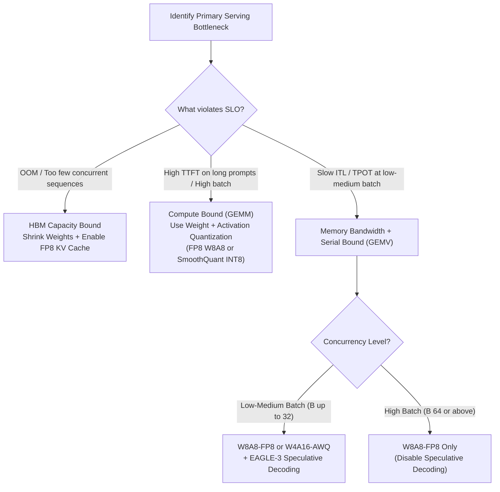
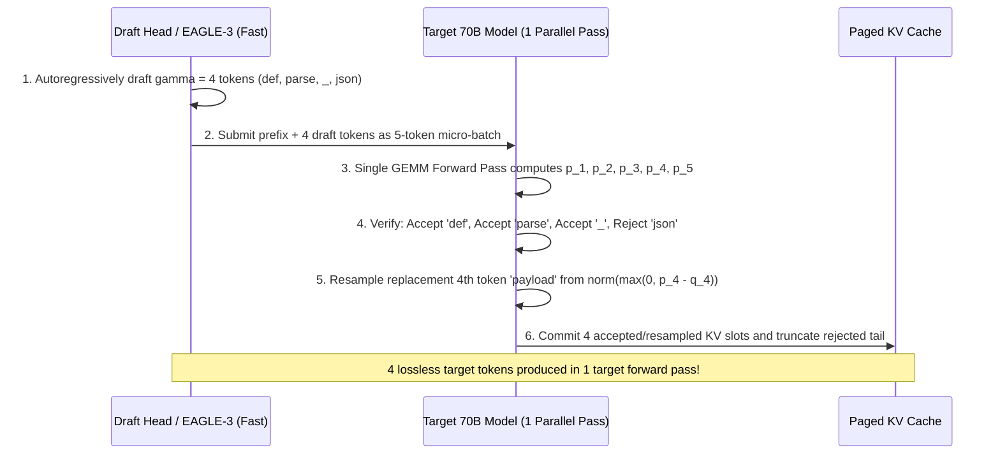

# Production Quantization & Speculative Decoding

In **[01-KV-CACHE-PAGEDATTENTION-VLLM-SGLANG.md](01-KV-CACHE-PAGEDATTENTION-VLLM-SGLANG.md)**, we proved via the Roofline Model that LLM prefill is **compute-bound** (limited by Tensor Core TFLOPS) while decode at low-to-moderate batch sizes is **memory-bandwidth-bound** (limited by HBM TB/s and sequential token dependencies).

**Quantization** and **Speculative Decoding** are the two primary mathematical levers used in production to push past dense BF16 hardware ceilings—but choosing the wrong quantization scheme or enabling speculative decoding at the wrong concurrency level will actively *degrade* server throughput or corrupt reasoning accuracy.

---

## 1. Roofline-Driven Optimization Decision Tree

Before touching model checkpoints or serving flags, map your bottleneck directly to the hardware subsystem it saturates:



### Critical Distinction: Weight-Only (`W4A16`) vs Weight-and-Activation (`W8A8`)

Many engineers confuse `W4A16` (4-bit weights, 16-bit activations) with `W8A8` (8-bit weights, 8-bit activations). Their hardware execution paths are fundamentally different:

1. **Weight-Only Quantization (`W4A16` — AWQ, GPTQ)**:
   - Weights sit in HBM packed as 4-bit integers (`0.5 bytes/param`, 4x smaller than BF16).
   - During the forward pass, fused CUDA kernels (such as **Marlin**) stream the 4-bit weights from HBM into SRAM registers, **dequantize them on-the-fly back to FP16/BF16**, and execute the matrix multiplication on **16-bit Tensor Cores**.
   - **Result**: Massive speedup at **small batch decode** ($B=1\text{--}16$) because HBM weight traffic drops by ~4x. However, at **large batch or long prefill** ($M \ge 128$), compute becomes the bottleneck, 16-bit Tensor Cores run at standard BF16 TFLOPS, *plus* you pay extra register instructions for dequantization—so `W4A16` actually becomes **slower than BF16/FP8** at high concurrency!
2. **Weight + Activation Quantization (`W8A8` — FP8, SmoothQuant INT8, NVFP4)**:
   - Both weights $W$ and activations $X$ are represented in 8-bit (or 4-bit on Blackwell), so multiplication runs natively on **FP8 / INT8 / FP4 Tensor Cores** at **2x to 4x the TFLOPS** of BF16, *and* HBM weight traffic drops by 2x to 4x simultaneously.
   - **Result**: Accelerates **both compute-bound prefill (TTFT) and bandwidth-bound decode (ITL)** across all batch sizes.

---

## 2. Numerical Formats & Scaling Granularity Under the Hood

### Bit-Layout Comparison Across Inference Data Types

$$\text{Floating Point Value} = (-1)^{\text{sign}} \times 2^{(\text{exponent} - \text{bias})} \times \left(1 + \frac{\text{mantissa}}{2^m}\right)$$

| Format | Total Bits | Sign / Exp / Mantissa | Dynamic Range (Max Normal) | Primary Production Role in 2027 |
| :--- | :--- | :--- | :--- | :--- |
| **BF16** | 16 | `1 / 8 / 7` | $\pm 3.39 \times 10^{38}$ | Training & unquantized reference baseline (same dynamic range as FP32). |
| **FP16** | 16 | `1 / 5 / 10` | $\pm 65,504$ | Legacy inference; prone to activation overflow without careful scaling. |
| **FP8 E4M3** | 8 | `1 / 4 / 3` | $\pm 448$ | **Universal Hopper/Blackwell inference standard** (higher precision via 3 mantissa bits). |
| **FP8 E5M2** | 8 | `1 / 5 / 2` | $\pm 57,344$ | Backward-pass training gradients or extreme-outlier KV tensors. |
| **INT8** | 8 | Symmetric `[-128, 127]` | Uniform linear steps | Pre-Hopper GPUs (A100/A10G) via SmoothQuant; requires outlier smoothing. |
| **INT4** | 4 | Asymmetric `[0, 15]` or `[-8, 7]` | 16 discrete levels | Memory-constrained deployments (`W4A16` AWQ / GPTQ-Marlin). |
| **NVFP4** | 4 (+ scale) | `1 / 2 / 1` + FP8 block scale | $\pm 6.0$ per 16-elem micro-block | Native **Blackwell (B200)** ultra-high-throughput serving (4x BF16 TFLOPS). |

### Scaling Factor Granularities & Overhead Math

To map a high-precision tensor $X$ into quantized target range $[-Q_{\max}, Q_{\max}]$ (where $Q_{\max} = 448$ for FP8 E4M3 or $7$ for symmetric INT4):

$$s = \frac{\max(|X|)}{Q_{\max}}, \qquad X_q = \text{clamp}\left(\text{round}\left(\frac{X}{s}\right), -Q_{\max}, Q_{\max}\right)$$

- **Per-Tensor Scaling**: One scalar FP32 scale $s$ for an entire $[8192, 8192]$ matrix. Zero memory overhead, fastest single Tensor Core GEMM call (`cublasLt`), works well for FP8 E4M3 weights on most dense models, but struggles if a single outlier channel dominates $\max(|X|)$.
- **Per-Channel (Weight) + Per-Token (Activation) Dynamic Scaling**:
  - Weight matrix $W \in \mathbb{R}^{K \times N}$ stores $N$ column scales $s_w \in \mathbb{R}^{1 \times N}$ offline.
  - Activation matrix $X \in \mathbb{R}^{M \times K}$ computes $M$ row scales $s_x \in \mathbb{R}^{M \times 1}$ dynamically on-the-fly in a fused preceding LayerNorm/RMSNorm kernel!
  - Output GEMM recovers exact outer-product scaling at zero extra HBM cost:
    $$Y = (X_q W_q) \odot (s_x \cdot s_w)$$
- **Group-Wise Scaling (`group_size = 128`, used in AWQ/GPTQ INT4)**:
  - Every contiguous block of 128 weights shares one FP16 scale ($2\text{ bytes}$) and one INT4 zero-point ($0.5\text{ bytes}$).
  - Effective bits per weight: $4 + \frac{16 + 4}{128} = \mathbf{4.156\text{ bits/param}}$.

---

## 3. Production Quantization Algorithms Deep Dive

### 3.1 Native FP8 (`W8A8-FP8` + `FP8 KV Cache`)

On NVIDIA Hopper (H100/H200), Ada (L40S), and Blackwell (B200), **dynamic per-token / per-channel FP8 E4M3** (generated via `llm-compressor` with zero calibration data needed for dynamic mode, or 512 calibration samples when calibrating static KV cache scales) is the undisputed production default:
- Retains **99.5% to 99.9%** of BF16 accuracy even on brittle coding, math, and tool-calling benchmarks.
- Cuts weight HBM by **50%**, doubles Tensor Core TFLOPS, and—when paired with calibrated `kv_scale`—cuts KV cache HBM by **50%**.

### 3.2 SmoothQuant (`W8A8-INT8` for A100 / Older Silicon)

Why does naive INT8 `W8A8` fail catastrophically on Transformers above 6.7B parameters? Xiao et al. discovered **systematic emergent activation outliers**: in specific fixed feature channels $j$, activation magnitudes $|X_{:, j}|$ routinely reach $50\text{--}100\times$ larger than all other channels across *every* token. Per-token scaling stretches the INT8 grid to fit that single outlier, crushing 99% of normal channels to `0`! Meanwhile, weights $W_{j, :}$ are flat and easy to quantize.

**SmoothQuant** mathematically migrates quantization difficulty from activations $X$ onto weights $W$ offline via a channel-wise diagonal smoothing vector $s \in \mathbb{R}^K$:

$$Y = X W = \underbrace{\left(X \cdot \text{diag}(s)^{-1}\right)}_{\hat{X}\text{ (smoothed, outlier-free)}} \cdot \underbrace{\left(\text{diag}(s) \cdot W\right)}_{\hat{W}\text{ (folded offline into weights)}}$$

The optimal migration balance factor $\alpha \in [0, 1]$ (typically $\alpha = 0.5$) equalizes dynamic ranges across both matrices:

$$s_j = \frac{\max(|X_{:, j}|)^\alpha}{\max(|W_{j, :}|)^{1-\alpha}}$$

Because $\text{diag}(s)^{-1}$ is fused directly into the preceding LayerNorm/RMSNorm affine weight $\gamma$, SmoothQuant adds **zero runtime latency overhead**.

### 3.3 GPTQ (`W4A16` via Second-Order Hessian Error Compensation)

GPTQ (Frantar et al.) quantizes weight rows one column (or block of 128 columns) at a time while minimizing layer-wise output squared error $\|W X - \hat{W} X\|_2^2$ on a small calibration set (e.g., 128 sequences of 2,048 tokens). When weight $w_q$ is rounded to 4-bit $\text{quant}(w_q)$, GPTQ adjusts all **remaining unquantized weights** $w_{F}$ using the inverse Hessian $H_F^{-1}$, where $H = 2 X X^\top + \lambda I$:

$$\delta_F = -\frac{w_q - \text{quant}(w_q)}{\left[H_F^{-1}\right]_{qq}} \cdot \left(H_F^{-1}\right)_{:, q}$$

Using Cholesky decomposition and lazy block updates, GPTQ quantizes a 70B model in ~2 GPU-hours. In production, always pair GPTQ checkpoints with **Marlin** fused CUDA kernels (`quantization="gptq_marlin"` in vLLM) to avoid slow legacy dequantization paths.

### 3.4 AWQ (Activation-Aware Weight Quantization, `W4A16`)

Lin et al. observed a crucial insight: **not all weights are equally important**, and weight importance is determined by **activation magnitude, not weight magnitude**. Keeping just the top **0.1% to 1% salient weight channels** (those multiplied by the largest activation channels) in FP16 preserves almost all model quality—but mixed-precision FP16+INT4 inside one matrix ruins GPU memory coalescing!

Instead of mixed precision, **AWQ** multiplies salient weight channels by a scale $s > 1$ before uniform INT4 quantization (and fuses $1/s$ into the preceding layer):
- Because rounding error $\Delta = |\text{round}(w \cdot s) - w \cdot s| \le 0.5$ stays bounded while $s > 1$, the effective dequantized error $\Delta / s$ on salient channels shrinks by $1/s$, while non-salient channels comfortably absorb the slight range expansion without clipping.
- AWQ shows better out-of-distribution generalization on coding/instruction tasks than GPTQ because it does not overfit inverse Hessian updates to the calibration text domain.

### Production Quantization Comparison Matrix

| Method | Precision | Weight HBM (70B) | Coding / Tool Eval Retention | Prefill Speedup (TTFT) | Decode Speedup ($B=1$) | High-Batch Throughput ($B=128$) | Minimum GPU Required |
| :--- | :--- | :--- | :--- | :--- | :--- | :--- | :--- |
| **Dense BF16** | `W16A16` | ~140 GB | 100.0% (Baseline) | $1.0\times$ | $1.0\times$ | $1.0\times$ | Any Ampere+ (2x 80GB) |
| **FP8 Dynamic / Static** | `W8A8` + FP8 KV | ~70 GB | **99.6% - 99.9%** | **$1.7\times\text{--}1.9\times$** | **$1.8\times$** | **$2.1\times\text{--}2.6\times$** | Hopper / Ada / Blackwell |
| **SmoothQuant** | `W8A8` INT8 | ~70 GB | 98.5% - 99.2% | $1.5\times\text{--}1.7\times$ | $1.6\times$ | $1.8\times$ | Ampere (A100 / A10G) |
| **AWQ (Marlin)** | `W4A16` (g128) | ~37 GB | 97.5% - 98.8% | $0.90\times$ (dequant cost) | **$2.6\times\text{--}3.2\times$** | $1.1\times\text{--}1.3\times$ | Ampere+ (fits 1x 48/80GB!) |
| **GPTQ (Marlin)** | `W4A16` (g128) | ~37 GB | 97.0% - 98.5% | $0.90\times$ | **$2.6\times\text{--}3.2\times$** | $1.1\times\text{--}1.3\times$ | Ampere+ (fits 1x 48/80GB!) |
| **NVFP4** | `W4A4` (Block) | ~36 GB | 98.8% - 99.4% | **$3.0\times+$** | **$3.1\times+$** | **$3.5\times+$** | Blackwell (B200 / GB200) |

---

## 4. Speculative Decoding: Breaking the Serial Decode Bottleneck

Recall from Module 01 that single-user decode on an H100 has an arithmetic intensity of $I \approx 1\text{ FLOP/Byte}$—meaning verifying **5 tokens in parallel** for one sequence takes almost the **exact same wall-clock time** (~29ms) as generating **1 token**, because streaming the 70B weights from HBM once is the entire bottleneck!

**Speculative Decoding** exploits this unused compute slack via a **Guess-and-Verify** protocol that is **mathematically lossless** (provably identical token distribution to standard autoregressive decoding, even at `temperature > 0`).

### Exact Lossless Rejection Sampling Algorithm

Let $p(x \mid x_{<t})$ be the expensive **Target Model** and $q(x \mid x_{<t})$ be a tiny, fast **Draft Mechanism**:

1. **Draft Phase**: Run $q$ autoregressively $\gamma$ steps (e.g., $\gamma = 4$) to propose draft tokens $\tilde{x}_1, \tilde{x}_2, \dots, \tilde{x}_\gamma$ along with their draft probability distributions $q_1, \dots, q_\gamma$.
2. **Parallel Verification Phase**: Run the large Target Model $p$ **once** on the concatenated sequence $[x_{\text{prefix}}, \tilde{x}_1, \dots, \tilde{x}_\gamma]$. In a single forward pass, $p$ produces **$\gamma + 1$ target distributions** $p_1, p_2, \dots, p_\gamma, p_{\gamma+1}$!
3. **Modified Rejection Sampling** (iterating $i = 1 \dots \gamma$ sequentially on logits):
   - Draw $r_i \sim \text{Uniform}(0, 1)$.
   - **Accept** $\tilde{x}_i$ if $r_i \le \min\left(1, \frac{p_i(\tilde{x}_i)}{q_i(\tilde{x}_i)}\right)$.
   - On the **first rejection** at index $i$: discard $\tilde{x}_i, \dots, \tilde{x}_\gamma$, roll back their KV cache entries, and immediately **resample a guaranteed valid replacement token** $x_i'$ from the adjusted residual distribution:
     $$p_i'(x) = \frac{\max(0, p_i(x) - q_i(x))}{\sum_{v} \max(0, p_i(v) - q_i(v))}$$
   - If **all $\gamma$ tokens are accepted**, sample a **bonus $(\gamma+1)$-th token** directly from $p_{\gamma+1}(x)$! (For greedy decoding `temperature = 0`, this reduces to checking $\tilde{x}_i == \arg\max p_i$, plus taking $\arg\max p_{\gamma+1}$ when all match.)



### Expected Speedup & Acceptance Rate Math

Assume average token acceptance rate $\alpha \in [0, 1]$ and draft-to-target single-step latency ratio $c = \frac{T_{\text{draft}}}{T_{\text{target}}}$:

$$\mathbb{E}[\text{Tokens per Target Pass}] = \frac{1 - \alpha^{\gamma + 1}}{1 - \alpha}, \qquad \text{Net Wall-Clock Speedup} = \frac{1 - \alpha^{\gamma + 1}}{(1 - \alpha)(1 + \gamma \cdot c)}$$

**Worked Numbers ($\gamma = 5, c = 0.04$)**:
- If $\alpha = 0.85$ (typical on code generation, JSON tool calls, or SQL synthesis with EAGLE-3):
  - $\mathbb{E}[\text{Tokens}] = \frac{1 - 0.85^6}{1 - 0.85} = \frac{1 - 0.377}{0.15} = \mathbf{4.15\text{ tokens/step}}$.
  - $\text{Net Speedup} = \frac{4.15}{1 + 5(0.04)} = \frac{4.15}{1.20} = \mathbf{3.46\times}$ faster streaming tok/s!
- If $\alpha = 0.35$ (creative open-ended fiction with poorly aligned draft model, $c = 0.12$):
  - $\mathbb{E}[\text{Tokens}] = \frac{1 - 0.35^6}{0.65} = 1.53$, and $\text{Net Speedup} = \frac{1.53}{1.60} = \mathbf{0.96\times}$ (**net slowdown!**).

### Evolution of Speculative Architectures (2024 to 2027)

| Speculation Architecture | Extra VRAM Overhead | Typical $\alpha$ (Code / Agents) | How It Works & Operational Pros / Cons |
| :--- | :--- | :--- | :--- |
| **Standalone Draft Model** (e.g., 1B drafting 70B) | +2 GB + separate KV | $0.65\text{--}0.75$ | Requires identical tokenizer family; awkward TP mismatch (70B runs $TP=4$, 1B runs slower across $TP=4$ due to NCCL latency). |
| **Prompt Lookup / N-gram** (`ngram` in vLLM) | **0 MB** | $0.75+$ on edits/RAG, $0.20$ on chat | Searches prompt + prior output for matching $n$-gram suffixes and copies the next $k$ tokens. Free 2.5x win for code diffs & RAG citations! |
| **Medusa** | ~1-2% params | $0.70\text{--}0.78$ | Attaches $K$ independent MLP heads to target's top hidden state; verifies candidate trees via custom tree-attention mask. |
| **EAGLE-2 / EAGLE-3** | ~2-4% params (1 Transformer layer) | **$0.82\text{--}0.90$** | Autoregresses at the **feature (hidden-state) level** conditioned on sampled token embeddings + multi-layer target features, with dynamic draft trees. **2027 gold standard.** |
| **Native MTP (Multi-Token Prediction)** | Built into checkpoint (e.g., DeepSeek-V3) | **$0.85\text{--}0.90$** | Trained natively from pretraining to predict $t+1, t+2$ sequentially; zero separate calibration needed at serving time. |

### The Batch-Size Crossover Trap (Critical Interview & Production Gotcha)

Speculative decoding **is not free compute**—every rejected draft token wasted target FLOPs!
- At **$B = 4$** with $\gamma = 4$, the target model processes $4 \times 5 = 20$ tokens ($I \approx 20 \ll I_{\text{ridge}} = 295$). Those extra 16 verification FLOPs sit completely inside idle memory-bandwidth slack, giving a **2.5x speedup**.
- At **$B = 96$** concurrent sequences, standard decode is already at $I \approx 96$. Multiplying token load by $5\times$ ($96 \times 5 = 480$ tokens/step) pushes the GPU **past the Roofline ridge point into the compute-bound regime**! Now target step time jumps by $2.5\times$, destroying ITL for everyone and lowering cluster throughput.
- **Production Rule**: Configure `--speculative-disable-by-batch-size 32` (supported natively in vLLM/SGLang) so the scheduler automatically bypasses draft generation whenever active batch size exceeds the hardware crossover threshold!

---

## 5. Rigorous LLM Serving Benchmarking: TTFT, ITL, TPOT & Goodput

Never accept a single "tokens per second" number in a benchmark report without asking *which* tokens/sec and *at what P99 SLO*.

### Canonical Latency & Throughput Metrics

1. **TTFT (Time to First Token)**: $t_{\text{first\_token}} - t_{\text{request\_sent}}$. Measures network queuing + prefill compute. Interactive chat SLO: **P95 $\le 500\text{ ms}$**; coding agent with 32K cached context: **P95 $\le 800\text{ ms}$**.
2. **ITL (Inter-Token Latency)**: $t_{k} - t_{k-1}$ for each individual step $k \ge 2$. Captures stalls/hiccups caused by unchunked prefills or KV preemptions. Human reading speed is ~8-10 tok/s ($100\text{ ms}$), while crisp streaming UI requires **P95 ITL $\le 35\text{--}45\text{ ms}$** (>25 tok/s).
3. **TPOT (Time Per Output Token)**: $\frac{t_{\text{last\_token}} - t_{\text{first\_token}}}{N_{\text{out}} - 1}$. Request-averaged decode speed (smooths out single-frame spikes—always inspect **both** P99 ITL and P95 TPOT!).
4. **Output Throughput**: $\frac{\sum N_{\text{out}}}{\text{Benchmark Duration}}$ across the whole node (determines **USD per 1M generated tokens**).
5. **SLO Goodput (The Ultimate Metric)**: Maximum sustainable requests/second (or output tok/s) where **$\ge 95\%$ of requests simultaneously satisfy both the TTFT SLA and the TPOT/ITL SLA**. Raising batch size from 64 to 256 might increase raw throughput by 18% while crashing SLO Goodput to **zero** because P95 TPOT crosses 90ms!

### Reproducible Production Benchmark Commands

```bash
# 1. Serve Qwen3-32B-FP8 with EAGLE-3 Speculative Decoding + Dynamic Batch Cutoff
vllm serve Qwen/Qwen3-32B-Instruct-FP8 \
  --kv-cache-dtype fp8 \
  --speculative-config '{
    "method": "eagle3",
    "model": "yuhuili/EAGLE3-Qwen3-32B",
    "num_speculative_tokens": 4,
    "disable_by_batch_size": 32
  }' \
  --enable-prefix-caching \
  --enable-chunked-prefill \
  --max-num-batched-tokens 4096

# 2. Sweep realistic agentic traffic (8K shared prefix + 2K unique input, 512 output)
#    and evaluate Goodput against TTFT <= 600ms and TPOT <= 35ms
vllm bench serve \
  --backend openai-chat \
  --base-url http://127.0.0.1:8000 \
  --model Qwen/Qwen3-32B-Instruct-FP8 \
  --dataset-name prefix_repetition \
  --prefix-repetition-prefix-len 8192 \
  --prefix-repetition-suffix-len 2048 \
  --prefix-repetition-num-prefixes 8 \
  --prefix-repetition-output-len 512 \
  --num-prompts 500 \
  --request-rate 12 \
  --goodput ttft:600 tpot:35 \
  --percentile-metrics ttft,tpot,itl,e2el \
  --metric-percentiles 50,95,99
```

---

## 5.5 Production Quantization Recipe (`llm-compressor` FP8 + Calibrated KV Scales)

In 2027, avoid ad-hoc unmaintained quantization scripts; use the unified `llm-compressor` pipeline (native to vLLM's `compressed-tensors` format) so weight scales, activation schemes, and calibrated FP8 KV cache scales serialize cleanly into HuggingFace `config.json`:

```python
from datasets import load_dataset
from transformers import AutoModelForCausalLM, AutoTokenizer
from llmcompressor import oneshot
from llmcompressor.modifiers.quantization import QuantizationModifier

MODEL_ID = "Qwen/Qwen3-32B-Instruct"
OUTPUT_DIR = "./Qwen3-32B-Instruct-FP8-KV"

model = AutoModelForCausalLM.from_pretrained(MODEL_ID, torch_dtype="auto", device_map="auto")
tokenizer = AutoTokenizer.from_pretrained(MODEL_ID)

# Representative domain calibration samples (crucial for accurate KV cache outlier scaling!)
raw_ds = load_dataset("HuggingFaceH4/ultrachat_200k", split="train_sft[:512]")
calib_ds = raw_ds.map(
    lambda row: {
        "text": tokenizer.apply_chat_template(row["messages"], tokenize=False)
    }
)

# W8A8 Dynamic FP8 E4M3 on Linear Layers + Calibrated Static FP8 KV Cache Scales
# Notice we explicitly exclude lm_head (and *.mlp.gate on MoE models)!
recipe = QuantizationModifier(
    targets="Linear",
    scheme="FP8_DYNAMIC",
    ignore=["lm_head", "re:.*mlp\\.gate$"],
    kv_cache_scheme={
        "num_bits": 8,
        "type": "float",
        "strategy": "tensor",
        "dynamic": False,
        "symmetric": True,
    },
)

oneshot(
    model=model,
    dataset=calib_ds,
    recipe=recipe,
    max_seq_length=4096,
    num_calibration_samples=512,
    output_dir=OUTPUT_DIR,
)
tokenizer.save_pretrained(OUTPUT_DIR)
```

### Quick Python Calculator: Speculative Decoding Crossover Check

Before turning on speculative decoding in production, run this sanity check against your observed acceptance rate $\alpha$ and GPU Roofline ridge point:

```python
def speculative_net_speedup(
    alpha: float,
    gamma: int = 4,
    draft_to_target_cost: float = 0.04,
    active_batch_size: int = 8,
    gpu_ridge_point: float = 295.0,  # H100 BF16 = 295, H200 BF16 = 206
) -> dict[str, float | bool]:
    expected_tokens = (1.0 - alpha ** (gamma + 1)) / (1.0 - alpha)
    effective_tokens_in_pass = active_batch_size * (gamma + 1)

    # Once batch * (gamma + 1) exceeds ridge point, target forward pass time scales up linearly!
    compute_penalty = max(1.0, effective_tokens_in_pass / gpu_ridge_point)
    step_overhead = compute_penalty + gamma * draft_to_target_cost
    speedup = expected_tokens / step_overhead

    return {
        "expected_tokens_per_step": round(expected_tokens, 2),
        "compute_bound_penalty": round(compute_penalty, 2),
        "net_wallclock_speedup": round(speedup, 2),
        "should_enable_speculation": speedup > 1.10,
    }
```

---

## 6. Pitfalls & Failure Modes Checklist

- **Quantizing Small MoE Routers or Vision Projectors**: Never quantize MoE gating routers (`gate` linear layer) or multimodal ViT projection layers to INT4/FP8—keep router gates in FP32/BF16 (`ignore=["*.mlp.gate"]`), or expert routing entropy collapses.
- **Using FP8 KV Cache Without Calibrated `kv_scale` on Outliers**: Some attention heads exhibit large Key RoPE magnitudes; running `--kv-cache-dtype fp8` with default scale `1.0` instead of calibrated per-layer scales degrades needle-in-a-haystack retrieval past 32K tokens.
- **Evaluating Quantization Only on WikiText Perplexity**: A bad INT4 quantization frequently changes perplexity by only `0.15` while dropping multi-step tool-JSON schema validity or SWE-bench coding pass rates by **8% to 14%**. Always benchmark on your domain's structured-output and coding evals.
- **Mismatching Draft Temperature and Target Temperature**: Speculative rejection sampling requires $q_i(x)$ and $p_i(x)$ to have identical temperature/top-p transformations applied before computing $p_i(x) / q_i(x)$; mismatched sampling wrappers break lossless convergence and collapse acceptance rate $\alpha$.

Next, see **[03-ENTERPRISE-LLM-GATEWAY-ARCHITECTURE.md](03-ENTERPRISE-LLM-GATEWAY-ARCHITECTURE.md)** to architect the distributed proxy data plane that sits in front of these GPU clusters and cloud APIs.
