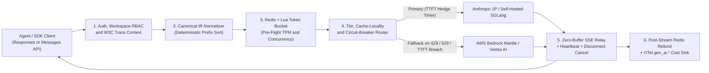
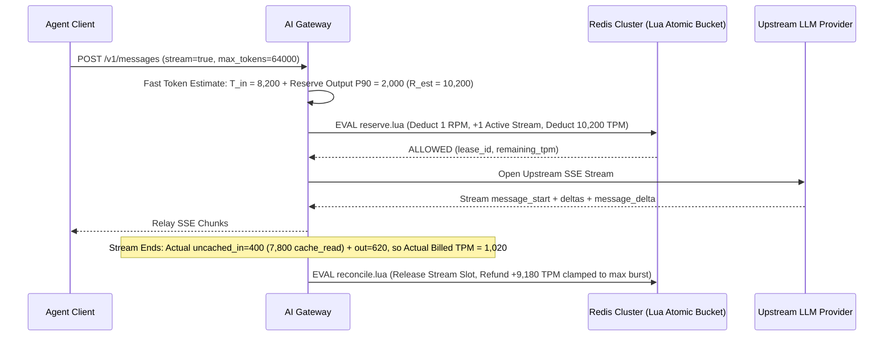

# Engineering an Enterprise High-Throughput AI Gateway

An **Enterprise AI Gateway** is the unified data plane sitting between internal applications, autonomous agents, and SDKs (`LangChain`, `Claude SDK`, `OpenAI SDK`) on the north side, and heterogeneous upstream inference providers (Anthropic Claude API, AWS Bedrock Mantle, Google Vertex AI, OpenAI, and self-hosted vLLM/SGLang GPU pools) on the south side.

Standard Layer-7 HTTP API gateways (vanilla NGINX, Kong, or AWS API Gateway) were engineered for 20ms stateless JSON RPCs. Put them in front of LLM traffic and they fail immediately: connections hold open for 30 to 300 seconds, proxy response buffers swallow SSE token streams, TCP idle timeouts sever adaptive-thinking pauses, RPM rate limiters miss 120K-token context bombs, and aborted client tabs leave zombie GPU generations burning thousands of dollars.

---

## 1. Gateway Architecture: Go Data Plane vs Python Control Plane

### Runtime Selection Trade-offs (Golang vs Python/FastAPI)

| Architectural Concern | Golang (`net/http` / `http2`) | Python (`FastAPI` / `uvicorn` + `httpx`) | Production Verdict (2027) |
| :--- | :--- | :--- | :--- |
| **Concurrent SSE Streams** | Goroutines start at **2-4 KiB** stack; 25,000 open 90-second SSE streams use $<250\text{ MB}$ RAM with sub-millisecond GC pauses. | Single-threaded `asyncio` event loop per worker; Pydantic JSON validation + chunk re-encoding saturates 1 CPU core at ~800-1,500 active high-tok/s streams. | **Go** wins decisively above 1,000 concurrent streams per pod; **FastAPI** (multi-worker `uvloop` + `orjson`) is great up to ~500 concurrent streams per pod. |
| **Memory Zero-Copy Streaming** | `bufio.Reader` / `io.CopyBuffer` slices bytes directly through pooled `sync.Pool` buffers without per-chunk heap churn. | Every SSE line creates Python `str`/`dict` objects unless carefully bypassed as raw `bytes`. | **Go** cuts P99 gateway-added TTFT overhead to **$<0.8\text{ ms}$** vs $4\text{--}15\text{ ms}$ in Python. |
| **Tokenizer & Guardrail Ecosystem** | Requires Rust FFI (`tiktoken-rs` / `tokenizers`) or sidecar RPC for ML classifiers. | Native HuggingFace `tokenizers`, ONNX Runtime, Pydantic schemas, and official AI SDK parity. | **Hybrid Architecture**: Go hot-path proxy + Python control plane / async guardrail & eval services (or Rust/Go with embedded ONNX). |

### Reference Enterprise AI Gateway Data Flow



---

## 2. Protocol Normalization: OpenAI Responses API & Anthropic Messages API

In 2027, internal agent teams expect a single gateway URL supporting both **OpenAI's stateful/item-based Responses API (`POST /v1/responses`)** and **Anthropic's block-based Messages API (`POST /v1/messages`)**. Translating naively via lossy legacy `chat/completions` shims strips critical capabilities (`thinking` signatures, `cache_control` breakpoints, server-side compaction blocks, and `stop_details` refusal metadata).

### Canonical Internal Representation (IR) Mapping

| Semantic Concept | OpenAI Responses API (`/v1/responses`) | Anthropic Messages API (`/v1/messages`) | Gateway Normalization Rule |
| :--- | :--- | :--- | :--- |
| **System Instructions** | `instructions` (string) or `role: "developer"` items | Top-level `system` block array + mid-conversation `role: "system"` | Keep static prefix in top-level `system` with `cache_control`; map dynamic turn updates to mid-turn `role: "system"`. |
| **Reasoning Control** | `reasoning: {effort: "low"\|"medium"\|"high", summary: "auto"}` | `thinking: {type: "adaptive", display: "summarized"}` + `output_config: {effort: ...}` | Never emit deprecated `budget_tokens` or `temperature` on Claude 5.x/4.7+; omit `thinking: disabled` on Opus 5.5 / Fable 5.2. |
| **Tool Definitions** | `tools: [{type: "function", name, parameters, strict: true}]` | `tools: [{name, description, input_schema, strict: true, eager_input_streaming: true}]` | Canonicalize JSON Schema key order (`sort_keys`) so serialized bytes never drift across pods and break prompt cache! |
| **Opaque State Replay** | `reasoning` item with `encrypted_content` / `previous_response_id` | `thinking` block (`signature`) & `compaction` block | **Never strip or mutate!** Store/echo opaque blocks byte-for-byte on follow-up turns to satisfy Preserved Thinking checks. |
| **SSE Text Delta** | `event: response.output_text.delta` | `event: content_block_delta` (`type: "text_delta"`) | Emit native stream framing matching the north-bound route (`/v1/responses` vs `/v1/messages`) requested by caller. |
| **SSE Tool Call Stream** | `event: response.function_call_arguments.delta` | `event: content_block_delta` (`type: "input_json_delta"`) | Stream `partial_json` chunks eagerly without server-side buffering; validate complete JSON at `message_stop` / `response.completed`. |
| **Final Token Accounting** | `response.completed` -> `response.usage` (`input_tokens_details.cached_tokens`) | `message_start` (input/cache usage) + `message_delta` (cumulative `output_tokens`) | Merge Anthropic's `message_start` and final `message_delta` usage counters into one unified `GatewayUsageRecord` before settlement! |

> **Subtle Anthropic Streaming Accounting Trap**: Unlike OpenAI (which emits the full `usage` object once in the final event), Anthropic's SSE stream emits `input_tokens`, `cache_creation_input_tokens`, and `cache_read_input_tokens` in **`message_start`**, and emits the final cumulative `output_tokens` in **`message_delta`** right before `message_stop`. If your gateway parser only reads `message_delta`, your recorded input and cache tokens will be `0` on every single request!

---

## 3. SSE Framing, Heartbeats & Client Disconnect Propagation

Three non-negotiable engineering rules govern streaming LLM proxies:

1. **Disable Every Proxy Buffer in the Chain**: Set `Content-Type: text/event-stream; charset=utf-8`, `Cache-Control: no-cache, no-transform`, `Connection: keep-alive`, and `X-Accel-Buffering: no` (critical if an ingress NGINX sits ahead of the gateway). Call `http.Flusher.Flush()` immediately after every SSE event frame (`\n\n`).
2. **Emit SSE Comment Heartbeats During Adaptive Thinking**: On `claude-opus-5-5` or `claude-fable-5-2` at `high`/`xhigh` effort with default `display: "omitted"`, the model may reason silently for **25 to 90 seconds** before emitting the first visible text token. AWS ALBs, Cloudflare proxies, and corporate NAT firewalls routinely kill idle TCP streams at 60 seconds. Sending `: keepalive 1732512000\n\n` (an RFC 8895 SSE comment starting with `:`) every **15 seconds** keeps TCP sockets alive while being 100% ignored by every compliant SSE client SDK!
3. **Propagate Client Disconnects Upstream Immediately**: When a user hits "Stop Generating", closes their IDE tab, or a parent orchestrator cancels a timed-out subagent, the downstream TCP connection closes (`r.Context().Done()` fires). Because your upstream HTTP request shares `r.Context()`, Go's HTTP transport immediately closes the upstream stream (`RST_STREAM` in HTTP/2), halting GPU decode steps on self-hosted vLLM/SGLang or stopping further upstream token generation within milliseconds.

### Production Go SSE Relay with Heartbeats, TTFT/ITL Metrics & Abort Propagation

```go
package gateway

import (
	"bufio"
	"bytes"
	"context"
	"errors"
	"fmt"
	"io"
	"net/http"
	"time"
)

type StreamMetrics struct {
	TTFT            time.Duration
	TotalDuration   time.Duration
	ChunkCount      int
	ClientAborted   bool
	Usage           TokenUsage
}

func ProxySSEStream(
	w http.ResponseWriter,
	r *http.Request,
	upstreamClient *http.Client,
	upstreamReq *http.Request,
	parseUsage func(line []byte, u *TokenUsage),
	reconcileTokens func(ctx context.Context, m StreamMetrics),
) error {
	flusher, ok := w.(http.Flusher)
	if !ok {
		http.Error(w, "streaming unsupported", http.StatusInternalServerError)
		return errors.New("response writer does not implement http.Flusher")
	}

	start := time.Now()
	// Bind upstream lifecycle directly to downstream client request context!
	// When client disconnects, r.Context() cancels -> upstream HTTP/2 stream aborts immediately.
	upstreamReq = upstreamReq.WithContext(r.Context())

	resp, err := upstreamClient.Do(upstreamReq)
	if err != nil {
		if errors.Is(r.Context().Err(), context.Canceled) {
			reconcileTokens(context.Background(), StreamMetrics{ClientAborted: true, TotalDuration: time.Since(start)})
			return nil
		}
		return fmt.Errorf("upstream request failed: %w", err)
	}
	defer resp.Body.Close()

	if resp.StatusCode != http.StatusOK {
		w.Header().Set("Content-Type", resp.Header.Get("Content-Type"))
		w.WriteHeader(resp.StatusCode)
		_, _ = io.Copy(w, io.LimitReader(resp.Body, 1<<20))
		reconcileTokens(context.Background(), StreamMetrics{TotalDuration: time.Since(start)})
		return fmt.Errorf("upstream status %d", resp.StatusCode)
	}

	// Anti-buffering SSE response headers
	h := w.Header()
	h.Set("Content-Type", "text/event-stream; charset=utf-8")
	h.Set("Cache-Control", "no-cache, no-transform")
	h.Set("Connection", "keep-alive")
	h.Set("X-Accel-Buffering", "no")
	w.WriteHeader(http.StatusOK)
	flusher.Flush()

	var metrics StreamMetrics
	defer func() {
		metrics.TotalDuration = time.Since(start)
		if errors.Is(r.Context().Err(), context.Canceled) {
			metrics.ClientAborted = true
		}
		// Always settle Redis token reservation on a detached background context with 2s timeout
		settleCtx, cancel := context.WithTimeout(context.Background(), 2*time.Second)
		defer cancel()
		reconcileTokens(settleCtx, metrics)
	}()

	type scanResult struct {
		line []byte
		err  error
	}
	linesCh := make(chan scanResult, 16)
	go func() {
		defer close(linesCh)
		reader := bufio.NewReaderSize(resp.Body, 64*1024)
		for {
			line, err := reader.ReadBytes('\n')
			if len(line) > 0 {
				cp := bytes.Clone(line)
				select {
				case linesCh <- scanResult{line: cp}:
				case <-r.Context().Done():
					return
				}
			}
			if err != nil {
				if err != io.EOF {
					select {
					case linesCh <- scanResult{err: err}:
					case <-r.Context().Done():
					}
				}
				return
			}
		}
	}()

	heartbeat := time.NewTicker(15 * time.Second)
	defer heartbeat.Stop()

	for {
		select {
		case <-r.Context().Done():
			return nil
		case <-heartbeat.C:
			// RFC 8895 SSE comment keeps ALBs / firewalls alive during long thinking pauses
			_, _ = w.Write([]byte(": keepalive\n\n"))
			flusher.Flush()
		case item, open := <-linesCh:
			if !open {
				return nil
			}
			if item.err != nil {
				return item.err
			}
			if bytes.HasPrefix(item.line, []byte("data: ")) {
				if metrics.TTFT == 0 {
					metrics.TTFT = time.Since(start)
				}
				metrics.ChunkCount++
				parseUsage(bytes.TrimPrefix(item.line, []byte("data: ")), &metrics.Usage)
			}
			if _, werr := w.Write(item.line); werr != nil {
				return werr
			}
			// Flush immediately on SSE frame boundary (\n after data line)
			if bytes.Equal(item.line, []byte("\n")) || bytes.Equal(item.line, []byte("\r\n")) {
				flusher.Flush()
			}
		}
	}
}
```

---

## 4. Distributed Redis + Lua Token-Bucket Rate Limiting (Two-Phase TPM/RPM)

### The Streaming Rate-Limit Paradox

Traditional API rate limiters deduct `1` unit at request admission. For LLMs, deducting only *after* a 45-second stream finishes creates a fatal **thundering-herd TOCTOU vulnerability**: a runaway agent loop can fire 200 concurrent requests at $t=0$ while recorded spend is still `0`, blowing past your tenant quota and exhausting your organization's upstream provider TPM ceiling! Conversely, permanently charging `input_tokens + max_tokens` (where `max_tokens = 64000`) penalizes every user who sets a safe backstop but only generates 350 tokens.

### Solution: Atomic Two-Phase Reservation & Post-Stream Reconciliation



1. **Phase 1 — Pre-Flight Reservation (`ADMIT`)**:
   - Estimate input tokens rapidly ($\approx \text{UTF-8 bytes} / 3.6$ or local `tiktoken` / Rust BPE in $<0.5\text{ ms}$).
   - Instead of reserving full `max_tokens = 64000`, reserve an adaptive output budget:
     $$R_{\text{est}} = T_{\text{in, est}} + \min(\text{max\_tokens}, \hat{O}_{P90}^{\text{tenant, model}})$$
     (where $\hat{O}_{P90}$ defaults to e.g. `2048` and tracks a rolling EWMA of actual output tokens for that route).
   - Atomically check and decrement **RPM bucket**, **TPM bucket**, and **In-Flight Concurrency Semaphore** (with a self-healing TTL lease in case a gateway pod crashes mid-stream!) in **one single Redis Lua `EVALSHA` call**.
2. **Phase 2 — Post-Stream Settlement (`RECONCILE`)**:
   - In a `defer` / `finally` block (guaranteed to run on normal completion, upstream error, *or* client disconnect):
   - Compute actual rate-limit-counted tokens $T_{\text{actual}}$ (note: on Anthropic API, `cache_read_input_tokens` do **not** count against upstream ITPM limits on current Claude 4.x/5.x models—so cache hits refund almost the entire input reservation!).
   - If the client disconnected before `message_delta`, approximate $T_{\text{out}} \approx \text{emitted\_text\_chunks} \times 1.3$ plus a conservative thinking margin.
   - Compute $\Delta = R_{\text{est}} - T_{\text{actual}}$. If $\Delta > 0$, **refund** $\Delta$ back to the token bucket (clamped to `burst_capacity`). If $\Delta < 0$ (a huge 30K generation exceeded $P_{90}$), **deduct the overdraft** $|\Delta|$ from the bucket (allowing temporary negative balance so that tenant pauses briefly on the *next* request without killing the in-flight response).

### Production Redis Lua Script & Python FastAPI Integration

```lua
-- rate_limit_two_phase.lua
-- KEYS[1]: bucket hash key  e.g. "rl:{tenant_42}:claude-sonnet-5-5"
-- KEYS[2]: active leases zset e.g. "rl:{tenant_42}:leases"
-- ARGV[1]: mode ("reserve" | "reconcile")
-- ARGV[2]: now_ms
-- ARGV[3]: tpm_rate_per_sec (e.g. 200000 / 60 = 3333.33)
-- ARGV[4]: tpm_burst_capacity (e.g. 200000)
-- ARGV[5]: rpm_rate_per_sec (e.g. 1000 / 60 = 16.67)
-- ARGV[6]: rpm_burst_capacity (e.g. 1000)
-- ARGV[7]: max_concurrent_streams (e.g. 50)
-- ARGV[8]: token_delta (reserve: estimated_tokens; reconcile: reserved - actual)
-- ARGV[9]: lease_id (UUID)
-- ARGV[10]: lease_ttl_ms (e.g. 300000 = 5 min crash-recovery expiry)

local bucket = KEYS[1]
local leases = KEYS[2]
local mode = ARGV[1]
local now = tonumber(ARGV[2])
local tpm_rate = tonumber(ARGV[3])
local tpm_cap = tonumber(ARGV[4])
local rpm_rate = tonumber(ARGV[5])
local rpm_cap = tonumber(ARGV[6])
local max_conc = tonumber(ARGV[7])
local delta = tonumber(ARGV[8])
local lease_id = ARGV[9]
local lease_ttl = tonumber(ARGV[10])

-- 1. Garbage-collect expired zombie stream leases from crashed gateway pods
redis.call("ZREMRANGEBYSCORE", leases, "-inf", now)

-- 2. Load & refill continuous token buckets (TPM and RPM)
local state = redis.call("HMGET", bucket, "tpm_tokens", "rpm_tokens", "last_ms")
local tpm_tokens = tonumber(state[1]) or tpm_cap
local rpm_tokens = tonumber(state[2]) or rpm_cap
local last_ms = tonumber(state[3]) or now

local elapsed_sec = math.max(0, (now - last_ms) / 1000.0)
tpm_tokens = math.min(tpm_cap, tpm_tokens + elapsed_sec * tpm_rate)
rpm_tokens = math.min(rpm_cap, rpm_tokens + elapsed_sec * rpm_rate)

if mode == "reserve" then
    local active = redis.call("ZCARD", leases)
    if active >= max_conc then
        return {0, "concurrency_exceeded", 1000, math.floor(tpm_tokens)}
    end
    if rpm_tokens < 1.0 then
        local retry_ms = math.ceil(((1.0 - rpm_tokens) / rpm_rate) * 1000)
        return {0, "rpm_exceeded", retry_ms, math.floor(tpm_tokens)}
    end
    if tpm_tokens < delta then
        local retry_ms = math.ceil(((delta - tpm_tokens) / tpm_rate) * 1000)
        return {0, "tpm_exceeded", retry_ms, math.floor(tpm_tokens)}
    end

    tpm_tokens = tpm_tokens - delta
    rpm_tokens = rpm_tokens - 1.0
    redis.call("HMSET", bucket, "tpm_tokens", tpm_tokens, "rpm_tokens", rpm_tokens, "last_ms", now)
    redis.call("PEXPIRE", bucket, 120000)
    redis.call("ZADD", leases, now + lease_ttl, lease_id)
    redis.call("PEXPIRE", leases, lease_ttl + 60000)
    return {1, "ok", 0, math.floor(tpm_tokens)}
else
    -- mode == "reconcile": release lease; positive delta refunds unused reservation, negative delta charges overdraft
    local removed = redis.call("ZREM", leases, lease_id)
    if removed == 1 then
        tpm_tokens = math.min(tpm_cap, tpm_tokens + delta)
        redis.call("HMSET", bucket, "tpm_tokens", tpm_tokens, "rpm_tokens", rpm_tokens, "last_ms", now)
        redis.call("PEXPIRE", bucket, 120000)
    end
    return {1, "reconciled", 0, math.floor(tpm_tokens)}
end
```

Notice the `{tenant_42}` Redis hash tag in both `KEYS[1]` and `KEYS[2]`: in **Redis Cluster**, wrapping the tenant ID in curly braces `{...}` guarantees both keys hash to the **exact same CRC16 hash slot**, preventing `CROSSSLOT Keys in request don't hash to the same slot` runtime errors!

```python
import time
import uuid
from contextlib import asynccontextmanager
from fastapi import HTTPException
from redis.asyncio import Redis

class TwoPhaseTokenLimiter:
    def __init__(self, redis: Redis, script_sha: str):
        self.redis = redis
        self.script_sha = script_sha

    @asynccontextmanager
    async def acquire(
        self,
        tenant_id: str,
        model: str,
        est_input_tokens: int,
        est_output_p90: int = 2048,
        tpm_limit: int = 400_000,
        rpm_limit: int = 1_200,
        max_concurrent: int = 64,
    ):
        bucket_key = f"rl:{{{tenant_id}}}:{model}"
        lease_key = f"rl:{{{tenant_id}}}:{model}:leases"
        lease_id = uuid.uuid4().hex
        reserved = est_input_tokens + est_output_p90
        now_ms = int(time.time() * 1000)

        allowed, reason, retry_ms, _ = await self.redis.evalsha(
            self.script_sha,
            2,
            bucket_key,
            lease_key,
            "reserve",
            now_ms,
            tpm_limit / 60.0,
            tpm_limit,
            rpm_limit / 60.0,
            rpm_limit,
            max_concurrent,
            reserved,
            lease_id,
            300_000,
        )
        if not allowed:
            raise HTTPException(
                status_code=429,
                detail={"error": reason, "retry_after_ms": retry_ms},
                headers={"Retry-After": str(max(1, retry_ms // 1000))},
            )

        settlement = {"actual_tokens": reserved}
        try:
            yield settlement
        finally:
            refund_delta = reserved - settlement["actual_tokens"]
            await self.redis.evalsha(
                self.script_sha,
                2,
                bucket_key,
                lease_key,
                "reconcile",
                int(time.time() * 1000),
                tpm_limit / 60.0,
                tpm_limit,
                rpm_limit / 60.0,
                rpm_limit,
                max_concurrent,
                refund_delta,
                lease_id,
                300_000,
            )
```

---

## 5. Resilience Engineering: Hedged Requests, Circuit Breakers & Multi-Provider Failover

### Rule 1: Only Hedge or Retry *Before* the First Downstream Event Flushes

In microservice RPCs, idempotent `GET` retries are trivial. In SSE token streaming, **once a single `content_block_delta` has been flushed to the caller, transparent server-side failover is impossible**—you cannot stitch Token 48 from Vertex AI onto Token 47 from Anthropic 1P because autoregressive trajectories diverge!

Therefore, split gateway timeout & retry guards into two strict phases:
- **Pre-First-Token Phase (Safe to Retry / Hedge)**:
  - Set an aggressive **Connection + Header + First-Event Deadline** (or **TTFT Hedge Timer** at the route's P98 TTFT, e.g., `2,500 ms` for non-thinking routes; `15,000 ms` for HTTP `200` + `message_start` header arrival on adaptive thinking routes).
  - If Primary returns `429 RateLimitError`, `500/502/503`, `529 Overloaded`, or breaches the `message_start` header deadline before any bytes flush downstream, cancel Primary and immediately dispatch to Secondary!
- **Mid-Stream Phase (Never Silently Splice)**:
  - If the upstream connection drops after 200 tokens have streamed to the client, emit a structured SSE `event: error` (`{"type": "error", "error": {"type": "api_error", "message": "upstream_stream_interrupted"}}`) and close cleanly so the SDK/agent harness can retry the turn cleanly from its intact message history.

### Rule 2: Classify Errors Precisely Inside Sliding-Window Circuit Breakers

Never trip a provider circuit breaker on **caller errors**!

| Upstream Signal | Trip Circuit Breaker? | Gateway Action |
| :--- | :--- | :--- |
| **`400 BadRequestError` / `422`** | **NEVER** | Return `400` directly to caller (e.g., invalid schema or unsupported param). Failing over to Bedrock will just `400` again! |
| **`200 OK` + `stop_reason: "refusal"`** | **NEVER** | Safety classifier refusal (not infra outage). Use Anthropic's server-side `fallbacks: "default"` (`server-side-fallback-2026-07-01`) or SDK `BetaRefusalFallbackMiddleware`. |
| **`429 RateLimitError`** | **Quota-State Trip** | Read `retry-after` / `anthropic-ratelimit-tokens-reset`; mark *that specific credential/region* cooling down until `reset_at` and route immediately to overflow workspace or Bedrock Mantle / Vertex AI. |
| **`500` / `502` / `503` / `529 Overloaded` / Connect Timeout** | **YES** (Trip if error rate $>20\%$ over 20-req rolling window) | Transition `CLOSED -> OPEN` (30s cooldown) -> `HALF_OPEN` (allow 2 canary probes); fail over traffic to healthy secondary region/cloud. |

### Multi-Provider Failover Compatibility Checklist (Anthropic 1P <-> AWS Bedrock Mantle <-> GCP Vertex)

When failing over a Claude request across clouds, normalize these subtle provider differences inside your gateway adapter—never leak them to application teams:

1. **Model Identifier Translation**:
   - First-party Claude API & GCP Vertex AI: `"claude-opus-5-5"`, `"claude-sonnet-5-5"`.
   - AWS Bedrock Mantle endpoint: requires `"anthropic."` prefix (`"anthropic.claude-opus-5-5"`).
2. **Prompt Cache Isolation**:
   - Prompt caches are **strictly isolated per provider, region, and workspace**. Failing over 10% of traffic during a transient blip pays a one-time cold cache write on the backup provider—so use **sticky primary affinity** (`Primary -> Backup`) rather than splitting 50/50 round-robin across two clouds!
3. **Feature Parity Guard**:
   - Some beta headers or server-hosted tools differ across clouds (e.g., Vertex AI supports basic `web_search_20250305` rather than dynamic `web_search_20260209`; Managed Agents sessions are not on Bedrock/Vertex). Maintain a static capability matrix in the gateway router so requests using 1P-only features fail over across 1P workspaces/keys rather than hitting a guaranteed `400` on a partner cloud.

Next, see **[04-SEMANTIC-ROUTING-PROMPT-CACHING-FINOPS.md](04-SEMANTIC-ROUTING-PROMPT-CACHING-FINOPS.md)** to turn your gateway into an economic multiplier via $>85\%$ prompt cache hit engineering, effort/model cascading, and OpenTelemetry `gen_ai.*` cost accounting.
