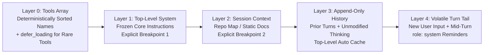
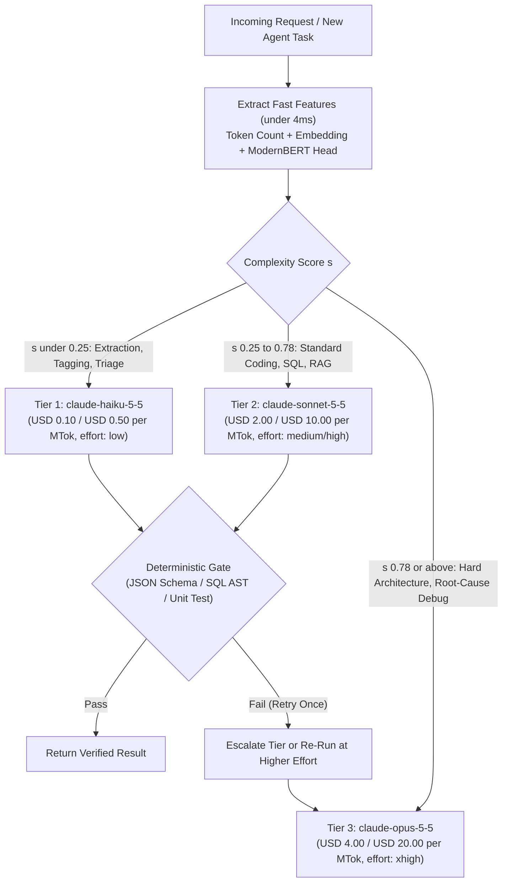

# Prompt Caching Engineering, Semantic Routing & AI FinOps

In production AI systems, **cost per completed task**—not sticker price per million tokens—is the ground-truth economic metric. A naive multi-turn agent loop running on a mid-tier model with broken prompt caching and unbounded tool schemas routinely costs **4x to 8x more** than a frontier model engineered with >85% prefix cache hits, deferred tool loading, calibrated effort tuning, and tiered subagent routing.

Building directly on the gateway architecture in **[03-ENTERPRISE-LLM-GATEWAY-ARCHITECTURE.md](03-ENTERPRISE-LLM-GATEWAY-ARCHITECTURE.md)**, this module provides the exact architectural blueprints, pricing math, and OpenTelemetry accounting pipelines required to cut enterprise inference spend by **60% to 80%** without sacrificing accuracy.

---

## 1. The Quadratic Agent Loop Problem & 2027 Token Economics

### Why Uncached Agent Loops Explode Quadratically

Every turn $k \in \{1, \dots, N\}$ of an autonomous coding or research agent resends the static system + tool prefix $P_{\text{static}}$ plus all accumulated conversation and tool-result deltas $\Delta_{\text{turn}}$:

$$\text{Total Uncached Input}(N) = \sum_{k=1}^{N} \left(P_{\text{static}} + k \cdot \Delta_{\text{turn}}\right) = N \cdot P_{\text{static}} + \frac{N(N+1)}{2}\Delta_{\text{turn}} = O(N^2)$$

For a 30-turn agent task with $P_{\text{static}} = 12,000$ tokens (system prompt + MCP tool schemas) and $\Delta_{\text{turn}} = 1,500$ tokens:
- **Without Prompt Caching**: $30(12,000) + \frac{30 \times 31}{2}(1,500) = 360,000 + 697,500 = \mathbf{1,057,500\text{ full-price input tokens}}$!
- **With Prefix-Stable Prompt Caching** (where cache reads bill at **0.05x** base input on `claude-opus-5-5` and `claude-sonnet-5-5`): over **94% of those 1.05M input tokens** hit cache reads, slashing effective input spend by **>12x** while also cutting prefill TTFT by 70-85%!

### Reference Anthropic Model Tier Economics (2026-2027 Baseline)

| Model Tier (`model` ID) | Context / Max Out | Base Input (per 1M) | Output (per 1M) | 5m Cache Write (1.25x) | 1h Cache Write (2.0x) | Cache Read Rate | Min Cache Prefix |
| :--- | :--- | :--- | :--- | :--- | :--- | :--- | :--- |
| **`claude-haiku-5-5`** ($\le 100\text{K}$) | 1M / 128K | USD 0.10 | USD 0.50 | USD 0.125 | USD 0.20 | ~0.10x (USD 0.01) | **512 tok** |
| **`claude-sonnet-5-5`** | 1M / 128K | USD 2.00 | USD 10.00 | USD 2.50 | USD 4.00 | **0.05x (USD 0.10)** | **512 tok** |
| **`claude-opus-5-5`** (Default) | 1M / 128K | USD 4.00 | USD 20.00 | USD 5.00 | USD 8.00 | **0.05x (USD 0.20)** | **512 tok** |
| **`claude-fable-5-2`** (Frontier) | 1M / 128K | USD 8.00 | USD 40.00 | USD 10.00 | USD 16.00 | **0.025x (USD 0.20)** | **512 tok** |

*(Note: Always verify live regional/partner rates on Amazon Bedrock and Vertex AI before computing dollar chargebacks; first-party cache reads also do **not** count against standard input-token rate limits on current Claude models.)*

---

## 2. Prompt Caching Engineering: Achieving >85% Hit Rates

### The One Law of Prompt Caching: Byte-Exact Prefix Order

Prompt caching is a **cryptographic prefix hash match** over rendered tokens. The server renders every request in strict order:

$$\texttt{tools} \longrightarrow \texttt{system} \longrightarrow \texttt{messages[0]} \longrightarrow \texttt{messages[1]} \longrightarrow \dots \longrightarrow \texttt{messages[n]}$$

**Any single-byte difference at byte offset $k$ invalidates 100% of cached blocks at positions $\ge k$.** Placing `cache_control` markers without ordering your prompt from *most immutable* to *most volatile* accomplishes nothing except paying a **25% cache-write surcharge** on every request!

### The Four-Layer Stability Architecture



1. **Layer 0 — Frozen, Canonicalized Tool Definitions (`tools`)**:
   - Tools render at position `0`—ahead of `system`! Adding, removing, or changing the iteration order of a Python `set` or Go `map` of tools invalidates the **entire prompt cache**.
   - **Rule**: Sort `tools` alphabetically by `name`, serialize JSON schemas with `sort_keys=True`, and keep the toolset identical across the entire session. If you have 80 MCP tools (>10K schema tokens), declare `tool_search_tool_bm25_20251119` and mark rare tools `defer_loading: true` up front rather than dynamically mutating `tools` per turn.
2. **Layer 1 — Frozen Global System Prompt (`system`, Explicit Breakpoint #1)**:
   - Never interpolate timestamps (`datetime.now()`), user names, feature flags, or session UUIDs into top-level `system`. Put an explicit `{"type": "ephemeral"}` breakpoint on the final block of `system`—this caches `tools + system` across **every user and every conversation** in that workspace!
3. **Layer 2 — Session-Static Context (`messages[0]`, Explicit Breakpoint #2)**:
   - Put project-level context (`CLAUDE.md`, schema DDL, pinned RAG files) in the first user message block with explicit `cache_control: {"type": "ephemeral"}`, ahead of the first question.
4. **Layer 3 & 4 — Append-Only History + Mid-Conversation `role: "system"` Updates**:
   - Enable **top-level automatic caching** (`cache_control: {"type": "ephemeral"}` at the root of `messages.create()`) alongside your explicit system breakpoint so the moving conversation tail caches automatically each turn.
   - **How to inject dynamic state mid-session without breaking cache OR Preserved Thinking**: On `claude-opus-5-5`, `claude-sonnet-5-5`, `claude-haiku-5-5`, and `claude-fable-5-2`, append `{"role": "system", "content": "Current UTC date: 2026-11-25. Mode: read-only."}` directly to the end of `messages[]` (after the latest `user` message)—**never** edit top-level `system` or mutate/prune earlier turns! Editing earlier turns invalidates both the KV prefix cache *and* triggers Preserved Thinking's history-editing check. For one-turn reminders in a tool loop, use `clear_at: "next_user_message"` (or append a text block after `tool_result` and leave earlier copies untouched).

### TTL Break-Even Math & `max_tokens: 0` Keep-Alives

A cache read refreshes the entry's TTL at zero extra write cost, measured from the **start** of the request:

- **5-Minute TTL (`{"type": "ephemeral"}`)**: Writes at $1.25\times$, reads at $0.05\times$ (Opus 5.5 / Sonnet 5.5). Break-even occurs on just the **2nd request**:
  $$1.25 + 0.05 = \mathbf{1.30\times} < 2.00\times \text{ (uncached)}$$
- **1-Hour TTL (`{"type": "ephemeral", "ttl": "1h"}`)**: Writes at $2.00\times$. Break-even requires at least **3 requests** ($2.00 + 0.05 + 0.05 = \mathbf{2.10\times} < 3.00\times$). Note: if mixing explicit 1h and 5m breakpoints, **1h breakpoints must precede 5m breakpoints**.
- **The `max_tokens: 0` Idle Keep-Alive Trick**: When a human developer pauses for 12 minutes reviewing a diff on a 120K-token cached Opus 5.5 / Fable 5.2 session, paying $2.0\times$ up front on every write hurts if most turns are $<5$ minutes apart. Instead, keep the default 5-minute TTL and, if a live IDE/Studio session sits idle at `t = 4m15s`, send a background **non-streaming** (`stream=False`) request with the exact cached prefix and `max_tokens: 0`. It generates zero output tokens, resets the 5-minute TTL clock, and costs only a tiny `0.05x` / `0.025x` cache read!

### The Seven Silent Cache Invalidators Checklist

| Silent Invalidator | Symptom in `response.usage` | Architectural Fix |
| :--- | :--- | :--- |
| **`datetime.now()` / UUID in `system`** | `cache_read_input_tokens == 0` on every request | Move timestamps/session state into a trailing `{"role": "system", ...}` inside `messages[]`. |
| **Non-deterministic JSON / Tool Order** | Random 50% hit/miss oscillation across pods | Canonicalize tool array sort order and `json.dumps(..., sort_keys=True)`. |
| **Automatic Cache on Unique One-Shot RAG** | High `cache_creation_input_tokens` every call, near-zero reads | Put explicit `cache_control` at the end of the *shared* prefix, leaving the unique question uncached. |
| **Deleting Injected Reminders Next Turn** | Cache rebuilds from turn $k-1$ every step + dropped thinking | Keep `messages[]` strictly append-only; use `clear_at: "next_user_message"` beta or keep text blocks. |
| **Top-Level `effort` / `thinking` Toggle** | Full messages-cache miss mid-conversation | Pin `thinking` + `effort` per session, or use mid-conversation `role: "system"` with `content: []` and `output_config: {effort: ...}`. |
| **>20-Block Lookback Window Overflow** | Sudden full rewrite after a turn with >20 sequential blocks | Place an intermediate explicit breakpoint every ~15 blocks (parallel `tool_use` runs collapse to 1 slot). |
| **Multi-Workspace Key Sharding** | Hit rate drops linearly as $1/K$ across $K$ API workspaces | Caches are workspace-isolated; route a conversation/tenant stickily to one workspace! |

### Production Prefix-Stable Assembler & Cache Verification Probe (Python)

```python
import hashlib
import json
from typing import Any
import anthropic

def canonicalize_tools(tools: list[dict[str, Any]]) -> list[dict[str, Any]]:
    """Guarantees byte-identical tool schema rendering across distributed workers."""
    sorted_tools = sorted(tools, key=lambda t: t["name"])
    return [json.loads(json.dumps(t, sort_keys=True)) for t in sorted_tools]

def build_cached_messages_request(
    *,
    model: str = "claude-opus-5-5",
    static_system_prompt: str,
    tools: list[dict[str, Any]],
    history: list[dict[str, Any]],
    new_user_text: str,
    operator_note: str | None = None,
    effort: str = "high",
) -> dict[str, Any]:
    messages = list(history)  # Append-only: never mutate prior turns or strip thinking blocks!
    messages.append({"role": "user", "content": new_user_text})
    if operator_note:
        # Mid-conversation system message preserves cached history prefix and thinking blocks
        messages.append({"role": "system", "content": operator_note})

    return {
        "model": model,
        "max_tokens": 64000,
        "thinking": {"type": "adaptive"},
        "output_config": {"effort": effort},
        "cache_control": {"type": "ephemeral"},  # Auto-caches growing conversation tail
        "tools": canonicalize_tools(tools),
        "system": [
            {
                "type": "text",
                "text": static_system_prompt,
                "cache_control": {"type": "ephemeral"},  # Explicit Breakpoint #1 on shared trunk
            }
        ],
        "messages": messages,
    }

def compute_cache_hit_ratio(usage: anthropic.types.Usage) -> float:
    # CRITICAL: Anthropic usage.input_tokens is ONLY the uncached remainder!
    total_input = (
        usage.input_tokens
        + (usage.cache_creation_input_tokens or 0)
        + (usage.cache_read_input_tokens or 0)
    )
    if total_input == 0:
        return 0.0
    return (usage.cache_read_input_tokens or 0) / total_input
```

---

## 3. Effort Tuning, Semantic Routers & Model Cascading

### First Rule of 2027 Model Routing: Never Switch Models Mid-Conversation!

Many outdated 2024 blog posts advocate routing Turn 1 to Opus, Turn 2 to Haiku, and Turn 3 back to Sonnet inside the **same conversation**. In 2027, **that is an anti-pattern**:
1. **Prompt caches are strictly model-scoped**: Switching from `claude-opus-5-5` to `claude-haiku-5-5` on Turn 5 with a 60K-token history forces a **cold 60K uncached prefill**, and switching back on Turn 6 misses any turns added in between.
2. **Preserved Thinking Isolation**: Earlier models cannot read newer frontier thinking blocks (and vice versa across incompatible tiers), silently dropping accumulated reasoning context.

Instead, apply routing across **three cache-safe boundaries**:

1. **Boundary A — Intra-Session Effort Scaling (Zero Cache Loss)**:
   - Keep the main agent loop pinned on one strong model (`claude-opus-5-5` or `claude-sonnet-5-5`).
   - Sweep `output_config.effort` (`"low"`, `"medium"`, `"high"`, `"xhigh"`) against your eval set first! Lowering effort on routine turns (via mid-conversation `{"role": "system", "content": [], "output_config": {"effort": "low"}}` under `mid-conversation-output-config-2026-07-01`) slashes thinking + output tokens by 40-65% while keeping 100% of the prompt cache warm.
2. **Boundary B — Turn-0 Semantic & Complexity Routing (Stateless / New Session Kickoff)**:
   - Classify incoming independent tasks at **Turn 0** before any session cache exists:



3. **Boundary C — Subagent Fan-Out & Advisor Delegation**:
   - **Orchestrator-Worker**: A `claude-opus-5-5` lead agent spawns stateless `claude-haiku-5-5` / `claude-sonnet-5-5` subagents to read 40 log files or summarize search results, returning compact 200-token digests into the lead's context.
   - **Advisor Pattern**: Run the main executor loop on `claude-sonnet-5-5` and attach `claude-opus-5-5` via the **Advisor tool** so the executor consults Opus only at high-uncertainty architectural forks.

### Comparing Semantic Router Architectures

| Router Mechanism | Gateway Latency | Routing Accuracy | Best Use Case & Pitfalls |
| :--- | :--- | :--- | :--- |
| **Deterministic Task Metadata** | $< 0.1\text{ ms}$ | **100%** (explicit) | Route by known endpoint/workflow (`autocomplete` -> Haiku, `pr_review` -> Sonnet/Opus). **Always use first where app knows task type!** |
| **Embedding Centroid Router** (`BGE-small` / ONNX) | $2\text{--}5\text{ ms}$ (CPU) | $78\%\text{--}85\%$ | Fast intent clustering (FAQ vs SQL vs Code), but cosine similarity struggles to distinguish *easy* Python bug from *hard* concurrency race! |
| **Calibrated MLP / ModernBERT Router** (RouteLLM style) | $4\text{--}8\text{ ms}$ (ONNX) | **$88\%\text{--}93\%$** | Trained on historical `(prompt, cheap_pass, expensive_pass)` eval pairs to predict $P(\text{Sonnet solves}) \ge \tau$; tune threshold $\tau$ continuously. |
| **Verifier-Gated Cascade** | $+1$ turn on ~12% failures | **Matches Frontier** | Run cheap cell first whenever a cheap deterministic checker exists (Pydantic strict schema, SQL `EXPLAIN`, compiler/pytest); escalate only failures! |

### Reference Python Implementation: Cache-Safe Tier & Effort Router

```python
from dataclasses import dataclass
from typing import Literal
import numpy as np

EffortLevel = Literal["low", "medium", "high", "xhigh"]

@dataclass(frozen=True)
class RouteDecision:
    model: str
    effort: EffortLevel
    reason: str

class CacheSafeComplexityRouter:
    """
    Routes Turn-0 requests across Haiku / Sonnet / Opus using calibrated complexity scores,
    while keeping in-flight multi-turn sessions pinned to their initial model to preserve
    both the workspace KV prompt cache and Preserved Thinking blocks!
    """

    def __init__(self, weights: np.ndarray, bias: float, t_haiku: float = 0.25, t_opus: float = 0.78):
        self.weights = weights
        self.bias = bias
        self.t_haiku = t_haiku
        self.t_opus = t_opus

    def score_complexity(self, embedding: np.ndarray) -> float:
        logit = float(np.dot(embedding, self.weights) + self.bias)
        return 1.0 / (1.0 + np.exp(-logit))

    def route(
        self,
        *,
        embedding: np.ndarray,
        existing_session_model: str | None = None,
        explicit_task_kind: str | None = None,
    ) -> RouteDecision:
        # 1. Never switch models mid-session: scale effort instead!
        if existing_session_model is not None:
            s = self.score_complexity(embedding)
            effort: EffortLevel = "low" if s < 0.30 else ("medium" if s < 0.70 else "high")
            return RouteDecision(
                model=existing_session_model,
                effort=effort,
                reason="pinned_session_model_for_cache_continuity",
            )

        # 2. Deterministic application-level routes win before ML classification
        if explicit_task_kind in {"classify", "extract_tags", "subagent_file_scan"}:
            return RouteDecision("claude-haiku-5-5", "low", f"deterministic:{explicit_task_kind}")
        if explicit_task_kind in {"architecture_review", "incident_root_cause"}:
            return RouteDecision("claude-opus-5-5", "xhigh", f"deterministic:{explicit_task_kind}")

        # 3. Calibrated embedding classifier head for Turn-0 kickoff
        s = self.score_complexity(embedding)
        if s < self.t_haiku:
            return RouteDecision("claude-haiku-5-5", "low", f"score={s:.3f}<{self.t_haiku}")
        if s < self.t_opus:
            effort = "medium" if s < 0.55 else "high"
            return RouteDecision("claude-sonnet-5-5", effort, f"score={s:.3f}_mid_tier")
        return RouteDecision("claude-opus-5-5", "high", f"score={s:.3f}>={self.t_opus}")
```

---

## 4. Enterprise AI FinOps & OpenTelemetry (`gen_ai.*`) Cost Accounting

### End-to-End Trace & Attribution Propagation

To attribute every fraction of a cent to a specific **Tenant, Cost Center, Agent Name, and Feature**, inject W3C **`traceparent`** (with sampled flag `01`) and **`baggage`** headers at the AI Gateway:
- `traceparent: 00-4bf92f3577b34da6a3ce929d0e0e4736-00f067aa0ba902b7-01`
- `baggage: user.id=usr_9812a,tenant.id=org_acme,agent.workflow=supply_chain_copilot` *(never put raw emails or PII inside `user.id` or `conversation_id`!)*

### Critical FinOps Bug: OTel `gen_ai.usage.input_tokens` vs Messages API `usage.input_tokens`

This discrepancy causes more broken FinOps dashboards in 2027 than any other bug:

| Field Source | Semantics of `input_tokens` | Exact Uncached Input Formula |
| :--- | :--- | :--- |
| **Anthropic Messages API JSON** (`response.usage`) | **Uncached remainder ONLY** (`input_tokens` excludes cache reads and writes!) | $T_{\text{uncached}} = \texttt{usage.input\_tokens}$ |
| **OpenTelemetry GenAI Span** (`gen_ai.usage.*`) | **TOTAL input tokens** (`gen_ai.usage.input_tokens` **ALREADY INCLUDES** `cache_read` and `cache_write`!) | $T_{\text{uncached}} = \texttt{gen\_ai.usage.input\_tokens} - \texttt{gen\_ai.usage.cache\_read.input\_tokens} - \texttt{gen\_ai.usage.cache\_write.input\_tokens}$ |

Furthermore, when both **SDK Tracing** (`span.kind == CLIENT`) and **API Tracing** (`span.kind == SERVER`) are enabled, both emit an `anthropic.messages.create` span for the same request!
- **Deduplication Rules**:
  1. Sum **only one source** per request (prefer `SERVER` spans from `service.name = "claude-platform"`, or filter strictly `span.kind == CLIENT` if using SDK-only tracing).
  2. Deduplicate at-least-once OTLP deliveries by `(trace_id, span_id)`.
  3. Add server-side `anthropic.compaction` span tokens (`anthropic.usage.compaction.input_tokens` / `output_tokens`), which are excluded from SDK `gen_ai.usage.*` attributes!

### Exact Per-Request Dollar Cost Formula

$$\text{Cost}_{\text{USD}} = \frac{T_{\text{uncached}} \cdot R_{\text{in}} + T_{\text{w5m}} \cdot (1.25 R_{\text{in}}) + T_{\text{w1h}} \cdot (2.0 R_{\text{in}}) + T_{\text{read}} \cdot R_{\text{read}} + T_{\text{out}} \cdot R_{\text{out}}}{10^6} \times M_{\text{tier}}$$

Where $M_{\text{tier}} = 0.5$ for **Message Batches API** (50% discount stacks on top of cache reads and writes!) and $M_{\text{tier}} = 2.0$ for `speed: "fast"` on Opus 5.5 / Fable 5.2.

### Production ClickHouse / PostgreSQL FinOps Attribution Rollup Query

```sql
-- Daily Per-Tenant, Per-Agent Cost, Cache Efficiency & Task Unit Economics
WITH deduped_spans AS (
    SELECT DISTINCT ON (trace_id, span_id)
        event_date,
        tenant_id,
        agent_workflow,
        task_id,
        model_id,
        is_batch,
        -- Subtract cache reads/writes from OTel gen_ai.usage.input_tokens!
        GREATEST(0, gen_ai_input_tokens - cache_read_tokens - cache_write_5m_tokens - cache_write_1h_tokens) AS uncached_in,
        cache_write_5m_tokens,
        cache_write_1h_tokens,
        cache_read_tokens,
        gen_ai_output_tokens AS output_tok,
        ttft_ms
    FROM otel_genai_spans
    WHERE event_date >= CURRENT_DATE - INTERVAL '30 days'
      AND span_name IN ('anthropic.messages.create', 'anthropic.compaction')
      AND span_kind = 'SERVER'
)
SELECT
    tenant_id,
    agent_workflow,
    COUNT(DISTINCT task_id) AS completed_tasks,
    ROUND(
        100.0 * SUM(cache_read_tokens)
        / NULLIF(SUM(uncached_in + cache_write_5m_tokens + cache_write_1h_tokens + cache_read_tokens), 0),
        2
    ) AS cache_hit_pct,
    PERCENTILE_CONT(0.95) WITHIN GROUP (ORDER BY ttft_ms) AS p95_ttft_ms,
    ROUND(SUM(
        (
            uncached_in * p.input_usd_per_m
            + cache_write_5m_tokens * (1.25 * p.input_usd_per_m)
            + cache_write_1h_tokens * (2.00 * p.input_usd_per_m)
            + cache_read_tokens * p.cache_read_usd_per_m
            + output_tok * p.output_usd_per_m
        ) / 1e6 * (CASE WHEN is_batch THEN 0.5 ELSE 1.0 END)
    )::numeric, 2) AS total_spend_usd,
    ROUND((SUM(
        (
            uncached_in * p.input_usd_per_m
            + cache_write_5m_tokens * (1.25 * p.input_usd_per_m)
            + cache_write_1h_tokens * (2.00 * p.input_usd_per_m)
            + cache_read_tokens * p.cache_read_usd_per_m
            + output_tok * p.output_usd_per_m
        ) / 1e6 * (CASE WHEN is_batch THEN 0.5 ELSE 1.0 END)
    ) / NULLIF(COUNT(DISTINCT task_id), 0))::numeric, 4) AS usd_per_task
FROM deduped_spans s
JOIN model_pricing_catalog p ON s.model_id = p.model_id
GROUP BY tenant_id, agent_workflow
ORDER BY total_spend_usd DESC;
```

---

## 5. 30-Day Playbook: Cutting Enterprise Spend by 76% (Worked Waterfall)

Apply optimizations strictly in **Free Wins -> Effort/Budgets -> Model Routing** order so quality never regresses silently. Below is a representative enterprise waterfall starting from a **USD 100,000 / month** unoptimized multi-agent deployment (running 100% uncached `claude-opus-5-5` at `high` effort across interactive copilots, MCP tool loops, and nightly analytics):

| Step | Lever Applied | Type | Quality Impact | Monthly Bill After Step | Incremental Saving |
| :--- | :--- | :--- | :--- | :--- | :--- |
| **0. Baseline** | Uncached `claude-opus-5-5`, 35 MCP tools inlined, `datetime.now()` in `system`, synchronous nightly jobs | — | 91.4% Eval Pass | **USD 100,000** | — |
| **1. Prefix-Stable Caching** | Fix `datetime.now()` -> mid-turn `role: "system"`, sort tools, add explicit `system` + auto tail `cache_control` (achieves 87% cache read hit rate) | **Free Win** | **91.4%** (0.0% loss, -68% TTFT) | **USD 52,000** | -USD 48,000 (-48%) |
| **2. Progressive Input Hygiene** | Enable `tool_search_tool_bm25` + `defer_loading: true` on 30 rare MCP tools; cap image inputs to `1280x720`; audit prompt cruft | **Free Win** | **91.8%** (+0.4% less distraction) | **USD 43,500** | -USD 8,500 (-16%) |
| **3. Async Batch API Offload** | Move nightly report synthesis, backfill, and CI eval runs (30% of remaining volume) to Message Batches API (-50% stacked on cache!) | **Free Win** | **91.8%** (async <24h window) | **USD 37,000** | -USD 6,500 (-15%) |
| **4. Effort Sweep & Task Budgets** | Sweep `output_config.effort` -> set routine chat/RAG routes to `medium`/`low`; attach `task_budget: {total: 64000}` on runaway loops | **Tradeoff** (Eval-verified) | **91.3%** (-0.5%, within noise) | **USD 29,200** | -USD 7,800 (-21%) |
| **5. Tiered Kickoff & Subagents** | Route extraction/file-scan subagents to `claude-haiku-5-5` and standard CRUD coding tasks to `claude-sonnet-5-5` with verifier escalation | **Tradeoff** (Eval-verified) | **91.5%** (+0.2% via verifier retry) | **USD 23,800** | -USD 5,400 (-18%) |

**Net Result**: Monthly inference spend drops from **USD 100,000 to USD 23,800 (-76.2%)**, P95 TTFT drops from `2.4s` to `0.65s`, and end-to-end eval pass rate holds steady at **91.5%**.

Return to **[00-README.md](00-README.md)** to review the full six-week execution plan and Staff interview diagnostic checklist.
