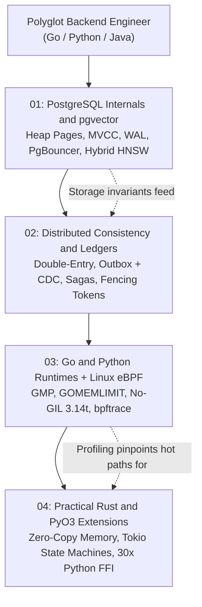
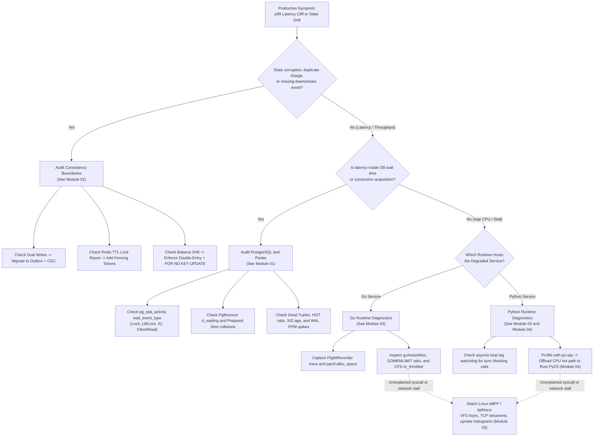

# Staff Backend Internals: Storage Engines, Distributed Consistency & Runtime Performance

In 2027, AI coding assistants generate CRUD endpoints, ORM migrations, and cloud boilerplate in seconds. That shift has bifurcated backend engineering compensation and career leverage: commodity API assembly is automated, while engineers who understand **storage engine mechanics, distributed failure invariants, language runtime schedulers, kernel observability, and native FFI hot paths** hold an asymmetric advantage.

When a multi-tenant AI gateway stalls at p99.9, when a Postgres cluster approaches transaction ID wraparound under 25,000 writes/sec, when a payment webhook retry double-credits a wallet, or when a Python `asyncio` service drops throughput by 10x due to a hidden GIL/event-loop stall, frameworks cannot save you. This vault is a dense, production-grade field manual designed for polyglot **Go, Python, and Java/Rust** engineers operating at—or targeting—Staff and Principal Backend / Platform levels.

---

## Curriculum Architecture & Learning Path

### Clickable Table of Contents

| Module | File | Core Focus | Key Production Artifacts |
| :--- | :--- | :--- | :--- |
| **01** | [01-POSTGRESQL-MVCC-WAL-AND-PGVECTOR.md](01-POSTGRESQL-MVCC-WAL-AND-PGVECTOR.md) | **Storage Engine & Vector Search** | 8 KB page layout, `xmin`/`xmax` visibility, HOT updates, XID wraparound tuning, WAL/FPW amplification, PgBouncer prepared statement multiplexing, `pgvector` HNSW iterative scans, Hybrid BM25 + Dense RRF SQL |
| **02** | [02-DISTRIBUTED-CONSISTENCY-OUTBOX-SAGA.md](02-DISTRIBUTED-CONSISTENCY-OUTBOX-SAGA.md) | **Ledgers, Outbox, Sagas & Locks** | Double-entry immutable SQL ledger, deterministic lock ordering, `SKIP LOCKED` vs CAS, Transactional Outbox + Logical WAL CDC, Saga isolation anomalies, Fencing Tokens, Stripe-grade `Idempotency-Key` state machine |
| **03** | [03-GO-PYTHON-RUNTIME-PROFILING-EBPF.md](03-GO-PYTHON-RUNTIME-PROFILING-EBPF.md) | **Runtimes, Schedulers & eBPF** | Go GMP work-stealing, CFS CPU quota throttling, escape analysis, GC Mark Assist & `GOMEMLIMIT`, Go FlightRecorder, Python `asyncio`/`uvloop` watchdog, Python 3.13t/3.14t free-threaded No-GIL internals, `bpftrace` uprobes/kprobes |
| **04** | [04-RUST-FOR-POLYGLOT-INFRA-AND-PYO3.md](04-RUST-FOR-POLYGLOT-INFRA-AND-PYO3.md) | **Rust & Native PyO3 Hot Paths** | Ownership/lifetimes mapped to Go/Java, stackless `tokio` futures vs goroutines, cancellation safety, zero-copy `serde`/`rkyv`, end-to-end 30x faster `PyO3` + `maturin` + `rayon` native Python extension |

---

## Senior vs. Staff+ Engineering Mental Models

Moving from Senior (L5) to Staff+ (L6/L7) requires shifting from *API-level usage* to *mechanical sympathy*—understanding how abstractions map to disk pages, network packets, CPU caches, and kernel syscalls.

| Dimension | Senior ("Framework Consumer") | Staff+ ("Systems Mechanic") |
| :--- | :--- | :--- |
| **PostgreSQL** | Adds B-tree indexes to slow queries; scales RDS instance size vertically when CPU hits 80%. | Designs `fillfactor` for HOT updates; eliminates `OldestXmin` blockers before XID wraparound; tunes `hnsw.iterative_scan` and WAL checkpoint intervals. |
| **Distributed State** | Wraps `db.Save()` and `kafka.Produce()` in one handler; uses Redis `SET NX EX` locks for critical sections. | Eliminates dual writes via Transactional Outbox + Logical WAL CDC; enforces monotonic Fencing Tokens on storage writes; models money as append-only double-entry postings. |
| **Go Concurrency** | Spawns goroutines freely; leaves GC at defaults until containers OOMKill in Kubernetes. | Aligns `GOMAXPROCS` with Linux CFS quotas; eliminates heap escapes on hot paths; pairs `GOMEMLIMIT` (80-85% of cgroup) with FlightRecorder ring-buffer traces to stop GC Mark Assist spikes. |
| **Python AI/Backend** | Uses FastAPI `async def` everywhere without auditing transitive sync I/O; scales horizontally with dozens of Gunicorn pods. | Runs an event-loop lag watchdog; understands Python 3.14t biased reference counting and C-extension GIL fallback hazards; offloads CPU hot loops to Rust via `PyO3` + `rayon`. |
| **Observability** | Adds structured logs and OpenTelemetry spans, then guesses when tail latency spikes outside instrumented code. | Attaches zero-overhead `bpftrace` kernel/user probes in production to measure VFS `fsync` histograms, TCP retransmits, and TLS cleartext without restarting processes. |

---

## 2027 Latency & Throughput Reference Numbers

Calibrating back-of-the-envelope architecture math requires modern hardware baselines (DDR5, PCIe Gen5 NVMe, AWS Graviton4 / AMD Turin, 25–100 GbE cloud networking):

| Operation | Typical Latency (2027 Server) | Architectural Implication |
| :--- | :--- | :--- |
| L1 / L2 Cache Reference | `0.5 ns` / `3 ns` | Keep hot state compact; avoid pointer-chasing across heap objects (Rust structs / Go value slices > Java/Python boxed objects). |
| L3 Cache Miss -> DDR5 Main RAM | `60 - 90 ns` | Cross-thread atomic refcount increments cause cache-line bouncing; explains why Python 3.14t uses *immortal objects* and *biased refcounting*. |
| Go Goroutine Context Switch | `150 - 300 ns` | ~10x cheaper than OS thread switch (`1.5 - 3 us`) because user-space `P` swaps registers without kernel ring transition. |
| Go `cgo` / Python `PyO3` FFI Call | `60 - 150 ns` | Trivial when amortized over a 1 ms batch; catastrophic if called inside a tight per-item Python loop of 1,000,000 iterations. |
| Local NVMe Gen5 Random 4 KB Read | `15 - 40 us` | Fast enough for DiskANN (`pgvectorscale`) SSD-backed vector traversal without holding 100% of embeddings in DRAM. |
| Cloud Block Storage (`io2` / `gp3`) `fsync` | `250 us - 1.5 ms` | Every synchronous Postgres `COMMIT` pays at least one WAL `fsync` unless batched via `commit_delay` or `synchronous_commit = off`. |
| Intra-AZ Network RTT | `150 - 350 us` | Chaining 20 sequential microservice RPCs adds `5 - 10 ms` at p50 and `40+ ms` at p99 due to tail amplification. |
| Cross-AZ Network RTT | `0.8 - 2.0 ms` | Synchronous quorum replication (Raft / Aurora / Patroni sync standby) sets a hard floor of ~`1.5 - 3 ms` per write transaction. |
| `pgvector` HNSW Query (10M x 1536d `halfvec`) | `2 - 6 ms` (`ef_search=80`) | Requires index graph (`~34 GB` for FP16) resident in `shared_buffers` / OS page cache to avoid random disk thrashing. |

Recall the tail-latency amplification formula when a single user request fans out sequentially or in parallel to $n$ downstream calls, each with independent 99th-percentile failure/slowness probability $p = 0.01$:

$$P(\text{at least one slow call}) = 1 - (1 - p)^n$$

At $n = 1$, only $1\%$ of requests hit the slow path. At $n = 50$ fan-out RPCs (common in chatty microservice or RAG retrieval pipelines), $1 - 0.99^{50} \approx 39.5\%$ of top-level user requests experience p99 degradation. Reducing cross-network hops (e.g., executing hybrid BM25 + HNSW RRF inside a single PostgreSQL query, or running tokenization in-process via `PyO3`) directly collapses $n$.

---

## Production Triage Decision Tree

Use this diagnostic flow when investigating p99 latency spikes, throughput cliffs, or state corruption across a polyglot backend stack:

---

## Four-Week Hands-On Mastery Protocol

Reading internals without observing them under synthetic load leaves fragile knowledge. Execute these four focused lab sprints on a local Linux VM or Docker environment (`--privileged` for eBPF labs):

### Week 1: PostgreSQL Storage & Vector Mechanics ([01-POSTGRESQL-MVCC-WAL-AND-PGVECTOR.md](01-POSTGRESQL-MVCC-WAL-AND-PGVECTOR.md))
1. Enable the `pageinspect` and `pg_buffercache` extensions on Postgres 17. Insert, update, and delete rows while inspecting raw `t_xmin`, `t_xmax`, `t_infomask`, and `t_ctid` chains via `heap_page_items(get_raw_page('accounts', 0))`.
2. Benchmark `pgbench` on a table with `fillfactor = 100` (indexed update) versus `fillfactor = 80` (non-indexed update) and verify `n_tup_hot_upd` in `pg_stat_user_tables`.
3. Load 1M 1536-dimensional `halfvec` embeddings, add a selective `tenant_id` filter (`0.2%` of rows), reproduce the classic HNSW under-fetching bug, and fix it with `SET LOCAL hnsw.iterative_scan = relaxed_order`.

### Week 2: Financial Ledgers, Outbox & Idempotency ([02-DISTRIBUTED-CONSISTENCY-OUTBOX-SAGA.md](02-DISTRIBUTED-CONSISTENCY-OUTBOX-SAGA.md))
1. Implement the 3-table immutable double-entry ledger (`ledger_accounts`, `journal_entries`, `ledger_postings`) and hammer concurrent bidirectional transfers (`A -> B` and `B -> A`) across 64 goroutines to verify deterministic lock ordering produces zero deadlocks and zero balance drift.
2. Build an `Idempotency-Key` middleware in Go that survives `kill -9` mid-flight via expiring recovery leases (`locked_until`) and rejects payload tampering with HTTP `422`.

### Week 3: Runtime Schedulers & Kernel eBPF ([03-GO-PYTHON-RUNTIME-PROFILING-EBPF.md](03-GO-PYTHON-RUNTIME-PROFILING-EBPF.md))
1. Run a Go HTTP server inside a container with `--cpus="1.0"` while setting `GOMAXPROCS=16`; measure p99 latency and `cpu.stat` `nr_throttled` before and after fixing `GOMAXPROCS`.
2. Trigger Go `gcAssistAlloc` by allocating large slices inside handlers with `GOMEMLIMIT` set dangerously close to live heap; capture the exact stall with Go's `trace.FlightRecorder`.
3. Run a Python `3.14t` free-threaded build alongside standard `3.14`, benchmark 8-thread CPU hashing/parsing, and inspect `bpftrace` VFS read/fsync latency histograms on the host kernel.

### Week 4: Rust & PyO3 Native Acceleration ([04-RUST-FOR-POLYGLOT-INFRA-AND-PYO3.md](04-RUST-FOR-POLYGLOT-INFRA-AND-PYO3.md))
1. Scaffold a hybrid Python/Rust package with `maturin init --bindings pyo3`.
2. Implement the batch PII redactor and token chunker in Rust using `py.allow_threads` + `rayon::par_iter()`, generate `.pyi` type stubs, and verify a 25x–40x wall-clock speedup and 10x lower p99 variance under `pytest-benchmark` / `locust`.

---

## Polyglot Runtime Selection Matrix (2027)

Modern backend and AI platform teams rarely run a monoculture. Selecting the right runtime per service boundary—or combining Python orchestration with Rust native hot paths—avoids fighting a language's memory model.

| Dimension | Go (1.24+) | Python (3.13 / 3.14t) | Java 21/25 (Virtual Threads + Generational ZGC) | Rust (`tokio` / `PyO3`) |
| :--- | :--- | :--- | :--- | :--- |
| **Concurrency Model** | Preemptive stackful goroutines (`GMP` scheduler, 2 KB stack) | `asyncio` (`uvloop`) cooperative OR `3.14t` OS threads (No-GIL) | Project Loom Virtual Threads (`Continuation` mounted on ForkJoinPool) | Stackless `Future` state machines polled by `tokio` work-stealing runtime |
| **Idle Pod Memory (RSS)** | `20 - 45 MB` | `60 - 150 MB` (`300 MB+` with ML libs) | `220 - 500 MB` (unless GraalVM Native Image) | `8 - 20 MB` |
| **Cold-Start Latency** | `15 - 50 ms` | `200 - 1,200 ms` (import graph bound) | `1.5 - 4.0 s` (JIT warmup required for peak QPS) | `5 - 20 ms` |
| **p99.9 Tail Determinism** | High (`< 1 ms` GC pauses, watch out for Mark Assist) | Moderate (interpreter overhead, C-ext GIL locks, refcount churn) | High with Generational ZGC (`< 1 ms` pauses, higher RAM overhead) | Extreme (zero GC, deterministic RAII `Drop`, predictable cache locality) |
| **Sweet-Spot Tier** | Control planes, API gateways, billing ledgers, K8s operators, CDC workers | AI/LLM agent orchestration, RAG pipelines, eval harnesses, data workflows | Enterprise core banking, Kafka Streams/Flink stateful stream processing | L4/L7 proxies, storage engines, WASM sandboxes, `PyO3` Python native extensions |

---

## Timeout Hierarchy & Capacity Sizing Formulas

Two quantitative formulas prevent 80% of cascading microservice outages before a single line of code reaches production:

### 1. Strict Monotonic Timeout Cascade
Every hop from the edge down to the storage engine must enforce a strictly tighter deadline than its caller, leaving budget for error serialization and retry backoff:

$$T_{\text{CDN / Ingress}} > T_{\text{API Gateway}} > T_{\text{Service Handler}} > T_{\text{Pool Acquire}} + T_{\text{DB statement\_timeout}}$$

Concrete production baseline for a synchronous user-facing API:
- Edge / Load Balancer idle timeout: `15,000 ms`
- API Gateway route timeout: `5,000 ms`
- Upstream RPC client deadline (`context.WithTimeout`): `2,000 ms`
- Connection pool acquisition wait (`pool_timeout`): `250 ms`
- PostgreSQL `statement_timeout`: `1,500 ms` and `idle_in_transaction_session_timeout`: `5,000 ms`

**Failure Mode**: When `statement_timeout` is unset (`0`) while the HTTP client times out at `2,000 ms` and retries 3 times, a single slow sequential scan spawns 4 concurrent runaway Postgres queries, exhausting all database CPU cores within seconds.

### 2. Little's Law & Database Pool Sizing
By Little's Law, average in-flight concurrency $L$ equals arrival rate $\lambda$ multiplied by mean service time $W$:

$$L = \lambda \times W$$

If an API handles $\lambda = 4,000\text{ req/s}$ and each request holds a Postgres transaction for $W = 5\text{ ms}$ (`0.005 s`), you only need $L = 4,000 \times 0.005 = 20$ active database server connections! Sizing `max_connections = 2000` directly on Postgres wastes ~`15 GB` of backend RSS and degrades `ProcArray` snapshot scans. Instead:
- Keep active PostgreSQL server connections bounded near:
  $$\text{ServerPoolSize} \approx (\text{vCPU} \times 2) + \text{Effective I/O Parallelism}$$
  (typically `64` to `200` server connections on a 32-vCPU NVMe instance).
- Multiplex `5,000+` application pod connections onto those `100` Postgres server connections through **PgBouncer in `transaction` mode** (covered in depth in [01-POSTGRESQL-MVCC-WAL-AND-PGVECTOR.md](01-POSTGRESQL-MVCC-WAL-AND-PGVECTOR.md)).

---

## Production Triage & Pre-Launch Audit Checklist

Before signing off on any tier-0 backend architecture review, verify every item below:

| Layer | Pre-Launch Invariant | Reference Module |
| :--- | :--- | :--- |
| **Postgres Storage** | High-update tables set `fillfactor` (`70–85`), index columns avoid volatile status flags, and `autovacuum_vacuum_scale_factor` is tuned (`0.01–0.02`) instead of the `0.20` default. | [01-POSTGRESQL-MVCC-WAL-AND-PGVECTOR.md](01-POSTGRESQL-MVCC-WAL-AND-PGVECTOR.md) |
| **Connection Pooling** | Transaction-mode PgBouncer has `max_prepared_statements` enabled (or driver prepared statements disabled), and `SET LOCAL` replaces session-level `SET`. | [01-POSTGRESQL-MVCC-WAL-AND-PGVECTOR.md](01-POSTGRESQL-MVCC-WAL-AND-PGVECTOR.md) |
| **Vector Retrieval** | Multi-tenant `pgvector` queries enable `hnsw.iterative_scan = relaxed_order` and combine dense cosine similarity with BM25 via RRF in a single SQL CTE. | [01-POSTGRESQL-MVCC-WAL-AND-PGVECTOR.md](01-POSTGRESQL-MVCC-WAL-AND-PGVECTOR.md) |
| **Money & State** | Balances are never mutated without an immutable `ledger_postings` entry; multi-row locks sort `account_id ASC`; no handler dual-writes to DB and Kafka without an Outbox. | [02-DISTRIBUTED-CONSISTENCY-OUTBOX-SAGA.md](02-DISTRIBUTED-CONSISTENCY-OUTBOX-SAGA.md) |
| **Idempotency** | Mutating endpoints require `Idempotency-Key`, store SHA-256 request payload hashes, and enforce monotonic fencing tokens on distributed lease writes. | [02-DISTRIBUTED-CONSISTENCY-OUTBOX-SAGA.md](02-DISTRIBUTED-CONSISTENCY-OUTBOX-SAGA.md) |
| **Go / Python Runtime** | Go pods set `GOMAXPROCS` from cgroup CPU quota and `GOMEMLIMIT` to `80–85%` of container memory; Python `asyncio` pods run an event-loop lag monitor and isolate CPU hot paths. | [03-GO-PYTHON-RUNTIME-PROFILING-EBPF.md](03-GO-PYTHON-RUNTIME-PROFILING-EBPF.md) |
| **Native Acceleration** | Python CPU bottlenecks (`> 20%` flamegraph share in serialization, regex, tokenization, crypto) batch inputs across FFI into a GIL-free `PyO3` + `rayon` Rust extension. | [04-RUST-FOR-POLYGLOT-INFRA-AND-PYO3.md](04-RUST-FOR-POLYGLOT-INFRA-AND-PYO3.md) |

---

## Staff+ RFC & Deep-Dive Calibration Rubric

When defending a system design RFC or interviewing at L6/Staff+ level, reviewers probe past surface buzzwords for mechanical proof:

| Topic | Weak / Surface Answer (L4–L5) | Staff+ Answer With Mechanical Proof (L6+) |
| :--- | :--- | :--- |
| **Database Scaling** | "We will add read replicas and put Redis in front of Postgres when writes get slow." | "Read replicas still replay 100% of primary WAL; our bottleneck is Cold Update index write amplification across 7 B-trees. Dropping the `updated_at` index and setting `fillfactor = 80` converts 92% of writes to HOT updates with on-page pruning." |
| **Event-Driven Reliability** | "We publish a Kafka event right after `tx.Commit()`, with 3 producer retries." | "Local retries fail if the pod OOMKills between `Commit()` and broker ack. We emit `pg_logical_emit_message` inside the same Postgres transaction and stream committed WAL via Debezium, paired with an idempotent consumer `inbox_events` key." |
| **Vector RAG Multi-Tenancy** | "We store embeddings in `pgvector` HNSW and filter `WHERE org_id = ?`." | "Selective `WHERE` predicates starve standard HNSW post-filtering; we switch to `halfvec(1536)` (halving RAM to 39 GB/10M vectors), enable `hnsw.iterative_scan = relaxed_order`, and fuse BM25 + cosine ranks via RRF in one CTE." |
| **Polyglot Performance** | "Python is slow so let's rewrite our entire AI gateway microservice in Rust." | "88% of gateway time is network I/O where `uvloop` is already fast; `py-spy` shows 90% of CPU is in PII regex and chunking. Extracting just that 120-line module into `PyO3` + `rayon` with `py.allow_threads` cuts pod count by 6x in 3 days instead of a 4-month service rewrite." |

---

## Cross-Cutting Architectural Principles

1. **Append-Only Beats In-Place Mutation**: Postgres MVCC tuples, WAL segments, double-entry ledger postings, and CDC event streams all rely on immutable facts. When you mutate state in place without a log, you forfeit auditability, crash recovery, and lock-free read concurrency.
2. **Batch Across Boundaries**: Whether crossing disk (`fsync` group commit), network (SQL CTE combining BM25 + vector RRF instead of two client round-trips), or language FFI (passing a `Vec<String>` batch into `PyO3` instead of calling Rust per token), amortizing boundary crossings is the single cleanest 10x optimization.
3. **Bound Every Queue and Lease**: Unbounded connection pools saturate Postgres `ProcArray`; unbounded goroutine spawns trigger OOMKills; unbounded `IDLE IN TRANSACTION` sessions halt autovacuum; lease locks without monotonic fencing tokens corrupt storage under GC pauses. Every resource needs an explicit capacity limit, timeout, and backpressure signal.
