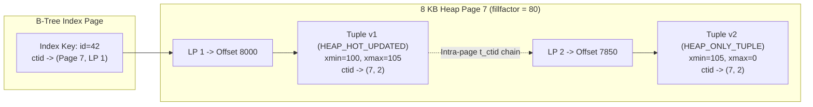
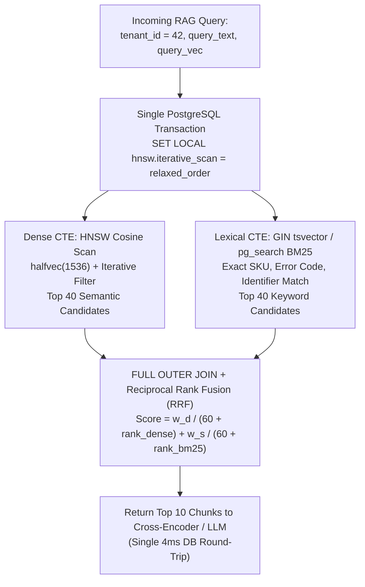

# PostgreSQL Internals & pgvector at Scale

PostgreSQL is the default operational data store—and increasingly the primary hybrid vector store—for modern backend platforms. Yet engineers trained on MySQL/InnoDB or DynamoDB frequently hit catastrophic PostgreSQL production cliffs because Postgres implements Multi-Version Concurrency Control (MVCC) via **append-only heap tuple versions** rather than an undo log. Every `UPDATE` is physically an `INSERT` plus a tombstoned old tuple. Understanding that single design choice unlocks everything from HOT updates and XID wraparound prevention to WAL write amplification, PgBouncer transaction pooling, and `pgvector` HNSW tuning.

> **Navigation**: [00-README.md](00-README.md) | Next: [02-DISTRIBUTED-CONSISTENCY-OUTBOX-SAGA.md](02-DISTRIBUTED-CONSISTENCY-OUTBOX-SAGA.md)

---

## 1. 8 KB Heap Page Layout & Tuple Anatomy

PostgreSQL stores table data ("heap" relations) as an array of fixed **8,192-byte (`8 KB`) pages** (`BLCKSZ`) inside segment files capped at `1 GB` each.

Inside every 8 KB heap page:
1. **`PageHeaderData` (24 bytes, offsets `0..23`)**: Tracks the page LSN (`pd_lsn`, the latest WAL byte offset modifying this page—critical for crash recovery and Full-Page Writes), `pd_checksum`, `pd_lower` (end of line pointers), and `pd_upper` (start of tuple data).
2. **`ItemIdData` Array ("Line Pointers", 4 bytes each)**: Grows **downward** from byte `24` toward `pd_lower`. Indexes (`B-tree`, `GIN`, `HNSW`) never point directly to a tuple's byte offset; they store a 6-byte `ctid = (block_number, line_pointer_index)`. That indirection allows Postgres to compact and defragment tuples inside a page without invalidating external index entries.
3. **Free Space ("Unallocated Hole")**: The region between `pd_lower` and `pd_upper`.
4. **`HeapTupleHeaderData` + User Attributes**: Grow **upward** from the bottom of the page (`8192`) toward `pd_upper`.
5. **Special Space**: Empty for ordinary heap pages; stores sibling pointers and metadata in B-tree/HNSW index pages.

### Tuple Header & "Column Tetris" Alignment
Every single row in PostgreSQL carries a **23-byte `HeapTupleHeaderData`** padded to **24 bytes** (`MAXALIGN = 8` on 64-bit CPUs), plus an optional null bitmap if any column is `NULL`:
- `t_xmin` (4 bytes): XID of the `INSERT` (or `UPDATE` new version) transaction.
- `t_xmax` (4 bytes): `0` if live, or XID of the `DELETE` / `UPDATE` (old version) / row-lock (`MultiXactId`).
- `t_cid` (4 bytes): Command ID (`cmin`/`cmax`) within the same transaction.
- `t_ctid` (6 bytes): Points to `(block, offset)` of itself—or to the **newer tuple version** after an `UPDATE`.
- `t_infomask2` & `t_infomask` (4 bytes): Visibility hint bits, HOT flags, null bitmap flag, and attribute count.
- `t_hoff` (1 byte): Header length including alignment padding.

CPU architectures require natural memory alignment (`bigint`/`float8`/`timestamptz`/`uuid`-aligned-8 = 8 bytes; `int4`/`float4` = 4 bytes; `int2` = 2 bytes; `boolean` = 1 byte). Alternating 1-byte and 8-byte columns wastes 7 padding bytes per pair:

```sql
-- BAD SCHEMA: 48 bytes of user payload per row due to alignment padding holes
CREATE TABLE events_bloated (
    is_processed boolean,       -- 1 byte + 7 bytes padding!
    created_at   timestamptz,   -- 8 bytes
    status_code  smallint,      -- 2 bytes + 6 bytes padding!
    account_id   bigint,        -- 8 bytes
    retry_count  smallint,      -- 2 bytes + 6 bytes padding!
    org_id       bigint         -- 8 bytes
);

-- OPTIMIZED ("Column Tetris"): Order fixed-width columns 8B -> 4B -> 2B -> 1B -> variable (text/jsonb)
-- Saves 18 bytes/row (25%+ heap & shared_buffers reduction across 500M rows = ~9 GB saved)
CREATE TABLE events_compact (
    created_at   timestamptz NOT NULL, -- 8 bytes
    account_id   bigint      NOT NULL, -- 8 bytes
    org_id       bigint      NOT NULL, -- 8 bytes
    status_code  smallint    NOT NULL, -- 2 bytes
    retry_count  smallint    NOT NULL, -- 2 bytes
    is_processed boolean     NOT NULL  -- 1 byte + 3 bytes tail pad = 32 bytes total
);
```

> **TOAST (The Oversized-Attribute Storage Technique)**: Because a tuple cannot span multiple 8 KB pages, whenever a row exceeds ~`2,000 bytes` (`TOAST_TUPLE_THRESHOLD`), PostgreSQL transparently compresses (`pglz` or `lz4`—always set `default_toast_compression = lz4` in PG 14+) and slices variable-length attributes (`jsonb`, `text`, `vector`) into 2 KB chunks in a shadow `pg_toast` table.

---

## 2. MVCC Visibility, Hint Bits & HOT Updates

### Snapshot Visibility & Why `SELECT` Writes to Disk
When a query starts (under `READ COMMITTED`, per statement; under `REPEATABLE READ` / `SERIALIZABLE`, at first statement of transaction), Postgres builds a `SnapshotData` struct from the shared-memory `ProcArray`:
- `xmin`: Lowest still-running XID. Any XID `< xmin` is finished.
- `xmax`: Next unassigned XID (`latestCompletedXid + 1`). Any XID `>= xmax` started after our snapshot and is invisible.
- `xip[]`: Array of in-progress XIDs between `xmin` and `xmax` at snapshot creation time.

To determine whether a tuple's `t_xmin` actually committed or aborted, Postgres checks `pg_xact` (formerly CLOG). Looking up `pg_xact` on every row scan would destroy CPU cache throughput. Therefore, the **first reader** to verify a tuple's commit status sets **Hint Bits** (`HEAP_XMIN_COMMITTED` or `HEAP_XMIN_INVALID`) directly inside the tuple's `t_infomask` and marks the 8 KB buffer **dirty**!
- **Production Surprise**: Running `SELECT COUNT(*) FROM orders` right after a bulk `COPY` or batch insert triggers massive background disk write I/O (`Checkpointer` / `BgWriter` flushing hint-bit-dirtied pages). Run `VACUUM (FREEZE)` or `VACUUM` immediately after bulk loads so user `SELECT` traffic doesn't pay the hint-bit write tax.

### Cold Updates vs. HOT (Heap-Only Tuple) Updates
In a **Cold Update**, inserting a new tuple version on a different page (or modifying *any* indexed column) forces PostgreSQL to insert a brand-new entry into **every index on the table**—even if 9 out of 10 indexed columns did not change! That index write amplification kills throughput and bloats B-tree/HNSW indexes.

PostgreSQL avoids this via **HOT (Heap-Only Tuple) Updates** when **both** conditions hold:
1. **Zero indexed columns are modified** by the `UPDATE` (even partial index predicate columns count!).
2. **The new tuple version fits inside the exact same 8 KB heap page** as the old tuple version.



With HOT:
- None of the table's indexes are touched. The index still points to `LP 1`, and readers follow the short intra-page `t_ctid` chain to `LP 2`.
- Better yet, **Single-Page Defragmentation (`heap_page_prune`)** reclaims dead HOT tuples *on the fly* during ordinary `SELECT` or `UPDATE` access to that page, turning `LP 1` into a `LP_REDIRECT` pointer without waiting for `autovacuum`!

```sql
-- Leave 20% headroom on every 8 KB page for high-churn mutable tables
ALTER TABLE user_sessions SET (fillfactor = 80);

-- Monitor live HOT update ratio (target > 90% on high-frequency status/heartbeat tables)
SELECT
    relname,
    n_tup_upd,
    n_tup_hot_upd,
    ROUND(100.0 * n_tup_hot_upd / NULLIF(n_tup_upd, 0), 2) AS hot_update_pct,
    n_dead_tup
FROM pg_stat_user_tables
WHERE n_tup_upd > 1000
ORDER BY n_tup_upd DESC;
```

---

## 3. XID Wraparound & High-Throughput Autovacuum Tuning

PostgreSQL transaction IDs (`TransactionId`) are **32-bit unsigned integers** (`0` to `4,294,967,295`; `0..2` are reserved). Postgres compares XIDs using **modulo-$2^{32}$ circular arithmetic**: for any current XID, the preceding $2^{31}$ (`~2.147 billion`) XIDs are in the **past** (visible), and the following $2^{31}$ XIDs are in the **future** (invisible).

If an old live row created at `xmin = 100` is still unfrozen when the cluster counter advances past $100 + 2^{31}$, that committed row crosses the modular horizon into the "future" and **instantly vanishes from all query results** (catastrophic silent data loss). To prevent this:
1. **`VACUUM FREEZE`** scans pages using the **Visibility Map (`_vm`)** and sets `HEAP_XMIN_FROZEN` (`HEAP_XMIN_COMMITTED | HEAP_XMIN_INVALID`), making the tuple permanently visible regardless of future XID rollover.
2. When `age(datfrozenxid)` exceeds `autovacuum_freeze_max_age` (default `200,000,000`), Postgres launches non-cancellable anti-wraparound autovacuum workers.
3. At `~3,000,000` XIDs remaining before $2^{31}$ (`xidStopLimit`), **PostgreSQL refuses all write commands globally**, forcing an outage until `VACUUM FREEZE` completes.

### The 4 Classic `OldestXmin` Blockers
Even if 32 autovacuum workers run at max I/O, they **cannot** clean or freeze dead tuples newer than the global `OldestXmin` horizon. Always alert on all four blockers:
1. **Orphaned Replication Slots**: A crashed Debezium connector or dropped read replica whose slot stays `active = false` freezes `catalog_xmin` / `xmin` indefinitely (and fills disk with retained WAL). Fix: set `max_slot_wal_keep_size = '50GB'` (PG 13+).
2. **`IDLE IN TRANSACTION` Sessions**: An application starts `BEGIN; SELECT ...` and calls a hung external LLM/payment API before `COMMIT`. Fix: enforce `idle_in_transaction_session_timeout = '10s'`.
3. **Long-Running Analytical Queries on Primary (or Standby with `hot_standby_feedback = on`)**: A 6-hour BI query holds back `backend_xmin` across the entire OLTP primary! Route analytics to a replica with `hot_standby_feedback = off` or `max_standby_streaming_delay`.
4. **Forgotten Prepared XA Transactions (`pg_prepared_xacts`)**: Orphaned `PREPARE TRANSACTION` entries survive crashes and permanently pin `OldestXmin` until `ROLLBACK PREPARED`.

### Production Autovacuum Configuration (`postgresql.conf` + Per-Table)
Postgres defaults (`scale_factor = 0.20`, `cost_limit = 200`) were designed for spinning HDDs: on a 100M-row table, `0.20` waits until **20,000,000 dead tuples** accumulate before vacuuming!

```ini
# postgresql.conf — Baseline for NVMe Gen4/Gen5 OLTP Primary (32+ vCPU)
autovacuum_max_workers = 6
autovacuum_naptime = 10s
autovacuum_vacuum_cost_delay = 2ms       # Default 2ms in PG12+, keep low
autovacuum_vacuum_cost_limit = 4000      # 20x default (200) so NVMe throughput isn't throttled
autovacuum_work_mem = 1GB                # Avoid multi-pass index vacuum scans (PG17 uses TidStore!)
autovacuum_vacuum_scale_factor = 0.05
autovacuum_analyze_scale_factor = 0.02
idle_in_transaction_session_timeout = 15s
max_slot_wal_keep_size = 64GB
```

For ultra-hot tables (`> 50M` rows), override scale factor with a fixed tuple threshold:

```sql
ALTER TABLE ledger_accounts SET (
    autovacuum_vacuum_scale_factor = 0.0,
    autovacuum_vacuum_threshold = 200000,   -- Trigger every 200k dead tuples deterministically
    autovacuum_vacuum_cost_limit = 8000
);

-- Diagnostic Query: XID Wraparound Proximity + Blocker Audit
SELECT
    datname,
    age(datfrozenxid) AS xid_age,
    ROUND(100.0 * age(datfrozenxid) / 2000000000.0, 2) AS pct_to_emergency_stop
FROM pg_database
ORDER BY xid_age DESC;
```

---

## 4. Write-Ahead Log (WAL), Torn Pages & Checkpointer Tuning

Every mutation writes an append-only `XLogRecord` to the in-memory `WAL Buffers` before modifying the cached 8 KB page in `shared_buffers`. On `COMMIT`, `XLogFlush()` issues `fdatasync()` up to the transaction's commit LSN.

### Why Checkpoints Trigger Massive Write Spikes (`full_page_writes`)
Linux filesystems (`ext4`, `xfs`) write in `4 KB` blocks, whereas Postgres pages are `8 KB`. If power fails mid-flush of a dirty heap page, disk can contain `4 KB` of new bytes and `4 KB` of old bytes—a **Torn Page** that byte-level WAL deltas cannot replay cleanly.

Therefore, with `full_page_writes = on` (mandatory unless on ZFS or battery-backed atomic storage), the **very first modification to any 8 KB page after a `CHECKPOINT` writes the entire 8 KB page image (FPI) into the WAL**! If checkpoints trigger every 90 seconds because `max_wal_size` is left at the `1 GB` default, Postgres enters a perpetual FPI write-amplification storm (`5x–10x` normal WAL volume).

```ini
# postgresql.conf — Smooth Checkpointing & WAL Compression
checkpoint_timeout = 20min               # Space out FPI bursts (default 5min is too aggressive)
max_wal_size = 32GB                      # Prevent forced "xlog" checkpoints before 20min timer
min_wal_size = 8GB                       # Recycle WAL segment files instead of unlinking/reallocating
checkpoint_completion_target = 0.9       # Spread dirty buffer writes smoothly over 18 of the 20 mins
wal_compression = zstd                   # PG 15+: Shrinks 8 KB Full-Page Images by 60-75% for minimal CPU!
wal_buffers = 64MB
```

> **Selective Durability (`SET LOCAL synchronous_commit = off`)**: For non-financial telemetry, heartbeats, or clickstreams, executing `SET LOCAL synchronous_commit = off` inside just those transactions skips the per-commit `fsync` wait while preserving **100% crash consistency** (zero database corruption; at most the last `~600 ms` (`3 * wal_writer_delay`) of async transactions are lost on OS kernel panic).

---

## 5. PgBouncer Transaction Pooling & Prepared Statement Pitfalls

Each direct PostgreSQL connection forks a dedicated OS process (`postgres` backend) consuming `5–12 MB` of private memory (`work_mem`, catalog caches) and lengthening `GetSnapshotData()` contention across `ProcArray`. Beyond `300–500` active backends, throughput collapses due to kernel scheduler and spinlock contention.

**PgBouncer in `pool_mode = transaction`** assigns a Postgres backend to a client *only* between `BEGIN` and `COMMIT`/`ROLLBACK`, multiplexing `10,000` app sockets onto `100` server processes. However, **any session-scoped state breaks or leaks across tenants**!

| PostgreSQL Feature | Why It Fails Under `pool_mode = transaction` | Safe Production Replacement |
| :--- | :--- | :--- |
| **Protocol Prepared Statements** (`PARSE` / `BIND`) | Statement `stmt_1` is prepared on Backend #4; next query lands on Backend #19 (`prepared statement does not exist`) or collides (`already exists`). | Enable PgBouncer `1.21+` **`max_prepared_statements = 200`** (rewrites & tracks statement IDs per backend!) OR disable client-side auto-prepare (`pgx.QueryExecModeSimpleProtocol` / `prepareThreshold=0`). |
| **`SET role` / `SET app.tenant_id`** (RLS) | Session GUC persists on Backend #4 after `COMMIT` -> **critical cross-tenant Row-Level Security data leak**! | Always use **`SET LOCAL app.tenant_id = 'org_99'`** inside an explicit `BEGIN ... COMMIT` block (automatically resets at transaction end). |
| **Session Advisory Locks** (`pg_advisory_lock`) | Lock stays held on Backend #4 after client releases connection back to pool; deadlocks random future requests. | Use transaction-scoped **`pg_advisory_xact_lock(key)`** exclusively. |
| **`LISTEN / NOTIFY` & `CREATE TEMP TABLE`** | Requires pinned session socket across transactions. | Connect a separate small secondary pool directly to Postgres (or a PgBouncer pool configured with `pool_mode = session`). |

---

## 6. `pgvector` at Scale: HNSW, DiskANN, Iterative Scans & Hybrid RRF

For corpus sizes up to `50M–100M` vectors, PostgreSQL with `pgvector` (`0.7+` / `0.8+`) and `pgvectorscale` eliminates the operational dual-write complexity of running a separate vector database—*provided* you size RAM and handle filtered vector scans properly.

### Vector Index Architecture & Memory Math

| Index Engine | Graph / Structure | Memory Footprint (10M x 1536d) | Recall@10 | QPS (32 vCPU) | Dynamic Writes & Best Fit |
| :--- | :--- | :--- | :--- | :--- | :--- |
| **`pgvector` IVFFlat** | K-means centroids + inverted posting lists | `~31 GB` (`halfvec`) / `~62 GB` (`vector`) | `0.85 - 0.93` | Medium | Requires periodic rebuild as data distribution drifts; fast build time, inferior recall/latency vs HNSW. |
| **`pgvector` HNSW** (`halfvec_cosine_ops`) | Multi-layer navigable small-world proximity graph | `~35 GB` (`halfvec` FP16, `m=16`) | `0.97 - 0.99` | High (`800 - 2,500`) | Handles incremental inserts/deletes cleanly without retraining; **graph must fit in RAM** (`shared_buffers` + OS page cache) for low latency. |
| **`pgvector` Binary Quantized HNSW** (`bit(1536)`) | Hamming distance on 1-bit sign vectors + exact FP16 re-rank | `~4.8 GB` graph in RAM (`~7x` smaller!) | `0.95 - 0.98` (with `4x` oversampling re-rank) | Very High | High-dimensional models (`1536d–3072d` OpenAI/Voyage/Cohere) where DRAM budget is tight. |
| **`pgvectorscale` StreamingDiskANN** | Vamana SSD-resident graph + Statistical Binary Quantization (SBQ) | `~3 - 5 GB` RAM + NVMe SSD | `0.97 - 0.99` | High on local NVMe | `50M - 500M+` vectors where holding HNSW in DRAM costs thousands of USD/month; requires fast local NVMe (`i4i` / `i7ie`), not high-latency network EBS. |

Estimate **`pgvector` HNSW RAM** for $N$ vectors of dimension $d$, element size $b$ bytes (`4` for `vector`, `2` for `halfvec`, `0.125` for `bit`), and graph parameter $M$ (default `16`):

$$\text{Bytes}_{\text{HNSW}} \approx N \times \left(d \times b + 2.2 \times M \times 8 + 56\right) \times 1.15$$

*Concrete check*: For $N = 10{,}000{,}000$, $d = 1536$, **`halfvec` ($b = 2$)** (`< 0.3%` recall difference vs FP32!), $M = 16$:
$$10^7 \times (3072 + 281.6 + 56) \times 1.15 \approx 39.2\text{ GB}$$
Switching from `vector(1536)` (`~74.5 GB`) to `halfvec(1536)` cuts index memory nearly **in half** with virtually identical semantic recall. Always set `maintenance_work_mem = '8GB'` (or higher than index size during `CREATE INDEX CONCURRENTLY`) and `max_parallel_maintenance_workers = 7` so HNSW graph construction builds in memory instead of thrashing disk `10x` slower.

### The Selective Filter Trap & `pgvector 0.8+` Iterative Scans
In naive `pgvector < 0.8.0`, an HNSW index scan fetched at most `hnsw.ef_search` (default `40`) nearest neighbors globally and applied `WHERE tenant_id = 42` *afterward* (post-filtering). If `tenant_id = 42` owns `0.2%` of the table, `40 * 0.002 = 0.08` rows survive—**returning `0` or `1` result even when `LIMIT 10` matching documents exist!** And if the planner switches to a B-tree scan on `tenant_id` with exact distance sorting, latency explodes when a large tenant owns `200,000` chunks.

**Three-Tier Solution for Multi-Tenant Filtered Vector Search**:
1. **Enable Iterative HNSW Scans (`pgvector 0.8.0+`)**: Setting `SET LOCAL hnsw.iterative_scan = relaxed_order` instructs HNSW to keep expanding graph neighborhoods in batches until `LIMIT k` rows satisfy the `WHERE` filter (up to `hnsw.max_scan_tuples`, default `20,000`). `relaxed_order` allows slight local rank inversions for dramatically better throughput and `> 0.98` recall; wrap in an outer CTE re-sort if exact ordering among the top $k$ is desired.
2. **List/Hash Partitioning by Tenant Tier**: Hash-partition `document_chunks` into `32` or `64` partitions by `tenant_id` (and give "whale" enterprise tenants dedicated list partitions), each with its own local HNSW index.
3. **Partial Indexes for Low-Cardinality Flags**: e.g., `CREATE INDEX ... USING hnsw ((embedding::halfvec(1536)) halfvec_cosine_ops) WHERE is_archived = false;`.



### Production SQL: Hybrid Search (Dense HNSW + Lexical BM25/FTS) via RRF
Dense embeddings miss exact part numbers (`ERR_SSL_VERSION_OR_CIPHER_MISMATCH`, `CVE-2026-4102`), while lexical search misses semantic paraphrases. **Reciprocal Rank Fusion (RRF)** merges both rank lists without brittle score normalization because it depends only on ordinal rank ($k = 60$ damps outliers):

$$\text{RRF}(d) = \frac{w_{\text{dense}}}{k + \text{rank}_{\text{dense}}(d)} + \frac{w_{\text{lexical}}}{k + \text{rank}_{\text{lexical}}(d)}$$

```sql
-- Schema with halfvec(1536) HNSW + generated tsvector GIN index
CREATE TABLE rag_chunks (
    chunk_id    bigint GENERATED ALWAYS AS IDENTITY PRIMARY KEY,
    tenant_id   bigint NOT NULL,
    doc_id      bigint NOT NULL,
    content     text   NOT NULL,
    embedding   halfvec(1536) NOT NULL,
    fts_tokens  tsvector GENERATED ALWAYS AS (to_tsvector('english', content)) STORED
);

CREATE INDEX CONCURRENTLY idx_rag_chunks_hnsw
    ON rag_chunks USING hnsw (embedding halfvec_cosine_ops)
    WITH (m = 16, ef_construction = 128);

CREATE INDEX CONCURRENTLY idx_rag_chunks_fts
    ON rag_chunks USING gin (fts_tokens);

CREATE INDEX CONCURRENTLY idx_rag_chunks_tenant
    ON rag_chunks (tenant_id);

-- Execute inside transaction (safe with PgBouncer transaction mode via SET LOCAL)
BEGIN;
SET LOCAL hnsw.ef_search = 80;
SET LOCAL hnsw.iterative_scan = relaxed_order;
SET LOCAL hnsw.max_scan_tuples = 25000;

WITH dense_candidates AS (
    -- Materialize & re-order relaxed iterative scan candidates for exact cosine ranking
    SELECT
        chunk_id,
        ROW_NUMBER() OVER (ORDER BY distance ASC) AS rank_dense
    FROM (
        SELECT chunk_id, (embedding <=> $1::halfvec(1536)) AS distance
        FROM rag_chunks
        WHERE tenant_id = $2
        ORDER BY embedding <=> $1::halfvec(1536)
        LIMIT 40
    ) raw_hnsw
),
lexical_candidates AS (
    -- For true Okapi BM25 at scale, swap ts_rank_cd with ParadeDB pg_search `@@@` operator
    SELECT
        chunk_id,
        ROW_NUMBER() OVER (
            ORDER BY ts_rank_cd(fts_tokens, websearch_to_tsquery('english', $3)) DESC
        ) AS rank_lexical
    FROM rag_chunks
    WHERE tenant_id = $2
      AND fts_tokens @@ websearch_to_tsquery('english', $3)
    ORDER BY ts_rank_cd(fts_tokens, websearch_to_tsquery('english', $3)) DESC
    LIMIT 40
),
rrf_fused AS (
    SELECT
        COALESCE(d.chunk_id, l.chunk_id) AS chunk_id,
        COALESCE(0.65 / (60 + d.rank_dense), 0.0) +
        COALESCE(0.35 / (60 + l.rank_lexical), 0.0) AS rrf_score,
        d.rank_dense,
        l.rank_lexical
    FROM dense_candidates d
    FULL OUTER JOIN lexical_candidates l USING (chunk_id)
    ORDER BY rrf_score DESC
    LIMIT 10
)
SELECT
    c.chunk_id,
    c.doc_id,
    c.content,
    f.rrf_score,
    f.rank_dense,
    f.rank_lexical
FROM rrf_fused f
JOIN rag_chunks c USING (chunk_id)
ORDER BY f.rrf_score DESC;

COMMIT;
```

---

## 7. Failure Modes & Production Pitfalls Summary

1. **`CREATE INDEX` Without `CONCURRENTLY`**: Acquires a `SHARE` lock blocking **all `INSERT`/`UPDATE`/`DELETE`** traffic for minutes or hours. Always run `CREATE INDEX CONCURRENTLY`, and monitor failed `INVALID` indexes (`pg_index.indisvalid = false`) which still slow down writes while serving zero reads!
2. **Adding Column with Volatile Default or `ALTER COLUMN TYPE`**: In PG 11+, `ADD COLUMN foo text DEFAULT 'bar'` is instant metadata-only, *unless* the expression is volatile (e.g., `clock_timestamp()`). Changing column types (`int4` -> `int8`) still **rewrites the entire table** under an `ACCESS EXCLUSIVE` lock; use expand-and-contract dual columns + trigger instead.
3. **Subtransactions (`SAVEPOINT` / `EXCEPTION WHEN ...` in PL/pgSQL loops)**: Nesting more than `64` subtransactions per backend overflows the `PGPROC` `subxids` cache (`PGPROC_MAX_CACHED_SUBXIDS = 64`), causing global `SubtransSLRU` LWLock contention that brings 64-core RDS primaries to `100%` wait lock freeze—the infamous GitLab/Postgres subtransaction outage pattern. Never wrap high-QPS OLTP loops in `SAVEPOINT` (which Django `atomic()` nests silently!).
