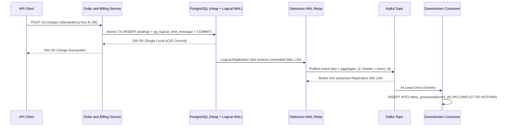
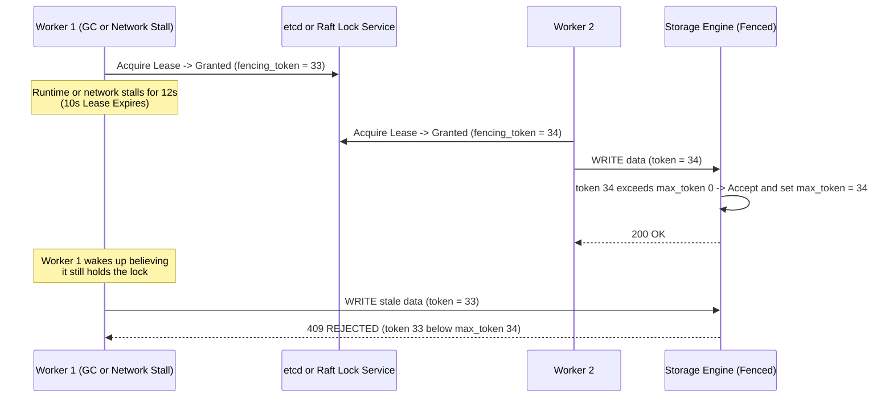

# Bulletproof Distributed Consistency, Financial Ledgers & Idempotency

In distributed billing, AI credit metering, marketplace payouts, and order fulfillment, "99.99% accurate" means silently losing or fabricating money every single day. The hardest bugs in distributed systems do not come from full node crashes—they come from **partial failures, GC/network pauses, client timeouts with blind retries, and concurrent race conditions**. This guide provides production-ready schemas, concurrency protocols, and Go/SQL implementations for building zero-drift state machines.

> **Navigation**: [00-README.md](00-README.md) | Prev: [01-POSTGRESQL-MVCC-WAL-AND-PGVECTOR.md](01-POSTGRESQL-MVCC-WAL-AND-PGVECTOR.md) | Next: [03-GO-PYTHON-RUNTIME-PROFILING-EBPF.md](03-GO-PYTHON-RUNTIME-PROFILING-EBPF.md)

---

## 1. Double-Entry Immutable Ledger Schema for Billing & Wallets

Never build a wallet, AI token credit system, or payment ledger around `UPDATE wallets SET balance = balance - 500 WHERE user_id = 42`. In-place balance mutation fails every serious engineering and financial invariant:
1. **Zero Audit Trail**: When a customer disputes a balance discrepancy, there is no mathematical chain proving how the current number was derived.
2. **Silent Money Creation/Destruction**: Updating one user's row without symmetrically crediting/debiting a counterparty (platform revenue, escrow, Stripe clearing account) hides partial-update bugs.
3. **IEEE-754 Float Corruption**: Storing `0.10 + 0.20` in `FLOAT` / `DOUBLE PRECISION` yields `0.30000000000000004`. Store all monetary and token quantities as **signed 64-bit integer minor units** (`BIGINT`: cents for USD, micro-dollars $10^{-6}$ for LLM token billing) or fixed-point `NUMERIC(28, 8)`.

### The Double-Entry Accounting Invariant
Every financial event is recorded as an **immutable `journal_entry`** containing two or more **`ledger_postings`** whose signed amounts sum strictly to zero across the same currency:

$$\sum_{i=1}^{k} \text{posting\_amount}_i = 0$$

Money is never created out of thin air; when a user deposits USD 50.00 (`5000` cents), the `stripe_clearing` asset account changes by `-5000` (or debit/credit convention) and `user_wallet:42` liability account changes by `+5000`.

### Production PostgreSQL Schema & Deadlock-Free Transfer
To give reads $O(1)$ latency without summing millions of historical postings on every request, materialize `posted_balance` and `pending_balance` on `ledger_accounts` **only inside the exact same ACID transaction** that inserts the immutable `ledger_postings`.

```sql
CREATE TYPE account_category AS ENUM ('ASSET', 'LIABILITY', 'EQUITY', 'REVENUE', 'EXPENSE');

CREATE TABLE ledger_accounts (
    account_id      bigint GENERATED ALWAYS AS IDENTITY PRIMARY KEY,
    external_key    text NOT NULL UNIQUE,           -- e.g. 'wallet:user_42:usd', 'rev:llm_tokens:usd'
    currency        char(3) NOT NULL,               -- ISO-4217 'USD' or 'TOK'
    category        account_category NOT NULL,
    allow_negative  boolean NOT NULL DEFAULT false, -- true ONLY for external clearing/omnibus accounts
    posted_balance  bigint  NOT NULL DEFAULT 0,     -- Signed minor units (e.g. micro-USD)
    pending_balance bigint  NOT NULL DEFAULT 0,     -- In-flight holds / authorizations
    version         bigint  NOT NULL DEFAULT 0,
    created_at      timestamptz NOT NULL DEFAULT now(),
    CONSTRAINT chk_non_negative_balance CHECK (
        allow_negative OR (posted_balance - pending_balance >= 0)
    )
);

CREATE TABLE journal_entries (
    entry_id        bigint GENERATED ALWAYS AS IDENTITY PRIMARY KEY,
    idempotency_key text NOT NULL UNIQUE,           -- Prevents duplicate financial execution
    reference_type  text NOT NULL,                  -- 'INVOICE_CHARGE', 'TOP_UP', 'REFUND'
    reference_id    text NOT NULL,
    metadata        jsonb NOT NULL DEFAULT '{}'::jsonb,
    created_at      timestamptz NOT NULL DEFAULT now()
);

CREATE TABLE ledger_postings (
    posting_id      bigint GENERATED ALWAYS AS IDENTITY PRIMARY KEY,
    entry_id        bigint NOT NULL REFERENCES journal_entries(entry_id),
    account_id      bigint NOT NULL REFERENCES ledger_accounts(account_id),
    amount          bigint NOT NULL CHECK (amount <> 0), -- Signed: -debit / +credit
    running_balance bigint NOT NULL,                     -- Exact post-tx snapshot for instant audit
    created_at      timestamptz NOT NULL DEFAULT now()
);

CREATE INDEX idx_postings_account_created ON ledger_postings (account_id, posting_id DESC);
```

### Deadlock-Proof Multi-Account Atomic Transfer
If Transaction 1 transfers `Account 10 -> Account 20` (locking `10`, then `20`) while Transaction 2 transfers `Account 20 -> Account 10` (locking `20`, then `10`), PostgreSQL hits a classic **AB-BA cycle deadlock**.
- **Rule**: Always acquire row locks in **deterministic canonical order** (`ORDER BY account_id ASC`) using **`FOR NO KEY UPDATE`** (lighter than `FOR UPDATE` because we never modify `account_id`, avoiding unnecessary foreign-key lock contention on child `ledger_postings` inserts!).

```sql
-- Atomic idempotent transfer of 2500 minor units from $2 (sender) to $3 (receiver), key = $1
BEGIN;

-- Step 1: Acquire row locks in strict ascending account_id order (zero AB-BA deadlocks!)
SELECT account_id, posted_balance, pending_balance, allow_negative
FROM ledger_accounts
WHERE account_id IN ($2, $3)
ORDER BY account_id ASC
FOR NO KEY UPDATE;

-- Step 2: Insert journal_entry (fails immediately on UNIQUE idempotency_key if duplicate)
WITH new_entry AS (
    INSERT INTO journal_entries (idempotency_key, reference_type, reference_id)
    VALUES ($1, 'USAGE_DEDUCTION', $4)
    RETURNING entry_id
),
updated_accounts AS (
    -- CHECK constraint chk_non_negative_balance automatically aborts tx if insufficient funds!
    UPDATE ledger_accounts
    SET posted_balance = posted_balance + CASE
            WHEN account_id = $2 THEN -$5::bigint
            WHEN account_id = $3 THEN +$5::bigint
        END,
        version = version + 1
    WHERE account_id IN ($2, $3)
    RETURNING account_id, posted_balance
)
INSERT INTO ledger_postings (entry_id, account_id, amount, running_balance)
SELECT
    ne.entry_id,
    ua.account_id,
    CASE WHEN ua.account_id = $2 THEN -$5::bigint ELSE +$5::bigint END,
    ua.posted_balance
FROM new_entry ne
CROSS JOIN updated_accounts ua;

COMMIT;
```

> **Solving Hot-Account Contention (`> 2,000 TPS` on Platform Revenue Account)**: Every user deduction credits the same `rev:llm_tokens:usd` row, turning that single row lock into a serialization bottleneck (`L = 1`). **Fix**: Split hot omnibus/revenue accounts into $K = 32$ **sharded sub-accounts** (`rev:llm_tokens:usd#00` .. `#31`), routing each transaction to shard `hashtext(idempotency_key) & 31`. Total platform revenue is simply `SUM(posted_balance) WHERE external_key LIKE 'rev:llm_tokens:usd#%'`, raising throughput `32x` linearly!

---

## 2. Concurrency Control: Pessimistic Locks vs. Optimistic CAS vs. `SKIP LOCKED`

Choosing the wrong concurrency primitive either serializes unrelated traffic or triggers retry storms under contention.

| Mechanism | SQL Idiom | Contention Profile | Best Production Use Case | Fatal Pitfall |
| :--- | :--- | :--- | :--- | :--- |
| **`FOR NO KEY UPDATE`** | `SELECT ... FOR NO KEY UPDATE` | Medium–High contention on non-PK updates | Wallet transfers, inventory deduction, state machine transitions | Holding lock across external HTTP/RPC call freezes DB connection pool! |
| **`FOR UPDATE`** | `SELECT ... FOR UPDATE` | Updates PK/unique key or `DELETE` | Deleting parent record or mutating primary/unique identifier | Blocks concurrent child table `INSERT`s checking foreign keys (`FOR KEY SHARE`)! |
| **Optimistic CAS** | `UPDATE ... SET val=$1, ver=ver+1 WHERE id=$2 AND ver=$3` | Low contention (`< 5%` collision rate) | Collaborative document metadata, user profile settings, long UI read-modify-write | Under high contention (`50` concurrent writers), `49` fail and retry -> $O(N^2)$ wasted work! |
| **`SKIP LOCKED`** | `SELECT ... FOR UPDATE SKIP LOCKED LIMIT 50` | Parallel worker pool pulling from shared queue | Outbox relay workers, background job queues, ticket/seat allocation pools | Never use for point lookups (`WHERE id = 42`); silently returns `0` rows if locked instead of waiting! |
| **`SERIALIZABLE` (SSI)** | `BEGIN ISOLATION LEVEL SERIALIZABLE` | Complex multi-table read-skew invariants | Schedule conflict prevention, medical/compliance rules | Must wrap every transaction in `40001` (`serialization_failure`) client retry loop. |

### High-Throughput Worker Claim Query (`SKIP LOCKED`)
```sql
-- Atomically claim up to 50 ready jobs across N concurrent worker pods with ZERO lock wait
WITH claimed AS (
    SELECT job_id
    FROM background_jobs
    WHERE status = 'PENDING'
      AND run_after <= now()
    ORDER BY priority DESC, run_after ASC
    FOR UPDATE SKIP LOCKED
    LIMIT 50
)
UPDATE background_jobs j
SET status = 'PROCESSING',
    locked_by = $1,
    locked_until = now() + interval '2 minutes',
    attempts = attempts + 1
FROM claimed c
WHERE j.job_id = c.job_id
RETURNING j.*;
```

---

## 3. Eliminating Dual Writes: Transactional Outbox + Logical WAL CDC

A **Dual Write** occurs whenever an application mutates PostgreSQL and publishes to Kafka/RabbitMQ/SQS without an atomic coordinator:
- **Order A (`DB Commit` -> `Kafka Publish`)**: Process OOMKills or Kafka broker times out 1 ms after `COMMIT`. Database shows order `PAID`; fulfillment service never receives the event.
- **Order B (`Kafka Publish` -> `DB Commit`)**: Kafka acks message; Postgres `COMMIT` fails on constraint/deadlock/network drop. Downstream ships physical goods for an order that never existed in the database ("ghost event").

### The Transactional Outbox + CDC Architecture
Write both the domain state mutation and an `outbox_events` record inside **one local PostgreSQL ACID transaction**, then stream committed WAL changes asynchronously to Kafka.



### Zero-Bloat Outbox Trick: `pg_logical_emit_message` (PostgreSQL 14+)
Standard `outbox_events` tables insert and delete millions of rows per hour, generating heavy MVCC dead-tuple bloat and `autovacuum` pressure (see [01-POSTGRESQL-MVCC-WAL-AND-PGVECTOR.md](01-POSTGRESQL-MVCC-WAL-AND-PGVECTOR.md)).
In PostgreSQL 14+, calling **`SELECT pg_logical_emit_message(true, 'outbox', payload::text)`** inside your `BEGIN ... COMMIT` transaction writes a **transactional message directly into the WAL** without touching any heap table or index!
- If the transaction rolls back, Debezium ignores the WAL message.
- If the transaction commits, Debezium (`pgoutput` plugin) emits the message directly to Kafka with **zero table bloat, zero vacuum overhead, and half the IOPS**.
- *Fallback*: If you do not run logical replication (e.g., restricted environments), use a partitioned `outbox_events` table polled via `FOR UPDATE SKIP LOCKED LIMIT 200` and drop daily partitions (`DROP TABLE outbox_2026_11_24`) instead of running `DELETE`.

---

## 4. Distributed Sagas: Orchestration, Choreography & Isolation Anomalies

Across independent databases or third-party APIs (Stripe, airline GDS, warehouse ERP), Two-Phase Commit (`2PC`/XA) holds locks across network RTTs and turns coordinator failures into global cluster hangs. Use **Sagas**: sequences of local ACID transactions paired with compensating actions.

### Every Saga Has Three Step Types (Order Matters!)
1. **Compensatable Transactions** (run first): Steps that can be cleanly undone via a semantic inverse (`ReserveInventory` $\leftrightarrow$ `ReleaseInventory`, `AuthorizeCard` $\leftrightarrow$ `VoidAuth`).
2. **The Pivot Transaction** (at most **one**, in the middle): The go/no-go commit point (`CapturePayment` or `FinalizeContract`). If the Pivot fails, roll backward; once the Pivot succeeds, the Saga **cannot roll back** and must finish forward!
3. **Retriable Transactions** (run after Pivot): Idempotent steps guaranteed to eventually succeed via exponential backoff (`EmitReceiptEmail`, `ProvisionEntitlements`, `PostAnalytics`).

### Choreography vs. Orchestration

| Criterion | Choreography (Event Pub/Sub) | Orchestration (State Machine / Temporal) |
| :--- | :--- | :--- |
| **Control Flow** | Decentralized: Service A emits `OrderCreated`, B emits `StockReserved`, C emits `CardCharged`. | Centralized: Durable workflow engine (`Temporal`, `Restate`, or Postgres state machine) commands participants via RPC/queues. |
| **Ideal Complexity** | `2 - 3` loosely coupled steps across separate org boundaries. | `4+` steps, branching compensations, timeouts, human-in-the-loop approvals, financial fulfillment. |
| **Cyclic Dependency Risk** | High ("pinball architecture" where nobody knows why an order is stuck at 3 AM). | Low: full Saga execution history, current step, and retry timer live in one inspectable state record. |

### Surviving the "Missing I" in Saga (ACD Without Isolation)
Because Sagas commit local database changes before the global workflow finishes, concurrent transactions can observe intermediate uncommitted workflow state. Guard against all three Saga anomalies:

1. **Lost Updates** (Saga B overwrites an order while Saga A is mid-cancellation):
   - *Countermeasure — Semantic Lock*: Step 1 sets `status = 'APPROVAL_PENDING'` on the domain record. Any concurrent Saga attempting to mutate a row in `*_PENDING` state is rejected or queued until the owning Saga clears the flag.
2. **Dirty Reads** (User spends refunded wallet credit while the original top-up Saga fails and compensates):
   - *Countermeasure — Two-Stage Pending Balance*: Credit `pending_balance` first; promote to spendable `posted_balance` only after the Pivot transaction succeeds.
3. **Premature / Out-of-Order Compensation** (Network delay causes `CancelInventoryReservation` to arrive at the Inventory service *before* the original `ReserveInventory` RPC arrives!):
   - *Countermeasure — Commutative Tombstone*: When `Cancel(saga_id=99)` arrives first and finds no reservation, **do not return `404` and forget it**—insert a row `(saga_id=99, status='CANCELLED')`. When the delayed `Reserve(saga_id=99)` arrives 500 ms later, it hits the existing `CANCELLED` tombstone and immediately returns a safe no-op!

---

## 5. Distributed Locks & Fencing Tokens

Never rely on a TTL-based distributed lock (Redis `SET resource uuid NX PX 10000`, Redlock, or DynamoDB lease) alone for **data correctness**. Lease locks without fencing only optimize efficiency (avoiding duplicate work); they **cannot guarantee mutual exclusion** in asynchronous networks with process pauses.

### The Lease Expiry Race Condition & Monotonic Fencing Solution



To enforce strict correctness:
1. Acquire leases from a **consensus-backed coordinator** (`etcd` lease `ModRevision`, ZooKeeper `zxid`, or a PostgreSQL `BIGSERIAL` / `epoch` table) that returns a **strictly monotonically increasing `fencing_token`**.
2. Pass `fencing_token` on every mutation to the downstream database or object store (`If-Match` / conditional write):
   ```sql
   UPDATE shard_state
   SET payload = $1, last_fencing_token = $2
   WHERE shard_id = $3 AND $2 >= last_fencing_token;
   -- Check rows_affected == 1; if 0, abort immediately as fenced zombie worker!
   ```

---

## 6. End-to-End Payment & Webhook Idempotency State Machine

Network clients cannot distinguish between "request dropped before reaching server" and "server committed charge, response dropped on the way back." Every state-mutating API (`POST /v1/payments`, `POST /v1/transfers`) and inbound webhook consumer must be strictly idempotent.

### Stripe-Grade Idempotency Rules
1. **Payload Hash Verification**: Compute `SHA-256(method + path + canonical_body)`. If a client retries the same `Idempotency-Key` with a *different* amount or recipient, return **`422 Unprocessable Entity`** immediately.
2. **In-Flight Lease (`locked_until`)**: If Client A sends a concurrent duplicate while the first request is still executing (`status = 'IN_PROGRESS'` and `locked_until > now()`), return **`409 Conflict` (`Retry-After: 1`)** rather than running side effects twice. If the first pod crashed (`locked_until <= now()`), allow the retry to steal the expired lease and resume safely!
3. **Selective Error Caching**: Cache deterministic client errors (`400`, `422`) and `2xx` responses for `24–72 hours`. Do **not** permanently lock keys on transient `503` / network timeout errors—transition back to retryable state.

### Production Go + PostgreSQL Atomic Idempotency Executor

```sql
CREATE TABLE idempotency_keys (
    tenant_id       bigint NOT NULL,
    idempotency_key text   NOT NULL,
    request_hash    bytea  NOT NULL,
    status          text   NOT NULL CHECK (status IN ('IN_PROGRESS', 'COMPLETED')),
    locked_until    timestamptz NOT NULL,
    response_code   int,
    response_body   jsonb,
    created_at      timestamptz NOT NULL DEFAULT now(),
    PRIMARY KEY (tenant_id, idempotency_key)
);
```

```go
package idempotency

import (
	"bytes"
	"context"
	"crypto/sha256"
	"errors"
	"time"

	"github.com/jackc/pgx/v5/pgxpool"
)

var (
	ErrPayloadMismatch  = errors.New("idempotency key reused with different request payload")
	ErrRequestInFlight  = errors.New("concurrent request with same idempotency key in flight")
)

type CachedResponse struct {
	StatusCode int
	BodyJSON   []byte
}

func ExecuteIdempotent(
	ctx context.Context,
	pool *pgxpool.Pool,
	tenantID int64,
	key string,
	rawPayload []byte,
	leaseTTL time.Duration,
	handler func(ctx context.Context) (CachedResponse, error),
) (CachedResponse, error) {
	sum := sha256.Sum256(rawPayload)
	reqHash := sum[:]

	// Phase 1: Atomically insert IN_PROGRESS or steal an expired crash lease
	var (
		storedHash []byte
		status     string
		respCode   *int
		respBody   []byte
		acquired   bool
	)
	const claimSQL = `
		INSERT INTO idempotency_keys (tenant_id, idempotency_key, request_hash, status, locked_until)
		VALUES ($1, $2, $3, 'IN_PROGRESS', now() + $4::interval)
		ON CONFLICT (tenant_id, idempotency_key) DO UPDATE
		SET locked_until = CASE
		        WHEN idempotency_keys.status = 'IN_PROGRESS' AND idempotency_keys.locked_until <= now()
		             AND idempotency_keys.request_hash = EXCLUDED.request_hash
		        THEN now() + $4::interval
		        ELSE idempotency_keys.locked_until
		    END
		RETURNING
		    request_hash,
		    status,
		    response_code,
		    response_body,
		    (xmax = 0 OR idempotency_keys.locked_until = now() + $4::interval) AS acquired;
	`
	err := pool.QueryRow(ctx, claimSQL, tenantID, key, reqHash, leaseTTL.String()).Scan(
		&storedHash, &status, &respCode, &respBody, &acquired,
	)
	if err != nil {
		return CachedResponse{}, err
	}
	if !bytes.Equal(storedHash, reqHash) {
		return CachedResponse{}, ErrPayloadMismatch // HTTP 422 Unprocessable Entity
	}
	if status == "COMPLETED" && respCode != nil {
		return CachedResponse{StatusCode: *respCode, BodyJSON: respBody}, nil
	}
	if !acquired {
		return CachedResponse{}, ErrRequestInFlight // HTTP 409 Conflict + Retry-After: 1
	}

	// Phase 2: Execute business logic (pass a DB tx if mutating local Postgres state)
	res, execErr := handler(ctx)
	if execErr != nil {
		// Release transient failure lease so client retry can re-attempt immediately
		_, _ = pool.Exec(ctx,
			`DELETE FROM idempotency_keys WHERE tenant_id = $1 AND idempotency_key = $2 AND status = 'IN_PROGRESS'`,
			tenantID, key,
		)
		return CachedResponse{}, execErr
	}

	// Phase 3: Persist canonical response for deterministic replay
	_, err = pool.Exec(ctx, `
		UPDATE idempotency_keys
		SET status = 'COMPLETED', response_code = $3, response_body = $4
		WHERE tenant_id = $1 AND idempotency_key = $2`,
		tenantID, key, res.StatusCode, res.BodyJSON,
	)
	return res, err
}
```

> **Production Refinement on Lease Claiming**: In `claimSQL`, distinguish the original winner from a concurrent duplicate in one expression by adding `RETURNING ..., (xmax = 0 OR idempotency_keys.locked_until = now() + $4::interval) AS acquired` (since `now()` evaluates identically to transaction start `transaction_timestamp()` across the statement!). If `acquired == false` and `status == 'IN_PROGRESS'`, immediately return `ErrRequestInFlight` (`HTTP 409`).

### Inbound Webhook Security & Replay Checklist
1. **Verify Raw Bytes Before JSON Parsing**: Compute `HMAC-SHA256(webhook_secret, timestamp + "." + raw_body)` using constant-time comparison (`hmac.Equal` / `hmac.compare_digest`). Re-serializing parsed JSON breaks whitespace/key-order signatures!
2. **Enforce a `300-second` Timestamp Window**: Reject any webhook whose header timestamp deviates from server NTP clock by `> 5 minutes` to block captured-packet replay attacks, while deduplicating `provider_event_id` in an `inbox_events` primary-key table for at least `7 days`.
