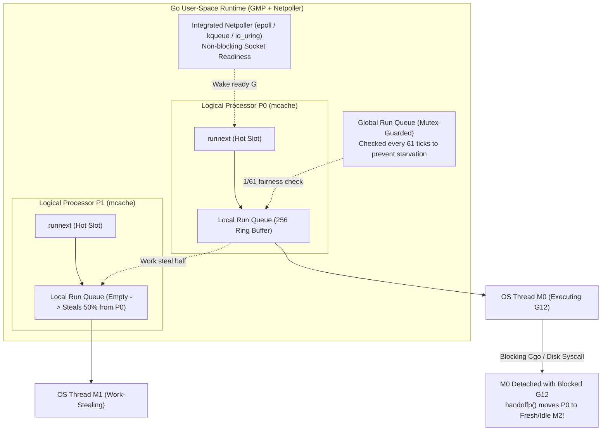
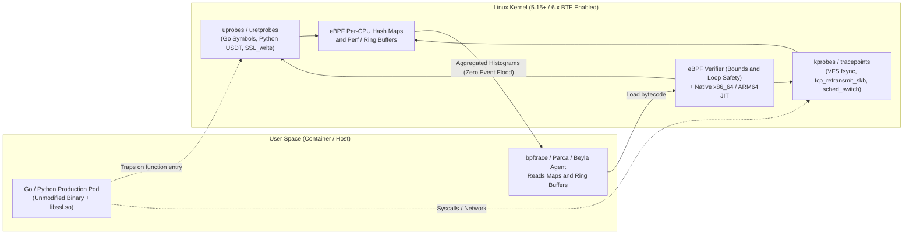

# Go & Python Runtime Internals, Profiling & Linux eBPF

Go and Python dominate modern cloud infrastructure and AI platform backends, yet their runtimes sit at opposite ends of the concurrency and memory spectrum. Go multiplexes lightweight preemptive goroutines over a concurrent tri-color garbage collector; Python historically relied on a single-threaded cooperative `asyncio` loop or multi-process workers under the Global Interpreter Lock (GIL), and in Python `3.13t`/`3.14t` unlocked true free-threaded (`No-GIL`) execution. Mastering both runtimes—and pairing them with zero-instrumentation **Linux eBPF** observability—lets you diagnose p99.9 stalls that leave ordinary application logs completely blind.

> **Navigation**: [00-README.md](00-README.md) | Prev: [02-DISTRIBUTED-CONSISTENCY-OUTBOX-SAGA.md](02-DISTRIBUTED-CONSISTENCY-OUTBOX-SAGA.md) | Next: [04-RUST-FOR-POLYGLOT-INFRA-AND-PYO3.md](04-RUST-FOR-POLYGLOT-INFRA-AND-PYO3.md)

---

## 1. Go GMP Scheduler Internals & Container CFS Throttling

The Go runtime multiplexes $N$ user-space goroutines onto $M$ OS kernel threads across $P$ logical scheduling contexts (`GOMAXPROCS`):
- **`G` (Goroutine)**: Execution stack (starts at just **`2 KB`**, vs `1–8 MB` for an OS `pthread`), instruction pointer, and scheduling status.
- **`M` (Machine)**: Actual OS kernel thread scheduled by Linux CFS/EEVDF.
- **`P` (Processor)**: Logical token required for an `M` to execute Go code. Holds a lock-free `256`-slot local run queue (`runq`), a single high-priority `runnext` slot (for newly woken channel/RPC peers to preserve CPU cache locality), and a thread-local allocator cache (`mcache`).



### Key Scheduler Invariants in Production
1. **Work-Stealing & The `schedtick % 61 == 0` Rule**: If `P0` always checked `runnext` and its local `runq` first, two ping-ponging goroutines could starve the Global Run Queue forever. Every **`61` scheduling ticks** (chosen as a prime number to avoid harmonic collisions with power-of-two loops), `findrunnable()` checks the Global Run Queue *before* the local queue. When a `P`'s local queue empties, it checks the global queue, polls `netpoll`, and finally steals **half** of a randomly chosen peer `P`'s local `runq`.
2. **Non-Blocking Netpoller vs. Blocking Syscalls**: Network sockets in Go are registered non-blocking with Linux `epoll`. Waiting on an HTTP/Postgres socket parks only `G` (`gopark`); `M` and `P` immediately run the next goroutine with **zero OS context switch**. By contrast, synchronous disk file I/O (unless `io_uring`), `cgo` calls, or blocking syscalls block the underlying `M` thread—forcing `entersyscall` / `sysmon` (`handoffp`) to detach `P` onto another OS thread.
3. **Asynchronous Signal Preemption (`SIGURG`)**: Tight pure-compute loops without function calls used to freeze Go's GC Stop-The-World phase. Since Go 1.14+, `sysmon` sends `SIGURG` to threads running a single goroutine for `> 10 ms`, preempting it at any safe instruction boundary.

### The Kubernetes CFS CPU Quota Trap
When a Go pod runs with `resources.limits.cpu: "2"` on a `64`-vCPU Kubernetes host, old Go versions (or misconfigured overrides) saw `64` host cores via `/proc/cpuinfo` and created **`64` `P`s (`GOMAXPROCS=64`)**.
- In 3 ms of wall-clock time, `32` OS threads burn `32 * 3 ms = 96 ms` of CPU time—exhausting almost the entire `200 ms` quota allotted per `100 ms` Linux CFS period (`cpu.cfs_period_us = 100000`).
- Linux CFS then **hard-throttles all container threads for the remaining `97 ms`**, turning a `2 ms` RPC into a **`99 ms` p99 tail spike** while Prometheus reports average CPU utilization at only `45%`!
- **Fix**: Go `1.25+` automatically inspects cgroup v1/v2 CPU quotas to set default `GOMAXPROCS` (`max(2, ceil(quota))`); on Go `<= 1.24`, always import `go.uber.org/automaxprocs` or pass `GOMAXPROCS` explicitly via the Kubernetes Downward API (`resourceFieldRef: limits.cpu`), or remove artificial K8s CPU `limits` while keeping accurate `requests`.

---

## 2. Go Stack Growth, Allocator Size Classes & Escape Analysis

### Contiguous Stacks & Zero-Lock `mcache` Allocation
When a goroutine overflows its `2 KB` stack, the function prologue calls `runtime.morestack`, allocates a **contiguous `4 KB` stack** (doubling up to `1 GB` max), copies existing frames, and adjusts stack-internal pointers. During GC, if `< 25%` of a stack is in use, Go shrinks it by half.

Heap allocations follow a 3-tier hierarchy modeled on TCMalloc:
1. **Tiny (`< 16 B`, pointer-free)** & **Small (`16 B .. 32 KB`, ~68 size classes)**: Served **lock-free** out of the current `P`'s `mcache` `mspan`!
2. **`mcentral`**: Shared per-size-class span list (spinlock acquired only when `mcache` refills an exhausted `8 KB+` span).
3. **`mheap`**: Page-level allocator for **Large objects (`> 32 KB`)**, requiring global/arena coordination.

> **The `noscan` Span Superpower**: Go partitions every size class into `scan` (contains pointers) and **`noscan` (zero pointers)** spans. The GC **never traverses inside `noscan` spans**! A `10 GB` in-memory cache of `map[uint64][64]byte` (`noscan` keys and values) adds virtually **`0 ms`** of GC mark overhead, whereas `map[string]*Session` (`scan` pointers) forces the GC to chase millions of heap pointers every cycle.

### Diagnosing Heap Escapes (`go build -gcflags="-m=2"`)
Stack allocation is practically free (bumping the `SP` register; freed automatically on return with zero GC pressure). A variable **escapes to the heap** whenever the compiler cannot prove at compile time that its lifetime stays within the stack frame or fits stack limits:

| Escape Pattern | Why Compiler Escapes It | Zero-Alloc Fix |
| :--- | :--- | :--- |
| Returning `*Struct` from constructor | Pointer outlives callee stack frame (`moved to heap`). | Return small/medium structs **by value** (`func New() Config`); callee writes directly into caller's stack slot! |
| Passing value to `any` / `fmt.Println` / `slog` non-typed | Interface boxing dynamically stores a pointer if type isn't devirtualized. | Use typed structured logging (`slog.Int64("id", id)` with `slog.Attr`) instead of `any` varargs on hot paths. |
| `make([]byte, dynamicLen)` | Size unknown at compile time (or exceeds `64 KB` stack cap). | Stack-allocate fixed scratch array `var buf [1024]byte` when `n <= 1024`, or borrow from `sync.Pool`. |
| Closure capturing outer variable in `go func()` | Goroutine outlives spawning stack frame. | Pass immutable values as explicit parameters `go func(id int64) { ... }(reqID)`. |

---

## 3. Go GC Pacer, `GOMEMLIMIT`, Mark Assist & `FlightRecorder`

Go uses a non-generational, non-compacting, concurrent tri-color mark-and-sweep collector with sub-millisecond STW (`100 - 400 us` to toggle the hybrid write barrier).

### Why Go Services Still Spike to `80 ms` During GC: **Mark Assist**
If STW pauses are `< 0.3 ms`, why do Go services suffer `50 - 150 ms` p99 spikes under bursty traffic? Because of **GC Mark Assist (`runtime.gcAssistAlloc`)**!
- Background GC mark workers are capped at ~`25%` of `GOMAXPROCS` CPU.
- If request handlers allocate new heap memory faster than background workers can scan live pointers, the GC Pacer **drafts the allocating request goroutine itself** to perform proportional GC marking work synchronously before `mallocgc` returns! Your user's HTTP handler literally pauses its business logic to scan heap spans.

### Tuning `GOGC` and `GOMEMLIMIT` Without Triggering a Death Spiral
The GC Pacer computes the target heap size at which each GC cycle must finish:

$$\text{TargetHeap} = \min\left(\text{GOMEMLIMIT},\; \text{LiveHeap} \times \left(1 + \frac{\text{GOGC}}{100}\right)\right)$$

- With default `GOGC=100` and no `GOMEMLIMIT`, a `4 GB` live heap waits until `8 GB` (`2x`) before finishing GC—causing sudden **Kubernetes OOMKills (`137`)** on a `6 GB` container!
- With `GOMEMLIMIT` (Go `1.19+`), Go triggers GC early as total runtime memory approaches the soft limit, preventing OOMKills while utilizing paid RAM efficiently.
- **Fatal Pitfall — The GC Death Spiral**: If actual `LiveHeap` grows to `98%` of `GOMEMLIMIT` (e.g., an unbounded in-memory cache or traffic surge), the Pacer runs GC **back-to-back continuously** (consuming up to `50%` total CPU + `Mark Assist` on every request), collapsing throughput to near zero. Go enforces a safety valve (capping GC CPU around `50%` and letting memory exceed the *soft* `GOMEMLIMIT`), which then triggers an OOMKill if `GOMEMLIMIT == cgroup limit`.
- **Golden Production Rule**: Set **`GOMEMLIMIT` to `80% - 85%` of container memory limit** (leaving `15 - 20%` headroom for OS page cache, goroutine bursts, and non-Go `mmap`/`cgo` memory) and keep `GOGC=100` (or `GOGC=200` on memory-rich nodes to halve GC frequency).

### Catching Rare p99.9 Spikes in Production: Go `trace.FlightRecorder`
Standard `pprof` CPU sampling (`100 Hz`) averages over 30 seconds and completely washes out a single `180 ms` tail-latency stall. Go's **`runtime/trace.FlightRecorder`** (`golang.org/x/exp/trace` -> standard library `runtime/trace` in Go `1.25+`) maintains a `< 1%` overhead **in-memory ring buffer** of the last few seconds of exact goroutine scheduling, syscall, mutex, and `gcAssistAlloc` events—writing a snapshot to disk **only when a request actually breaches your SLA**!

```go
package observability

import (
	"net/http"
	"os"
	"runtime/trace"
	"sync/atomic"
	"time"
)

func LatencyTrapMiddleware(next http.Handler, threshold time.Duration) (http.Handler, error) {
	fr := trace.NewFlightRecorder(trace.FlightRecorderConfig{
		MinAge:   3 * time.Second,
		MaxBytes: 16 << 20, // Cap ring buffer at 16 MB in RAM
	})
	if err := fr.Start(); err != nil {
		return nil, err
	}

	var lastDumpUnixNano atomic.Int64 // Rate-limit dumps to at most 1 per minute

	return http.HandlerFunc(func(w http.ResponseWriter, r *http.Request) {
		start := time.Now()
		next.ServeHTTP(w, r)

		if elapsed := time.Since(start); elapsed > threshold {
			now := time.Now().UnixNano()
			prev := lastDumpUnixNano.Load()
			if now-prev > int64(time.Minute) && lastDumpUnixNano.CompareAndSwap(prev, now) {
				go func() {
					f, err := os.Create("/tmp/slow-request-flight-trace.out")
					if err != nil {
						return
					}
					defer f.Close()
					_, _ = fr.WriteTo(f) // Inspect via: go tool trace /tmp/slow-request-flight-trace.out
				}()
			}
		}
	}), nil
}
```

---

## 4. Python `asyncio`, `uvloop` & Event-Loop Blocking Detection

Python's `asyncio` runs a **single-threaded cooperative event loop**. Replacing the pure-Python `SelectorEventLoop` with **`uvloop`** (a Cython wrapper over Node.js's C `libuv` library—enabled via `uvicorn --loop uvloop`) delivers a **`2x - 4x` socket/HTTP throughput speedup** out of the box.

### The #1 Python Production Killer: Accidental Event-Loop Blocking
Inside an `async def` coroutine, execution yields **only** at explicit `await` expressions backed by non-blocking OS file descriptors. Calling **any** synchronous I/O or CPU-bound function (`requests.post()`, `boto3` sync client, `psycopg2`, `json.loads()` on a `15 MB` LLM batch response, `tiktoken` encoding, or `Jwt.verify`) blocks the single OS thread—**freezing health checks, SSE token streams, and all `500` concurrent requests on that worker simultaneously!**

Always deploy a lightweight **Event-Loop Lag Watchdog** alongside `loop.slow_callback_duration = 0.05`:

```python
import asyncio
import logging
import sys
import time
import traceback

logger = logging.getLogger("runtime.loop_watchdog")


async def monitor_event_loop_lag(interval: float = 0.1, threshold: float = 0.05) -> None:
    """Detects synchronous calls starving the asyncio loop (>50ms lag) in production."""
    loop = asyncio.get_running_loop()
    while True:
        expected = loop.time() + interval
        await asyncio.sleep(interval)
        lag = loop.time() - expected
        if lag > threshold:
            # Capture current stack or emit Prometheus histogram metric: asyncio_loop_lag_seconds
            logger.warning("Event loop blocked for %.1f ms (threshold %.1f ms)", lag * 1000, threshold * 1000)


# Offloading rule inside async handlers:
# 1. Sync network/disk I/O (releases GIL in C): await asyncio.to_thread(sync_s3_upload, payload)
# 2. Heavy pure-Python CPU (under classic GIL): await loop.run_in_executor(process_pool, cpu_fn, data)
#    OR run on Python 3.14t Free-Threaded / offload to Rust PyO3 with py.allow_threads()!
```

---

## 5. Python 3.13t / 3.14+ Free-Threaded (`No-GIL` / PEP 703) Internals

Classic CPython protected reference counts (`ob_refcnt`) with a single **Global Interpreter Lock (GIL)**: even with `32` `threading.Thread`s on a `32`-core server, only **one thread executed Python bytecode at a time**, switching every `5 ms` (`sys.getswitchinterval()`).

Python `3.13t` introduced experimental `--disable-gil` builds, and **Python `3.14` (`python3.14t`) promoted Free-Threaded Python to officially supported status (PEP 779)** with single-threaded overhead reduced to just **`~5% - 8%`** thanks to Python's specializing adaptive interpreter and three low-level memory breakthroughs:

1. **Biased Reference Counting**: Naive atomic `LOCK XADD` on every `Py_INCREF`/`Py_DECREF` across threads destroys L1/L2 CPU caches (`60+ ns` cache-line ping-pong). Instead, each object records its *owning thread ID*. The owning thread mutates a **local non-atomic refcount** at full single-core speed; other threads mutate a separate shared atomic field, reconciled only when the owner deallocates or hits a GC safepoint!
2. **Immortal Objects (PEP 683)**: Singletons (`None`, `True`, `False`), small integers, and interned code/string constants set a special `ob_refcnt` bit pattern that `Py_INCREF`/`Py_DECREF` treat as a no-op. Threads can read shared constants concurrently with **zero cache-line invalidation**.
3. **Per-Thread `mimalloc` Arenas & Critical Sections**: CPython replaces `pymalloc` with Microsoft's thread-caching **`mimalloc`** allocator and protects built-in containers (`dict`, `list`, `set`) via lightweight per-object locks (`Py_BEGIN_CRITICAL_SECTION`) instead of a process-wide lock.

### Choosing the Right Python Concurrency Model in 2027

| Model | RAM Overhead (8 Workers) | Shared In-Memory State | True Multi-Core CPU? | Best Production Fit |
| :--- | :--- | :--- | :--- | :--- |
| **`asyncio` + `uvloop`** (1 proc/vCPU) | Low–Medium | Per-process only | Via multi-worker Gunicorn/Uvicorn | High-concurrency I/O proxies, LLM SSE streaming gateways, DB CRUD APIs. |
| **`multiprocessing`** | Very High (`8x` copy of PyTorch/tokenizer weights unless `mmap`) | Slow (`pickle` IPC / `SharedMemory`) | Yes (separate OS processes) | Legacy GIL-bound batch jobs isolated from C-extension thread bugs. |
| **Python `3.14t` Free-Threaded** (`ThreadPoolExecutor`) | **Very Low** (`1x` shared address space!) | **Instant direct object sharing** | **Yes** (`~6.5x` speedup on 8 cores for pure Python!) | Multi-threaded data pipelines, shared-memory RAG caches, parallel agent orchestration. |
| **Rust `PyO3` + `rayon`** (Module 04) | **Minimal** (`Zero` Python object boxing) | Zero-copy Rust slices / Arrow | **Yes + SIMD (`25x - 60x` faster!)** | Hot-loop tokenizers, PII regex/AST scanners, crypto, custom vector math. |

> **Critical `3.14t` Production Pitfall — Silent GIL Re-Enablement**: If a `python3.14t` service imports *even one* transitive C/Cython extension compiled without the `Py_MOD_GIL_NOT_USED` slot, CPython logs a runtime warning and **permanently re-enables the GIL across the entire process**, instantly collapsing 16-core throughput back to 1 core! In production containers targeting No-GIL, set **`PYTHON_GIL=0`** (forces keep-disabled or fail-fast audit) and assert `assert not sys._is_gil_enabled()` at service startup!

---

## 6. Zero-Instrumentation Production Debugging with Linux eBPF

Application metrics (`Prometheus`) and distributed traces (`OpenTelemetry`) only measure code paths you explicitly wrapped. When a pod suffers mysterious `200 ms` stalls caused by noisy-neighbor EBS NVMe flushes, Linux kernel TCP SYN/data retransmits, DNS resolver packet drops, or glibc mutex contention, **eBPF (Extended Berkeley Packet Filter)** lets you run sandboxed, JIT-compiled programs directly inside the Linux kernel with **`< 1%` overhead and zero app restarts**.



Why eBPF is safe in production: the **Kernel Verifier** statically proves every eBPF program terminates (bounded loops), never dereferences unchecked/null pointers, and never overflows its `512-byte` stack *before* JIT-compiling it to native machine instructions. Aggregating latency histograms inside **per-CPU eBPF maps** inside the kernel avoids copying millions of raw events to user space.

### Four High-Leverage Production `bpftrace` Recipes

```bash
# 1. VFS / NVMe fsync() Latency Histogram by Process (Catches EBS / Disk IOPS Throttling!)
#    Outputs a power-of-2 microsecond histogram when you press Ctrl-C.
sudo bpftrace -e '
tracepoint:ext4:ext4_sync_file_enter { @start[tid] = nsecs; }
tracepoint:ext4:ext4_sync_file_exit /@start[tid]/ {
    @fsync_us[comm] = hist((nsecs - @start[tid]) / 1000);
    delete(@start[tid]);
}'

# 2. Real-Time Kernel TCP Retransmits with PID, Process Name, and Destination IP:Port
#    Instantly distinguishes "remote service is slow" from "underlying AZ network is dropping packets"
sudo bpftrace -e '
tracepoint:tcp:tcp_retransmit_skb {
    printf("%-8d %-16s %s:%d -> %s:%d (state=%d)\n",
        pid, comm,
        ntop(args->saddr), args->sport,
        ntop(args->daddr), args->dport,
        args->state);
}'

# 3. Zero-Code TLS Cleartext Inspection via User-Space uprobe on OpenSSL (libssl.so)
#    Captures outbound HTTPS/LLM/Webhook payloads BEFORE OpenSSL encrypts them—no MITM proxy needed!
sudo bpftrace -e '
uprobe:/lib/x86_64-linux-gnu/libssl.so.3:SSL_write /comm == "python3" || comm == "envoy"/ {
    printf("[%s pid=%d] %s\n", comm, pid, str(arg1, 120));
}'

# 4. Off-CPU Scheduler Block Profiler (Finds why Go/Python threads sleep: Mutex, Disk, Epoll)
sudo bpftrace -e '
tracepoint:sched:sched_switch {
    if (args->prev_state == 2) { // TASK_UNINTERRUPTIBLE (Disk / Kernel Lock D-State!)
        @dstate_start[args->prev_pid] = nsecs;
    }
    if (@dstate_start[args->next_pid]) {
        @uninterruptible_sleep_us[args->next_comm] = hist((nsecs - @dstate_start[args->next_pid]) / 1000);
        delete(@dstate_start[args->next_pid]);
    }
}'
```

> **Note on Go `uprobe` Return Tracing (`uretprobe`)**: Never attach legacy `uretprobe`s to hot Go functions on older kernels! Because Go dynamically grows and moves goroutine stacks (`runtime.morestack`), a kernel `uretprobe` that overwrites a return address on a Go stack can **crash the Go process (`SIGSEGV`)** when the stack relocates. To measure Go function duration via eBPF safely, attach **`uprobe`s at function entry AND explicit `RET` instruction offsets** (the exact technique used by Grafana Beyla, Cilium, and OpenTelemetry eBPF Go auto-instrumentation).
