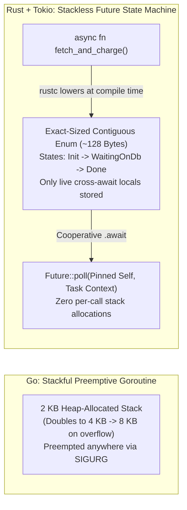
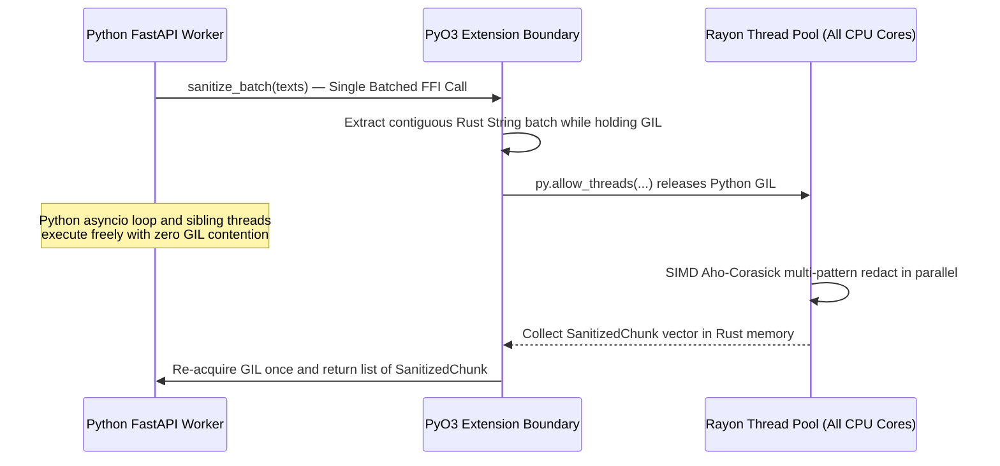

# Practical Rust & PyO3 for Go/Python Platform Engineers

You do not need to rewrite your entire company's Go microservices or Python AI orchestrators in Rust to capture 95% of Rust's business value. In 2027's most productive backend organizations (OpenAI, Anthropic, Cloudflare, Astral, Pydantic, Polar/Polars), Python and Go handle high-velocity control planes and API glue, while **surgical Rust modules (`PyO3` native extensions, L7 proxies, tokenizers, and zero-copy parsers)** eliminate CPU, memory, and GC bottlenecks by **`25x - 60x`**. This guide translates Rust's memory and async models directly into Go/Java mental models and walks through shipping a production `PyO3` + `maturin` + `rayon` Python extension.

> **Navigation**: [00-README.md](00-README.md) | Prev: [03-GO-PYTHON-RUNTIME-PROFILING-EBPF.md](03-GO-PYTHON-RUNTIME-PROFILING-EBPF.md)

---

## 1. Strategic ROI: Where Rust Wins (and Where Go/Python Stay)

Before writing a line of Rust, verify the **FFI & Ergonomics Tradeoff**:
- **Python + Rust (`PyO3`) = Highest ROI in Backend/AI**: Pure Python loops execute `30x - 100x` slower than native SIMD/LLVM machine code, and every Python `int` or `str` allocates a `28–56 byte` reference-counted heap object. Replacing a hot `500`-line Python tokenizer, AST scanner, JSON validator (`pydantic-core`), or PII redactor with a `PyO3` crate routinely drops CPU utilization by **`95%`** while keeping the rest of the Python codebase untouched.
- **Go + Rust (`cgo`) = High Friction Unless Batched**: Go already compiles to native machine code (`~1.2x - 2.5x` within Rust speed for typical logic), and every `cgo` call pays **`~80 - 150 ns`** to switch from Go's `2 KB` movable goroutine stack onto the OS `g0` thread stack and notify the GMP scheduler (`entersyscall`/`exitsyscall`). Only call Rust from Go for coarse-grained `> 500 us` batches (e.g., Tantivy full-text indexing, RocksDB, cryptography, WebAssembly `wasmtime`), or deploy Rust as a standalone data-plane proxy/sidecar.

---

## 2. Ownership, Borrowing & Lifetimes for Go & Java Engineers

Rust achieves memory safety and data-race freedom **at compile time** without a garbage collector through three strict rules:
1. Every value has **exactly one owner** variable; when the owner goes out of scope, Rust deterministically runs `Drop::drop` (RAII—freeing heap memory, sockets, or mutex guards immediately at the closing `}`).
2. Assigning or passing a non-`Copy` value (`String`, `Vec<u8>`, `TcpStream`) **moves** ownership; using the old variable afterward is a compile error (eliminating use-after-free and double-free).
3. **Aliasing XOR Mutability**: At any point in code, you may hold **either** any number of shared immutable references (`&T`) **or** **exactly one** exclusive mutable reference (`&mut T`)—never both simultaneously!

### Go / Java to Rust Mental Model Rosetta Stone

| Concept | Go Idiom | Java Idiom | Rust Equivalent & Mechanical Difference |
| :--- | :--- | :--- | :--- |
| **Pointer / Borrow** | `*User` (nullable, GC-tracked) | `User` ref (nullable, GC-tracked) | `&User` (read-only) or `&mut User` (exclusive write); **guaranteed non-null and valid**! |
| **Nullable Value** | `*User` (`nil` panic risk) | `Optional<User>` (extra heap box) | `Option<&User>` (**zero overhead**: compiler uses `0x0` null niche inside the 8-byte pointer!). |
| **Heap Box** | Escape analysis auto-boxes | Every `new Object()` | Explicit `Box<T>` (single owner on heap) or `Arc<T>` (thread-safe atomic refcount). |
| **Mutex + State** | `mu sync.Mutex` beside fields (easy to forget `mu.Lock()`!) | `synchronized` / `ReentrantLock` | `Mutex<State>`: **data lives inside the lock**! You physically cannot touch `State` without calling `.lock()` to obtain `MutexGuard<State>`. |
| **Polymorphism** | `interface` (2-word `(itab, data)` runtime dispatch) | `interface` (vtable JIT devirt) | `fn run<T: Store>(s: &T)` (**zero-cost static monomorphization**) OR `&dyn Store` (16-byte `(data_ptr, vtable_ptr)` fat pointer). |
| **Error Handling** | `val, err := fn(); if err != nil` | Checked/unchecked `throw` (expensive stack unwind) | `Result<T, E>` enum + `?` propagation operator (fast branch jump, impossible to ignore `err` silently!). |

### Lifetimes (`'a`) Demystified: Zero-Copy Without Memory Leaks
A lifetime annotation like `fn parse_bearer<'a>(header: &'a str) -> Option<&'a str>` **does not change how long any variable lives at runtime**—lifetimes erase completely before machine code generation! It simply tells the compiler: *"The returned string slice points directly into the memory bytes of `header`, so the caller must not drop or mutate `header` while still reading the returned slice."*

Compare what happens when parsing a `10 MB` HTTP/log buffer in Go/Java versus Rust:
- **Go Trap**: Slicing `sub := bigBuf[12:28]` shares the underlying `10 MB` backing array—keeping that `16-byte` `sub` string/slice in a map **pins the entire `10 MB` buffer in Go's GC heap** unless you explicitly `strings.Clone(sub)` (paying a heap allocation)!
- **Rust Superpower**: If `big_buf` is dropped before `sub`, **your code refuses to compile** (`big_buf does not live long enough`), forcing an explicit `.to_owned()` *only* when data truly outlives the network read buffer, and giving you `0`-allocation slice views everywhere else!

```rust
/// Zero-allocation header parser: borrows directly from the raw HTTP read buffer.
pub fn extract_api_key<'buf>(auth_header: &'buf str) -> Option<&'buf str> {
    let token = auth_header.strip_prefix("Bearer ")?.trim();
    if token.len() >= 16 {
        Some(token) // 16-byte (ptr, len) fat pointer into auth_header; 0 heap allocations!
    } else {
        None
    }
}
```

---

## 3. `tokio` Work-Stealing Async vs. Go Goroutines

Both Go (`GMP`) and Rust (`tokio`) multiplex hundreds of thousands of concurrent I/O tasks onto a work-stealing pool of OS threads (`num_cpus`), but their memory representations are fundamentally inverted:



- **Why Rust `Future`s Are Ultra-Compact**: Calling a nested chain of 8 `async fn`s in Rust compiles into a **single flat, nested `enum` struct** holding only local variables that survive across `.await` points! There is no `2 KB` minimum stack per connection, no stack-doubling copy, and no `cgo` stack switch when calling C/SIMD libraries (`FFI` from Rust is `0 ns` direct ABI call!).
- **Why `Pin<&mut Self>` Exists**: Because a paused `Future` enum can hold a reference from one local variable to another inside the same struct across an `.await` point (a *self-referential struct*), moving that struct in memory would invalidate its internal pointer. `Pin` statically guarantees the state machine's memory address stays fixed once polling begins.

### Three Fatal `tokio` Footguns for Go Engineers

1. **Holding a Synchronous `MutexGuard` Across `.await`**:
   - Locking `std::sync::Mutex` (or `parking_lot::Mutex`), then hitting `.await` while the guard is still in scope either fails compilation (`MutexGuard is not Send` because another OS worker thread might resume the future!) or deadlocks the entire `tokio` worker thread!
   - **Rule**: Use fast `parking_lot::Mutex` inside a tight synchronous `{ let mut g = mu.lock(); g.update(); }` block **dropped before `.await`**. Use async `tokio::sync::Mutex` *only* when you genuinely must hold a lock across an async I/O `.await` boundary.

2. **Running CPU-Intensive or Blocking File I/O on `tokio` Worker Threads**:
   - Unlike Go's `SIGURG` preemptive scheduler + `handoffp`, `tokio` is **strictly cooperative** between `.await` points! Running `15 ms` of SHA-256 hashing, `zstd` compression, or `std::fs::read` inside `async fn` freezes all `256` sibling tasks queued on that `tokio` worker thread!
   - **Rule**: Offload blocking syscalls via `tokio::task::spawn_blocking(|| ...)` and offload heavy CPU parallelism to a dedicated **`rayon` thread pool**, bridging back to `tokio` via `tokio::sync::oneshot`.

3. **`tokio::select!` Cancellation Safety**:
   - In Go, `select` waits on channel readiness; unselected channel operations haven't started mutating state. In Rust, `tokio::select!` polls multiple `Future`s concurrently and **`drop`s (cancels) every losing `Future` the instant one branch wins!**
   - If a losing branch was mid-way through `stream.read_exact(&mut buf).await`, dropping that future **permanently discards any bytes already read from the TCP socket into `buf`**, corrupting framing! Stick to cancellation-safe primitives inside `select!` loops (`mpsc::Receiver::recv`, `tokio::time::sleep`, `TcpListener::accept`), or instantiate the stateful future *outside* the `loop` with `tokio::pin!(fut)` and poll `&mut fut`.

---

## 4. Zero-Copy Serialization (`serde` Borrow, `Cow`, `bytes::Bytes`, `rkyv`)

Allocating millions of short-lived `String` objects during JSON or Protobuf deserialization dominates flamegraphs in API gateways and ingestion pipelines.

### Zero-Copy JSON Deserialization with `serde` + `Cow<'a, str>`
Why use `std::borrow::Cow<'a, str>` (Clone-on-Write) instead of raw `&'a str` for JSON strings?
- If a JSON string is `"hello world"`, its UTF-8 bytes exist verbatim inside the input slice -> `serde` returns `Cow::Borrowed("hello world")` with **zero heap allocation**.
- If a JSON string contains escape sequences like `"line1\nline2"`, those unescaped bytes do not exist contiguously in the raw buffer -> raw `&'a str` fails at runtime, whereas `Cow<'a, str>` seamlessly falls back to `Cow::Owned(String)` *only* for escaped strings!

```rust
use serde::Deserialize;
use std::borrow::Cow;

#[derive(Deserialize)]
pub struct LlmSpanEvent<'a> {
    #[serde(borrow)]
    pub trace_id: &'a str,       // Pure ASCII hex ID: 100% zero-copy borrowed!
    #[serde(borrow)]
    pub model: &'a str,          // Zero-copy slice into raw HTTP body
    #[serde(borrow)]
    pub prompt_preview: Cow<'a, str>, // Zero-copy when unescaped; allocates ONLY if \n or \" present!
    pub completion_tokens: u32,
}
```

### Choosing the Right Zero-Copy Rust Crate

| Crate | Core Mechanism | Ideal Production Workload |
| :--- | :--- | :--- |
| **`serde` + `#[serde(borrow)]`** | Borrows `&'a str` / `&'a [u8]` slices directly from network read buffer | High-QPS JSON/MsgPack webhook & telemetry ingestion. |
| **`bytes::Bytes`** | Atomic reference-counted (`Arc`-like) contiguous byte buffer supporting $O(1)$ zero-copy `.slice(a..b)` | L7 HTTP/gRPC proxies, SSE fan-out broadcasters, framing codecs. |
| **`rkyv`** | Serializes Rust structs with relative pointers so disk/SHM bytes **are** the valid in-memory layout (`mmap` + $O(1)$ pointer cast!) | Instant `0 ms` cold-start loading of multi-GB ML vocabularies, routing tables, or GeoIP indexes. |
| **`bumpalo`** | Per-request bump arena allocator (`ptr += size`; frees entire request tree in 1 instruction on drop!) | SQL/GraphQL AST parsers and request-scoped compilers. |

---

## 5. Building a 30x Faster Python Extension with `PyO3` + `maturin` + `rayon`

Suppose your Python FastAPI LLM gateway scans batches of RAG chunks or user prompts for PII patterns (emails, SSNs, API keys), redacts matches, and computes BPE-approximate token counts. In pure Python (`re` + string slicing), scanning `2,000` chunks (`~4 MB` text) takes **`~185 ms`** while holding the GIL (freezing the `asyncio` loop unless sent to multiprocessing with costly `pickle` copies).

By writing a **110-line Rust `PyO3` module** backed by SIMD **Aho-Corasick** automata and **`rayon`** data-parallel threads while **releasing the Python GIL**, the exact same `2,000`-chunk batch finishes in **`~4.2 ms` (`44x` faster)** across 8 cores while allowing Python `asyncio` coroutines to run concurrently!



### Step 1: `Cargo.toml` & `pyproject.toml` (`abi3` Stable Wheel)

```toml
# Cargo.toml
[package]
name = "fast_guardrails"
version = "0.1.0"
edition = "2021"

[lib]
name = "fast_guardrails"
crate-type = ["cdylib"]

[dependencies]
# abi3-py311 builds ONE wheel across standard CPython 3.11-3.14; omit abi3-py311 when building cp314t No-GIL wheels
pyo3 = { version = "0.23", features = ["extension-module", "abi3-py311"] }
rayon = "1.10"
aho-corasick = "1.1"

[profile.release]
lto = "fat"           # Cross-crate Link-Time Optimization (+15-25% extra throughput!)
codegen-units = 1
strip = true
```

```toml
# pyproject.toml
[build-system]
requires = ["maturin>=1.7,<2.0"]
build-backend = "maturin"

[project]
name = "fast-guardrails"
version = "0.1.0"
requires-python = ">=3.11"
```

### Step 2: `src/lib.rs` (GIL-Free Parallel Rust Implementation + Python `3.14t` Support)

```rust
use aho_corasick::{AhoCorasick, AhoCorasickBuilder, MatchKind};
use pyo3::exceptions::PyValueError;
use pyo3::prelude::*;
use rayon::prelude::*;

#[pyclass(frozen, get_all)]
#[derive(Clone)]
pub struct SanitizedChunk {
    pub redacted_text: String,
    pub redaction_count: usize,
    pub estimated_tokens: usize,
}

#[pyclass(frozen)]
pub struct BatchRedactor {
    automaton: AhoCorasick,
    replacements: Vec<String>,
}

#[pymethods]
impl BatchRedactor {
    #[new]
    pub fn new(patterns: Vec<String>, mask_token: &str) -> PyResult<Self> {
        if patterns.is_empty() {
            return Err(PyValueError::new_err("patterns list must not be empty"));
        }
        let replacements = vec![mask_token.to_owned(); patterns.len()];
        let automaton = AhoCorasickBuilder::new()
            .match_kind(MatchKind::LeftmostLongest)
            .ascii_case_insensitive(true)
            .build(&patterns)
            .map_err(|e| PyValueError::new_err(format!("invalid pattern automaton: {e}")))?;

        Ok(Self {
            automaton,
            replacements,
        })
    }

    /// Processes thousands of documents in parallel across all CPU cores with the GIL released.
    pub fn sanitize_batch(&self, py: Python<'_>, texts: Vec<String>) -> Vec<SanitizedChunk> {
        // CRITICAL: Release Python's GIL (in PyO3 0.24+, py.detach(|| ...)) before CPU work!
        py.allow_threads(|| {
            texts
                .par_iter()
                .map(|doc| {
                    let mut redacted = String::with_capacity(doc.len());
                    let mut count = 0usize;

                    self.automaton.replace_all_with(doc, &mut redacted, |mat, _, dst| {
                        count += 1;
                        dst.push_str(&self.replacements[mat.pattern().as_usize()]);
                        true
                    });

                    // Fast heuristic token upper-bound (~4 UTF-8 bytes/token or whitespace split)
                    let est_tokens = redacted.len().div_ceil(4);

                    SanitizedChunk {
                        redacted_text: redacted,
                        redaction_count: count,
                        estimated_tokens: est_tokens,
                    }
                })
                .collect()
        })
    }
}

/// Declare gil_used = false so Python 3.13t / 3.14t Free-Threaded builds NEVER re-enable the GIL!
#[pymodule(gil_used = false)]
fn fast_guardrails(m: &Bound<'_, PyModule>) -> PyResult<()> {
    m.add_class::<BatchRedactor>()?;
    m.add_class::<SanitizedChunk>()?;
    Ok(())
}
```

### Step 3: Strict Python Type Stubs (`fast_guardrails.pyi`) & Build Commands
Never ship an untyped native `.so` module—always commit a `.pyi` stub so `Pyright`, `Mypy`, and IDE autocomplete treat Rust types identically to native Python dataclasses:

```python
# fast_guardrails.pyi
from typing import final

@final
class SanitizedChunk:
    @property
    def redacted_text(self) -> str: ...
    @property
    def redaction_count(self) -> int: ...
    @property
    def estimated_tokens(self) -> int: ...

@final
class BatchRedactor:
    def __init__(self, patterns: list[str], mask_token: str) -> None: ...
    def sanitize_batch(self, texts: list[str]) -> list[SanitizedChunk]: ...
```

```bash
# Local development install (ALWAYS pass --release when benchmarking; debug Rust is 15-30x slower!)
maturin develop --release

# Build portable manylinux / macOS universal2 wheels for CI/CD deployment
maturin build --release --strip
```

---

## 6. Five FFI Anti-Patterns That Ruin `PyO3` Performance

1. **Calling Rust Inside a Python `for` Loop**:
   - *Anti-Pattern*: `[redactor.sanitize_one(doc) for doc in ten_thousand_docs]` crosses the FFI boundary `10,000` times, converts Python `str` headers `10,000` times, and cannot parallelize across `rayon` threads.
   - *Fix*: Always expose a **vectorized batch API** (`sanitize_batch(list[str])` or NumPy/Arrow zero-copy `PyReadonlyArray1<f32>` / Arrow C Data Interface `__arrow_c_array__`) so FFI runs **once** per request.
2. **Forgetting `py.allow_threads` (`py.detach`)**:
   - Without explicitly releasing the GIL inside `#[pymethods]`, your Rust code holds the Python GIL for the entire `4 ms` duration—blocking `asyncio` socket heartbeats and sibling Python threads!
3. **Returning Nested `dict[str, Any]` Instead of `#[pyclass(frozen)]`**:
   - Constructing `PyDict` with string keys allocates dozens of Python heap objects and hashes every key name per row. Returning a `#[pyclass(frozen)]` struct keeps fields in a compact C-layout Rust allocation and converts a field to a Python object *lazily* only if Python reads that attribute!
4. **Benchmarking Without `--release`**:
   - Unoptimized `cargo` debug builds disable LLVM vectorization, inlining, and bounds-check elision—often running *slower* than C extensions. Always benchmark with `maturin develop --release` and `lto = "fat"`.
5. **Omitting `#[pymodule(gil_used = false)]` on Python `3.13t` / `3.14t`**:
   - As detailed in [03-GO-PYTHON-RUNTIME-PROFILING-EBPF.md](03-GO-PYTHON-RUNTIME-PROFILING-EBPF.md), importing a `PyO3` extension that forgets `gil_used = false` forces free-threaded CPython to fall back to global GIL mode across the entire process! Ensure every `#[pyclass]` is either `frozen` (immutable) or wraps interior mutability in `Mutex` / `Atomic*` before marking `gil_used = false`.
