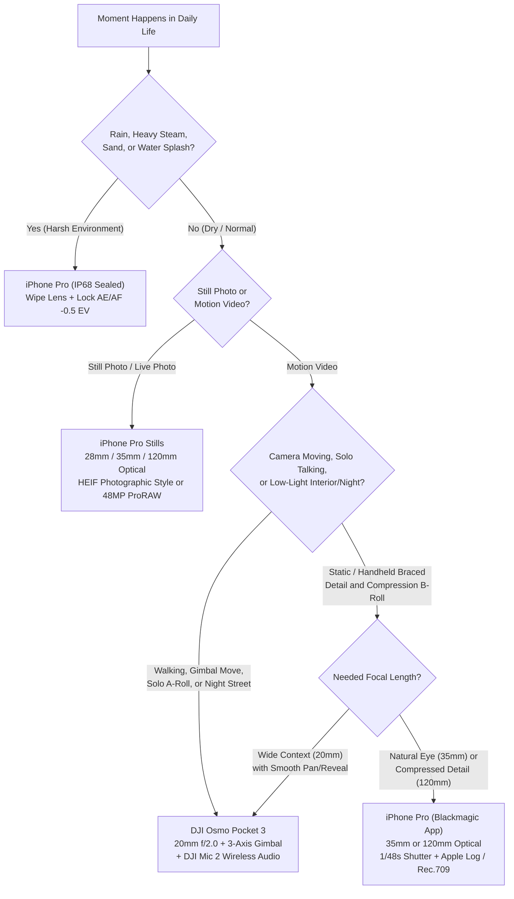

# Everyday Life Camera Kit: iPhone Pro + DJI Osmo Pocket 3 Synergy

## 1. Why Friction Kills Personal Life Documentation

Most engineers who decide to document their lives better make the exact same first mistake: they research sensor dynamic range charts for three weeks, spend USD 3,500 to 4,500 on a full-frame mirrorless body plus a fast standard zoom (`24-70mm f/2.8`), bring it on two weekend trips, and then leave it sitting on a shelf for the next eleven months.

The enemy of personal life documentation is never raw image quality. Modern sensors crossed the threshold of "good enough for a 4K OLED television" years ago. **The real enemy is activation energy**—the physical, mechanical, and social friction between noticing a meaningful moment and pressing record.

We can model the probability $P(\text{capture})$ that you actually record an unrepeatable everyday memory (a rainy walk home, your parents laughing over hotpot, a quiet Sunday morning coffee) as inversely proportional to four compounding friction terms:

$$P(\text{capture}) \propto \frac{1}{T_{\text{deploy}} \times M_{\text{carry}} \times S_{\text{intrusion}} \times F_{\text{ingest}}}$$

Where:
- **$T_{\text{deploy}}$ (Deployment Latency)**: Seconds from device-in-pocket to rolling stabilized video with clean audio. Above 5 seconds, spontaneous human moments evaporate.
- **$M_{\text{carry}}$ (Carry Mass and Bulk)**: Anything requiring a dedicated camera backpack gets left behind on ordinary Tuesday evenings—which is where 80% of your actual life happens.
- **$S_{\text{intrusion}}$ (Social Intrusiveness)**: A matte-black mirrorless camera with a shotgun mic triggers immediate self-consciousness in friends, family, waiters, and passersby. Smiles freeze; natural conversation stops.
- **$F_{\text{ingest}}$ (Post-Production Friction)**: Juggling V90 SD cards, separate external audio recorders that need waveform syncing, and gimbal balancing rituals creates editing procrastination.

### The Two-Device Pocket Synergy Thesis

By pairing the **iPhone Pro** (already in your trouser pocket 100% of waking hours) with a **DJI Osmo Pocket 3 Creator Combo** (179g, slips into a jacket pocket or 1.5L everyday sling), you cover **95% of real-world personal photography, travel vlogging, culinary recording, and family documentation** while keeping total added carry weight under 500g.

| Dimension | Full-Frame Mirrorless + Gimbal | Smartphone Alone (iPhone Pro) | Action Cam Alone (GoPro / Action 5) | **iPhone Pro + Osmo Pocket 3 Combo** |
| :--- | :--- | :--- | :--- | :--- |
| **Total Carry Weight** | 1,800g to 2,600g | 0g incremental (already carried) | 150g to 200g | **~420g incremental (Pocket 3 + Mic 2 + ND)** |
| **Boot-to-Record Time** | 15s to 60s (lens cap, gimbal balance) | **0.8s (Action Button / Lock Screen)** | 1.5s (QuickCapture) | **1.2s (screen flip auto-powers and frames)** |
| **Low-Light Moving Video** | Exceptional (if on heavy gimbal) | Poor (EIS micro-jitter blurs lights) | Poor (EIS smearing below `1/100s`) | **Excellent (1-inch sensor + mechanical 3-axis)** |
| **Solo Hands-Free Framing** | Static tripod only (unless AI pod) | Static only | Wide fixed FOV | **ActiveTrack 6.0 mechanical pan/tilt follow** |
| **Telephoto Reach** | Requires extra 500g lens swap | **Built-in 120mm (5x optical)** | None (ultra-wide fixed) | **Covered instantly by iPhone 120mm** |
| **Weather / Kitchen Steam** | Weather-resistant (lens-dependent) | **IP68 waterproof / wipeable** | Waterproof to 10m+ | **iPhone takes rain/steam; Pocket 3 stays dry** |
| **Social Stealth in Cafes** | Very low (looks like film crew) | Maximum (everyone holds a phone) | Medium | **Very high (palm-sized, zero "big lens" threat)** |
| **Wireless Audio Speed** | Plug-in RX + 3.5mm cable routing | Requires USB-C dongle RX | Native wireless (1-2 mics) | **Instant internal 2.4GHz link on power-up** |

---

## 2. Optical and Mechanical Division of Labor

Treating the iPhone Pro and DJI Osmo Pocket 3 as competitors misses the entire point of carrying both. They have **orthogonal strengths** engineered around completely different physical constraints.

### Why the Osmo Pocket 3 Beats the iPhone for Moving Video & A-Roll
1. **Mechanical 3-Axis Stabilization vs Electronic Image Stabilization (EIS)**:
   - An iPhone stabilizes walking motion via sensor-shift OIS combined with digital frame cropping (EIS). In daylight at `1/1000s` shutter speed, EIS looks smooth. In an evening street or indoor restaurant where shutter speed drops to `1/48s` or `1/50s`, every footstep creates motion blur *during* the exposure, while EIS digitally shifts the frame to compensate—producing ugly **high-frequency shimmer ("jello/ghosting trails")** around streetlights and signage.
   - The Pocket 3 physically isolates pitch, yaw, and roll using brushless motors *before* photons hit the sensor. You can shoot true 180-degree shutter (`1/48s`) at night with zero digital stabilization artifacts.
2. **True 1-Inch Sensor Optical Depth of Field at 20mm `f/2.0`**:
   - At arm's length (45 to 60 cm) or across a dining table, the Pocket 3's physical `9.4mm` focal length (`20mm` full-frame equivalent) at `f/2.0` produces genuine optical falloff behind your face or coffee cup—without computational "Cinematic Mode" hair-masking glitches around eyeglasses or chopsticks.
3. **Robotic Solo Cameraman (`ActiveTrack 6.0`)**:
   - When you live or travel solo, nobody is holding the camera for you. Placed on a kitchen counter or cafe table, the Pocket 3 physically pans and tilts to keep you framed on a rule-of-thirds line while you cook, pour tea, or talk.
4. **Built-In Dual DJI Mic 2 Receiver**:
   - Flip open the screen, turn on the clip-on DJI Mic 2 transmitter, and broadcast-grade 48kHz wireless audio is already linked with zero cables hanging off a phone port.

### Why the iPhone Pro Beats the Pocket 3 for Stills, Telephoto & Harsh Conditions
1. **Multi-Focal Perspective Control (`13mm`, `24mm`, `28mm`, `35mm`, `120mm`)**:
   - The Pocket 3 is permanently locked to a wide `20mm` perspective. Wide lenses exaggerate foreground size and push backgrounds away—terrible for distant architectural geometry, candid street portraits, or isolating mountain layers. The iPhone Pro's `35mm` (`1.5x` main sensor crop) and `120mm` (`5x` tetraprism telephoto) provide the tight framing and background compression that make sequences feel like cinema rather than a continuous wide-angle vlog.
2. **IP68 Environmental Immunity**:
   - Gimbal motors hate torrential rain, beach sand, ocean spray, and boiling wok oil splatter. Your iPhone Pro dives right over a sizzling cast-iron pan or out into a Kyoto downpour, then rinses clean under a tap.
3. **48MP ProRAW Stills & Live Photo Moments**:
   - Pocket 3 stills are functional snapshots, not gallery photographs. The iPhone Pro handles all high-resolution still photography, document scanning, night sky tripod exposures, and handheld Live Photo long-exposures.
4. **ProRes Apple Log Hero Shots**:
   - Mounted stably or braced handheld with an external MagSafe SSD, iPhone ProRes Apple Log renders extraordinary 10-bit highlight roll-off that grades alongside cinema cameras.

### Equivalent Optics Reality Check

To understand background separation across devices, apply the crop factor $C$ to both focal length and f-number relative to a `36mm x 24mm` full-frame sensor:

$$f_{\text{eq}} = f_{\text{physical}} \times C, \qquad N_{\text{eq}} = N_{\text{physical}} \times C$$

| Camera Module | Sensor Diagonal | Crop Factor ($C$) | Equiv. Focal Length | Physical Aperture | Full-Frame Equiv. DOF ($N_{\text{eq}}$) |
| :--- | :--- | :--- | :--- | :--- | :--- |
| **Osmo Pocket 3** | 15.86 mm (1-inch type) | $2.72\times$ | 20 mm | `f/2.0` | **`f/5.4` equivalent** |
| **iPhone Pro Main (1x)** | ~12.8 mm (1/1.28-inch) | $3.38\times$ | 24 mm | `f/1.78` | `f/6.0` equivalent |
| **iPhone Pro Tele (5x)** | ~5.7 mm (1/3.06-inch) | $7.60\times$ | 120 mm | `f/2.8` | `f/21.3` (uses 120mm focal length for compression) |
| **iPhone Pro Ultra-Wide** | ~6.4 mm (1/2.55-inch) | $6.76\times$ | 13 mm | `f/2.2` | `f/14.9` (everything in deep focus) |

Notice the key physical insight: at wide angles (`20mm` vs `24mm`), the Pocket 3 has the largest effective entrance pupil (`9.4mm / 2.0 = 4.7mm` vs iPhone Main `6.76mm / 1.78 = 3.8mm`) and focuses down to `20cm`, giving smooth organic separation on close-up subjects. Meanwhile, the iPhone `120mm` achieves subject isolation not through a shallow f-stop, but through **narrow `20-degree` angle-of-view magnification**, magnifying distant background blur disks relative to your subject.

---

## 3. Real-World Shot-Routing Decision Engine

In the field, hesitation ruins pacing. Train an automatic muscle-memory rule for which device comes out of your pocket based on the shot's physics and environment:



### Classic Two-Camera Sequence Recipe (The 60-Second Cafe or Cooking Vignette)

Watch how a 4-shot sequence uses both devices to look like a dedicated two-person crew filmed it:
1. **Establishing Wide (iPhone Pro `24mm` or `120mm` from across the street)**: Compressed exterior shot of you walking through the cafe door (`3.5 seconds`).
2. **Moving POV / Reveal (Osmo Pocket 3 `20mm` Tilt Locked)**: Smooth low-angle push-in across wooden tables toward the espresso machine (`4 seconds`).
3. **Tight Sensory Detail (iPhone Pro `120mm` or `35mm`)**: Close-up compression of steam rising from the pour-over kettle, backlit by window light at `-0.7 EV` (`3 seconds`).
4. **Solo Conversational A-Roll (Osmo Pocket 3 on Mini Tripod + `ActiveTrack 6.0` + DJI Mic 2)**: Pocket 3 sits unobtrusively next to the sugar jar, tracking subtle head movements while DJI Mic 2 captures warm, intimate voice audio over cafe chatter (`15 seconds`).

---

## 4. Color Science & Frame-Rate Unification Protocol

Jarring cuts between an iPhone and an Osmo Pocket 3 happen for only three reasons: **mismatched frame rates**, **auto-white-balance drift**, and **clashing contrast/sharpening curves**. Standardize these four rules across both cameras on Day 1 so clips drop onto the same timeline seamlessly:

### Rule 1: Standardize One Master Timeline Frame Rate
- Pick **`24 fps` (`23.976 fps`)** for cinematic personal films, travel essays, and moody storytelling, **OR** pick **`30 fps` (`29.97 fps`)** if 90% of your output goes straight to vertical social platforms (Instagram Reels, Xiaohongshu/RED, YouTube Shorts) where native 60Hz/120Hz phone screens favor 30/60fps cadence.
- **Never mix `24 fps` Pocket 3 A-roll with `30 fps` iPhone B-roll** on the same timeline—frame pulldown creates stutter every fourth frame.
- Shoot **`60 fps`** *only* when you intend to slow the clip down in post (`40%` on a 24fps timeline or `50%` on a 30fps timeline) and when sufficient light exists for a `1/120s` shutter.

### Rule 2: Choose One Matching Color Tier Per Project

| Workflow Tier | iPhone Pro Mode | Osmo Pocket 3 Mode | Post-Production Effort | Best Use Case |
| :--- | :--- | :--- | :--- | :--- |
| **Tier A: Zero-Grade Fast Turnaround** | Stock Camera `4K 24/30`, HDR **OFF** (SDR Most Compatible or Tone-Mapped), Exposure `-0.5 EV` | **Normal (8-bit)**, Sharpness `-1`, Noise Reduction `-2`, Exposure `-0.3 EV` | Zero LUTs needed; cut and export in 15 mins | Daily family clips, quick weekend recaps |
| **Tier B: HDR OLED Viewing** | Stock Camera **Dolby Vision HDR** (`10-bit HLG`), Exposure `-0.3 EV` | **HLG (10-bit Rec.2020)**, Sharpness `-1`, NR `-2` | Edit on Rec.2100 HLG timeline (Final Cut / CapCut / DaVinci) | Viewing on iPhone / iPad Pro / Apple TV HDR displays |
| **Tier C: Maximum Cinema Latitude (Recommended for Vlogs)** | Blackmagic Camera **HEVC 10-bit Apple Log** (or ProRes 422 LT Apple Log) | **D-Log M (10-bit)**, Sharpness `-1`, NR `-2` | Apply official Apple Log -> Rec.709 & DJI D-Log M -> Rec.709 LUTs in DaVinci Resolve | Travel films, high-contrast sunlight, warm cafes, timeless personal archives |

### Rule 3: Lock White Balance on Both Devices
Auto White Balance (AWB) on iPhones leans slightly warm/yellow indoors, while DJI's AWB leans slightly cool/magenta under mixed LEDs. Whenever shooting a multi-clip scene in one room:
- **Daylight / Outdoor Shade**: Lock `5600K` (or `6000K` in open shade).
- **Mixed Window + Cafe Interior**: Lock `4300K` to `4600K`.
- **Warm Evening Restaurant / Tungsten**: Lock `3200K` to `3600K` (do *not* neutralize down to `2500K`, or warm candlelight turns clinical white).

### Rule 4: Kill Digital Oversharpening
The dead giveaway of small-sensor video is dark halo edges around tree branches, hair, and text. Apple Log on iPhone completely disables Apple's sharpening engine; on Pocket 3, setting `Sharpness = -1` and `Noise Reduction = -2` removes DJI's artificial edge enhancement so both cameras render smooth, organic roll-off.

---

## 5. Curriculum Learning Path & Table of Contents

Work through the four modules in sequence—each module configures concrete hardware settings, optical formulas, and muscle-memory drills that build on the previous file.


### Complete Module Directory

1. **[00-README.md](00-README.md) — Everyday Life Camera Kit: iPhone Pro + DJI Osmo Pocket 3 Synergy** *(Current Document)*
   - Activation energy math, full-frame vs hybrid pocket kit comparison, optical/crop-factor physics, shot-routing decision tree, Apple Log + D-Log M color unification, and EDC sling workflow.
2. **[01-IPHONE-PRO-PHOTO-AND-VIDEO-TRICKS.md](01-IPHONE-PRO-PHOTO-AND-VIDEO-TRICKS.md) — iPhone Pro Camera Mastery: Focal Lengths, Exposure Control, Apple Log & Blackmagic Camera**
   - Deconstructing harsh computational HDR; mastering `24mm`, `28mm`, `35mm`, and `120mm` optical sweet spots; `AE/AF Lock` + `-0.5 EV` reflex; Live Photo long-exposure handheld tricks; 180-degree shutter physics in Blackmagic Camera; and MagSafe NVMe ProRes Apple Log rigging.
3. **[02-DJI-OSMO-POCKET-3-COMPLETE-MASTERY.md](02-DJI-OSMO-POCKET-3-COMPLETE-MASTERY.md) — DJI Osmo Pocket 3 Complete Field Playbook**
   - Day-1 menu configuration (`Sharpness -1`, `NR -2`, `Rotational Speed Slow`, `C1/C2/C3` presets); D-Log M 10-bit exposure rules; `Follow` vs `Tilt Locked` vs `FPV` gimbal mechanics; `ActiveTrack 6.0` solo dynamic framing; night street anti-flicker low-light setup; and biomechanics for the 8 signature gimbal moves.
4. **[03-WIRELESS-AUDIO-LIGHTING-AND-ACCESSORIES.md](03-WIRELESS-AUDIO-LIGHTING-AND-ACCESSORIES.md) — DJI Mic 2 Audio, Magnetic ND/Mist Filters & Shooting Confidently in Public**
   - Acoustic inverse-square law; pairing DJI Mic 2 directly to Pocket 3; `32-bit float` internal backup + `-6 dB` safety track gain staging; hidden collar mounting & wind muffs; magnetic VND + `1/4` Black Mist highlight halation math; natural cafe window lighting; and psychological tactics for filming naturally in public without awkwardness.

---

## 6. The Zero-Excuse Everyday Carry (EDC) Sling & Data Hygiene

A camera system only captures your life if its battery is charged, its card has space, and your sling sits right by the front door.

### Minimalist 1.5L–2.5L Sling Packing List (~480g Total)
- **Main Bay**: DJI Osmo Pocket 3 inside its protective snap-on hard shell (with Battery Handle or Mini Tripod Handle attached).
- **Magnetic Filter Slot (built into DJI Protective Cover)**:
  - `VND 2-5 Stop` (`ND4–ND32`) magnetic filter (lives inside the case slot).
  - `1/4 Black Mist` (or combo `VND + 1/4 Mist`) magnetic filter.
- **Audio Pocket**: 1x DJI Mic 2 Transmitter with clip magnet + twist-lock furry wind muff pre-attached (total 32g).
- **iPhone Companion Pouch**:
  - Ultra-thin MagSafe 2230 NVMe SSD (`1TB` or `2TB`) + 13cm right-angle USB-C 10Gbps ribbon cable (only packed when planning heavy Apple Log shoots; otherwise Blackmagic HEVC 10-bit Apple Log records straight to internal iPhone storage!).
  - Clean dry optical microfiber cloth in a sealed zip sleeve (skin oil on small lenses causes 90% of night-time flare streaks).

### Post-Shoot 10-Minute Offload & Archive Protocol

Personal life footage increases in emotional value exponentially over decades—treat raw family and life clips with the same durability rigor as production database backups:

1. **Same-Day Card Offload**: Plug Pocket 3 directly via USB-C into your Mac (or pop the microSD into a UHS-II/UHS-I reader) and AirDrop / USB-C copy iPhone Blackmagic clips into a date-stamped project folder:
   ```text
   LifeArchive/
   └── 2027/
       └── 2027-04-18_Kyoto-Philosophers-Path/
           ├── 01_Pocket3_CamA/
           ├── 02_iPhone_CamB/
           └── 03_Mic2_32BitFloat_Backup/
   ```
2. **Cull Immediately, Never Hoard Junk**: Delete accidental floor shots and failed takes within 24 hours, or a single weekend trip bloats to 180GB of unsearchable noise. Keep the top 15–25% of genuine moments.
3. **3-2-1 Storage Rule**:
   - **Copy 1**: Working external NVMe SSD (`2TB–4TB` Thunderbolt/USB4) for fast DaVinci Resolve / Final Cut editing.
   - **Copy 2**: Local NAS or high-capacity desktop HDD mirror (`RAID 1` or nightly `rsync` / Carbon Copy Cloner).
   - **Copy 3**: Offsite encrypted cloud or cold drive backup (Backblaze / iCloud Photos for curated exports).
4. **Format in Camera Only**: Once verified on two drives, format the Pocket 3 microSD card **inside the Pocket 3 menu** (never via macOS Finder Trash, which leaves hidden `.Trashes` metadata partitions without resetting DJI's allocation table).

---

## 7. Common System-Level Failure Modes to Avoid

| Failure Mode | Symptom in Edit | Root Cause | Permanent Fix |
| :--- | :--- | :--- | :--- |
| **The Greasy Lens Haze** | Streetlights streak diagonally; daytime contrast looks milky | Thumbprints on iPhone sapphire cover or Pocket 3 front element | Wipe both lenses with clean microfiber *every single time* before first shot of the location |
| **60fps Indoor Darkness** | Grainy, muddy shadows in dim restaurants | Shooting `4K 60fps` forces shutter $\ge 1/120\text{s}$, starving sensor by 1.3 stops vs `24fps` (`1/48s`) | Default to `24fps` or `30fps` indoors; reserve `60fps` strictly for well-lit slow-motion B-roll |
| **Horizon Roll Drift** | Architecture leans 2 degrees sideways on Pocket 3 pans | Putting Pocket 3 down crookedly during boot calibration or shooting in `FPV` mode unintentionally | Double-tap joystick/trigger on level surface before walking; run Gimbal Auto-Calibration monthly |
| **iPhone VFR Audio Drift** | iPhone stock-app clip drifts out of sync with external DJI Mic 2 WAV over 5+ minutes | Stock iOS Camera records Variable Frame Rate (`23.4–24.3 fps`) under thermal/CPU load | Use **Blackmagic Camera** (locks tighter Constant Frame Rate behavior) or conform VFR clips before multicam sync |
| **Over-Shooting Without Living** | You return from dinner with 90 clips and zero memory of what your friend actually said | Treating life like continuous surveillance instead of intentional vignettes | Follow the **5-Second Vignette Rule**: capture 5–8 clean clips in the first 3 minutes, put the camera away, and be 100% present |
