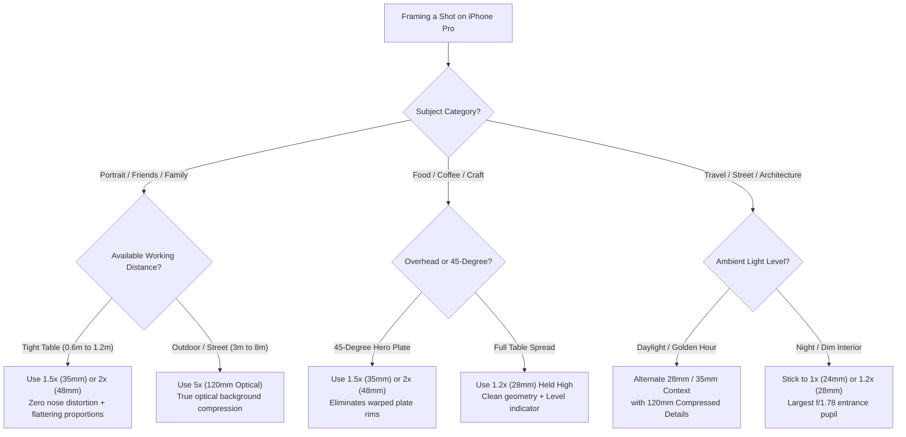
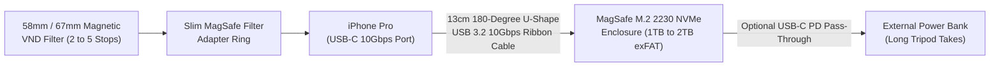

# iPhone Pro Camera Mastery: Focal Lengths, Exposure Control, Apple Log & Blackmagic Camera

The iPhone Pro carries one of the most sophisticated multi-camera optical arrays ever miniaturized into a consumer device—yet 90% of people point it on factory defaults and get brittle, overly bright, hyper-sharpened images that scream "shot on a smartphone."

Mastering the iPhone Pro is not about buying clip-on anamorphic lenses. It is about **defeating aggressive computational tone-mapping**, **staying strictly on optical/sensor-binned sweet spots**, and **taking manual control of exposure, shutter angle, and color space**.

*(For how the iPhone Pro pairs with the DJI Osmo Pocket 3 in a unified carry kit, start at [00-README.md](00-README.md).)*

---

## 1. Deconstructing the "Smartphone Look" (Why Defaults Fail)

When you press the shutter or record button in the default iOS Camera app, you are not capturing a linear optical photograph. Apple's Image Signal Processor (ISP) fuses 8 to 12 bracketed frames via **Smart HDR** and **Deep Fusion**, applying three aggressive transformations optimized for viewing on a small screen outdoors at noon:

1. **Shadow Crushing Elimination (Over-Lifted Shadows)**: Dark cozy corners in a dimly lit ramen shop or jazz bar get boosted up to middle gray (`45–60 IRE`), destroying atmosphere, mystery, and lighting directionality.
2. **Local Tone-Mapping Flattening**: Bright windows and faces in shade are compressed toward the exact same brightness level, producing an unnatural "HDR halo" around hairlines and rooftops.
3. **High-Frequency Unsharp Masking**: Dark 1-pixel and 2-pixel contrast outlines are drawn around foliage, brick, facial pores, and stubble—creating harsh "crunchy" video texture.

Every technique in this playbook directly neutralizes one or more of those three ISP behaviors.

---

## 2. Mastering the Optical Focal Length Sweet Spots

An iPhone Pro (15 Pro Max, 16 Pro / Pro Max, and newer) is **not** a continuous optical zoom lens. It is three discrete prime cameras (`13mm`, `24mm`, `120mm`) supplemented by lossless center-sensor Quad-Bayer readout modes on the `48MP` main sensor. Zooming to arbitrary intermediate numbers like `2.4x` or `3.8x` forces the phone to upscale cropped `12MP` pixels—turning fine detail into watercolor mush.

### How the 48MP Main Sensor Creates 24mm, 28mm, and 35mm

The main `1/1.28-inch` Quad-Bayer sensor contains $8064 \times 6048$ photosites (`48MP`):
- **`1x` (`24mm`, `24MP` / `48MP`)**: Reads the full sensor area, combining $2\times 2$ binned `12MP` dynamic range with full-resolution `48MP` luminance detail.
- **`1.2x` (`28mm`, `24MP`)**: Crops gently into the sweet center of the `48MP` array while fusing high-density center photosites—far cleaner than post-cropping a `12MP` JPEG.
- **`1.5x` (`35mm`, `24MP`)**: Crops to an approximately `20MP–24MP` native center readout region, giving classic photojournalistic framing with noticeably less wide-angle edge stretching than `24mm`.
- **`2x` (`48mm`, `12MP`)**: Reads the exact central $4032 \times 3024$ (`12MP`) unbinned pixel area (`1:1` pixel readout without digital upscaling, though individual `1.22 µm` unbinned pixels gather $4\times$ less light per pixel in dim interiors).

### Complete iPhone Pro Focal Length Architecture

| UI Button | Full-Frame Equiv. | Physical Sensor Used | Optical Quality | Ideal Subject & Visual Emotion | Strictly Avoid When |
| :--- | :--- | :--- | :--- | :--- | :--- |
| **`0.5x`** | **13 mm** (`f/2.2`) | Ultra-Wide (`1/2.55"`) | Good in bright sun; soft corners | Grand cathedral ceilings, cramped interiors, dramatic leading lines, macro `2cm` | Human faces near frame edges (severe skull stretching); dim night scenes |
| **`1x`** | **24 mm** (`f/1.78`) | Main Full (`1/1.28"`) | **Maximum sensor light & dynamic range** | Night scenes, environmental context, tabletop group dinners | Tight headshots closer than `0.8m` (enlarges noses by ~25% vs ears) |
| **`1.2x`** | **28 mm** (`f/1.78`) | Main Sensor Fusion | **Near-peak (`24MP` output)** | Street photography, travel walking shots (Ricoh GR / Leica Q classic FOV) | Pitch-black night scenes where full `24mm` pixel binning helps slightly |
| **`1.5x`** | **35 mm** (`f/1.78`) | Main Sensor Fusion | **Excellent (`24MP` output)** | **Best everyday human-eye documentary lens**; half-body portraits, food plates | Ultra-tight macro (minimum focus distance on main lens is ~`20cm`) |
| **`2x`** | **48 mm** (`f/1.78`) | Main `12MP` 1:1 Center | Clean in daylight; noisier at night | Across-the-table portraits, overhead 45-degree food framing | Low-light interiors (iOS may secretly fall back to cropping `24mm` `12MP`!) |
| **`2.1x–4.9x`** | **50–118 mm** | **Digital upscale** | **POOR — Dead Zone** | **Never use intentionally** | **Always step forward with `2x` or step back to use native `5x` (`120mm`)** |
| **`5x`** | **120 mm** (`f/2.8`) | Tetraprism Telephoto | **True Optical Telephoto** | Architectural geometry, compressed street candids, mountain layers, distant details | Subjects closer than `1.0m–1.2m` or dim interiors (iOS hijacks to `1x` digital crop!) |

### Field Focal-Length Selection Decision Tree

> **Enable 28mm and 35mm Fast Tap**: Go to `Settings > Camera > Formats > Main Camera` (or `Fusion Camera`), turn ON **28 mm** and **35 mm**, and set your **Default Lens** to **28 mm** or **35 mm** instead of `24 mm`. Simply tapping the `1x` circle in the viewfinder now cycles cleanly through `24mm -> 28mm -> 35mm`!

---

## 3. Stock Camera App Mastery: Day-1 Settings & Rapid Field Tricks

Even when you need 1-second draw speed from the lock screen without opening a third-party app, proper configuration transforms stock Camera output immediately.

### Essential `Settings > Camera` Checklist

| Menu Path | Setting | Value | Engineering Rationale |
| :--- | :--- | :--- | :--- |
| `Camera > Composition` | **Grid** & **Level** | **ON** | Prevents 1.5-degree crooked horizons and aligns vertical architectural lines |
| `Camera > Formats` | **Camera Capture** | **High Efficiency** | Required for 10-bit HEIF, 24MP Fusion stills, and 4K60 / Log codecs |
| `Camera > Formats` | **Photo Mode** | **24 MP** | Doubles spatial detail over 12MP at ~2.5MB file size |
| `Camera > Formats` | **ProRAW & Resolution Control** | **ON** (`JPEG-XL Lossy` or `ProRAW Max`) | Puts instant `RAW` toggle in top corner for hero sunset/night frames |
| `Camera > Formats` | **Apple ProRes** -> **Log** | **ON** (`Log` selected) | Unlocks Apple Log recording when needed |
| `Camera > Record Video` | **Lock Camera** | **ON** | Stops iPhone from jarring mid-shot lens jumps (`1x` to `5x` shift) while zooming |
| `Camera > Record Video` | **Lock White Balance** | **ON** | **Critical**: locks Kelvin tint the instant you hit Record so skin never shifts green-to-orange |
| `Camera > Record Video` | **Enhanced Stabilization** | **OFF** (default) | Prevents unnecessary `10%+` crop and low-light shutter boosting on gentle pans |
| `Camera > Preserve Settings` | **Exposure Adjustment** | **ON** | Displays permanent EV gauge in top corner and remembers your `-0.3` / `-0.5 EV` bias |
| `Camera > Preserve Settings` | **Macro Control** | **ON** | Stops jarring automatic jump to the inferior Ultra-Wide lens when moving near coffee/food |
| `Camera > Macro Control` | **Show Flower Icon** | **ON** | Lets you manually tap the yellow flower icon *only* when you truly want `2cm` macro |

### Trick 1: The `AE/AF Lock` + `-0.5 EV` Reflex (Instant Cinema Contrast)

This single 1.5-second habit improves 90% of iPhone photos and stock videos:
1. Frame your shot at `28mm`, `35mm`, or `120mm`.
2. **Long-press (`1.2 seconds`)** on your subject's lit cheek or the brightest important texture until the yellow **`AE/AF LOCK`** banner pulses at the top.
3. **Slide your finger downward** alongside the yellow sun icon to **`-0.3 EV` to `-0.7 EV`** (`-1.0 EV` in dramatic directional sunlight or neon night streets).
4. Shoot.

**Why this works**: Pulling exposure down by half a stop prevents highlight clipping on skin foreheads, porcelain plates, and clouds, while forcing dark shadows back down to `10–20 IRE` where shadow noise stays invisible and natural chiaroscuro contrast returns.

### Trick 2: Photographic Styles Tone Pad (`Tone -40`) for Permanent Anti-HDR Stills

On iPhone 16 Pro (and Photographic Styles on 15 Pro):
- Set **Tone** to **`-35` to `-50`** (on 16 Pro, drag the 2D control pad slightly **down** on the vertical Tone axis to deepen shadows, while keeping Undertone neutral).
- Unlike a post-capture filter, Photographic Styles execute **inside the semantic ISP pipeline** before HEIF encoding—protecting skin warmth while letting background shadows fall naturally dark without editing a 75MB ProRAW file.

### Trick 3: Handheld Live Photo Long-Exposure (No Tripod, No ND Filter)

Want silky motion-blurred waterfalls, rushing subway trains behind a sharp commuter, or blurred tourist crowds in front of a monument in broad daylight?
1. Turn **Live Photo ON** (concentric circle icon top right).
2. Brace both elbows tightly against your ribs, exhale halfway, and hold completely still for **1.5 seconds before** and **1.5 seconds after** tapping the shutter.
3. Open the photo in **Photos**, tap the **`LIVE`** dropdown badge in the top-left corner, and choose **`Long Exposure`**.
4. iOS aligns the static architecture across ~45 frames using gyroscopic telemetry and stacks the moving water/trains/crowds into a smooth 2-second silk exposure—even at midday without carrying a tripod or ND1000 filter!

---

## 4. Blackmagic Camera App: True Manual Cinema Physics

Even with `Lock White Balance` enabled, the stock iOS Camera app still **refuses to lock shutter speed**. Step outside into sunshine at `24fps`, and stock iOS spikes the electronic shutter to `1/1500s` or `1/3000s`—freezing every water droplet and hand gesture into brittle, jittery `Saving Private Ryan` staccato motion.

Install the free **Blackmagic Camera** app from Blackmagic Design to turn the iPhone Pro into a manual cinema B-cam.

### The 180-Degree Shutter Angle Rule

To replicate natural human retinal motion blur, exposure time $T_{\text{shutter}}$ should equal half the frame interval ($180^\circ$ of a $360^\circ$ rotary cinema shutter):

$$T_{\text{shutter}} = \frac{\theta}{360^\circ \times \text{FPS}}$$

- At **`24 fps`**: $T_{\text{shutter}} = \frac{180}{360 \times 24} = \frac{1}{48}\text{ s}$ (use `1/50s` in 50Hz AC countries like Mainland China, Europe, and Eastern Japan to prevent indoor LED banding).
- At **`30 fps`**: $T_{\text{shutter}} = \frac{180}{360 \times 30} = \frac{1}{60}\text{ s}$.
- At **`60 fps`**: $T_{\text{shutter}} = \frac{180}{360 \times 60} = \frac{1}{120}\text{ s}$ (or `1/100s` under 50Hz lighting).

> **Important Optical Catch**: Because the iPhone Pro has a **fixed physical aperture** (`f/1.78` on `1x`, `f/2.8` on `5x`), locking shutter speed to `1/48s` in outdoor daylight **will overexpose the image solid white** even at base ISO (`ISO 55`), *unless* you snap a **Magnetic Variable ND Filter (`ND8–ND64`)** onto a MagSafe filter mount! Without an ND filter outdoors, leave Shutter on Auto and rely on Apple Log for highlight recovery; indoors or at golden hour/night, **always lock `1/48s` or `1/50s`**.

### Optimal Blackmagic Camera Menu Setup (Set Once)

1. **`Settings > Record`**:
   - **Codec**: **`HEVC (H.265)`** (delivers **10-bit 4:2:0 Apple Log** straight to internal storage at ~`60–110 Mbps`—roughly **1/12th the file size** of ProRes 422 HQ with 95% of the visual grading latitude for personal vlogs!) OR **`Apple ProRes 422 LT`** when connected to an external SSD for heavy VFX/grading.
   - **Resolution**: `4K` (`3840x2160`).
   - **Color Space**: **`Apple Log - HDR`** (`Apple Log`).
   - **Time Lapse / Frame Drop Warning**: Enable **Drop Frame Alert** so you know immediately if storage slows down.
2. **`Settings > Camera`**:
   - **Shutter Measurement**: `Shutter Speed` (easier to verify `1/50s` vs `1/60s` anti-flicker) or `Shutter Angle` (`180°`).
   - **Stabilization**: **`Standard`** (never `Extreme` unless running handheld—`Standard` preserves wider FOV and minimal low-light warp).
   - **Lock White Balance on Record**: **ON**.
3. **`Settings > Monitor` & `LUTs`**:
   - **Zebra**: **`95%`** (warns right before Apple Log specular highlights clip).
   - **Focus Assist**: `Colored Lines` (Green or Red peaking when pulling manual focus on `120mm`).
   - **Display LUT**: **ON** -> Select built-in **`Apple Log to Rec.709`**.
   - **Record LUT to Clip**: **OFF** (crucial: lets you monitor rich, normal contrast on screen while recording flat 10-bit Apple Log data onto disk!).
4. **`Settings > Audio`**:
   - **Audio Source**: `iPhone Microphone` (set to `Back` or `Stereo` for ambient B-roll) or `USB` when a DJI Mic 2 receiver is plugged in.
   - **Format**: `Linear PCM` (`48 kHz`).

---

## 5. Shooting ProRes & HEVC Apple Log (Internal vs MagSafe NVMe SSD)

Apple Log is transformative not merely because it records 10-bit color (`1,024` tonal steps per channel vs `256` in 8-bit), but because **enabling Apple Log completely bypasses Apple's aggressive sharpening and Smart HDR local tone-mapping**. Edges look silky, highlights roll off like celluloid, and skin tones lose that orange/plastic digital cast.

### Codec Bitrate & Storage Math (`4K 24fps` / `30fps`)

| Recording Method | Codec & Bit Depth | Approx. Data Rate | Storage per 10 Mins | Requires External USB-C SSD? | Recommended Use Case |
| :--- | :--- | :--- | :--- | :--- | :--- |
| **Blackmagic App Internal** | **HEVC 10-bit 4:2:0 Apple Log** | ~75 Mbps (`9.4 MB/s`) | **~5.6 GB** | **No** (records to internal iPhone storage!) | **90% of daily life & travel B-roll** |
| **External NVMe (Sweet Spot)** | **ProRes 422 LT 10-bit Apple Log** | ~410 Mbps (`51 MB/s`) | ~30.5 GB | Required at `4K60` (optional at `4K24/30`) | Paid client work, heavy color grading, fast NLE scrubbing |
| **External NVMe (Standard)** | **ProRes 422 10-bit Apple Log** | ~590 Mbps (`74 MB/s`) | ~44.0 GB | Recommended (`4K60` mandatory) | Hero commercial / documentary interviews |
| **External NVMe (Max)** | **ProRes 422 HQ 10-bit Apple Log** | ~885 Mbps (`110 MB/s`) | ~66.0 GB | Mandatory for practical capacity | Overkill for personal vlogs; wastes 6x disk space |

> **Key Engineering Insight**: Stock iOS Camera locks Apple Log exclusively behind massive **ProRes** files (`~6 GB per minute` in 4K30 HQ). **Blackmagic Camera** unlocks **Apple Log inside 10-bit HEVC**, shrinking files by **10x** with zero umbilical SSD cable required for everyday `4K24/30` shooting!

### Ultra-Clean MagSafe External SSD Rigging (When Shooting ProRes `4K60`)

When you do want zero-compression ProRes `4K 60fps` Apple Log (which writes up to `220 MB/s` and requires an external USB 3.2 Gen 2 `10Gbps` drive formatted as **`exFAT`** or **`APFS`**):

**Hardware Selection Rules for External SSDs**:
1. **Sustained Write Speed, Not Peak Cache Speed**: Cheap thumb drives advertise `1000 MB/s` burst speed, then thermal-throttle to `40 MB/s` after 45 seconds when SLC cache fills—dropping frames mid-take. Choose sustained-write M.2 2230 NVMe enclosures (with low power draw `< 4.5W`, e.g., Lexar SL500 Portable Magnetic SSD or WD SN770M inside an aluminum MagSafe heatsink enclosure).
2. **Cable Rating**: The included white Apple charging cable inside the iPhone box is **USB 2.0 (`480 Mbps`)**—it **cannot** record `4K60` ProRes! Always use a certified `10 Gbps` (USB 3.2 Gen 2) short U-bend ribbon cable so nothing snags your fingers.

### Two-Click Apple Log Color Conversion in DaVinci Resolve

Never manually drag Contrast and Saturation sliders to grade Apple Log—log curves are mathematical logarithmic encodings that require a proper Color Space Transform (CST):
1. Drop your iPhone Apple Log clip onto a DaVinci Resolve timeline.
2. Add a **`Color Space Transform`** effect on Node 2 (reserving Node 1 *before* it for Exposure/Offset and White Balance adjustments):
   - **Input Color Space**: `Apple Log`
   - **Input Gamma**: `Apple Log`
   - **Output Color Space**: `Rec.709`
   - **Output Gamma**: `Rec.709` (or `Gamma 2.4`)
   - **Tone Mapping Method**: `DaVinci` (Luminance Mapping ON)
3. Adjust Offset/Lift/Gain gently on Node 1—because Node 1 sits in linear/log space *upstream* of the Rec.709 clamp, you can pull down blown sunlit clouds by 2 full stops cleanly!

---

## 6. Field Failure Modes & Instant Fixes

### 1. Indoor LED Banding / Rolling Black Bars (`50Hz` vs `60Hz`)
- **Symptom**: Horizontal dark bands roll across restaurant walls or shop signs in video.
- **Physics**: Mains AC power and cheap PWM-dimmed LEDs pulse at $2 \times f_{\text{mains}}$ (`100 Hz` in `50 Hz` grids: Mainland China, Hong Kong, Europe, UK, Australia, Tokyo/Eastern Japan; `120 Hz` in `60 Hz` grids: USA, Canada, Taiwan, Korea, Osaka/Kyoto/Western Japan!).
- **Fix**: Set shutter speed to an exact integer divisor of pulse frequency:
  - In **50Hz grids (China / Europe / Tokyo)**: Use **`1/50s`** or **`1/100s`**.
  - In **60Hz grids (USA / Osaka-Kyoto / Taiwan)**: Use **`1/60s`** or **`1/120s`**.

### 2. The `5x` (`120mm`) Secretly Falling Back to `1x` Digital Zoom
- **Symptom**: You tap `5x` inside a museum or close to a plate of food, and the resulting photo/video looks blocky and pixelated.
- **Root Cause**: Whenever light is dim or the subject sits closer than `~1.1 meters`, the stock Camera app silently ignores the `f/2.8` tetraprism lens and digitally zooms `500%` into the `24mm` `1x` sensor!
- **Fix**: Step back past `1.2 meters` in stock Camera, OR shoot in **Blackmagic Camera** / **Halide**, where selecting the **`120mm` Telephoto** physical hardware lens guarantees zero secret sensor-swapping.

### 3. Night-Time Floating Green Orbs (Internal Ghosting)
- **Symptom**: Pointing toward bright streetlamps or neon signs at night produces inverted green dots floating in the dark sky.
- **Root Cause**: Specular internal reflection bouncing between the flat sapphire lens cover and the sensor's IR-cut filter.
- **Fix**:
  1. Wipe skin grease off the lens cover horizontally in one direction with a dry microfiber cloth (radial wiping creates star-burst streaks).
  2. Tilt the phone by 2–3 degrees so those green ghost reflections land *on top of* bright buildings or textured pavement where they vanish visually, rather than floating in empty black sky.

---

## Next Step in the System

Whenever the camera needs to **walk smoothly, track you hands-free while talking, or glide through low-light evening streets** without electronic stabilization shimmer, put the iPhone back in your pocket and draw the Pocket 3. Proceed to **[02-DJI-OSMO-POCKET-3-COMPLETE-MASTERY.md](02-DJI-OSMO-POCKET-3-COMPLETE-MASTERY.md)**.
