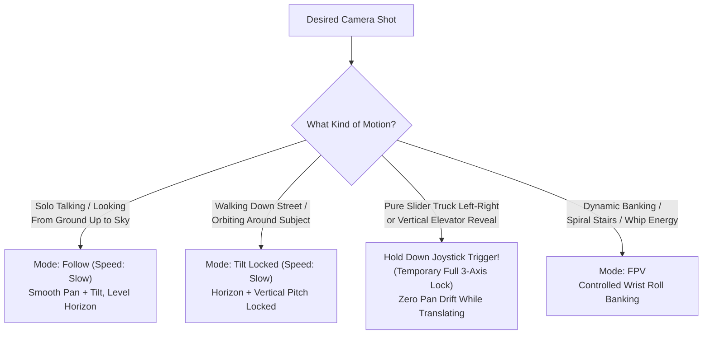
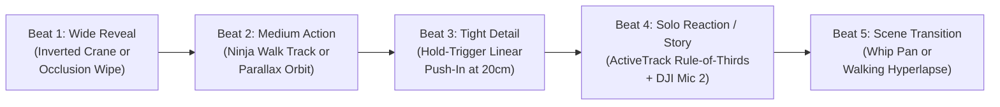

# DJI Osmo Pocket 3 Complete Field Playbook

The DJI Osmo Pocket 3 is the rarest category of consumer hardware: a palm-sized 179g tool whose mechanical 3-axis gimbal, `1-inch` stacked CMOS sensor (`20mm f/2.0` equivalent), and instant rotatable 2-inch OLED screen solve problems that even USD 4,000 mirrorless bodies struggle with when you are traveling, eating, or exploring solo.

Out of the box, however, the Pocket 3 ships with **over-sharpened consumer defaults, twitchy gimbal pan speed, auto-exposure pumping, and confusing tracking behaviors**. Configure it properly once on Day 1, and every clip looks damped, organic, and cinema-grade.

*(See [00-README.md](00-README.md) for how Pocket 3 pairs with iPhone Pro, and [01-IPHONE-PRO-PHOTO-AND-VIDEO-TRICKS.md](01-IPHONE-PRO-PHOTO-AND-VIDEO-TRICKS.md) for covering `35mm` and `120mm` telephoto shots.)*

---

## 1. Day-1 Optimal Menu & Image Engineering Setup

Before filming your first clip, swipe through the Pocket 3 touchscreen menus to lock in these permanent foundation settings.

### Step 1: Defeat Digital Crunchy Edges (`Image Adjustment`)
1. Swipe **left** from the right edge of the viewfinder to open shooting parameters.
2. Switch from `Auto` to **`PRO`** mode (top-right toggle badge).
3. Tap **`Image Adjustment`** (slider icon):
   - **Sharpness**: **`-1`** (or **`-2`** if cutting directly alongside soft cinema cameras / Black Mist filters). Factory `0` adds harsh digital edge ringing around hair, leaves, and building rooflines.
   - **Noise Reduction**: **`-2`**. Factory `0` smears fine skin texture into waxy plastic in dim rooms. Leaving fine monochromatic luma grain (`-2`) preserves micro-detail and allows vastly cleaner post-noise reduction in DaVinci Resolve if ever needed.

### Step 2: Color Profiles — `D-Log M (10-bit)` vs `HLG` vs `Normal`

While in **`PRO`** mode, tap **`Color`**:

| Color Mode | Bit Depth & Chroma | Dynamic Range & Tonality | Exposure Compensation Target | When to Choose |
| :--- | :--- | :--- | :--- | :--- |
| **Normal** | 8-bit `4:2:0` (`Rec.709`) | Baked contrast & punchy DJI color science | **`-0.3 EV`** (protects sky & forehead highlights) | Fast same-day edits, sharing straight via DJI Mimo app to phone |
| **HLG** | 10-bit `4:2:0` (`Rec.2020`) | High dynamic range with bright speculars | **`0.0` to `-0.3 EV`** | Editing HDR timelines for iPhone / iPad OLED & YouTube HDR |
| **D-Log M** | **10-bit `4:2:0` (`1.07B` colors)** | **Flat semi-log curve; smooth highlight roll-off** | **`0.0` to `-0.3 EV`** *(Never overexpose!)* | **Default choice for vlogs, travel films, and matching iPhone Apple Log** |

> **Critical D-Log M Exposure Rule (Do NOT ETTR!)**: Unlike Sony `S-Log3` (where cinematographers expose `+1.3` to `+1.7 EV` to the right), DJI `D-Log M` allocates most of its 10-bit code values around middle gray and clips highlights abruptly near `95 IRE`. **Expose D-Log M at `0.0 EV` or `-0.3 EV`**, and turn ON **`Color Recovery`** (in the pull-down quick menu, LUT icon) so your Pocket 3 screen previews normalized Rec.709 contrast while recording flat 10-bit D-Log M to the microSD card.

### Step 3: System & Gimbal Damping Settings (Swipe Down from Top)

| Menu Icon / Path | Setting | Optimal Value | Why It Matters |
| :--- | :--- | :--- | :--- |
| **Rotational Speed** (Gimbal dial icon) | Gimbal Follow Speed | **`Slow`** | Eliminates robotic micro-jerks; mimics a heavy fluid-head cinema tripod pan |
| **Settings (Gear) > Gimbal Startup Direction** | Lens Direction on Flip | **`Forward`** (or `Last Setting`) | Ensures flipping the screen open instantly points outward to capture fleeting street scenes |
| **Settings > Screen Off When Locked** | Rotate Screen to Power Off | **`2s`** (or `Immediately`) | Lets you snap the screen vertical to power down cleanly with one thumb |
| **Settings > Anti-Flicker** | Mains Frequency | **`50 Hz`** (China/EU/East JP) or **`60 Hz`** (US/West JP) | Prevents horizontal dark rolling bands under indoor LED/fluorescent tubes when Shutter is Auto |
| **Settings > Gridlines** | Framing Overlay | **`Grid + Diagonals`** (or `Grid`) | Essential for leveling horizons in `FPV` mode and placing faces on rule-of-thirds intersections |
| **Settings > Wireless Mic > LED** | TX Status Lights | **OFF** | Turns off bright blue/green/red lights on your chest when wearing DJI Mic 2 in public! |
| **Settings > Video Compression** | Codec | **`HEVC` (`H.265`)** | Required for 10-bit `D-Log M` and `HLG` recording |

### Step 4: Program Your 3 Custom Mode Slots (`C1`, `C2`, `C3`)

Fumbling with ISO, frame rate, and gimbal modes on a busy sidewalk guarantees missed moments. Swipe down -> tap the **`C` (Custom Mode)** icon to save three instant field profiles:

| Preset Slot | Mode & Resolution | Shutter / ISO | WB & Color | Gimbal Mode & Speed | Field Purpose |
| :--- | :--- | :--- | :--- | :--- | :--- |
| **`C1`: Everyday Vlog & A-Roll** | Video `4K 24fps` (or `30fps`) | Auto Shutter (with VND outdoors) or `1/50s`; ISO `50–800`; EV `-0.3` | `5600K` (or AWB Outdoors); `D-Log M` (`-1` Sharp, `-2` NR) | **`Follow`**, Speed `Slow` | Talking while walking, general daytime storytelling |
| **`C2`: Dreamy Slow-Mo B-Roll** | Video `4K 60fps` | `1/120s` (or `1/100s` in 50Hz); ISO `50–1600`; EV `-0.3` | `5600K`; `D-Log M` (`-1` Sharp, `-2` NR) | **`Tilt Locked`**, Speed `Slow` | Smooth slider reveals, parallax orbits, pouring coffee/cooking slowed to `40%` |
| **`C3`: Night Street & Cafe** | **Low-Light** `4K 24/30fps` *(or Video `PRO` `D-Log M`)* | Fixed **`1/50s`** (50Hz) / **`1/60s`** (60Hz); ISO `50–3200` | Locked **`4300K`** | **`Tilt Locked`**, Speed `Slow` | Neon night markets, dim izakayas, cozy evening walks with zero light-smear |

*Note on `4K 120fps`*: Access dedicated **Slow Motion** mode (`4K 120fps`) via the mode carousel for hero 5x slow-motion bursts (raindrops hitting puddles, wok flames, train passing). Note that `4K 120fps` records 8-bit Normal color with baked audio muted/separated—use `C2` (`4K 60fps`) when you want full 10-bit `D-Log M` color grading!

---

## 2. Mastering the 3 Gimbal Modes & Trigger Muscle Memory

Understanding *which physical axes are locked vs damped* separates intentional camera movement from seasick wandering. Every 3-axis gimbal controls three rotations:
- **Pan (Yaw)**: Turning left and right horizontally.
- **Tilt (Pitch)**: Looking up at the sky and down at the ground.
- **Roll (Horizon)**: Tilting your head ear-to-shoulder.

### The Three Gimbal Modes Deconstructed

1. **`Follow` (Pan Follows + Tilt Follows | Roll Locked Level)**
   - **Behavior**: Horizon stays dead level, while the camera smoothly follows both your left/right turns and your upward/downward hand tilts.
   - **Use For**: Solo vlogging (`A-roll`), POV storytelling (looking down at your boarding pass then tilting up to the departure gate), following children or pets.
2. **`Tilt Locked` (Pan Follows | Tilt Locked + Roll Locked)**
   - **Behavior**: The lens stares straight ahead at a fixed vertical angle (usually `0°` horizontal) **no matter how high or low you raise your arm** or tilt the handle!
   - **Use For**: **80% of cinematic B-roll**—linear hallway walks, low-to-high crane elevations, pushing over a dining table without accidentally pitching down at your shoes.
3. **`FPV` / `Perpetual FPV` (All 3 Axes Follow — Pan, Tilt, Roll)**
   - **Behavior**: Unlocking the roll motor lets the horizon bank smoothly like a banking aircraft wing as you twist your wrist.
   - **Use For**: Energetic transitions, winding spiral staircases, POV cycling, creative Dutch-angle reveals. *(Never leave `FPV` active during normal talking shots, or crooked horizons will make viewers dizzy.)*

### 5D Joystick Button Muscle Memory (Memorize Until Automatic)

The tiny clickable joystick on the handle is also your mechanical command trigger:

| Joystick Gesture | Mechanical Action | Critical Field Application |
| :--- | :--- | :--- |
| **Single Press** | Cancels `ActiveTrack` (if active) | Instant unlock when stepping out of solo tracking |
| **Double Press** | **Recenter Gimbal** | Always double-press with handle vertical *before* starting any move |
| **Triple Press** | **180° Selfie Flip** | Seamless mid-clip switch from showing your view to talking to camera (and back!) |
| **Press and Hold** | **FULL LOCK Mode (All 3 Axes Locked)** | **Secret Cinema Weapon**: Locks Pan, Tilt, and Roll completely parallel in space! Move your arm left, right, up, down, or diagonally to emulate a USD 2,000 mechanical camera slider or jib arm! |

### Gimbal Mode & Gesture Routing Diagram

---

## 3. ActiveTrack 6.0: Your Solo Robotic Camera Operator

When filming your own life, nobody is standing behind the camera to reframe as you chop vegetables, make coffee, or gesture at a whiteboard. `ActiveTrack 6.0` uses on-chip vision + mechanical gimbal motors to keep you framed smoothly without digital cropping.

### Three Pro ActiveTrack Techniques

1. **Dynamic Framing (Never Sit Dead Center Like a Passport Photo!)**:
   - Instead of simply double-tapping your face (which pins your nose dead center with wasted headroom above your hair), go to the **ActiveTrack settings** or **drag your finger on the joystick *after* locking ActiveTrack** to offset your face onto the **left-third or right-third upper grid intersection**!
   - Pocket 3's **Dynamic Framing** remembers that golden-ratio composition offset and pans smoothly to preserve your lead room as you lean across a desk or kitchen counter.
2. **Face Auto-Detect Mode for Zero-Touch Vlogging**:
   - Enable **Face Auto-Detect** when filming dedicated solo A-roll: the instant you triple-press into selfie orientation (or step in front of the lens), Pocket 3 locks onto your face automatically without tapping the tiny 2-inch glass.
3. **The Tabletop "Invisible Crew" Setup**:
   - Screw the included **Mini Tripod** onto the `1/4"-20` Battery Handle thread.
   - Place the Pocket 3 at the far corner of your kitchen counter, workbench, or restaurant booth (`1.2m` to `2.0m` away, slightly below or at eye level).
   - Draw a green tracking box over your upper torso, offset framing to the `1/3` grid line, and forget the camera exists for the next 10 minutes. As you walk from the cutting board to the stove, the mechanical head pans silently like a human camera operator.

---

## 4. Night & Low-Light Street Mastery (Zero Motion Smear)

Evenings—warm dinner tables, rainy neon crosswalks, lantern-lit alleys—hold the richest mood in personal life videos, yet most pocket cameras turn night walks into blurry smear.

### Why Gimbal Footwork Still Matters at Night (The Z-Axis Physics)

A 3-axis gimbal cancels **rotational angles** ($\theta_{\text{pan}}, \theta_{\text{tilt}}, \theta_{\text{roll}}$), **not linear vertical translation** ($\Delta Z$). If you stomp your heels at night while shooting `1/50s` shutter:
1. During the `20 ms` (`1/50s`) exposure window, the camera physically drops `8 mm` vertically.
2. Nearby foreground signs or table edges blur vertically by several pixels during that exposure, creating rhythmic "step-bounce pulsing" on every footstep!

### Two Proven Night Shooting Configurations

#### Option A: Dedicated `Low-Light` Mode (Fastest Plug-and-Play)
- Select **`Low-Light`** from the main mode carousel (`4K 24fps` or `30fps`).
- DJI switches to a multi-frame temporal denoising + expanded dynamic range pipeline engineered specifically for high-contrast night highlights (preventing neon signs from blowing out to white blobs while keeping alleys clean up to `ISO 6400`).
- *Tradeoff*: `Low-Light` mode outputs 8-bit `Normal` color (`D-Log M` is unavailable inside dedicated Low-Light mode).

#### Option B: Manual `PRO` `D-Log M` Night Setup (Best Color Control)
When you want 10-bit grading consistency with the rest of your film:
1. Stay in normal **`Video`** mode (`4K 24fps` or `30fps`), `Color: D-Log M`.
2. Switch Exposure from `Auto` to **`M` (Manual)** (or `Auto` with clamped ISO):
   - **Shutter Speed**: Lock strictly at **`1/50s`** (in 50Hz countries like China/Europe) or **`1/60s`** (in 60Hz countries). *Never let Auto Shutter drop to `1/25s` while walking, or every neon sign smears!*
   - **ISO Range**: Set `50–1600` for bustling lit streets, or `50–3200` for quieter residential lanes. On the `1-inch f/2.0` lens, `ISO 1600` at `1/50s` is remarkably clean!
   - **White Balance**: Lock **`4200K` to `4500K`**. At `4300K`, sodium/tungsten restaurant windows glow warm amber (`2800K`) while overhead street LEDs read crisp cool cyan (`5600K`)—giving instant *Blade Runner* / Wong Kar-wai color contrast right in camera!

---

## 5. The 8 Signature Gimbal Moves (Biomechanics & Execution)

Never wave a gimbal aimlessly. Every shot in an edit should execute **one deliberate geometric vector** for `4 to 6 seconds` (holding steady `1 second` before and after the move for clean edit handles).

### Move 1: The Ninja Walk (Z-Axis Isolation Foundation)
- **Mode**: `Tilt Locked` (`Speed: Slow`).
- **Biomechanics**: Bend both knees slightly (`15 degrees`), engage your core so your hips glide at a constant height above the pavement, and roll smoothly **heel-to-ball-of-foot** (walking forward) or **toe-to-heel** (walking backward). Tuck your shooting elbow softly (`45 degrees` bend) as a human shock absorber—never lock your arm straight out!

### Move 2: The Inverted Underslung Crane Reveal
- **Mode**: `Tilt Locked` (`Speed: Slow`).
- **Execution**: Flip the Pocket 3 **upside down (`180°` inverted)** so the camera head hangs just `5 cm` above cobblestones, tall grass, or a cafe tabletop. Double-tap the joystick to level the inverted head. Begin walking slowly forward while smoothly raising the camera from ankle height up to chest height behind a foreground object (a stone balustrade, flower bed, or coffee mug).
- **Visual Effect**: Mimics a Hollywood crane jib rising into a grand establishing view with rich foreground parallax.

### Move 3: The Press-and-Hold Linear Slider Push-In / Pull-Out
- **Mode**: Any mode -> **Press and HOLD the joystick button continuously**.
- **Execution**: Frame a close-up subject (`30 cm` from a steaming bowl of noodles, mechanical keyboard, or artisan hands). Hold the joystick button down to freeze all 3 axes, plant your front foot, and shift your body weight smoothly forward (`20 cm` closer) or backward (`30 cm` wider) over `4 seconds`.
- **Visual Effect**: Indistinguishable from a motorized Edelkrone rail slider because pan drift is mathematically zero.

### Move 4: The Parallax 180-Degree Orbit
- **Mode**: `Tilt Locked` + **`ActiveTrack 6.0` locked on center object/person** (no manual thumb pan needed!).
- **Execution**: Draw an ActiveTrack box around your friend, statue, or vintage car (`1.5m` to `3m` radius). Walk in a smooth semicircle sideways (`heel-over-toe` grapevine step) while ActiveTrack counter-rotates the gimbal head smoothly to keep the subject pinned in frame as the background spins behind them!

### Move 5: The Foreground Occlusion Wipe (Invisible Cut)
- **Mode**: **Press-and-Hold Full Lock** (`4K 60fps` recommended).
- **Execution**: Truck laterally left-to-right behind a dark vertical foreground element (a temple pillar, tree trunk, wall edge, or passing pedestrian's coat) until it fills `100%` of the frame in black/blur. Start the *next* location's clip emerging left-to-right from behind a dark doorframe or pillar. Splice the two clips on the dark middle frame in your NLE for a seamless time/location jump.

### Move 6: The Whip Pan Transition
- **Mode**: `Follow` or `Tilt Locked`.
- **Execution**: Hold steady on Subject A for `3 seconds`, then flick your wrist rapidly **horizontally right** (`90+ degrees` in `0.2 seconds`) so motion blur streaks across the sensor. At Location B, start pointing left, flick your wrist **rapidly right** onto Subject B, and hold steady for `3 seconds`. Cut right on the peak motion-blur frame (`add a subtle whoosh SFX` in post).

### Move 7: The 90-Degree Overhead Culinary Sweep
- **Mode**: `Follow` -> Tilt camera straight down (`-90°`), **then Press-and-Hold Joystick** to lock straight-down pitch!
- **Execution**: Raise the Pocket 3 `60 cm` directly above a spread of Chinese dishes, travel journal, or desk gear, and glide smoothly parallel to the table edge from one dish to the next. Locking the trigger prevents the gimbal from hitting pitch gimbal-lock singularities when pointing straight down.

### Move 8: Anchored Walking Hyperlapse & Waypoint Motionlapse
- **Walking Hyperlapse**: Select **`Hyperlapse`** (`4K`, `Rate: 10x` or `15x`). Tap a distant stationary architectural landmark (pagoda tower, clock tower, skyscraper tip) to engage **ActiveTrack**. Walk straight toward it for `2 to 3 minutes`—ActiveTrack keeps that landmark pinned dead-center across 400 footsteps!
- **Night Traffic Light-Trail Motionlapse**: Mount Pocket 3 on the Mini Tripod overlooking an intersection, select **`Motionlapse`**, tap `+` to set Waypoint A (left) and Waypoint B (right), set `Interval: 2s`, `Duration: 10m`, snap on an **`ND16` or `ND64` filter** (at twilight) or `ISO 50`, and set Manual Shutter to **`1/2s` or `1s`**. Every car headlight stretches into silky neon ribbons while the camera pans microscopically across the skyline.

---

## 6. Hardware Care, microSD Cards & Field Pitfalls

1. **microSD Specification**: Always use **UHS-I Speed Class 3 (`U3`), Video Speed Class `V30`, Application Class `A2`** (`128GB` or `256GB` sweet spot—e.g., SanDisk Extreme Pro, Samsung PRO Plus, or Lexar Silver Plus). Cheap `U1 / Class 10` cards choke on `130 Mbps` 4K60 10-bit streams and halt recording mid-take.
2. **Never Force or Pocket an Unprotected Gimbal**: Brushless gimbal ribbon cables are hair-thin. Always snap the Pocket 3 head-first into DJI's Protective Cover (aligning the screen inward) before tossing it into a jacket or bag.
3. **Remove Thick Stacked Filters Before Powering Down**: Thin single-layer magnetic ND or Black Mist filters usually fold flat when the gimbal parks, **but thick rotating VND + CPL combo filters will jam the gimbal arm during power-off parking**, straining the roll motor! Pop thick VND filters onto the magnetic slot inside the Protective Cover *before* rotating the screen shut.

---

## Next Step in the System

Smooth 10-bit gimbal footage still falls flat if wind buffets your audio, midday sun forces a `1/2000s` shutter, or self-consciousness makes you freeze up in cafes. Proceed to **[03-WIRELESS-AUDIO-LIGHTING-AND-ACCESSORIES.md](03-WIRELESS-AUDIO-LIGHTING-AND-ACCESSORIES.md)** to master DJI Mic 2 `32-bit float` audio, magnetic ND/Mist filtration, and low-profile public filming psychology.
