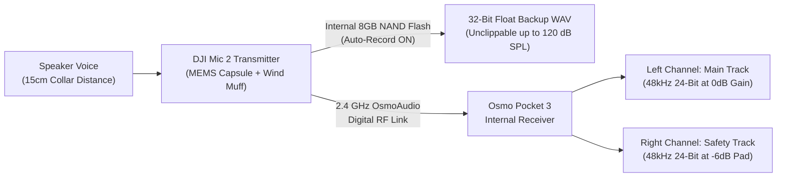
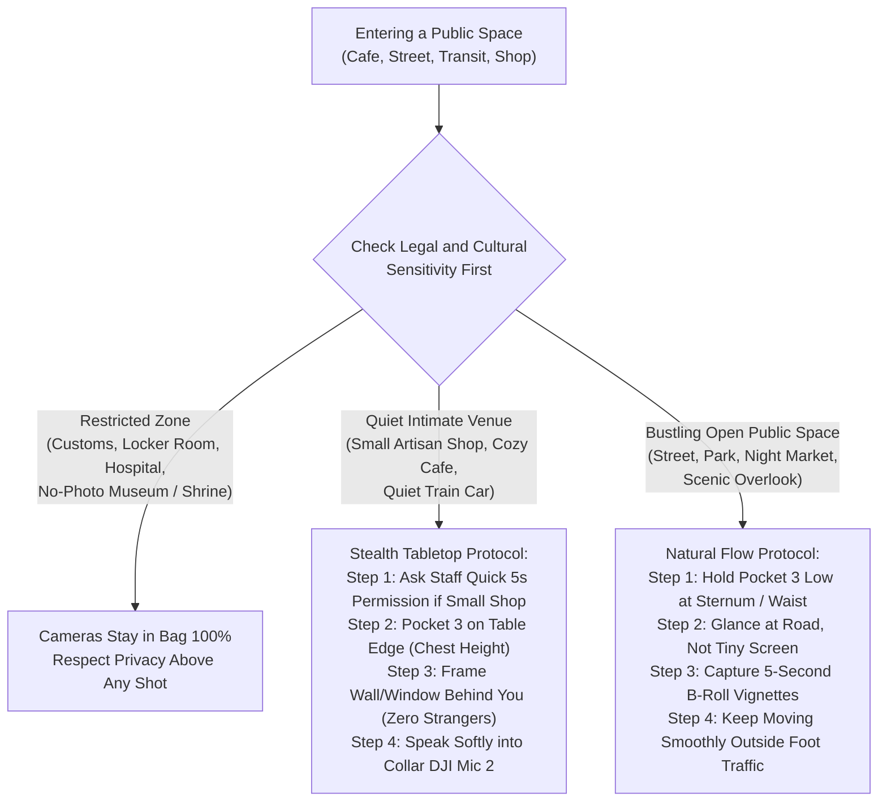

# DJI Mic 2 Audio, Magnetic ND/Mist Filters & Shooting Confidently in Public

Viewers will gladly watch slightly grainy handheld footage if the story feels intimate and the voice sounds warm, present, and effortless. Conversely, **viewers abandon crystal-clear 4K ProRes video within five seconds** if wind roars across the capsule, espresso machines drown out speech, or digital clipping crackles on every laugh.

This final module completes your pocket production system across three pillars: **fail-safe 32-bit float wireless audio**, **optical ND and Black Mist filtration**, and **the psychological & social craft of filming naturally in public without awkwardness**.

*(Review [00-README.md](00-README.md) for overall kit synergy, [01-IPHONE-PRO-PHOTO-AND-VIDEO-TRICKS.md](01-IPHONE-PRO-PHOTO-AND-VIDEO-TRICKS.md) for iPhone optical control, and [02-DJI-OSMO-POCKET-3-COMPLETE-MASTERY.md](02-DJI-OSMO-POCKET-3-COMPLETE-MASTERY.md) for Pocket 3 gimbal execution.)*

---

## 1. Acoustic Physics: Why Mic Placement Beats Expensive Microphones

Sound pressure intensity falls off according to the **Inverse Square Law** ($I \propto \frac{1}{d^2}$). Every time you halve the distance between your mouth and the microphone capsule, your direct voice signal increases by **`+6 dB`** relative to diffuse background restaurant chatter or traffic noise:

$$\Delta \text{SNR (dB)} = 20 \log_{10}\left(\frac{d_{\text{camera}}}{d_{\text{collar}}}\right)$$

Compare two setups across a noisy cafe table:
- **Built-in Camera Mic at $d_{\text{camera}} = 1.80\text{ m}$ (`180 cm`)**: Captures clinking dishes, espresso steam wands, and room slapback echo at nearly the same loudness as your voice.
- **DJI Mic 2 Clipped at Collarbone $d_{\text{collar}} = 0.15\text{ m}$ (`15 cm`)**:
  $$\Delta \text{SNR} = 20 \log_{10}\left(\frac{180}{15}\right) = 20 \log_{10}(12) \approx +21.6\text{ dB}$$

A **`+21.6 dB`** boost in voice-to-noise ratio means you can **speak softly in a normal, relaxed indoor tone**—never "projecting like a YouTuber"—and sound like an intimate late-night podcast host while diners at the next table cannot even hear what you are saying.

---

## 2. DJI Mic 2 + Osmo Pocket 3 Direct Ecosystem Setup

The Osmo Pocket 3 Creator Combo ships with a **DJI Mic 2 Transmitter (`TX`)** that links directly to the Pocket 3's internal `2.4 GHz` receiver (`OsmoAudio`)—requiring zero external receiver dongles or `3.5 mm` TRS patch cables.

### Direct Pairing & Connection Caveat (Pocket 3 vs iPhone Pro)

- **With Osmo Pocket 3 (Best Quality, Zero Dongle)**:
  1. Swipe down on Pocket 3 -> `Settings (Gear) > Wireless Mic > TX1` to enter pairing mode (already factory-paired in the Creator Combo!).
  2. On the DJI Mic 2 TX: power it on, hold the **Record** button + **Linking** button (or hold Linking for 2s until the LED flashes rapid blue) if re-pairing after Bluetooth use.
  3. Transmits uncompressed **`48 kHz 24-bit`** digital audio over `2.4 GHz` directly into your Pocket 3 `.MP4` file!
- **With iPhone Pro (CRITICAL Bluetooth Warning!)**:
  - DJI Mic 2 *can* pair directly to an iPhone via **Bluetooth** (holding Power to turn the LED blue, then holding Link). **However**, Bluetooth audio profiles drop sampling bandwidth down to **`16 kHz` narrowband** (telephone/AirPods mic quality) and work only inside select apps like Blackmagic Camera—not the stock iOS Camera app in full fidelity!
  - **Pro Rule**: When recording primary spoken A-roll on your iPhone Pro, either plug a **DJI Mic 2 USB-C Receiver (`RX`)** into the iPhone's USB-C port (`48 kHz 24-bit` full broadcast spectrum), OR let the DJI Mic 2 TX record standalone **`32-bit float` internal WAV** (press the red REC button on the side of the mic, clap your hands once on camera, and auto-sync waveforms in 1 click in DaVinci Resolve / Final Cut!).

### Redundant Dual-Path Audio Architecture

Configure your DJI Mic 2 settings inside the Pocket 3 `Wireless Mic` menu so **zero human error can ever ruin a take**:

### Exact `Wireless Mic` Menu Configuration on Pocket 3

| Menu Parameter | Recommended Value | Why This Setting Saves Shots |
| :--- | :--- | :--- |
| **Audio-to-Video Sync / Auto Record** | **ON** | Every time you hit Record on Pocket 3, the Mic 2 TX automatically writes a redundant backup `.WAV` file onto its internal `8 GB` memory (`14 hours` capacity)! |
| **32-Bit Float Recording** | **ON** | Uses IEEE 754 floating-point encoding on internal `.WAV` backups—even if someone screams or laughs right into the mic, pulling gain down `-12 dB` in post restores a 100% clean, unclipped waveform! |
| **Backup Audio Track (`-6 dB` Safety)** | **ON** (or Built-in Mic Backup ON) | Writes a `-6 dB` padded safety channel (or ambient stereo room track on the Pocket 3's internal 3 mics!) so you have both close-mic voice and stereo street ambience! |
| **Transmitter Gain** | **`-3 dB` to `0 dB`** | Keeps normal conversational peaks sitting safely around `-12 dBFS` to `-8 dBFS` on the Pocket 3 meter |
| **Low Cut (`150 Hz`)** | **ON** outdoors / transit; **OFF** quiet home | Cuts rumble below `150 Hz` from subways, AC vents, and wind; turn OFF in quiet bedrooms to preserve chest resonance |
| **Noise Cancelling** | **OFF** default; **Basic** in loud crowds | Toggle via **single-press on the Mic 2 Power button** (LED turns yellow-amber). Use `Basic` in noisy streets/trains; avoid `Strong` unless next to jet/construction noise, as heavy DSP gating introduces metallic vocal artifacts |
| **TX LED Indicator** | **OFF** | Hides glowing lights on your collar so strangers never stare at your chest |
| **Vibration Notification** | **ON** | Gives a discreet haptic buzz on your collarbone when recording or noise-cancelling toggles (since LEDs are hidden!) |

> **Why `32-Bit Float` Is Not Magic Above `120 dB SPL`**: `32-bit float` eliminates **ADC digital clipping** inside the recorder electronics, *not* physical diaphragm overload of the microphone capsule (`120 dB SPL` limit). Never blow compressed air directly into the grille, and always mount the wind muff outdoors!

---

## 3. Invisible Collar Mounting & Wind Protection

How you clip a wireless transmitter separates clean documentary visuals from amateur clutter.

1. **Defeat "T-Shirt Collar Droop"**: Clipping a `28g` rectangular transmitter sideways onto a thin summer cotton t-shirt pulls your neckline down in an awkward V-sag. Instead:
   - Place the **transmitter body *inside* your shirt** against your sternum (`15–18 cm` below your chin, capsule grille facing *upward* toward your mouth), and snap the **small square clip magnet on the *outside***—or hide both behind a button-down shirt placket!
   - If wearing a thick sweater, hoodie, or jacket lapel, clip normally with the DJI logo facing *inward* against the fabric so only a tiny matte-black tab is visible.
2. **Prevent Beard & Fabric Rustle**: Ensure your chin or stiff jacket zipper does not rub across the top mesh grille when turning your head left and right. Leave `1 cm` of air clearance above the capsule.
3. **Mandatory Outdoor Wind Muff Rule**: Human ears ignore a `12 km/h` gentle breeze; an unshielded omnidirectional MEMS port turns that exact breeze into `80 Hz` thunder that ruins even 32-bit float files. **Leave the furry twist-lock wind muff attached inside your sling bag whenever shooting outdoors**, snapping it off only when indoors on camera.

---

## 4. Optical Filtration: Magnetic VND & Black Pro-Mist Filters

Small fixed-aperture cameras (`f/2.0` on Pocket 3, `f/1.78` on iPhone Pro) suffer from one unavoidable law of physics: **they have no mechanical iris blades to stop down to `f/8` or `f/11` in bright sunlight**.

Without a Neutral Density ("sunglasses for your lens") filter on a sunny afternoon:
- At `ISO 50` and `f/2.0`, proper exposure requires a shutter speed around **`1/2500s` to `1/4000s`**.
- Every walking step, ocean wave, bicycle spoke, and hand gesture freezes with zero motion blur—producing harsh, hyper-real "soap opera / security camera" cadence, and triggering nasty rolling-shutter jello on fast pans.

### Neutral Density Stop Reduction Math

An ND filter's optical factor reduces incoming photon flux by $2^N$, where $N$ is the number of exposure stops:

$$N = \log_2(\text{ND Factor}), \qquad T_{\text{new}} = T_{\text{unfiltered}} \times \text{ND Factor}$$

Use this field lookup chart to hit your `180-degree` cinematic shutter (`1/48s` or `1/50s` at `24fps`; `1/60s` at `30fps`) at `ISO 50`:

| Lighting Condition | Unfiltered Shutter at `f/2.0, ISO 50` | Required ND Filter (`Stops`) | Resulting Cinematic Shutter |
| :--- | :--- | :--- | :--- |
| **Night / Dim Cafe / Indoor** | `1/30s` to `1/60s` (`ISO 400–3200`) | **None (`Remove ND immediately!`)** | `1/50s` |
| **Deep Overcast / Blue Hour / Forest Canopy** | `1/200s` to `1/400s` | **ND4 to ND8** (`2–3 Stops`) | `1/50s` |
| **Open Shade / Hazy Bright Day / Golden Hour** | `1/800s` | **ND16** (`4 Stops`, $16\times$) | `1/50s` |
| **Direct Clear Midday Sunlight** | `1/1600s` to `1/3200s` | **ND32 to ND64** (`5–6 Stops`, $32\times\text{ to }64\times$) | `1/50s` |
| **Snowfield / Tropical White Sand Beach / Glare** | `1/5000s+` | **ND128 to ND256** (`7–8 Stops`) | `1/50s` |

### Choosing the Right Magnetic Filters for Pocket 3 & iPhone

1. **Magnetic Variable ND (`VND 2–5 Stop` / `ND4–ND32`) — Your #1 Everyday Filter**:
   - Snaps onto the Pocket 3 gimbal face magnetically in `0.5 seconds`. Instead of swapping three tiny glass chips with greasy fingertips when walking from a shady alley into a sunlit plaza, you simply rotate the hard-stopped gold outer ring from `2` to `5` stops!
   - **Hard-Stop VND Only**: Buy only **hard-stopped** VNDs (`2–5 stops` and `6–9 stops` split across two filters—e.g., Freewell, K&F Concept, or Neewer slim magnetic series). Cheap `ND2-ND400` all-in-one VNDs rotate past `90 degrees` of cross-polarization, stamping a giant purple **`X` shadow** across `20mm` wide skies!
2. **`1/4` or `1/8` Black Mist (Diffusion) Filter — The Anti-Digital Secret**:
   - Microscopic black specks suspended inside optical glass scatter a tiny fraction of specular highlight energy into adjacent shadow regions (**halation bloom**) while softening harsh digital micro-contrast on skin pores.
   - **Strength Guide**:
     - **`1/8` Black Mist**: Ultra-subtle; safe to leave on 24/7 day and night without milky daytime flare.
     - **`1/4` Black Mist**: Classic filmic glow around cafe Edison bulbs, rainy night streetlamps, and backlit hair; pairs extraordinarily well with `D-Log M` and `Apple Log`.
     - **`1/2` or `1` Black Mist**: Too heavy for a `20mm` lens—turns daylight skies hazy gray. Skip.
   - *Combo Tip*: Many manufacturers offer a **2-in-1 Magnetic `VND (2–5 Stop) + 1/4 Black Mist`**, giving both shutter control and highlight bloom in one glass mount (just remember to pop thick combo filters off before powering down the Pocket 3 so the gimbal parks flush!).

---

## 5. Natural Light Shaping & Pocket Fill Lighting

Before buying any LED light, learn to **position yourself relative to existing light**—a USD 0 habit that outperforms USD 500 lighting kits in daily life:

1. **The 45-Degree Cafe Window Rule**: Never sit *with your back* to a bright daytime window (turns your face into a dark silhouette or forces blown-out white windows behind you). Sit **sideways or 45 degrees facing the window**: soft diffused sky light wraps across one cheek into a natural triangle on the shadow cheek (**Rembrandt lighting**), while the dark interior wall behind you gives rich depth contrast!
2. **Kill Overhead "Raccoon-Eye" Ceiling Downlights**: In hotel rooms, Airbnb kitchens, and home offices, overhead recessed ceiling spots cast harsh black bags directly under your eyebrows and nose. **Switch overhead ceiling lights OFF**, and turn ON table lamps, floor lamps, or range-hood lights positioned near eye level.
3. **The Pocket Bi-Color LED Fill (`CRI 96+`)**:
   - Carry one credit-card-sized bi-color LED light with a snap-on **silicone diffusion dome** (e.g., Zhiyun Fiveray M20C, Aputure MC Pro, or Ulanzi Mini Cube—around `70g` to `140g`).
   - **Never blast `5600K` white light at `100%` into your face in a cozy `2900K` candlelit restaurant**—you will blind neighboring tables and turn your face ghostly blue! Dial the LED down to **`2700K–3000K` at `5% to 12%` brightness**, held `45 degrees` off-axis at arm's length just to put a gentle catchlight in your eyes and lift under-eye shadows by 1 stop.

---

## 6. Psychology & Etiquette: Filming Naturally in Public Without Awkwardness

Technical camera settings are easy; **overcoming the internal cringe of holding a camera in public at age 32** is what actually stops most thoughtful people from making vlogs or recording life memories.

### Defeating the "Spotlight Effect" (Cognitive Psychology Reality)

Social psychologists Thomas Gilovich and Kenneth Savitsky demonstrated the **Spotlight Effect**: humans consistently overestimate the percentage of strangers noticing them by **`300% to 500%`**. In any bustling city cafe, subway platform, or market:
- **95% of passersby are staring at their own smartphones** or lost in personal errands.
- The remaining **5% glance for `0.8 seconds`** purely out of peripheral motion reflex—checking *"Is this person blocking my path, filming ME without consent, or being loud and obnoxious?"*—and immediately look away when the answer is *no*.

People do not stare at cameras; **people stare at nervous, furtive, or performative behavior** (holding a tripod stick stiffly at full arm extension while shouting *"HEY GUYS WELCOME BACK!"*).

### Public Environment Sensitivity & Stealth Protocol

### Six Concrete Field Habits That Eliminate Awkwardness Overnight

1. **Drop the Camera from Eye Level Down to Sternum Level**:
   - Holding any camera straight out at eye level signals *"Everybody watch out, I am filming!"*
   - Holding the palm-sized Pocket 3 loosely near your **chest or sternum (`Tilt` angled slightly up by `10 degrees` toward your face, or straight ahead for B-roll)** looks virtually identical to holding an iced coffee or power bank. Strangers barely register it exists.
2. **Frame Walls, Windows, and Foliage Behind You (Protect Strangers' Privacy)**:
   - In restaurants or cafes, choose a **corner seat or wall booth facing inward/sideways** so the background behind your shoulders is brick, plants, bookshelves, or your own table—never an unconsenting stranger chewing lunch `1.5 meters` behind your ear! Not only is this respectful (and legally critical in privacy-conscious countries like **Japan, Germany, and France**), it also makes your composition 10x cleaner.
3. **Talk *To One Close Friend*, Never *At an Imaginary Crowd***:
   - The "fake YouTuber voice" feels embarrassing because it *is* unnatural. Imagine you are recording a calm voice-memo postcard for your best friend or your 60-year-old future self. With DJI Mic 2 `15 cm` from your mouth, a relaxed library-volume voice cuts cleanly through ambient noise.
4. **The 5-Second Polite Nod to Shopkeepers & Baristas**:
   - In independent coffee roasters, ramen counters, or craft workshops, simply smile, hold up the tiny Pocket 3, and ask: *"Your coffee setup looks awesome—do you mind if I grab a quick 5-second clip of the pour? No faces!"* (`"すみません、手元だけ少し撮ってもいいですか？"` in Japan).
   - **9 times out of 10**, artisans light up with pride, slow down their pour for you, and give you hero shots you could never sneakily steal!
5. **Shoot Short `5-Second` Intentional Clips, Not 20-Minute Continuous Streams**:
   - Nobody notices someone taking 5 seconds to capture steaming dumplings arriving at the table and immediately setting the camera down to eat. Everybody gets exhausted by someone holding a camera up for 15 minutes straight while the food goes cold.
6. **Look Into the Physical Lens Barrel, Not the Tiny OLED Screen**:
   - When speaking to camera, looking down at your own image on the `2-inch` screen makes your eyes appear downcast and disconnected in the final edit—and triggers self-judgment while speaking. Glance at the screen for `1 second` to verify framing, then lock eyes directly with the tiny round glass lens like a friend's eyes.

---

## 7. Buy-Once Accessory Matrix (Skip the Junk Drawer)

Camera brands profit endlessly from selling bulky aluminum cages, suction rigs, and plastic adapters that turn a 179g pocket camera back into an annoying 900g contraption. Buy **only** Tier 1 essentials first; add Tier 2 only after 10+ shoots prove a genuine bottleneck.

| Tier | Accessory | Approx. Cost | Verdict & Specific Buying Guidance |
| :--- | :--- | :--- | :--- |
| **Tier 1: Essential** | **Pocket 3 Creator Combo** (includes Mic 2 TX, Battery Handle, Mini Tripod, Wide Lens, Bag) | Included (~USD 670 kit) | Saves ~USD 180 vs buying DJI Mic 2 + Battery Handle piecemeal; the Battery Handle also gives proper full-hand grip ergonomics |
| **Tier 1: Essential** | **256GB UHS-I U3 V30 A2 microSD** (x2 cards) | USD 22 to 30 each | `256GB` holds ~`4.2 hours` of `4K30 10-bit`; carry one card inside camera + one spare in wallet |
| **Tier 1: Essential** | **Magnetic Hard-Stop `VND 2–5 Stop` (`ND4–ND32`)** (or `VND + 1/4 Mist`) | USD 35 to 60 | Mandatory for `1/48s`–`1/60s` motion blur outdoors in daylight |
| **Tier 1: Essential** | **Magnetic `1/4` or `1/8` Black Mist Filter** | USD 20 to 35 | Leave on for evening streets, cafes, and portraits to soften digital highlight edges |
| **Tier 2: High Value** | **MagSafe Filter Mount + `58mm/67mm` VND for iPhone Pro** | USD 45 to 75 | Unlocks true `1/48s` manual shutter outdoors in Blackmagic Camera on `24mm`/`35mm`/`120mm` |
| **Tier 2: High Value** | **MagSafe M.2 2230 NVMe SSD (`1TB`) + U-Bend `10Gbps` Cable** | USD 95 to 140 | Needed *only* if shooting heavy `4K60` ProRes Apple Log or instant multi-day travel backups |
| **Tier 2: High Value** | **Ultra-Mini Magnetic Pocket Tripod / Backpack Strap Mount** | USD 20 to 35 | Great for hands-free hiking POV or ultra-stable tabletop `ActiveTrack` angles |
| **Tier 3: Trap (Skip)** | **Heavy Aluminum Pocket 3 Cages & Dual-Handle Gimbal Rings** | USD 60 to 150 | **Defeats the entire stealth & pocketability thesis** of owning a Pocket 3! |
| **Tier 3: Trap (Skip)** | **Z-Axis Spring Bounce Arms** | USD 80 to 130 | Bulky, looks ridiculous in cafes, and completely unnecessary once you spend 15 minutes practicing the heel-to-toe Ninja Walk |
| **Tier 3: Trap (Skip)** | **Clip-On Glass Smartphone Telephoto / Anamorphic Lenses** | USD 100 to 250 | Degrades corner sharpness, blocks LiDAR/neighboring lenses, and takes 45 seconds to align when native `35mm` + `120mm` optical lenses are already built in! |

---

## Final Field Readiness Checklist (30 Seconds Before Leaving Home)

1. **Power**: Pocket 3 internal battery + Battery Handle `> 80%`; DJI Mic 2 TX `> 80%`; iPhone Pro charged.
2. **Storage**: Pocket 3 microSD verified with `> 60 GB` free; iPhone internal storage `> 30 GB` free.
3. **Optics**: Both lenses wiped once horizontally with a dry microfiber cloth; `VND 2–5 Stop` + `1/4 Black Mist` snapped into the Pocket 3 cover slots.
4. **Audio**: DJI Mic 2 wind muff attached in pocket; `Auto Record` + `32-Bit Float` verified **ON**; TX LED **OFF**.
5. **Mindset**: Capture **five to eight intentional 5-second visual memories** of each chapter of your day, put the gear back in your pocket, and fully live the life in front of you.
