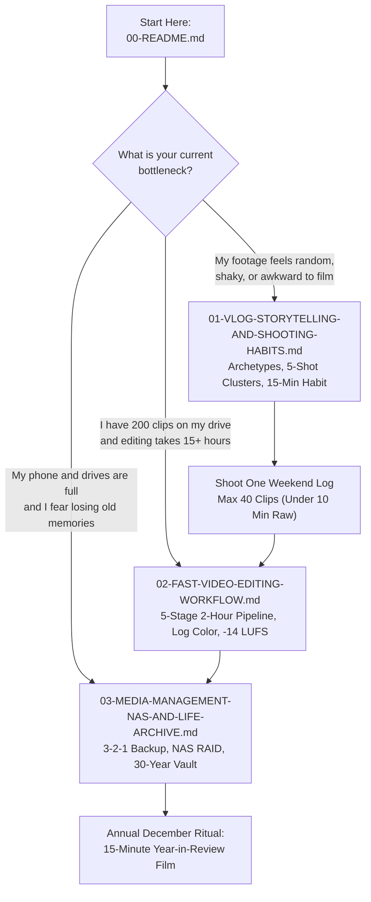

# Sustainable Personal Life Vlogging: Capturing Memories Without Living Behind a Screen

Personal life vlogging has an unfortunate reputation because commercial YouTube culture turned the word "vlog" into an exhausting performance: talking loudly into a wide-angle lens in public, staging fake morning routines, obsessing over click-through rates, and spending 20 hours every weekend editing a 10-minute video. Under that model, 95% of software engineers who buy a nice camera quit within six weeks. The camera collects dust in a drawer, and five years of their thirties pass with nothing left behind except scattered, unsearchable phone photos of receipts and lunch plates.

This curriculum designs the exact opposite system: **low-friction, cinema-inspired personal memory capture built for a full-time engineer who wants to sustain the habit for 10 to 30 years**. Your primary audience is not an algorithm. Your primary audience is your 50-year-old self, your parents as they grow older, your partner, and the handful of close friends who shared those years with you.

---

## 1. The Core Philosophy: Memory Architecture vs Content Treadmill

When you approach personal filmmaking as an engineer, your first step is defining the system's objective function. Commercial creators optimize for **viewer retention per impression**. Personal life archivists optimize for **emotional recall per unit of life disruption**.

| Dimension | Commercial Content Treadmill | Sustainable Personal Life Archive |
| :--- | :--- | :--- |
| **Primary Audience** | Strangers scrolling an algorithmic feed | Future self (5, 10, 30 years out), family, close friends |
| **Success Metric** | Views, first-30-second retention, sponsorships | Rewatchability in 2040, authenticity of voice and place |
| **Shooting Footprint** | 2 to 4 hours of staging, retakes, lighting setup | Under 15 minutes of cumulative recording per day |
| **Camera Rig** | Heavy mirrorless body, gimbal, shotgun mic, VND rig | Pocket-sized kit: iPhone Pro + DJI Osmo Pocket 3 |
| **Pacing Style** | Hyper-cut every 1.5 seconds, loud sound effects | Breathing room, J/L-cuts, ambient soundscapes, natural rhythm |
| **Publishing Cadence** | Strict weekly upload schedule or channel dies | Event-driven and seasonal; zero guilt during busy sprints |
| **Archive Longevity** | Raw files deleted or lost on random portable drives | Structured 3-2-1 NAS + offsite cloud vault with clean masters |

### The Presence Paradox (And How to Solve It)

The most common objection to recording your life is: *"If I am filming the moment, I am not living the moment."*

That happens only when your shooting workflow requires **continuous cognitive decision-making**—fiddling with ISO, balancing a 3-axis gimbal, checking focus peaking, or asking friends to "do that again." When you strip camera operation down to pre-configured hardware presets and instinctive 6-second micro-habits, filming a dinner with friends takes **45 seconds out of a 3-hour evening**:

1. **10 seconds walking up to the restaurant**: One establishing wide shot of the street sign and warm window light.
2. **15 seconds when dishes arrive**: Three 5-second close-ups of steam, chopsticks, and hands pouring tea.
3. **20 seconds mid-dinner**: Set the Osmo Pocket 3 unobtrusively at the corner of the table capturing ambient laughter while you eat and talk with zero screen interaction.

For the remaining 2 hours and 59 minutes, the camera is off and in your pocket. Five years later, that 45-second cluster edits into a 25-second scene that brings back the exact smell, voices, and atmosphere of that night.

---

## 2. System Architecture & Curriculum Map

A sustainable creator workflow is a four-stage pipeline: **Intention & Capture -> Fast Ingest -> 2-Hour Assembly Edit -> 30-Year Vault**. Friction at any single stage causes a backlog of unedited SD cards, which creates psychological guilt, which stops you from picking up the camera next weekend.

```mermaid
flowchart LR
    subgraph S1["Stage 1: Low-Friction Capture"]
        A["Pocket Kit Ready<br/>iPhone Pro + Osmo Pocket 3"] --> B["5-Shot B-Roll Clusters<br/>Under 15 min filming / day"]
        B --> C["Diegetic Soundscapes<br/>and Authentic Moments"]
    end

    subgraph S2["Stage 2: Verified Ingest"]
        D["Post-Shoot Offload<br/>NVMe Working SSD"] --> E["YYYY-MM-DD Taxonomy<br/>and Aggressive Culling"]
    end

    subgraph S3["Stage 3: 2-Hour Edit"]
        F["Selects Stringout<br/>and Radio Edit Spine"] --> G["J/L-Cuts, B-Roll<br/>and 2-Node Log Grade"]
        G --> H["Mix to -14 LUFS<br/>and Master Export"]
    end

    subgraph S4["Stage 4: 30-Year Archive"]
        I["NAS RAID Warm Vault<br/>Btrfs / ZFS Scrubbing"] --> J["Encrypted Offsite Cloud<br/>and Annual Highlight Reel"]
    end

    C --> D
    E --> F
    H --> I
```

### Clickable Curriculum Table of Contents

Work through the modules in sequence. Each guide is designed as a standalone operational reference with checklists, exact metrics, and failure recovery protocols:

1. **[01-VLOG-STORYTELLING-AND-SHOOTING-HABITS.md](01-VLOG-STORYTELLING-AND-SHOOTING-HABITS.md) — How to Structure & Shoot a Compelling Personal Vlog**
   - The 3 timeless personal vlog archetypes: *Story-Driven Day/Weekend*, *Quiet Cinematic/ASMR Life Log*, and *Travel Chapter Film*.
   - The **5-Shot B-Roll Cluster Method** so your editing self never runs out of cutaways or suffers awkward jump cuts.
   - Capturing seamless in-camera transitions, ambient room tone, and unforced human moments in under 15 minutes of filming per day.
2. **[02-FAST-VIDEO-EDITING-WORKFLOW.md](02-FAST-VIDEO-EDITING-WORKFLOW.md) — The 2-Hour Vlog Edit: CapCut Pro, DaVinci Resolve & Final Cut Pro Workflows**
   - The **5-Stage Assembly Line** (Stringout -> Radio Edit A-Roll -> J/L-Cut Pacing -> B-Roll & Match Cuts -> Color & Audio Polish) that prevents perfectionist paralysis.
   - Side-by-side NLE selection guide (CapCut Desktop Pro vs Final Cut Pro vs DaVinci Resolve) and high-velocity `J-K-L` + ripple-trim keyboard muscle memory.
   - Reproducible 2-node color grading for **DJI D-Log M** and **Apple Log**, plus clean `-14 LUFS` audio mixing and understated editorial typography.
3. **[03-MEDIA-MANAGEMENT-NAS-AND-LIFE-ARCHIVE.md](03-MEDIA-MANAGEMENT-NAS-AND-LIFE-ARCHIVE.md) — Bulletproof 3-2-1 Media Backup, NAS Setup & 30-Year Memory Archiving**
   - Post-shoot SD card and iPhone SSD ingest checklists, bit-rate storage math, and a future-proof `YYYY/YYYY-MM-DD_Event` folder taxonomy.
   - Smart pruning: what raw footage to delete, how to export archival clean masters, and how to prevent multi-terabyte bloat.
   - Full hardware and software blueprint: NVMe working SSD + 2/4-bay NAS RAID + client-side encrypted cloud backup + the **Annual Highlight Reel** ritual.

---

## 3. Designing a 10-Year Cadence Alongside a Software Engineering Career

A demanding engineering job moves in cycles: calm feature weeks, intense architecture sprints, on-call rotations, public holidays, and international trips. A rigid rule like *"publish a 10-minute vlog every Sunday"* fails the first time production breaks or a deadline hits.

Instead, adopt a **tiered cadence architecture** where different energy levels map to different film formats:

| Format Tier | Target Frequency | Raw Footage Shot | Edit Time Budget | Final Runtime | Best Used When... |
| :--- | :--- | :--- | :--- | :--- | :--- |
| **Tier 0: 10-Second Vault Clips** | 2 to 3x per week | 30 seconds total | 0 min (archived raw) | Stored for year-end | Busy sprint weeks; cooking dinner, gym PR, rainy commute |
| **Tier 1: Quiet Weekend Vignette** | 1 to 2x per month | 8 to 12 minutes | 45 to 75 minutes | 2 to 4 minutes | Slow Saturday coffee, hike, cooking a new dish, bookshop visit |
| **Tier 2: Story / Chapter Vlog** | Quarterly or per trip | 25 to 45 minutes | 2 to 3 hours | 6 to 12 minutes | 3-day trip, birthday, moving apartment, visiting parents |
| **Tier 3: Annual Life Film** | Once a year (late Dec) | Pulled from Vault | 4 to 6 hours | 12 to 20 minutes | Year-end reflection combining Tier 0-2 highlights + voiceover |

### The Shooting Ratio Law

In documentary filmmaking, the **shooting ratio** is defined as:

$$\text{Shooting Ratio} = \frac{\text{Total Raw Footage Duration}}{\text{Final Edited Film Duration}}$$

- Hollywood documentaries often shoot at $40:1$ to $100:1$ because they employ full-time assistant editors.
- Beginning vloggers accidentally shoot at $20:1$—recording 3 hours of walking footage for a 9-minute video—and then drown in review fatigue.
- **Your target personal vlog shooting ratio is $3:1$ to $5:1$.** For a crisp 6-minute weekend film, you should return home with **18 to 30 minutes of raw footage** (roughly 120 to 180 intentional 6-to-10-second clips plus 2 or 3 short voice notes). Keep your raw capture disciplined, and editing shrinks from a weekend chore into a relaxing two-hour evening session with tea or coffee.

---

## 4. Friction Elimination: The "Zero-Setup" Everyday Kit

Every extra zipper, cable, lens cap, or Bluetooth pairing step adds **activation energy**. In physics and behavioral psychology alike, doubling activation energy cuts habit frequency by an order of magnitude.

### The Two-Camera Pocket Ecosystem

For 98% of personal life scenarios, the combination of an **iPhone Pro** and a **DJI Osmo Pocket 3** beats a USD 3,500 full-frame mirrorless setup because **the best camera is the one that does not make your friends feel like they are on a television set**:

1. **iPhone Pro (Always on Body — Zero-Second Draw)**
   - **Strengths**: Weather-sealed (rain, kitchen steam, beach), true multi-focal-length framing (13mm ultra-wide, 24mm main, 48mm/77mm/120mm telephoto compression), superior HDR preview, Apple Log 10-bit flexibility.
   - **Role**: Spontaneous moments, rainy streets, cooking close-ups, architectural telephoto shots (`3x` or `5x` lens), Tier 0 daily vault clips.
2. **DJI Osmo Pocket 3 (Jacket Pocket / Small Sling — 2-Second Flip-to-Record)**
   - **Strengths**: 1-inch CMOS sensor (real low-light depth and natural optical roll-off), mechanical 3-axis gimbal stabilization without micro-jitter, effortless active-track face framing when solo, instant wireless connection to **DJI Mic 2**, and ultra-discreet form factor.
   - **Role**: Walking shots, night markets, indoor warm restaurants, sit-down reflections, placing on a counter to film yourself cooking or working hands-free.

### Pre-Flight Hardware Defaults (Set Once, Forget Forever)

Configure both devices once so turning them on immediately records matching footage:

- **Frame Rate**: Pick **one base frame rate** and stick to it across all cameras (`24 fps` or `30 fps` in 60Hz regions like North America/Japan/Taiwan; `25 fps` in 50Hz PAL regions like Mainland China/Europe if indoor LED flicker occurs, or adjust anti-flicker shutter). Use `60 fps` (`50 fps` in 50Hz regions) **only** when you consciously want $40\%$ to $50\%$ slow motion.
- **Resolution & Bit Depth**: `4K` (`3840x2160`), `10-bit HEVC (H.265)`. Avoid shooting uncompressed Apple ProRes 422 HQ for casual vlogging unless connected to an external SSD for a specific short project—a single 60-minute ProRes 422 HQ stream consumes roughly `790 GB`, whereas 10-bit HEVC Log or D-Log M consumes ~`40 to 55 GB/hr` with virtually indistinguishable Rec.709 grading latitude for personal films.
- **Color Profile**:
  - *Fastest turnaround (CapCut / zero-grade)*: Standard `Rec.709` / Normal color with `-1` sharpness and `-0.3 EV` exposure compensation to protect bright sky highlights.
  - *Best cinematic consistency (2-node LUT workflow)*: **DJI D-Log M (10-bit)** on Pocket 3 + **Apple Log (HEVC or ProRes LT)** on iPhone Pro.
- **White Balance Rule**: Never leave White Balance on `Auto (AWB)` once you start filming a scene—otherwise grass, skin tones, and walls shift from warm amber to cold cyan mid-clip. Tap to lock WB (`5500K` daylight, `4300K` shade/mixed indoor, `3200K` warm tungsten dinner) before hitting record.

### Gear Discipline: What Actually Moves the Needle vs Marketing Traps

Camera brands release new bodies every 12 months designed to trigger upgrade anxiety. Use this engineering ROI table before spending money:

| Upgrade Category | Real Impact on Personal Films | Buy / Skip Verdict |
| :--- | :--- | :--- |
| **Clean Wireless / Pocket Audio (DJI Mic 2)** | **Massive** — warm, intimate voice + wind protection | **Buy Once**; audio ages far better than resolution |
| **Snap-On Magnetic ND Filters (Pocket 3)** | **High** outdoors — preserves natural `1/50s` or `1/60s` motion blur in bright sun | **Buy** a simple `ND16 / ND64` magnetic set |
| **Fast NVMe Editing SSD + Home NAS** | **Massive** — removes ingest friction and storage anxiety | **Prioritize**; see [03-MEDIA-MANAGEMENT-NAS-AND-LIFE-ARCHIVE.md](03-MEDIA-MANAGEMENT-NAS-AND-LIFE-ARCHIVE.md) |
| **Upgrading `4K` Camera Body to `8K` Mirrorless** | **Near Zero** — adds `3x` weight, scares friends, quadruples file bloat | **Skip** unless shooting paid commercial client work |
| **Full-Size 3-Axis Mirrorless Gimbal** | **Negative** — 15-minute balancing setup kills spontaneity | **Skip**; Pocket 3 fits in your jeans pocket |

---

## 5. Privacy, Engineer OPSEC & The 4-Ring Sharing Model

You do **not** have to become a public internet personality to make vlogs. In fact, separating *making films* from *broadcasting publicly* removes 90% of creative self-consciousness. Decide every film's audience deliberately using the **4-Ring Distribution Model**:

| Sharing Ring | Audience | Delivery Channel | Editorial Freedom |
| :--- | :--- | :--- | :--- |
| **Ring 0: Personal Vault** | Only yourself (future 40/50/70-year-old you) | Local NAS + encrypted backup | 100% unfiltered honesty, career reflections, raw voice memos |
| **Ring 1: Family Cinema** | Partner, parents, siblings | Private Jellyfin / Immich album or AirDrop | Warm family dinners, hometown visits, uncut parent stories |
| **Ring 2: Inner Circle** | 5 to 15 close friends | **Unlisted** YouTube link or private cloud link | Group trips, hikes, housewarmings, annual highlight reels |
| **Ring 3: Public Portfolio** | General public | Public YouTube / Bilibili / Xiaohongshu | Curated travel chapters, desk/cooking craft, strict OPSEC |

### Mandatory OPSEC Check Before Sharing Any Ring 2 or Ring 3 Video

Modern `4K` sensors resolve tiny text across a room. Before uploading anything outside Ring 0/1, scan every desk, airport, and apartment clip for five accidental leaks:

1. **Work Screens & Employer IP**: Never film your company laptop screen showing proprietary source code, internal Slack channels, Jira tickets, internal `.corp` URLs, SSH keys, or `.env` files. Angle the camera from behind the monitor lid or blur the display in post.
2. **Home Address Geo-Markers**: Avoid filming the exact exterior entrance of your apartment building paired with visible street-number plaques or distinct window views facing identifiable intersections.
3. **Travel Barcodes & Passports**: Boarding pass QR/Aztec barcodes and visible `6-character PNR` booking codes allow strangers to look up your full legal name, passport details, and cancel return flights. Keep passports closed and boarding passes face-down.
4. **Badges & Credit Cards**: Tuck away corporate ID badges on lanyards and blur payment screens or shipping labels on kitchen packages.
5. **Bystander & Friend Consent**: Ask friends before posting candid conversations to public Ring 3 channels; default group dinners to **Ring 1/2 Unlisted** links so everyone can relax completely around you.

---

## 6. Failure Modes & Anti-Burnout Protocols

Even experienced creators hit predictable failure modes. Treat these as engineering incidents with concrete runbooks:

### Failure Mode 1: The "Unedited SD Card Backlog" Spiral
- **Symptom**: You return from a 10-day trip to Japan with 380 GB of footage, feel overwhelmed, put off editing for three months, and stop filming new weekends because you "haven't finished the Japan edit yet."
- **Root Cause**: Coupling *archival ingest* with *creative editing*, and attempting to edit a 40-minute chronological monster film.
- **Recovery Runbook**:
  1. **Decouple Ingest from Editing**: Offload and back up footage on the night you return (15 minutes). Once backed up in your `YYYY-MM-DD` vault, the memories are safe—even if you edit them two years from now.
  2. **Declare Vlog Bankruptcy Without Guilt**: Never block *today's* weekend vignette on *last quarter's* unfinished trip edit. Always edit the freshest memory first while emotional energy is high.
  3. **Shrink the Scope**: Instead of a 30-minute "All of Japan" documentary, cut a 3-minute single-song montage of your top 35 clips in 60 minutes. Done beats abandoned.

### Failure Mode 2: Over-Directing Real Life
- **Symptom**: Your partner, parents, or friends tense up or sigh whenever you pull out your camera.
- **Root Cause**: Asking non-creators to repeat actions, wait before eating hot food, or speak artificially "to the audience."
- **Recovery Runbook**:
  - **The One-Take Rule**: Real life gets **zero retakes**. If you missed the cheers at dinner, let it go and enjoy the drink.
  - **Hot Food First**: Never hold up a shared meal for more than 5 seconds. Shoot one fast close-up while chopsticks are already moving.
  - **Shoot Below Eye Level**: Hold the Pocket 3 at sternum/waist height rather than shoving a lens at eye level. People forget a chest-level pocket camera within seconds.

### Failure Mode 3: Perfectionist Timeline Paralysis
- **Symptom**: Spending 90 minutes auditioning 45 lo-fi tracks and tweaking color curves on Clip #3 before the rest of the timeline is even assembled.
- **Root Cause**: Violating stage separation—mixing *editorial architecture* (macro decisions) with *finishing polish* (micro decisions).
- **Recovery Runbook**: Enforce strict time-boxed stages from [02-FAST-VIDEO-EDITING-WORKFLOW.md](02-FAST-VIDEO-EDITING-WORKFLOW.md). Maintain a pre-curated local folder of 15 go-to instrumental tracks so music selection takes under 3 minutes, and lock your 2-node LUT preset so color grading takes 10 minutes across the entire timeline.

---

## 7. Quick-Start Weekend Challenge (Your First Iteration)

Before buying any new storage hardware or memorizing 50 keyboard shortcuts, execute one complete end-to-end loop this coming Saturday:

1. **Pick one ordinary 3-hour window**: Making Saturday lunch at home, visiting a local market, or taking an afternoon walk.
2. **Constraint**: Shoot **exactly 25 clips**, each **5 to 8 seconds long**, using the 5-Shot Cluster habit in [01-VLOG-STORYTELLING-AND-SHOOTING-HABITS.md](01-VLOG-STORYTELLING-AND-SHOOTING-HABITS.md). Total filming time: **under 4 minutes**.
3. **Record one 30-second voice memo** on your phone before bed answering one honest question: *"What has been on my mind this week?"*
4. **Edit in 60 minutes** on Sunday evening using the 5-Stage Assembly Line in [02-FAST-VIDEO-EDITING-WORKFLOW.md](02-FAST-VIDEO-EDITING-WORKFLOW.md) to produce a **90-to-120-second film**.
5. **Store the master and selects** in your clean `YYYY/YYYY-MM-DD_Event` structure from [03-MEDIA-MANAGEMENT-NAS-AND-LIFE-ARCHIVE.md](03-MEDIA-MANAGEMENT-NAS-AND-LIFE-ARCHIVE.md).

Once you complete that single 90-second film without stress, you own a repeatable creative skill that will preserve the richest decades of your life.
