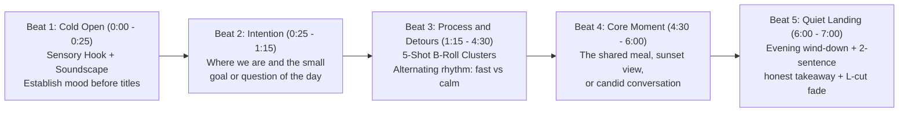
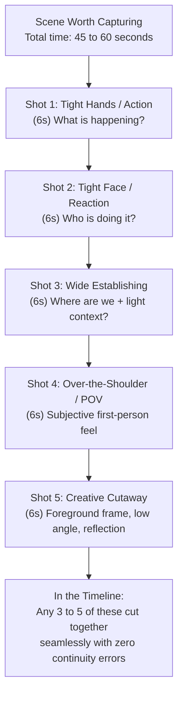

# How to Structure & Shoot a Compelling Personal Vlog

Most beginners assume great vlogs are rescued in the editing room with trendy LUTs, speed ramps, and kinetic text animations. In reality, **80% of how effortless and emotional a film feels is decided before you press record**. If you come home with 90 shaky, eye-level panning clips that have no beginning, middle, or acoustic texture, even 15 hours in DaVinci Resolve will only produce a polished slideshow.

Conversely, when you understand lightweight story arcs and shoot intentional **5-shot clusters**, you can record for less than **12 to 15 minutes across an entire Saturday** and assemble an absorbing short film in one sitting.

---

## 1. From "Clip Dump" to Story: The Micro-Intention Principle

Why do raw camera-roll dumps feel tedious even to the person who lived them? Because human memory does not index experiences as flat timestamps—it indexes **intention, sensory contrast, and emotional shift**.

You do not need extreme travel or manufactured drama to tell a compelling story at age 32. Ordinary adult life is full of quiet, deeply relatable arcs when framed around a single **Micro-Intention**:

- **Weak premise (Clip Dump)**: *"Here is random stuff I did on Sunday."*
- **Strong premise (Micro-Intention)**:
  - *"After a brutal on-call week, I turned off Slack for 24 hours to cook my grandmother's 红烧肉 (braised pork belly) from scratch."*
  - *"Walking 15 kilometers across rainy Osaka with only a 50mm-equivalent lens and no itinerary."*
  - *"Moving into a new apartment at 32: building a calm desk setup and cooking the first meal on an empty floor."*

Every memorable personal vlog answers three quiet questions by the time the screen fades to black:
1. **Context & Intention**: Where are we, what does this day feel like, and what small thing are we trying to do or experience?
2. **Process & Texture**: What did it sound like, smell like, look like—including the small detours, burned garlic, missed trains, or unexpected conversations?
3. **Landing**: How did the day settle, and what single honest thought is worth remembering ten years from now?

---

## 2. The 3 Timeless Personal Vlog Archetypes

Instead of reinventing your format every weekend, pick **one** of these three proven archetypes before leaving the house (or opening the kitchen cabinet). Knowing your archetype immediately tells you whether you need on-camera dialogue, ambient foley, or chapter cards.

| Archetype | Target Runtime | Voice / Narration Mode | Shooting Effort | Ideal Occasion |
| :--- | :--- | :--- | :--- | :--- |
| **1. Story-Driven Day / Weekend** | 5 to 9 min | Casual A-roll + brief voiceover | 30 to 45 clips (~12 min raw) | Weekend project, visiting friends, birthday, career milestone |
| **2. Quiet Cinematic / ASMR Log** | 3 to 6 min | Zero talking; diegetic sound + clean subtitles | 25 to 35 static clips (~8 min raw) | Cooking at home, rainy day, solo cafe session, evening routine |
| **3. Travel Chapter Film** | 8 to 15 min | Chapter title cards + post-trip voiceover | 20 to 30 clips/day (~10 min/day) | 3-to-10-day domestic or international trip, visiting hometown |

### Archetype 1: The Story-Driven Day / Weekend Vlog
This is the classic personal essay film—think Casey Neistat's structural clarity blended with calmer, adult pacing.
- **Audio Spine**: Mix 30% direct-to-camera moments (walking with Pocket 3 or sitting at your desk) with 70% voiceover recorded calmly after the weekend is over.
- **Secret Weapon**: Record a **60-second voice memo** on your iPhone while lying in bed Sunday night while your feelings are still fresh and unfiltered. Read or riff off that exact memo for your voiceover instead of writing stiff essay prose.

### Archetype 2: The Quiet Cinematic / ASMR Life Log ("Silent Vlog")
Popularized by East Asian solo-living creators, this format is the **lowest-stress entry point for introverted engineers** because you never have to speak to a lens in public or worry about how your voice sounds on camera.
- **Visual Discipline**: 90% **locked-off static shots** (camera resting on a kitchen shelf, tripod, mug, or bookshelf). Let yourself walk into the frame, chop vegetables, pour tea, and walk out.
- **Audio Spine**: Ambient diegetic sound is the star—oil sizzling in a carbon-steel wok, rain tapping the balcony, pages turning, ceramics clinking—paired with a subtle acoustic piano or lo-fi instrumental bed at `-26 dBFS`.
- **Narrative Layer**: Sparse, poetic lower-third subtitles (1 to 2 sentences every 15–20 seconds) sharing inner monologue: *"32 feels strangely quieter than 25. Lately I actually look forward to Friday nights at home."*

### Archetype 3: The Travel Chapter Film
The #1 mistake in travel vlogging is **chronological exhaustion**: *"Good morning guys, it's Day 3, we're getting breakfast, now we're on the metro, now we're at a temple, now we're getting lunch..."* Nobody—including you in five years—wants to watch seven consecutive mornings of hotel corridors.
- **The Thematic Chapter Cure**: Group your trip footage into **4 or 5 short chapters** separated by minimalist 2.5-second title cards and distinct musical moods:
  - *Chapter 01 — 35,000 Feet & First Night Neon*
  - *Chapter 02 — Morning Markets & Counter-Seat Ramen*
  - *Chapter 03 — Waiting Out the Typhoon in Kamakura*
  - *Chapter 04 — Conversations Over Highballs*
- **Shooting Rule Abroad**: Capture **transitions of movement** (train doors opening, stepping off a ferry, stamping a ticket, local street signs, hands exchanging coins) and **one 15-second ambient sound clip** in every neighborhood.

### Concrete Beat Sheet: A 6-Minute Saturday Vlog Shot in 11 Minutes Total

To see how little raw recording time a complete film requires, here is an exact shot budget for a **6-minute Story-Driven Saturday Vlog** (*"Resetting after a rough sprint: wet market run + cooking braised ribs"*):

| Film Timestamp | Narrative Beat | Clips Needed | Raw Time Recorded | Audio Layer |
| :--- | :--- | :--- | :--- | :--- |
| **`0:00 – 0:25`** | **Cold Open**: Rain on window, kettle whistle, opening curtains | 4 static shots (`6s` each) | `0:24` | Crisp kitchen room tone + rain |
| **`0:25 – 1:10`** | **Intention**: Desk talk or walk out door explaining the week's exhaustion | 2 A-roll clips + 3 doorway/shoe cuts | `1:40` | Pocket 3 / DJI Mic 2 spoken voice |
| **`1:10 – 2:45`** | **Neighborhood Market**: Choosing ribs, scallions, vendor weighing produce | Two 5-shot clusters (10 clips) | `1:15` | Bustling market chatter + subtle lo-fi |
| **`2:45 – 4:30`** | **Kitchen Process**: Blanching, caramelizing rock sugar, simmering pot | Three 5-shot clusters (15 clips) | `2:00` | Tactile knife/wok ASMR (`-18 dB`) + music |
| **`4:30 – 5:20`** | **The First Bite**: Steam lifting off lid, plating over white rice, honest reaction | 5 shots + 20s candid reaction | `1:05` | Music fades out; quiet room + voice |
| **`5:20 – 6:00`** | **Evening Landing**: Clean kitchen, tea by lamp, night balcony skyline | 3 wide static shots (`8s` each) + VO | `1:30` | Calm Sunday voiceover + L-cut fade to black |
| **TOTAL** | **Complete 6-Minute Film** | **39 Video Clips + 1 Short VO** | **~7m 54s (+3m buffer)** | **Under 11 minutes of total filming** |

---

## 3. The 5-Shot B-Roll Cluster Method (Never Fight Jump Cuts Again)

When beginners film an activity—like brewing morning coffee, assembling a keyboard, or ordering street food—they usually stand in one spot at eye level and record one 45-second continuous clip. In the edit, trimming that 45-second clip down to 12 seconds creates ugly **jump cuts** where your body teleports across the frame.

Documentary editors solve this in the field using the **5-Shot Cluster Grammar** (adapted from BBC video journalism). Whenever an activity is worth including in your vlog, spend **45 seconds capturing five 6-second shots**:

### Concrete Field Examples of 5-Shot Clusters

| Shot Slot | Camera Distance & Lens | Example A: Cooking Mapo Tofu | Example B: Working at a Cafe | Example C: Night Market Abroad |
| :--- | :--- | :--- | :--- | :--- |
| **1. Tight Action** | Close (`2x`/`3x` iPhone or close Pocket 3) | Ladle stirring bubbling chili oil and soft tofu cubes | Fingers typing on keycaps beside a steaming cortado | Vendor's spatula flipping crispy 煎饼 or takoyaki |
| **2. Tight Face** | Medium-Close (`1x`/`2x`) | Your focused eyes tasting a spoonful and nodding | Subtle squint at laptop screen, sip of coffee | Friend's wide-eyed grin taking the first hot bite |
| **3. Wide Context** | Wide (`1x` 24mm/20mm) | Full kitchen counter framed through doorway in warm lamp light | Corner window seat showing rain outside and cafe interior | Bustling alley full of red lanterns and rising smoke |
| **4. OTS / POV** | Chest/Shoulder (`1x`) | Looking past your shoulder down into the sizzling wok | First-person look down at notebook sketch + trackpad | Hand handing cash across the stall counter |
| **5. Creative Angle** | Varied (`3x`/`5x` or low angle) | Camera set inside open spice shelf looking out as you reach in | Reflection of streetcars passing across the cafe glass | Low pavement shot of footsteps splashing past neon puddles |

**Why this works like magic in post-production**: Because Shot 1 (tight hands) and Shot 2 (tight face) hide spatial discontinuities, you can compress a **25-minute cooking process into a tight, rhythmic 18-second sequence** using five 3.5-second cuts, backed by continuous sizzling audio underneath.

---

## 4. Five Habits to Shoot a Full Vlog in Under 15 Minutes a Day

If your raw clip count stays around **30 to 45 clips of 6 to 8 seconds each**, your total time with a recording indicator blinking is **4 to 6 minutes**—plus maybe **5 minutes** of spoken thoughts. Here are the five physical camera habits that maximize usable footage per second recorded.

### Habit 1: Treat Video Clips Like "Moving Photographs" (The 6-Second Static Rule)
Amateur footage screams "home video" because the camera **never stops wandering**—panning left, tilting up, zooming in, and panning right again in a single clip ("garden-hosing"). Almost none of that chaotic motion is usable in an edit.

- **Plant your feet, lock your wrists, compose a balanced photograph, press record, and count slowly from 1 to 6 without moving the camera at all.**
- Let the **world move inside your static frame**: steam rising, subway train entering, friends walking away down an alley, leaves blowing in wind.
- If you want a second composition, **stop recording** (or pause, reframe decisively, lock still again, and hold for another 6 seconds).

### Habit 2: Intentional Camera Movement Grammar (When You Do Move)
Reserve camera movement for deliberate emotional punctuation, using one axis at a time:

| Movement | How to Execute Cleanly | Emotional Signal in the Edit |
| :--- | :--- | :--- |
| **Slow Push-In** | Pocket 3 in `Tilt Locked` mode; heel-to-toe ninja walk forward for 5s | Draws viewer into intimacy, curiosity, or detail |
| **Slow Pull-Back** | Walk backward slowly revealing surrounding landscape/room | Closure, scale, loneliness, or ending a scene |
| **Lateral Parallax Slide** | Place a tree, doorway, pillar, or lamp 0.5m in foreground; slide 1m sideways | Instant 3D cinematic depth separating foreground from background |
| **Static Enter / Exit** | Set Pocket 3 on ground/rail; walk *past* lens and out of frame | Effortless time/location jump to the next shot |

### Habit 3: Five Zero-Plugin In-Camera Transitions
Skip spinning zoom blurs and glitch plugins—they age terribly within 12 months. Use classic physical transitions instead:

1. **Foreground Wipe**: End Shot A by walking smoothly behind a dark pillar, wall, or passing bus until the frame fills with dark blur; start Shot B emerging from behind a doorway or tree in the new location moving in the **same left-to-right (or right-to-left) screen direction**.
2. **Action Match Cut**: End Shot A placing a ceramic mug down onto your home desk; cut on the exact impact frame to Shot B placing a beer glass down onto an izakaya table in Tokyo.
3. **Directional Whip Pan**: At the end of Shot A, flick the camera briskly right-to-left (`180°/fps` motion blur); start Shot B flicking rapidly right-to-left and settling onto the new subject.
4. **Cover-Lens / Light-Switch Cut**: Setting down a backpack over the lens or clicking off a bedside lamp cuts naturally to opening curtains the next morning.
5. **Audio Pre-Lap (The Editor's Best Transition)**: Keep the visuals strictly simple—let the *sound* of the next scene (waves crashing, train announcer, sizzle of garlic) fade in **1.5 seconds before** the video cuts. Read [02-FAST-VIDEO-EDITING-WORKFLOW.md](02-FAST-VIDEO-EDITING-WORKFLOW.md) for exact J-cut frame offsets.

### Habit 4: Capture Tactile Audio & 15-Second "Room Tone"
Viewers forgive slightly soft video, **never** harsh, windy, hollow audio.
- **The 20cm Mic Proximity Rule**: For crisp ASMR cooking/coffee/unboxing foley without buying studio mics, bring the Osmo Pocket 3 or clipped **DJI Mic 2** (with furry wind muff attached outdoors) within **20 to 30 cm** of the action—never across the room.
- **32-bit Float Backup on DJI Mic 2**: Enable internal `32-bit Float` backup recording on your DJI Mic 2 transmitter whenever recording unrepeatable dialogue (interviews with grandparents, toasts, noisy streets). Even if someone laughs explosively right next to the mic, it cannot digitally clip in post.
- **The 15-Second Wild Track**: Once per major location (rainy balcony, bustling market, quiet forest), stand still and record **15 seconds of pure ambient environment audio**. In the edit, laying that 15-second stereo bed beneath your cutaways glues 8 separate visual cuts into one continuous, believable reality.

### Habit 5: Capturing Authentic Human Moments (Without Making People Self-Conscious)
The clips you will treasure most at age 55 are not cinematic B-roll of lattes—they are your mother's hands folding dumplings, your best friend laughing mid-story, and how your own voice sounded at 32.

- **Use the Pocket 3 "Tabletop Totem" Trick**: Because the DJI Osmo Pocket 3 stands upright on any flat surface and has a tiny 2-inch screen you can rotate away (or dim), set it at the far edge of the kitchen counter or dinner table **after asking once** (*"Mind if I grab 30 seconds for my personal memory log?"*), then ignore it completely and engage in real conversation.
- **Film Hands and Profiles, Not Just Front-On Stares**: Non-actors freeze when a lens points straight between their eyes. Step 45 degrees to the side and frame their hands gesturing, cooking, pouring tea, or driving while their voice carries the warmth.
- **Pad Your Starts and Ends (2-Second Handles)**: Whenever speaking on camera, breathe quietly for **1.5 seconds before your first word** and hold a calm expression for **2 seconds after your final word** before tapping Stop. Your editing self needs those clean handles for J-cuts, L-cuts, and crossfades.
- **International Street Etiquette**: In privacy-conscious places (especially Japan, Germany, Switzerland), keep lenses pointed down toward your own table/hands or wide architectural skylines, avoid pointing lenses directly into strangers' faces on trains or inside small shops, and ask `"Daijoubu desu ka?"` / `"May I film my dish?"` with a warm nod at counter restaurants. Almost every chef smiles and says yes when asked respectfully.

---

## 5. Lighting & Composition Cheat Sheet Using Zero Studio Gear

You do not need LED softboxes in your living room to make everyday apartments and restaurants look cinematic:

1. **Kill Overhead Ceiling Fluorescents**: Overhead ceiling lights cast dark "raccoon eye" shadows and muddy green-magenta color casts. Turn off the main ceiling fixture and turn on **two warm practical lamps** (desk lamp, range-hood light, floor lamp) or stand **45 degrees beside a window**.
2. **Shoot Toward the Shadow Side ("Short Lighting")**: Position yourself or your food so window light comes from the **side or 135-degree back-side** rather than flat behind the camera lens. Back-side light makes steam glow, gives food glossy specular highlights, and carves three-dimensional separation on faces.
3. **Underexpose Slightly (`-0.3` to `-0.7 EV`)**: Digital smartphone and 1-inch sensors look cheap the instant forehead highlights or bright windows clip to pure `255` white. Locking exposure `-0.3 EV` darker preserves rich sky gradients and moody shadows.
4. **Foreground + Midground + Background**: Before hitting record, take half a step left or right so *something* sits out-of-focus in the near corner of the frame (a coffee cup rim, bookshelf edge, doorway frame, foliage), your subject sits in the midground, and warm depth trails into the background.

---

## 6. Speaking Naturally on Camera & Recording Intimate Voiceovers

Many software engineers hate the sound of their recorded voice at first because staring into a glass lens triggers "presentation mode"—pitch rises by half an octave, pacing speeds up, and natural warmth disappears. Use these four techniques to sound grounded and genuine:

### 1. Speak to One Specific Friend, Never "You Guys"
Ban broadcaster phrases like *"Hey guys, welcome back"* or *"Today I'm going to show you..."* Before pressing record, picture **one specific close friend** sitting across a quiet dinner table and start mid-conversation:
- *Stiff broadcaster*: *"Hey everyone, today it's Saturday morning and I decided to come to this cafe in Jing'an."*
- *Grounded personal voice*: *"It rained all night, and for the first time in two weeks my phone isn't buzzing. I walked twenty minutes just to sit by this window."*

### 2. Lower Volume by 20% & Drop Into Chest Resonance
Microphones—especially a clipped **DJI Mic 2** or an iPhone held 15 cm from your chin under a duvet—love **quiet, close speech**. Speaking 20% softer than conference-room volume forces you out of strained throat projection and creates warm radio-documentary intimacy.

### 3. Osmo Pocket 3 Framing Geometry for Solo Talking Shots
- **Arm Distance**: Do not hold the Pocket 3 right in front of your nose (`20mm` wide lenses exaggerate nose size inside `35 cm`). Rest your elbow comfortably against your ribs and hold the Pocket 3 **`50 to 65 cm` away**, slightly off-center, or set it **`1.2 meters` away** on a shelf/bookshelf with `ActiveTrack 6.0` locked on your face using the rule-of-thirds grid.
- **Eye Line**: Look straight into the **physical gimbal camera lens** (or look 15 degrees off-axis as if reflecting to an interviewer when recording pensive thoughts)—never down at the tiny 2-inch OLED preview screen! Looking at the screen makes your eyes appear downcast and disconnected on a large monitor.

### 4. The 3-Prompt Sunday Night Voice Memo Ritual
If you struggle to improvise spoken thoughts on the street, shoot **100% silent B-roll** during the day and record a 2-minute voice memo in a quiet bedroom before sleep answering any one of these three prompts:
1. *"What tiny detail from today will I forget in five years if I don't say it out loud right now?"*
2. *"What stressed me out this week, and did today change how heavy it feels?"*
3. *"Who did I spend time with today, and what made me grateful for them?"*

---

## 7. Common Shooting Failure Modes & Immediate Fixes

| Field Symptom | Why It Happens | 5-Second Habit Fix |
| :--- | :--- | :--- |
| **Clips are unusable due to constant panning** | Treating video camera like human eyeballs scanning a room | Lock feet & wrists; count 6 full seconds per static composition |
| **Colors jump wildly from clip to clip** | Auto White Balance (`AWB`) fooled by green trees or warm cafés | Lock WB to `5500K` outdoors or `3200K–4200K` indoors per location |
| **iPhone footage looks overly crisp / "soap opera"** | Default HDR tone-mapping + aggressive digital oversharpening + 60fps | Shoot `24fps` or `30fps` in Apple Log (or use Blackmagic Camera app) |
| **Jittery vertical "Z-axis bobbing" when walking** | Heavy heel strikes transmitted straight through a stiff arm | Bend knees slightly, roll heel-to-toe softly, use Pocket 3 `Tilt Locked` |
| **Clipped endings ruin best spoken sentences** | Looking down and thumbing the Stop button while finishing last word | Hold eye contact and silence for 2 full seconds after finishing sentence |
| **Nothing connects Scene A (Home) to Scene B (Park)** | Only filming destinations, zero connective tissue | Shoot one 4-second "door/shoes/transit" micro-clip whenever changing spots |

---

## 8. Your Pocket Pre-Shoot Checklist (Memorize in 60 Seconds)

Before stepping out the door or starting a weekend project, run this 5-point mental check (**L-F-W-A-C**):

- [ ] **L — Lens Clean**: Wipe iPhone lenses and Osmo Pocket 3 glass with the inside of a clean cotton t-shirt or microfiber cloth (finger grease causes muddy neon streaks that look like cheap fog).
- [ ] **F — Frame Rate Matched**: Confirm both cameras sit on your chosen project base (`24fps`, `25fps`, or `30fps`), 10-bit Log or matched Rec.709 profile.
- [ ] **W — White Balance & Exposure**: Tap to check `-0.3 EV` highlight safety and lock WB once inside your lighting environment.
- [ ] **A — Audio Check**: Confirm wind muff is snapped on outdoors and DJI Mic 2 green level bar bounces healthy around `-12 dB` when speaking normally.
- [ ] **C — Cluster Mindset**: Remind yourself: *"Shoot 6-second static frames in 5-shot clusters, then put the camera away and enjoy my day."*

Once you return home with 30 to 45 clean, intentional clips, move directly to [02-FAST-VIDEO-EDITING-WORKFLOW.md](02-FAST-VIDEO-EDITING-WORKFLOW.md) to turn them into a finished film in under two hours—after safely offloading your card via [03-MEDIA-MANAGEMENT-NAS-AND-LIFE-ARCHIVE.md](03-MEDIA-MANAGEMENT-NAS-AND-LIFE-ARCHIVE.md).
