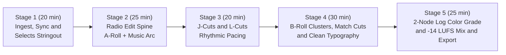
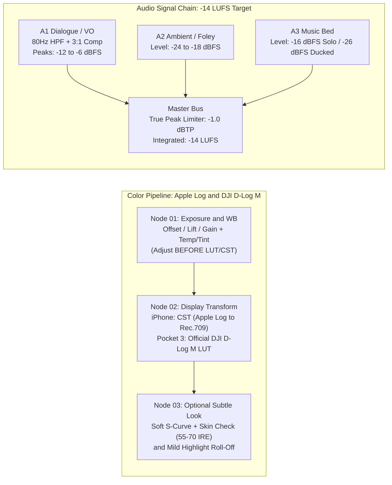

# The 2-Hour Vlog Edit: CapCut Pro, DaVinci Resolve & Final Cut Pro Workflows

The single biggest reason personal vlogs die on hard drives is **editing bloat**. When an engineer opens an NLE (Non-Linear Editor) with 180 unorganized clips and tries to simultaneously cull bad takes, hunt for background music, tweak color curves on Clip #2, animate titles, and adjust audio levels, context-switching thrash turns a 6-minute video into a **16-hour ordeal**.

Professional documentary and commercial editors finish fast not because their hands move faster on a mouse, but because they treat editing as a **strictly sequential 5-stage assembly line** where macro decisions always precede micro polish. Follow this blueprint, and you will reliably turn 30 minutes of weekend footage into a polished, cinema-grade 6-minute personal film in **120 minutes or less**.

---

## 1. Choosing Your Editing Engine: CapCut Pro vs Final Cut Pro vs DaVinci Resolve

Do not pick an NLE out of tribalism. Evaluate them like software infrastructure—balancing turnaround latency, color science, subtitle automation, and 10-year project portability.

| Dimension | CapCut Desktop Pro | Final Cut Pro (macOS) | DaVinci Resolve (Free / Studio) |
| :--- | :--- | :--- | :--- |
| **Assembly Speed** | Very fast; beginner-friendly magnetic track | **Fastest on Earth** (Magnetic Timeline + skimmer) | Fast once `Cut`/`Edit` page shortcuts are mapped |
| **Bilingual Captions (EN / 中文)** | **Best-in-class** fast ASR + clean batch styling | Good built-in captions (macOS Sequoia+), fewer styles | Very solid Studio transcription; manual styling |
| **Apple Log & D-Log M Color** | Basic LUT import + wheels; limited highlight recovery | Strong Color Wheels + Custom LUT layers | **Industry Gold Standard** (32-bit float nodes + CST) |
| **Audio Mixing (`-14 LUFS`)** | Basic loudness normalization + auto-ducking | Fast Voice Isolation + Roles-based audio lanes | **Full Fairlight DAW** (sub-buses, EQ, limiter, LUFS meter) |
| **Apple Silicon Optimization** | Very light on M-series chips | **Unmatched Metal optimization**; instant skim | Excellent (Studio unlocks full Neural Engine + 10-bit HW) |
| **Storage & Cache Hygiene** | Tends to bloat hidden app library if unchecked | Library `.fcpbundle` grows huge unless cache is external | Clean external cache folder; tiny `.drp` project backups |
| **10-Year Archive Portability** | Weak (cloud/proprietary ecosystem shifts) | Good via FCPXML | **Best** (`.drp` / `.dra` + open OTIO/XML + SQLite DB) |
| **Cost Model** | Subscription (~USD 10 to 20/month) | One-time ~USD 299 | Free (8-bit/basic 10-bit) or **One-time ~USD 295 Studio** |

### The Pragmatic Engineer's Recommendation
- **Choose DaVinci Resolve (or Resolve Studio)** as your primary long-term craft tool if you shoot **Apple Log + DJI D-Log M** and care about consistent filmic skin tones, clean Fairlight audio busing, and owning a one-time license that works across macOS, Windows, and Linux.
- **Choose Final Cut Pro** if you exclusively use macOS, hate managing tracks manually, and value pure timeline cutting velocity above node-based color grading.
- **Choose CapCut Desktop Pro** (or use it solely as a final captioning pass) when cutting quick 2-minute family updates or bilingual Mandarin/English travel reels where automated subtitle alignment saves 30 minutes.

---

## 2. Keyboard Muscle Memory: The 7 Shortcuts That Triple Editing Speed

Touching the mouse to drag the edge of every clip is the equivalent of coding without copy, paste, or word-jump shortcuts. Remap and drill **seven core actions** so your left hand rests on `Q-W-E / I-O` and your right hand rests on `J-K-L`:

| Action | Why It Saves Hours | DaVinci Resolve | Final Cut Pro | CapCut Desktop |
| :--- | :--- | :--- | :--- | :--- |
| **Shuttle Reverse / Stop / Forward** | Tap `L` twice to scrub footage at `2x` speed | `J` / `K` / `L` | `J` / `K` / `L` | `J` / `K` / `L` |
| **Mark In / Mark Out** | Select exact usable 5s range in viewer | `I` / `O` | `I` / `O` | `I` / `O` |
| **Ripple Trim Start to Playhead** | **Deletes everything from clip start to playhead & closes gap in 1 keystroke** | `Cmd+Shift+[` *(Remap to `Q`!)* | `Option + [` | `Q` |
| **Ripple Trim End to Playhead** | **Deletes everything from playhead to clip end & closes gap in 1 keystroke** | `Cmd+Shift+]` *(Remap to `W`!)* | `Option + ]` | `W` |
| **Split / Blade at Playhead** | Slice active clip without switching tools | `Cmd + B` | `Cmd + B` | `Cmd + B` |
| **Ripple Delete Selected** | Remove bad clip and snap timeline shut | `Shift + Delete` | `Delete` | `Delete` |
| **Disable / Mute Clip** | Audition with/without B-roll or music non-destructively | `D` | `V` | `V` |

> **Single Highest-ROI Customization in DaVinci Resolve**: Open *DaVinci Resolve -> Keyboard Customization*, search for `Trim Start` (under Ripple/Trim) and bind **Ripple Start to Playhead = `Q`** and **Ripple End to Playhead = `W`**. With `L` (2x play), `Cmd+B` (split), `Q`, and `W`, you can trim 30 minutes of raw footage down to 6 minutes of pure gold in **12 minutes** without touching your trackpad once.

---

## 3. The 5-Stage 120-Minute Assembly Line

Never move to Stage $N+1$ until Stage $N$ is 100% complete. Duplicate your timeline at the end of each stage (`01_Stringout`, `02_RadioEdit`, `03_PictureLock`, `04_Master`)—it costs zero disk space and gives you instant Git-style rollback points.

---

### Stage 1: Project Setup & The Ruthless Selects Stringout (Minutes 0–20)

1. **Standardized Timeline Preset**:
   - **Resolution**: `3840 x 2160` (`4K UHD`), Square Pixels. (Even if you have `1080p` clips mixed in, a `4K` export triggers YouTube/Bilibili's higher-bitrate `VP9`/`AV1` transcode pipeline.)
   - **Timeline Frame Rate**: Match your primary shooting base (`23.976` / `24` / `25` / `30 fps`). Note that timeline frame rate in DaVinci Resolve locks once clips are added—double-check before dropping Clip #1.
   - **Conforming Slow Motion (`60fps` / `50fps` Clips)**: Any clip shot at `60fps` for dreamy B-roll should be slowed mathematically to exact frame cadence rather than arbitrary percentages like `63%` (which causes frame stutter):

     $$\text{Clean Slow-Mo Speed} = \frac{f_{\text{timeline}}}{f_{\text{clip}}} \implies \frac{24}{60} = 40\%, \quad \frac{30}{60} = 50\%, \quad \frac{25}{50} = 50\%$$

2. **The `2x` Ripple Stringout**:
   - Drag all raw clips chronologically onto timeline `01_Stringout`.
   - Hit `L` twice to play at `2x` speed.
   - The moment a steady 5-second composition begins, hit `Q` (ripple trim head). Five seconds later when the camera starts shaking, hit `Cmd+B`, jump to the next steady moment, and hit `Q` again.
   - **Rule of Ruthlessness**: Delete 65% to 75% of raw duration right here. Never keep two mediocre angles of the same coffee cup "just in case"—keep the stronger 4 seconds and discard the twin.

---

### Stage 2: The "Radio Edit" — Narrative Spine & Music Architecture (Minutes 20–45)

Duplicate `01_Stringout` to `02_RadioEdit`. Now build the **structural skeleton** of the film:

1. **Cut the Spoken Spine First (If Story/Chapter Vlog)**:
   - Place all talking-head clips and post-weekend voiceover recordings on `V1 / A1`.
   - Close your eyes and press Play. Does the story flow logically, with clear intention at the beginning and honest reflection at the end? Trim out filler words (*"um," "basically," "so yeah"*), long throat clears, and repetitive points—**keep natural 0.4-second breaths** so you still sound like a calm human rather than a breathless TikTok ad.
2. **Music Selection Without the 90-Minute Rabbit Hole**:
   - **Never browse music websites mid-edit.** Once a quarter, spend 30 minutes downloading 15 instrumental tracks you love (Artlist, Epidemic Sound, Musicbed, or royalty-free ambient libraries) into a local folder sorted into four subfolders:
     - `01_Morning_Acoustic` (warm guitar, light percussion)
     - `02_City_Pulse_LoFi` (walking, transit, cooking montages)
     - `03_Quiet_Piano_Ambient` (rain, night reflection, voiceover beds)
     - `04_Crescendo_Cinematic` (travel vistas, year-end climaxes)
   - **The 2-Track Limit**: For a 6-minute vlog, use **at most 2 songs**—with a **15-to-25-second music-free gap** in the middle where pure ambient street/kitchen sound breathes. Wall-to-wall music from `0:00` to `6:00` numbs the ear.
   - **Seamless Song Shortening Trick**: If a song is `3:30` and your scene is `1:45`, drop the song's final chorus/outro at `1:15`, zoom into the waveform, slice both regions **right on the vertical spike of matching downbeat `1`**, and apply a **4-frame Constant Power crossfade**. Even trained musicians cannot hear the seam.

---

### Stage 3: Pacing Mastery — J-Cuts, L-Cuts & Rhythmic Contrast (Minutes 45–65)

When every video cut and audio cut happen at the exact same timestamp (`butt cut`), the viewer feels every seam like speed bumps on a highway. **Split edits (J-cuts and L-cuts)** decouple eyes from ears, mimicking how human attention works in real life (you hear a door open *before* you turn your head to look).

| Split Edit Type | Geometry on Timeline | Frame Offset (`24–30fps`) | Best Psychological Use Case |
| :--- | :--- | :--- | :--- |
| **J-Cut (Audio Pre-Lap)** | Next clip's audio starts **under** end of current video | `-12` to `-36` frames (`0.5s–1.5s`) | Scene transitions; starting a new thought or sizzle sound to pull viewer forward |
| **L-Cut (Audio Trail)** | Current clip's audio lingers **under** next video shot | `+15` to `+48` frames (`0.6s–2.0s`) | Emotional landing; letting last spoken sentence echo over a wide sunset cutaway |

### Pacing Rhythm: Alternate Fast Clusters with Long Breaths
Good pacing is **not** fast cutting—it is **variance in shot duration**:
- **Action / Montage Cluster**: Five shots from your 5-Shot Cluster cut at `1.8s` to `2.8s` each (e.g., chopping scallions -> garlic hitting hot oil -> tossing noodles -> plating -> steam rising).
- **Breathing Shot**: Immediately follow that 12-second rhythmic burst with **one static 6-to-8-second wide shot** with relaxed ambient sound where nothing is rushed. That contrast between density and stillness is what makes a personal film feel mature and cinematic.

---

### Stage 4: B-Roll Layering, Match Cuts & Editorial Typography (Minutes 65–95)

1. **Layering B-Roll Over A-Roll (`V2` Over `V1`)**:
   - Place B-roll clusters on `V2` directly over jump cuts in your `V1` spoken spine.
   - **Crucial Audio Detail**: Do not mute `V2` B-roll audio completely! Keep sizzling pans, footsteps, subway doors, and pouring tea tucked on `A2` at `-20` to `-24 dBFS` beneath your voice. Silent B-roll looks sterile and disconnected.
2. **Cutting on Action (The 2-Frame Overlap Rule)**:
   - When cutting from a wide shot of setting down a cup to a close-up of the cup touching the wood, cut **mid-motion**—never after motion stops in Shot A and before motion starts in Shot B. Cutting mid-velocity makes the human visual cortex fuse two angles into a single fluid gesture.
3. **Tasteful Editorial Typography (Zero Clutter)**:
   - Avoid thick black outlines, neon backgrounds, comic bounce animations, and 6 different fonts. Adopt a **restrained magazine-editorial type system** saved as reusable presets:

| Text Element | Recommended Font Pairing (EN / 中文) | Size on `4K` (`3840x2160`) | Tracking & Placement |
| :--- | :--- | :--- | :--- |
| **Opening / Chapter Title** | *Instrument Serif* / *Playfair Display* + *Songti SC (宋体)* | `110 to 150 px` | Tracking `0%` to `+2%`; dead center or bottom-left grid |
| **Location / Timestamp Tag** | *JetBrains Mono* or *Inter Medium* (ALL CAPS) | `34 to 40 px` | Tracking `+12%` to `+18%`; subtle `80%` white opacity |
| **Bilingual Subtitles** | Primary: *Noto Sans SC* / *PingFang SC* (`48 px`) Secondary: *Inter Regular* (`34 px`, `82%` opacity) | `46 to 52 px` (top line) `32 to 36 px` (second line) | Bottom safe margin `9%` (`~195 px` from bottom); soft shadow (`35%` opacity, `12px` blur), **no stroke** |

---

### Stage 5: The 2-Node Log Color Grade, -14 LUFS Audio Mix & Export (Minutes 95–120)

Save color and audio for the final 25 minutes so you never waste GPU cycles grading clips that get deleted.

#### Part A: Fast, Accurate Color Matching (iPhone Apple Log + Pocket 3 D-Log M)

Why put **Exposure and White Balance in Node 01 *before* your LUT or Color Space Transform (Node 02)**? Because LUTs clip out-of-bounds values above `100 IRE`. Pulling down overexposed sky highlights *upstream* in Node 01 recovers rich cloud detail cleanly before the Rec.709 curve compresses the dynamic range.

1. **iPhone Pro (Shot in Apple Log)**:
   - **Resolve Node 02**: Apply `Color Space Transform (CST)` effect:
     - *Input Color Space*: `Apple Log`
     - *Input Gamma*: `Apple Log`
     - *Output Color Space*: `Rec.709`
     - *Output Gamma*: `Rec.709-A` (on macOS QuickTime/ColorSync displays) or `Gamma 2.4` (with `Use Mac Display Color Profiles` checked in Preferences)
     - *Tone Mapping*: `DaVinci` (`Luminance Mapping`), *Gamut Mapping*: `Saturation Compression`.
2. **DJI Osmo Pocket 3 (Shot in 10-bit D-Log M)**:
   - **Critical Engineering Nuance**: DJI's **D-Log M** on the Pocket 3 is *not* cinema Inspire/Ronin `D-Gamut / D-Log`—it is a custom flat curve inside a modified Rec.709 gamut. Selecting `DJI D-Gamut / D-Log` inside Resolve's CST produces oversaturated neon reds and unnatural orange skin!
   - **Correct Transform**: Download DJI's free official **`DJI OSMO Pocket 3 D-Log M to Rec.709 V1.cube`** LUT from DJI's Downloads page and place it on **Node 02** (set Node Key Output Gain to `0.85`–`1.00`), then balance exposure/WB upstream on **Node 01**.
   - **In Final Cut Pro / CapCut Pro**: Apply a `Custom LUT` (`Apple Log to Rec.709` or `DJI D-Log M to Rec.709`), and drag your `Color Wheels` / `Adjustments` layer **above/before** the LUT in the inspector order.
3. **30-Second Skin-Tone Sanity Check**:
   - Open the **Waveform** and **Vectorscope** (`Show Skin Tone Indicator` enabled).
   - Well-exposed East Asian skin tones under natural light sit comfortably between **`55 IRE` and `70 IRE`** on luminance and align cleanly along the upper-left **Skin Tone Line** (`~11 o'clock` on the Vectorscope). If skin drifts toward magenta, nudge Node 01 `Tint` `-2` to `-5` toward green; if Pocket 3 greens look slightly electric outdoors, pull `Hue vs Sat` yellow-green down by `10%`.
   - Save this 3-node structure as a **PowerGrade** in Resolve (`Gallery -> PowerGrade 1`). Next weekend, middle-clicking applies your entire color pipeline in 2 seconds.

#### Part B: The 10-Minute `-14 LUFS` Audio Recipe

Great personal vlogs sound warm, intimate, and consistent—you never have to scramble for the volume key when music kicks in after quiet dialogue.

| Audio Track / Bus | Target Meter Level (`dBFS`) | Essential 2-Plugin Chain |
| :--- | :--- | :--- |
| **`A1` Dialogue & Voiceover** | Peaks between `-12` and `-6 dBFS` | 1. **EQ**: High-Pass Filter at `80 Hz` (kills wind/desk rumble), `-2 dB` cut at `300 Hz` if boxy 2. **Compressor**: Ratio `3:1`, Attack `15 ms`, Release `100 ms`, `3 to 4 dB` max reduction |
| **`A2` Ambient / B-Roll Foley** | `-24` to `-18 dBFS` | Short `3-to-6 frame` audio crossfades on **every** clip edge to eliminate digital clicks |
| **`A3` Room Tone Bed** | `-34` to `-28 dBFS` | Continuous 15s looped wild track bridging cuts inside the same room |
| **`A4` Music Track** | `-16` to `-13 dBFS` (instrumental montage) **`-28` to `-23 dBFS` (ducked under voice)** | Keyframe smooth `1.2-second` volume ramps (or Fairlight/FCP Auto-Ducking); optional `-3 dB` EQ dip around `2.2 kHz` so vocal consonants cut cleanly through guitar/piano |
| **Master Output Bus** | **`-14.0 LUFS` Integrated** (`±1 LU`) | **True Peak Limiter** ceiling locked at **`-1.0 dBTP`** |

#### Four Subtle Sound-Design Recipes (Zero Cheesy "Whoosh" Spam)

Instead of loud synthetic transition packs, use these four cinema-grade acoustic techniques that take 30 seconds each:

1. **The Low-Pass "Next Room" Music Transition**: When transitioning from an energetic outdoor montage into a quiet indoor conversation, instead of fading the music out lazily, automate a **Low-Pass Filter cutoff down from `20,000 Hz` to `380 Hz`** over `1.5 seconds` while dropping volume by `-8 dB`. The song instantly sounds as if it is playing softly behind a wooden cafe door.
2. **The Hard-Silence Scenic Drop**: Build gentle momentum across 4 quick travel transit cuts, then cut **all music and ambient noise to `-infinity dB` for `0.6 seconds`** right as a wide mountain, ocean, or night-sky shot opens—letting pure wind or ocean waves rush back in a beat later.
3. **The Continuous Rain / Street Glue**: Whenever cutting 6 separate shots inside the same rainy afternoon or restaurant, lay a single uninterrupted `20-second` ambient recording on `A3` at `-28 dBFS` across the entire sequence. Even when visual angles jump, continuous acoustic space tricks the brain into experiencing unbroken time.
4. **3-Frame Constant Power Audio Crossfades Everywhere**: Select your entire `A1` and `A2` tracks (`Cmd+A` on audio lanes) and apply a default **`3-frame` (`~0.1s`) audio crossfade** (`Shift+T` or default transition). Every microscopic zero-crossing pop between clips vanishes instantly.

#### Part C: Clean Export Settings (Quality Without File-Size Insanity)

| Export Target | Container & Codec | Resolution & Frame Rate | Bitrate / Mode | Audio Codec |
| :--- | :--- | :--- | :--- | :--- |
| **1. Archival & YouTube / Bilibili Master** | `.mp4` or `.mov`, **H.265 (HEVC) Main10 (10-bit)** | `3840x2160` (match timeline fps) | Constant/Restricted VBR **`40 to 55 Mbps`** | AAC `320 kbps` `48 kHz` (or Linear PCM `24-bit` in `.mov`) |
| **2. Family / WeChat / AirDrop Share** | `.mp4`, **H.264 High Profile (8-bit)** | `1920x1080` (match timeline fps) | VBR **`12 to 16 Mbps`** (~`60–75 MB` per min) | AAC `256 kbps` `48 kHz` |

---

## 4. NLE Cache Hygiene & Smooth Apple Silicon Playback

Nothing ruins a 2-hour editing session faster than a `"Your Startup Disk Is Almost Full"` macOS popup caused by silent background render caches expanding `10x` larger than your raw footage. Configure these three guardrails once:

| NLE | Default Cache Trap | One-Time Engineering Fix |
| :--- | :--- | :--- |
| **DaVinci Resolve** | Uncompressed `16-bit Float` `CacheClip` folder in `~/Movies` eats `150+ GB` per project | *Project Settings -> Master Settings -> Optimized Media & Render Cache*: set format to **`ProRes 422 LT`** (or `ProRes 422 Proxy`), point working folders to `/Volumes/VlogWorkSSD/_ResolveCache/`, and set *Playback -> Render Cache -> `None`* unless using heavy Temporal Noise Reduction |
| **Final Cut Pro** | Background Rendering creates `200+ GB` inside `.fcpbundle` every time you pause 0.3s | *Settings -> Playback*: **Uncheck `Background Render`** immediately; set Library *Storage Locations -> Cache* to an external folder outside the `.fcpbundle` so you can delete render files anytime via *File -> Delete Generated Library Files* |
| **CapCut Desktop** | Hidden cache in `~/Library/Containers` or `AppData` never auto-purges old projects | *Settings -> Drafts & Cache*: point Cache Path to external SSD and enable **Auto-Delete Cache Older Than `30 Days`** |

### Instant Scrubbing Lag Relief (Without Generating Proxies)
Modern M1/M2/M3/M4 Pro/Max chips decode `4K 10-bit 4:2:0` and `4:2:2 HEVC` in dedicated silicon. If timeline scrubbing ever stutters after stacking color nodes or titles:
1. Toggle **Timeline Proxy Resolution -> `Half` or `Quarter`** (*Playback -> Timeline Proxy Resolution* in Resolve; *View -> Better Performance* in FCP). Full `4K` resolution automatically restores itself during final export!
2. Bypass heavy nodes (`Color + Film Grain + Halation`) globally during cutting (`Shift + D` in Resolve) and re-enable right before Stage 5 export.

---

## 5. Common Editing Anti-Patterns & How to Fix Them Instantly

- **Over-Edited "YouTuber" Sound Effects Fatigue**: Adding cartoon *whooshes*, *pops*, *camera shutters*, and *bell dings* every 4 seconds destroys emotional sincerity. Strip 90% of synthetic SFX; rely on genuine recorded kitchen/street sounds and gentle musical entrances.
- **Music Fighting Human Speech**: If a friend says you are hard to hear, do not boost your vocal into distortion—**drop the music bed another `6 dB`** (down to `-26 dBFS`) and carve `-3 dB` out of the music at `2 kHz`.
- **60fps Played Back at Real-Time 100% Speed Without Motion Blur**: Dropping `60fps` clips into a `24fps` timeline at `100%` speed with `1/120s` shutter makes normal walking look jittery and staccato. Only shoot `60fps` for shots you intend to slow down to `40%–50%`.

---

## 6. The 2-Minute Pre-Export Quality Control (QC) Checklist

Run this fast 7-point gate before walking away from the edit—it catches 99% of embarrassing defects on the first render:

- [ ] **In/Out Range Check**: Press `Option + X` (clear stray In/Out marks on Deliver page) or verify `Render: Entire Timeline` so you do not accidentally export only 12 seconds of your film—or include a forgotten scrap clip sitting at `14:00` after 8 minutes of black screen!
- [ ] **1-Frame Black Gap Scan**: Zoom to fit timeline (`Shift + Z`) and verify zero accidental 1-frame black holes between `V1` clips.
- [ ] **Color Bypass Sanity Check**: Confirm global Color Bypass (`Shift + D`) is **OFF** and zero clips were left as flat grey ungraded Log by mistake.
- [ ] **OPSEC Visual Sweep**: Confirm zero visible passwords, work IDE screens, apartment numbers, or flight PNR barcodes in `4K` detail.
- [ ] **Loudness & Clipping Check**: Confirm Fairlight / Master Loudness reads **`-14 LUFS` (`±1.5`)** and True Peak never exceeds **`-1.0 dBTP`**.
- [ ] **Clean Master Second Render**: Right after queueing `Master_4K.mp4`, mute `A4 Music` + disable `Subtitles` and queue `CleanMaster_Textless.mp4` into the render queue so both finish back-to-back.
- [ ] **Single Real-World Watch-Through**: AirDrop or play `Master_4K.mp4` once on phone speakers or AirPods from `0:00` to the end before closing the project.

Once your master `.mp4` passes that single phone check, you are ready to archive your finished film, clean master, and top raw selects permanently using [03-MEDIA-MANAGEMENT-NAS-AND-LIFE-ARCHIVE.md](03-MEDIA-MANAGEMENT-NAS-AND-LIFE-ARCHIVE.md)—completing the full loop from [00-README.md](00-README.md) and [01-VLOG-STORYTELLING-AND-SHOOTING-HABITS.md](01-VLOG-STORYTELLING-AND-SHOOTING-HABITS.md).
