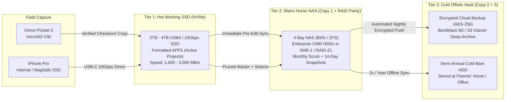
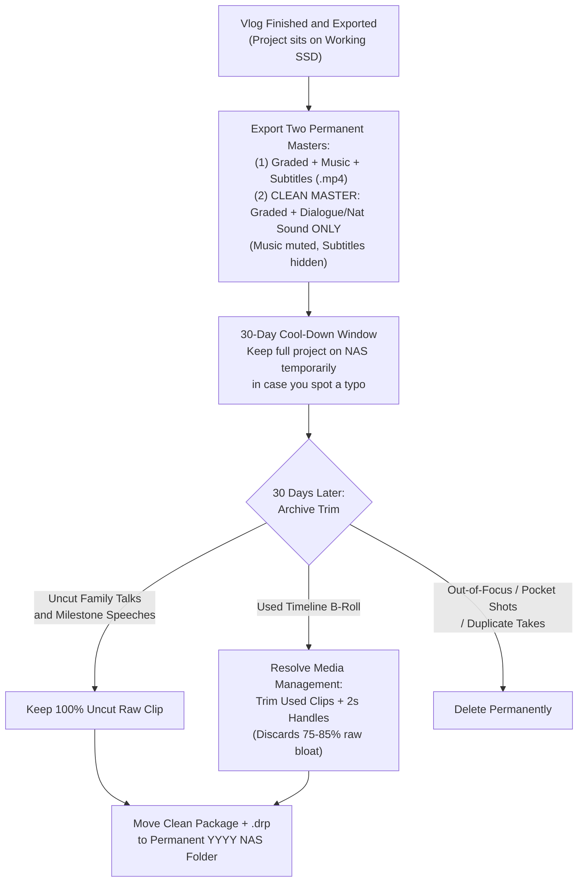

# Bulletproof 3-2-1 Media Backup, NAS Setup & 30-Year Memory Archiving

Capturing and editing personal films is only half the craft. Without a disciplined storage architecture, video creators inevitably hit the same wall within 18 months: a MacBook internal SSD choking at `98%` full, four unlabeled portable drives scattered across desk drawers, duplicate `IMG_4821.MOV` files in three folders, and the quiet terror that a single dropped drive or SSD controller failure could erase five years of irreplaceable family memories.

As a software engineer, you already know how to design durable distributed systems. Applying those exact principles—**tiered storage, cryptographic checksums, open file formats, and automated offsite replication**—lets you build a zero-stress **30-year personal memory archive** that takes less than 10 minutes of maintenance per month.

---

## 1. Why Consumer Cloud Photo Libraries Break Under 4K Video

Services like iCloud Photos and Google Photos are convenient for casual smartphone JPEG snapshots, **not** structured multi-camera filmmaking:

1. **Opaque Database Lock-In**: Footage from your DJI Osmo Pocket 3, DJI Mic 2 `.wav` backups, LUTs, and DaVinci Resolve timelines do not live cleanly inside Apple's `Photos Library.photoslibrary` package.
2. **Eviction Throttling**: "Optimize Mac Storage" silently evicts heavy `4K` `.mov` originals to the cloud, forcing painful re-downloads mid-edit.
3. **Sync Is Not Backup**: Delete a folder accidentally on one synced laptop and cloud sync faithfully propagates that deletion everywhere within seconds.

### The 3-2-1-1-0 Durability Standard

Design your life archive around the modern **3-2-1-1-0** durability contract:

- **3 Copies of Every Memory**: Primary working/warm copy + secondary local array copy + remote offsite copy.
- **2 Different Storage Media**: Solid-state NVMe flash (for high-IOPS editing) + enterprise **CMR** spinning magnetic disks (for high-capacity, bit-rot-scrubbed longevity).
- **1 Offsite Copy**: Client-side encrypted cloud object storage (`Backblaze B2` or `AWS S3 Glacier Deep Archive`) or a cold drive stored at a relative's home in another building/city.
- **1 Immutable / Versioned Layer**: Read-only Btrfs/ZFS snapshots so accidental `rm -rf` or ransomware cannot wipe historical files.
- **0 Unverified Backups**: Automated monthly checksum scrubbing + an annual 5-minute test restore.



---

## 2. Storage Capacity Math & Codec Economics

Before buying drives, run the exact bitrate math. Video storage footprint is governed by:

$$\text{Storage (GB per hour)} = \frac{\text{Bitrate (Mbps)} \times 3600\text{ s}}{8\text{ bits/byte} \times 1024\text{ MB/GB}} \approx \text{Bitrate (Mbps)} \times 0.4395$$

| Camera & Recording Mode | Typical Bitrate | Footprint per Hour | 30-Min Weekend Raw | Verdict for Personal Vlogging |
| :--- | :--- | :--- | :--- | :--- |
| **Pocket 3 — `4K30` 10-bit D-Log M (HEVC)** | `~90 Mbps` | `~39.6 GB / hr` | `~19.8 GB` | **Sweet Spot** — crisp 10-bit color, manageable size |
| **Pocket 3 — `4K60` 10-bit D-Log M (HEVC)** | `~130 Mbps` | `~57.1 GB / hr` | `~28.6 GB` | Great for intentional `40%–50%` slow-motion B-roll |
| **iPhone Pro — `4K30` Apple Log (HEVC)** *(Blackmagic App)* | `~65 Mbps` | `~28.6 GB / hr` | `~14.3 GB` | **Sweet Spot** — full Apple Log latitude at 1/6th ProRes size |
| **iPhone Pro — `4K30` ProRes 422 LT (Apple Log)** | `~410 Mbps` | `~180.2 GB / hr` | `~90.1 GB` | Use only for short, high-grade Hero commercials/interviews |
| **iPhone Pro — `4K60` ProRes 422 HQ (Apple Log)** | `~1,800 Mbps` | **`~791.0 GB / hr`** | **`~395.5 GB`** | **Storage Trap** — avoid for everyday life vlogging |
| **Finished `4K30` Master Export (10-bit HEVC)** | `45 Mbps` | `~19.8 GB / hr` | `~2.0 GB` *(6-min film)* | Tiny permanent footprint with pristine visual fidelity |

### 10-Year Storage Projection (Why Smart Pruning Changes Everything)

Suppose you shoot **24 weekend vlogs per year** (`20 GB` raw each) plus **two 7-day international trips** (`200 GB` raw each):
- **Unpruned Raw Hoarding**: `~880 GB` to `1.5 TB / year` $\implies$ `10 to 15 TB` over a decade.
- **Pruned Archive (Finished Masters + Clean Masters + Top 20% Selects)**: `~220 to 350 GB / year` $\implies$ **only `2.5 to 3.5 TB` for an entire decade of your thirties!**

---

## 3. Post-Shoot Ingest Checklist (Zero Lost Cards)

The highest-risk window in filmmaking is the **24 hours between finishing a shoot and verifying two independent copies**. Follow this invariant protocol every time you come home:

1. **Use Fast Physical Interfaces**:
   - **microSD**: Use `UHS-I V30 / A2` cards (`256 GB` or `512 GB` SanDisk Extreme Pro or Samsung PRO Plus) paired with a high-speed USB-C card reader (`170–200 MB/s`). Buy two `256 GB` cards rather than one giant `1 TB` card to halve blast radius if a card ever fails.
   - **iPhone Pro**: Connect via a **true USB 3.2 Gen 2 (`10 Gbps`) USB-C cable** (not the braided USB 2.0 `480 Mbps` charging-only cable shipped inside the iPhone box, which bottlenecks transfers at `38 MB/s` instead of `700+ MB/s`). Even faster: plug your NVMe working SSD directly into the iPhone's USB-C port and move files inside the iOS Files app or record straight to SSD via Blackmagic Camera.
2. **Copy with Checksum Verification (Never `Cut & Paste`)**:
   - Never `Cmd+X` / move files off an `exFAT` SD card—if the reader disconnects mid-move, `exFAT`'s single non-journaled allocation table can corrupt both source and destination.
   - Use a verified copy command in Terminal (macOS/Linux) or a checksum offload utility (`OffShoot` / `FreeFileSync`):

```bash
# Verified checksum ingest from SD card to Working NVMe SSD + NAS staging
rsync -avhP --checksum \
  "/Volumes/OSMO_SD/DCIM/100MEDIA/" \
  "/Volumes/VlogWorkSSD/2026/2026-11-28_Home_BraisedPorkVlog/01_Footage/A_Pocket3/"
```

3. **Spot-Check 3 Clips**: Open the **first**, **middle**, and **last** clip from the destination SSD in QuickTime (`Spacebar`) to confirm clean video and audio playback.
4. **Sync Copy #2 to NAS Before Wiping Media**: Run a quick sync of the project folder to your NAS (`00_Ingest_Active/`). Only when the footage exists on **both** your NVMe SSD and your NAS may you format the microSD card.
5. **Always Format Inside the Camera Menu**: Never delete files from an SD card using macOS Finder (`Move to Trash`). macOS moves files into a hidden `.Trashes` directory on the card—leaving the card `99%` full when placed back in your Osmo Pocket 3! Always format via *Osmo Pocket 3 -> Settings -> Format SD Card*.

---

## 4. The 30-Year Self-Describing Folder Taxonomy

Proprietary catalog databases (`Lightroom`, `Final Cut Bundles`, cloud albums) come and go every decade. **Hierarchical POSIX directories named with `ISO-8601` dates (`YYYY-MM-DD`) will still sort chronologically on every operating system in 2056.**

Use clean ASCII or standard UTF-8 characters without slashes, colons, or leading spaces:

```text
LifeArchive/
├── 2026/
│   ├── _00_2026_Annual_Vault_Selects/          # Drop 10s favorite clips here all year!
│   ├── 2026-04-12_Hangzhou_SpringWestLake/
│   │   ├── 01_Footage/
│   │   │   ├── A_Pocket3/                      # DJI_20260412_142015_001.MP4
│   │   │   ├── B_iPhone/                       # Apple Log / HEVC clips
│   │   │   └── C_Audio/                        # DJI Mic 2 32-bit float .WAV + Voiceover
│   │   ├── 02_Assets/                          # Track music used, LUTs, map graphics
│   │   ├── 03_Project/                         # DaVinci Resolve .drp export + timelines
│   │   └── 04_Exports/
│   │       ├── 2026-04-12_WestLake_Master_4K.mp4
│   │       ├── 2026-04-12_WestLake_CleanMaster_Textless.mp4
│   │       └── 2026-04-12_WestLake_Share_1080p.mp4
│   └── 2026-11-28_Home_BraisedPorkWeekend/
│       └── ...
└── _Shared_Creator_Kit/                        # Reusable across all projects
    ├── 01_LUTs/                                # Official DJI D-Log M & Apple Log LUTs
    ├── 02_Music_Crate/                         # Pre-curated 4-mood music folders
    ├── 03_SFX_Organic/                         # Subtle room tones & foley
    └── 04_Typography_Presets/                  # Fonts & Resolve/FCP title templates
```

---

## 5. Pruning Bloat Without Regret: The "Clean Master" Standard

Here is a painful mistake veterans discover 10 years too late:
- If you keep **every single shaky raw clip**, your NAS fills with terabytes of garbage you will never open again.
- Yet if you delete **all raw files** and keep **only your final YouTube `.mp4`**, every memory now has loud background music and burned-in subtitles permanently baked over your mother's voice or your travel footage—making it impossible to re-edit into a 40th-birthday film or family documentary later!

### The 3-Artifact Eternal Archive Protocol

Solve both problems permanently with a **3-minute post-edit habit** plus a **30-day cool-down prune**:



1. **Artifact 1 — `Master_4K.mp4`**: Your finished, scored, subtitled film ready to watch on any TV, phone, or Jellyfin server.
2. **Artifact 2 — `CleanMaster_Textless.mp4` (Your Secret Time Capsule)**: Right after exporting your final vlog, **mute the Music track (`A4`), hide the Subtitle track, and hit Render one more time** (`3 minutes`). You now possess a color-graded, audio-leveled copy of every visual and spoken word with **zero burned-in text and zero music**. Twenty years from now, it cuts effortlessly into any future retrospective.
3. **Artifact 3 — Trimmed Selects + `.drp` Project File**:
   - In DaVinci Resolve, open *File -> Media Management -> Timelines -> Copy -> Used media and trim keeping `48` frame handles*. Resolve automatically copies **only the exact 5-second slices used in your edit (plus 2 seconds of safety padding)** and drops your project folder size from `32 GB` down to `5 GB`!
   - Also export a tiny `.drp` (`DaVinci Resolve Project` file, `~5 MB`) into `03_Project/` so your timeline cuts remain documented outside Resolve's local database.

### Optional: Compressing Bloated ProRes Clips to Visually Lossless 10-bit HEVC

If you accidentally shot `150 GB` of iPhone ProRes 422 HQ that you want to preserve without buying extra hard drives, Apple Silicon's hardware `VideoToolbox` encoder shrinks ProRes by **`85% to 90%`** into `10-bit HEVC` while preserving creation timestamps and GPS location tags:

```bash
# Convert heavy ProRes .MOV to archival 10-bit HEVC on Apple Silicon Mac
# Preserves QuickTime creation_time, GPS metadata, and 10-bit Apple Log range
for f in *.MOV; do
  ffmpeg -i "$f" \
    -map_metadata 0 \
    -movflags use_metadata_tags+faststart \
    -c:v hevc_videotoolbox -profile:v main10 -q:v 68 -tag:v hvc1 \
    -c:a copy \
    "archived_${f%.*}.mp4"
done
```

---

## 6. Hardware Blueprint: SSD, NAS RAID & Encrypted Cloud

### Tier 1: Hot Working NVMe SSD (On Your Desk / Backpack)
Never edit heavy 4K video off slow spinning drives or network Wi-Fi. Keep current-month projects on an external NVMe SSD:
- **Recommended Hardware**: `2 TB` or `4 TB` **Samsung T9**, **Crucial X10 Pro**, or a **DIY USB4 (`40 Gbps`) enclosure** (`OWC Express 1M2` + `WD Black SN850X` / `Lexar NM790`, which sustains `2,800+ MB/s` without thermal throttling).
- **Critical File System Rule on macOS**: Format your editing SSD as **`APFS`** (not `exFAT`!). `exFAT` lacks file-system journaling; a single accidental cable tug breaks NLE cache databases and corrupts open `.mov` headers. Keep one tiny `256 GB` thumb drive formatted `exFAT` only if you occasionally exchange files with Windows machines.

### Tier 2: Warm Home NAS (Your 24/7 Private Cloud)

| Setup Tier | Enclosure Recommendation | Recommended Drive Config | Usable Space | Approximate Total Budget |
| :--- | :--- | :--- | :--- | :--- |
| **Compact Starter (2-Bay)** | Synology `DS224+` or UGREEN `DXP2800` | `2 x 12 TB` CMR in `SHR-1` / `RAID 1` | `~10.9 TiB` | `USD 750 to 950` |
| **10-Year Sweet Spot (4-Bay)** | Synology `DS423+` / `DS923+` or UGREEN `DXP4800 Plus` | Start with `2 or 3 x 16 TB` CMR in `SHR-1` / `RAID-Z1` (1-disk fault tolerance, easy slot expansion) | `~14.5 to 29.0 TiB` | `USD 1,150 to 1,550` |

#### Four Non-Negotiable NAS Engineering Rules
1. **Buy Strictly `CMR` Drives (Never `SMR`)**: Purchase **WD Red Plus / Red Pro**, **Seagate IronWolf / IronWolf Pro / Exos**, or **Toshiba N300 / MG Enterprise**. Avoid cheap consumer desktop drives using **SMR (Shingled Magnetic Recording)**—during a RAID rebuild, SMR write penalties stall throughput to `<2 MB/s` and cause array timeouts.
2. **Use `Btrfs` or `ZFS` with Checksum Scrubbing**: When creating your storage pool, choose `Btrfs` (Synology, checking *Enable data checksum for advanced data integrity*) or `ZFS` (TrueNAS). Schedule an **automated monthly Data Scrub** at 3:00 AM on the 1st of every month so silent cosmic-ray/magnetic bit rot is detected and healed automatically from parity blocks.
3. **Attach a `USD 80` UPS Battery Backup**: Connect an APC / CyberPower UPS via USB to your NAS and set it to enter safe mode `3 minutes` after utility power drops. Sudden brownouts during RAID parity writes are the #1 killer of home arrays.
4. **Remember: RAID Is High Availability, Not Backup**: If lightning fries your NAS PSU or a bug deletes a shared folder, both mirrored drives lose the data simultaneously. Always maintain Tier 3 offsite copies.

### Tier 3: Cold Offsite Encrypted Cloud + Parents' House Drive
- **Client-Side Encrypted Cloud**: Configure `Synology Hyper Backup` (with Client-Side `AES-256` encryption enabled—save the `.pem` key in your password manager!) or `restic` / `rclone crypt` to back up your `04_Exports` and `Selects` folders nightly:
  - **Backblaze B2**: `~USD 6 / TB / month` (instant retrieval; `3 TB` archive costs `~USD 18/month`).
  - **AWS S3 Glacier Deep Archive**: `~USD 0.99 / TB / month` (12-hour retrieval; `3 TB` of priceless finished films + clean masters costs **`~USD 3/month`**—less than one cup of coffee per month to survive a total house fire).
- **Semi-Annual Cold Physical Drive**: Keep one bare `14 TB–18 TB` external HDD stored at your parents' home or office locker. Sync it twice a year during Lunar New Year and Mid-Year holidays.

#### Automated Zero-Trust `restic` Cloud Backup Script (CLI Option)

If you prefer open-source, vendor-agnostic encryption over proprietary NAS GUI apps, **`restic`** encrypts (`AES-256` + `Poly1305`), deduplicates, and snapshots your `LifeArchive` to Backblaze B2 or S3-compatible object storage with cryptographic verification:

```bash
#!/usr/bin/env bash
set -euo pipefail

# Store repository URL and encryption password in protected root/user secrets
export RESTIC_REPOSITORY="s3:s3.us-west-004.backblazeb2.com/my-life-archive-vault"
export RESTIC_PASSWORD_FILE="${HOME}/.config/restic/vault-password.txt"
export AWS_ACCESS_KEY_ID="your-b2-key-id"
export AWS_SECRET_ACCESS_KEY="your-b2-application-key"

# 1. Incremental client-side encrypted backup of finished films & trimmed selects
restic backup "/Volumes/NAS_LifeArchive/LifeArchive" \
  --exclude="*.CacheClip*" \
  --exclude=".DS_Store" \
  --tag "personal-vlog-vault"

# 2. Enforce 30-year retention policy & prune unreferenced blocks
restic forget \
  --keep-daily 7 \
  --keep-weekly 5 \
  --keep-monthly 12 \
  --keep-yearly 35 \
  --prune

# 3. Verify repository metadata + sample 2% of encrypted data packs each run
restic check --read-data-subset=2%
```

---

## 7. Emergency Incident Runbooks (When Hardware Fails)

Panic destroys more footage than hardware defects. If storage fails, follow these exact runbooks:

| Incident | Immediate Do-NOT-Do Rule | Step-by-Step Recovery Protocol |
| :--- | :--- | :--- |
| **microSD Card Says `"Card Unreadable / Initialize"`** | **NEVER click `Initialize` or `Format`**, and never record another clip on the card | 1. Eject immediately and flip read-only switch (if full-size SD adapter)<br/>2. Image raw sectors first onto SSD via GNU **`ddrescue`**:<br/>`ddrescue -d /dev/diskX ~/Desktop/sdcard_raw.img ~/Desktop/sdcard.map`<br/>3. Run **`PhotoRec` (`testdisk`)** or **SanDisk RescuePRO** against `sdcard_raw.img` (never against the dying physical card!) |
| **1 Drive Turns Amber (`Degraded`) in NAS `SHR-1` / `RAID-Z1`** | Do not pull the *wrong* healthy drive; do not run heavy video edits off the degraded pool | 1. Verify offsite cloud backup is current before touching hardware<br/>2. Identify exact serial number of failed bay in Storage Manager<br/>3. Swap in an equal-or-larger **CMR** replacement drive (`16 TB+`) and let parity rebuild finish uninterrupted on UPS power (`18–36 hrs`) |
| **Accidental `rm -rf` of a Project Folder** | Stop writing new gigabytes to the working SSD or NAS volume | Restore instantly in 10 seconds from **NAS Btrfs/ZFS Read-Only Local Snapshots** (`#snapshot` directory) or `restic restore latest --target ./recovered --include "2026-11-28*"` |

---

## 8. Making the Archive Alive: Annual Highlight Films & Family Vaults

An archive nobody watches is a digital graveyard. Build two lightweight rituals so your films stay woven into family life:

### 1. The `_00_Annual_Vault_Selects` Folder & December Film Ritual
Every time you finish editing a weekend vlog (or ingest a Tier 0 smartphone clip during a busy work week), immediately copy your **1 to 3 favorite 8-second clips** into `LifeArchive/2026/_00_2026_Annual_Vault_Selects/`.
- By December 27th, that single folder already holds **80 to 120 chronological highlights** from the entire year—zero hunting through terabytes of folders required!
- Brew a pot of tea during the year-end holiday break, pick two sweeping instrumental tracks, record a quiet 3-minute voiceover reflecting on what 32 taught you, and assemble your **Annual Year-in-Review Film** in a single afternoon. Ten years of those annual films (`Age 32` through `Age 42`) will become one of the most meaningful possessions you own.

### 2. Private Family Streaming (Without Public Social Media Pressure)
Not every personal memory belongs on public YouTube or Bilibili. Run **Jellyfin** or **Immich** in Docker on your NAS and create a dedicated library called **`Family Cinema`**. Your partner and aging parents can browse your finished chapter films by year with custom poster thumbnails right on an Apple TV, iPad, or smart TV—privately, in crisp `4K` bitrate, with zero ads or comment sections.

### 3. The 10-Minute Quarterly Maintenance Checklist
Add a recurring calendar reminder on the first Sunday of each quarter (`Jan / Apr / Jul / Oct`):
- [ ] **Working SSD Hygiene**: Move any completed projects older than 30 days off your NVMe working SSD onto the NAS (after exporting your `CleanMaster` and trimming raw bloat).
- [ ] **NAS Health & Scrub Check**: Verify `0` bad sectors in SMART stats and confirm last month's `Btrfs`/`ZFS` scrub completed with `0` unrecoverable checksum errors.
- [ ] **Offsite Sync & 1-File Restore Drill**: Confirm encrypted cloud backup succeeded within the past 7 days, and download **one random `.mp4`** from the cloud backup using your decryption key to verify end-to-end recoverability.

With capture habits from [01-VLOG-STORYTELLING-AND-SHOOTING-HABITS.md](01-VLOG-STORYTELLING-AND-SHOOTING-HABITS.md), the 2-hour editing assembly line from [02-FAST-VIDEO-EDITING-WORKFLOW.md](02-FAST-VIDEO-EDITING-WORKFLOW.md), and the 3-2-1 vault architecture in this guide, your entire personal filmmaking workflow from [00-README.md](00-README.md) is complete, resilient, and built to last decades.
