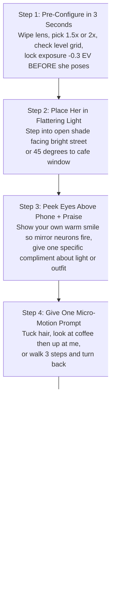
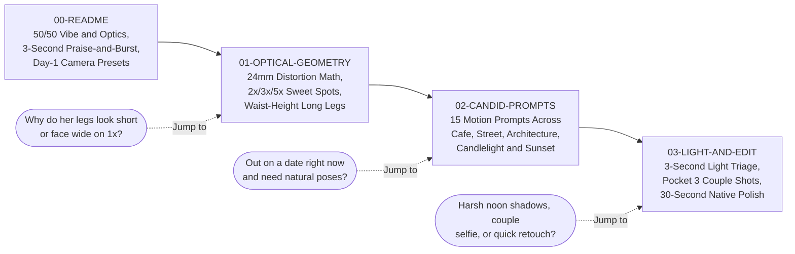

# Boyfriend Camera Mastery: Why Great Partner Photos Are 50% Emotional Vibe and 50% Optical Geometry

## 1. Why Guys With Great Cameras Still Take Terrible Partner Photos

Every weekend in cafés from Shanghai's Wukang Road to Rabat's Kasbah of the Udayas, the exact same micro-tragedy unfolds: a guy pulls out the latest iPhone Pro (or a USD 3,000 mirrorless kit), stands stiffly at his own eye height, points a wide `1x (24mm)` lens downward at his girlfriend in dead silence for four seconds, taps the shutter **once**, lowers the phone, and says: *"Done! Let's keep walking."*

When she looks at the screen, she sees a photo where her head looks disproportionately large, her legs look 15 cm shorter than real life, harsh overhead shadows sit under her eyes, and she was caught mid-blink with a frozen, awkward smile. He feels confused because the image is technically sharp; she feels deflated because she spent forty minutes getting ready and feels unseen.

Great partner photography (给女朋友拍照的满分底层逻辑) is **never** a sensor-resolution problem. It is a multiplicatively coupled system of **emotional safety** and **optical geometry**:

$$Q_{\text{portrait}} = E_{\text{vibe}} \times G_{\text{optics}} \times L_{\text{vector}} \times N_{\text{sampling}}$$

Because these four terms multiply rather than add, **a zero in any single term collapses the entire photograph to zero**:

- **$E_{\text{vibe}}$ (Emotional Safety and Spoken Warmth)**: If you sigh impatiently, hide silently behind your phone with a furrowed "debugging" frown, or critique her posture (*"Why do you look so stiff?"*), her nervous system tenses immediately. Facial micro-muscles around the eyes (*orbicularis oculi*) lock up, producing a forced grimace that no lens can rescue.
- **$G_{\text{optics}}$ (Optical Geometry: Distance, Focal Length, and Pitch)**: Perspective distortion is governed strictly by camera-to-subject distance $d$, while leg-to-torso ratios are governed by camera elevation $h_{\text{cam}}$ and vertical tilt angle $\theta$.
- **$L_{\text{vector}}$ (Light Direction Relative to Nose and Eyes)**: Overhead noon sun creates dark eye sockets regardless of camera price; rotating 90 degrees into open shade puts luminous catchlights in her eyes in two seconds.
- **$N_{\text{sampling}}$ (Micro-Expression Sampling Rate)**: Human laughter and relaxed expressions peak during a `0.3s to 0.6s` transition window *after* a movement or joke. Taking 1 static frame has less than a 10% probability of hitting that window; shooting 10 to 15 Live Photos across a 3-second burst raises hit probability above 90%.

### Stiff Boyfriend Snapshot vs High-EQ Partner Photography

| Dimension | Frustrating Boyfriend Habit | High-EQ Partner Photographer Standard |
| :--- | :--- | :--- |
| **Initiation** | Waits until asked, then sighs or treats photos like a chore interrupting the walk | Proactively spots flattering light first: *"Wait, the sunset on your hair right here is unreal—give me 10 seconds!"* |
| **Pre-Shot Setup** | Makes her stand frozen in a pose for 12 seconds while fumbling with lens buttons | Dials focal length (`2x` or `1.5x`), level grid, and `-0.3 EV` **before** asking her to step into the spot |
| **Behind-the-Lens Face** | Hides entire face behind phone with silent, serious concentration frown | Peeks warm eyes *over* top edge of phone; smiles and gives specific, genuine compliments mid-shoot |
| **Shutter Volume** | Fires 1 or 2 static clicks, drops arm immediately, says *"Done!"* (拍一张就说好了) | Fires **10 to 15 rapid Live Photos** across 2 focal lengths (`2x` half-body + `1.5x` full-body) per spot |
| **Camera Elevation** | Shoots lazily from male standing eye height (`170 cm+`) tilted downward | Drops phone to **chest height** for half-body (`2x`) or **navel/hip height** (`100 cm`) for full-body (`1.5x`) |
| **Handover Etiquette** | Hands over raw roll starting on an unflattering mid-blink test frame | Spends 6 seconds tapping `Heart` on the **top 2 sharpest winners** and opens the best frame first |
| **Response to Retake** | Gets defensive (*"That's literally how the lighting looks here"*) | Takes ownership warmly (*"My angle was too high—step half a pace toward the window, watch this one!"*) |

---

## 2. The Psychology Behind the Lens: The 3-Second Praise-and-Burst Loop

Professional portrait directors know an uncomfortable truth: **almost nobody besides paid fashion models feels comfortable staring silently into a glass lens**. Within `1.5 seconds` of silence, self-consciousness floods the brain (*"Where do I put my hands? Does my chin look weird? Are passersby watching me?"*).

Worse, human mirror neurons copy the face opposite them. When an engineer concentrates on framing a composition, his eyebrows knit together and his mouth flattens. When your girlfriend looks toward your phone and sees an expressionless face staring silently at a screen, her brain unconsciously reads **judgment**, killing her smile instantly.

### The 3-Second Praise-and-Burst Habit (三秒情绪价值连拍法)

Replace silent single-clicking with a repeatable 15-second rhythm where **praise triggers natural emotion** and **continuous shooting captures the unguarded transition**:

### Spoken Lines That Create Genuine Smiles (Zero Cheesy Fake Cues)

Never say *"1, 2, 3, smile!"* or *"Say cheese!"*—counting down triggers the zygomatic major mouth muscle *without* engaging the eyes, creating a stiff passport grin. Use **specific visual appreciation** or **playful micro-prompts** while your thumb is already tapping the shutter:

1. **Specific Light + Outfit Praise (First 2 Seconds)**:
   - *"Hold on—the way that golden light catches your earrings and collar right now looks like a magazine cover. Stay right there!"*
   - *"That olive coat against this blue wall in the Kasbah is an insane color match—look slightly toward the alley first."*
2. **Capturing the Post-Laugh Exhale (`t + 0.4s` Window)**:
   - Tell a tiny inside joke or playful tease (*"Look at me like I just tried to pronounce Darija in front of a taxi driver"*), tap 4 frames during the big laugh, and **keep tapping 4 more frames** as her laugh settles into a soft, glowing half-smile. That `t + 0.4s` post-laugh frame is almost always the keeper.
3. **Shielding Her From Public Shyness**:
   - If passersby walk near the frame on a busy Shanghai or Paris sidewalk, never rush awkwardly. Stand calmly as her visual anchor, keep warm eye contact with *her* (ignoring the crowd completely), and say softly: *"Take your time, nobody's watching—just adjust your cuff and walk slowly toward me."* When you are unbothered, her shyness evaporates by 80%.

### Bilingual High-EQ Praise Bank (Specific Beats Generic)

Generic filler (*"Good, nice, keep going"*) sounds robotic after three seconds. Anchor every compliment in **one concrete visual detail** (light, color, movement, or expression) so she knows what is working and feels genuinely seen:

| Moment in Shoot | Robotic Filler (Avoid) | Specific Spoken Line (English / Mandarin) |
| :--- | :--- | :--- |
| **First 2 Seconds** | "Okay stand there, 1-2-3." | *"Wait—this side light on your cheekbones is gorgeous, don't move!"* / *"等一下，这道侧光打在你脸上绝了，先别动！"* |
| **Wind Catches Hair** | "Your hair is messy, fix it." | *"That breeze in your hair looks like a movie poster—tuck just one side!"* / *"风吹头发太有电影感了，顺手往耳后撩一下！"* |
| **Full-Body OOTD** | "Stand straight." | *"This coat silhouette against the archway makes you look 175 cm tall!"* / *"这件外套配拱门比例绝了，腿长一米八！"* |
| **Changing Angles** | "Hmm, that looked bad, redo." | *"That one's already a keeper! Step half a pace left so I can catch the sky too."* / *"这张已经超好看了！再往左半步我把后面的蓝天也框进来。"* |
| **When She Feels Shy** | "Stop covering your face." | *"Keep laughing just like that—that shy half-smile is my favorite frame today."* / *"就这样笑别停，刚刚害羞低头那一下最好看！"* |

---

## 3. Culling, Review Etiquette, and Never Taking Just One Frame

Even top commercial portrait shoots have a **keeper rate of 8% to 15%** because eyelashes blink every 4 seconds, wind blows stray hair across lips, and walking strides pass through awkward mid-step phases. Expecting 1 click to nail framing, posture, wind, and expression simultaneously violates basic probability.

### The "2 Angles x 6 Frames" Rule Per Spot

Whenever you stop at a scenic corner or café table, spend **under 25 seconds** capturing two complementary compositions without making her feel stuck in a marathon photoshoot:

1. **Pass A — Tight Vibe Shot (`2x 48mm` or `3x 77mm`, 6 rapid Live Photos)**: Captures facial expression, eyes, jewelry, coffee cup, and soft background separation from chest/eye level.
2. **Pass B — Full-Outfit Context Shot (`1.2x 28mm` or `1.5x 35mm`, 6 rapid Live Photos)**: Step back two paces, lower phone to waist height (`+3 degrees` upward tilt), align shoes near the bottom frame border, and capture her full OOTD plus architecture.

### Four Non-Negotiable Review Rules

- **Open on Your Strongest Frame First**: First impressions anchor emotional perception. Take 6 seconds after shooting to flick through the 12 shots, tap the `Heart` icon on the top 2 frames (sharp eyes, clean jawline, flattering leg line), and hand her the phone opened directly on Favorited Frame #1.
- **Never Batch-Delete Unilaterally**: Even if you think Frame #4 has slightly messy hair, keep all 12 frames in the roll until *she* picks her favorites—men typically judge technical sharpness and background symmetry, whereas she checks facial angle, hair volume, shoulder line, and overall effortless vibe (*松弛感*).
- **Translate Critique Into Immediate Geometric Adjustments**:
  - If she says *"I look short here"* -> Lower phone from chest height down to your navel (`100 cm`), keep shoes in the bottom 8% of the frame, and leave 35% sky/architecture above her head.
  - If she says *"My face looks wide or puffy"* -> Step back 80 cm, switch from `1x (24mm)` to `2x (48mm)` or `3x`, and angle her shoulders 45 degrees toward a directional light source.
  - If she says *"I look awkward and stiff"* -> Give her hands a physical anchor (cup, sunglasses, bag strap, railing) and shoot *while* she walks or turns rather than standing still.
- **Know When to Pocket the Phone**: Capture 12 great frames in 25 seconds while energy is high, confirm she loves 1 or 2 winners, then put the camera away and enjoy the date with 100% presence. Quality + speed beats exhausting 20-minute posing sessions every time.

---

## 4. Day-1 iPhone Pro & Osmo Pocket 3 Boyfriend Camera Setup

Configure these settings **once** on your iPhone Pro (`Settings -> Camera`) and DJI Osmo Pocket 3 so every spontaneous shot starts with flattering geometry and rescue insurance:

| Setting Path | Exact Configuration | Why It Saves Partner Portraits |
| :--- | :--- | :--- |
| **Grid & Level** | `Grid: ON`; `View Outside the Frame: OFF` | Gives instant 3x3 proportion lines and central crosshair to prevent crooked horizons or accidental extreme tilt |
| **Live Photo + Preserve** | `Live Photo: ON`; `Preserve Settings -> Live Photo: ON` | Records 1.5s before and after shutter (`45 frames`); rescues closed eyes via `Edit -> Live -> Make Key Photo` |
| **Main Camera Lenses** | Enable `28 mm (1.2x)` and `35 mm (1.5x)` under Main Camera | Gives distortion-controlled full-body focal lengths at a single tap on the `1x` button |
| **Photographic Style** | `Amber` or `Rose Gold` (`Tone -10`, `Undertone +12`) | Neutralizes clinical green/grey smartphone skin casts while keeping highlights creamy instead of harsh HDR |
| **Portraits in Photo Mode** | `ON` (iPhone 15/16/17 Pro) | Automatically saves depth maps whenever a face is detected in standard Photo mode—optional `f/2.8–f/5.6` blur *after* shooting without missing fast bursts |
| **Mirror Front Camera** | `ON` | Prevents couples selfies from horizontally flipping her face into an unfamiliar asymmetry she isn't used to seeing in mirrors |
| **Prioritize Faster Shooting** | `ON` | Lets rapid shutter tapping fire 5+ frames per second without computational freeze lag |
| **Pocket 3 Portrait Defaults** | `4K 24/30fps`, `Sharpness -1`, `Noise Reduction -2`, `EV -0.3`, `Glamour Effects: Subtle or OFF` | Eliminates harsh digital skin sharpening on video clips and rolling couple vignettes |

> **The 1-Second Lens Wipe Reflex**: Skin oil from your thumb on the iPhone sapphire cover scatters light into milky contrast loss and diagonal streaks across her face. Wipe the rear lenses against a clean cotton shirt hem or microfiber cloth **every single time** the phone leaves your pocket.

### Choosing the Right Shutter Cadence on iPhone Pro

Not all "multi-frame shooting" uses the same image-processing pipeline on iOS—pick the right trigger for the lighting:

- **Rapid Single Tapping with `Live Photo: ON` (`3 to 4 taps/sec` — Use 90% of the Time)**:
  - Every tap runs Apple's full **Photonic Engine / 24MP multi-exposure fusion** *plus* saves a 45-frame `3-second` motion buffer. Ideal for cafés, street walks, architecture, golden hour, and evening restaurants.
- **Swipe-Shutter-Left Hardware Burst (`10 fps` — Bright Daylight Action Only)**:
  - Dragging the shutter button left toward the edge fires 10 raw single-exposure 12MP frames per second—skipping multi-frame HDR fusion. Reserve hardware burst **strictly for bright outdoor sunlight (`1/500s+`)** when she is spinning a dress hem, jumping on wet sand, or running across a crosswalk; never use swipe-burst in dim cafés where single exposures look grainy.
- **Background Clutter & Outfit Contrast Scan (`拍前两秒背景排雷`)**:
  1. **Head-Intersection Check**: Shift your own body `20 cm` left or right so streetlamps, tree trunks, cafe signs, or umbrella poles do **not** sprout vertically out of the top of her head.
  2. **Figure-Ground Luminance Separation**: Place dark hair or black coats against sunlit stone, sky, or warm walls (never against pitch-black shadows where hair outline disappears); place white/cream dresses against darker foliage, cobalt blue doors, or shaded colonnades.
  3. **Edge Distraction Purge**: Nudge `2x` framing `3 degrees` inward to slice bright red fire hydrants, neon trash bins, or parked delivery scooters cleanly out of the frame border.

---

## 5. Curriculum Learning Path and Complete Folder Index

Work through the four guides below to build effortless muscle memory across optics, natural posing direction, light reading, couple two-shots, and fast native retouching.

### Clickable Module Directory

1. **[00-README.md](00-README.md) — Boyfriend Camera Mastery: Why Great Partner Photos Are 50% Emotional Vibe and 50% Optical Geometry** *(Current Document)*
   - The multiplicative partner-portrait equation; why silent 1-click shooting fails; the 3-Second Praise-and-Burst habit; culling and handover etiquette; Day-1 iPhone Pro and Osmo Pocket 3 setup.
2. **[01-FOCAL-LENGTHS-ANGLES-AND-PROPORTIONS.md](01-FOCAL-LENGTHS-ANGLES-AND-PROPORTIONS.md) — Optical Flattery Physics: Focal Lengths, Camera Angles and Effortless Proportions on iPhone Pro and Pocket 3**
   - Why `24mm (1x)` enlarges noses by 25% up close and warps limbs in frame corners; mastering `2x (48mm)` for café/half-body and `3x/5x (77–120mm)` for creamy portrait compression; the exact `1.2x/1.5x` waist-height `+3-degree` upward tilt formula for long legs without double chin; joint-crop rules.
3. **[02-FIFTEEN-NATURAL-CANDID-POSES-AND-PROMPTS.md](02-FIFTEEN-NATURAL-CANDID-POSES-AND-PROMPTS.md) — 15 Zero-Awkwardness Action Prompts Across 5 Real Date Scenes**
   - Why motion verbs beat finger micro-management; 45-degree shoulder and breathable waist-gap mechanics; 15 word-for-word playful prompts across Café tables, Street crosswalk look-backs, Wind & Rabat/Shanghai architecture, Candlelit restaurants, and Sunset silhouettes.
4. **[03-FLATTERING-LIGHT-COUPLE-SHOTS-AND-30S-EDIT.md](03-FLATTERING-LIGHT-COUPLE-SHOTS-AND-30S-EDIT.md) — Reading Light in 3 Seconds, Aesthetic Couple Two-Shots and Natural 30-Second Retouching**
   - Defeating overhead noon "raccoon-eye" shadows (顶光熊猫眼); 45-degree window Rembrandt/butterfly light and `-0.3 EV` golden-hour rim light; framing high-taste couple two-shots with Osmo Pocket 3 `ActiveTrack 6.0`, MagSafe stands, and stranger hand-offs; 30-second luminous native edit without plastic AI filters.

---

## 6. Six Classic Boyfriend Failure Modes and Instant Field Fixes

| Failure Mode | Visual Symptom on Screen | Root Cause | 5-Second Field Fix |
| :--- | :--- | :--- | :--- |
| **The Eye-Level `1x` Dwarf Shot** | Large head, short torso-to-leg ratio, vast pavement around shoes | Standing `175 cm+` tall shooting downward on wide `24mm` lens | Step back 1m, switch to `1.5x (35mm)`, drop phone to navel (`100 cm`), place shoes in bottom 8% |
| **Close-Range `1x` Cafe Puffiness** | Nose looks wider, ears disappear, cheeks look rounder than reality | Perspective distortion at `d = 60 cm` across small cafe table | Tap **`2x (48mm)`**, lean back 20 cm in your chair, shoot from `2–5 degrees` slightly above her eye line |
| **Ankle-Guillotine Framing** | Legs look abruptly stumpy and grounded | Bottom border slices directly across ankles or shins | Either include **whole shoes + 2 cm floor** OR crop cleanly at **mid-thigh / waist**—never cut joints |
| **Extreme Knee-Crouch Chin Trap** | Long legs, but nostrils show and jawline gains an artificial double chin | Crouching at knee level (`50 cm`) with `+15 degree` steep upward tilt | Raise camera back to **waist/hip (`100 cm`)**, keep tilt `+2 to +4 degrees`, cue her chin slightly forward-level |
| **Overhead Spot Raccoon Shadows** | Dark hollows under eyes, harsh shadow under nose tip | Standing directly under mall/restaurant ceiling spotlight or noon sun | Step 80 cm backward out of the downlight cone or 1m inside open shade facing the bright street |
| **Nuclear Forehead / Blown Dress** | White dress or sunlit cheek clips into featureless pure white | iOS auto-exposure meters for dark background shadows | Tap her sunlit cheek, slide the yellow sun icon down **`-0.3 to -0.7 EV`** before firing burst |

---

## 7. The Date-First Golden Ratio: 3 Micro-Sessions in 3 Hours

The ultimate goal of partner photography is **amplifying the joy of your date**, never turning an afternoon together into an exhausting commercial shoot. Follow the **3 x 45-Second Micro-Session Rhythm** across any 3-hour date or travel walk:

1. **Window 1 — First 15 Minutes After Meeting (`妆发最佳黄金期`)**:
   - Hair volume, lip color, and outfit crispness are at 100% peak right when you step out the door or arrive at the first street corner. Proactively capture **1 full-body OOTD burst (`1.5x`) + 1 tight half-body smile (`2x`)** within the first 15 minutes—never wait until 22:00 after wind, humidity, and heavy dinner when she feels tired!
2. **Window 2 — Café Window or Golden-Hour Stroll (`光线最佳黄金期`)**:
   - Spend 45 seconds when afternoon coffee arrives (`2x` across the table) or when low `16:30–18:00` sun hits a beautiful street archway (`3x / 5x` rim light).
3. **Window 3 — One Couple Two-Shot Memory (`合照留念期`)**:
   - Set the Osmo Pocket 3 on a café corner or hand a pre-composed `1.5x` template to a friendly camera-carrying passerby so **both** of you appear in the memory archive—not just solo portraits of her.

Total active camera time across a 180-minute date: **under 4 minutes (`2.2%` of your evening)**—producing 6 to 8 magazine-grade keepers while keeping 97.8% of your attention locked on real conversation, laughter, and connection.

---

## 8. Post-Date Delivery, Live Photo Magic, and High-ROI Print Surprises

Most guys stop thinking about photos the second they lock their phone screen—missing the easiest emotional-warmth multiplier of the entire workflow:

1. **Same-Evening Curated AirDrop (Never Delay Three Days)**:
   - Spend 90 seconds while waiting for dessert or riding the taxi home to run the 30-second luminous polish ([03-FLATTERING-LIGHT-COUPLE-SHOTS-AND-30S-EDIT.md](03-FLATTERING-LIGHT-COUPLE-SHOTS-AND-30S-EDIT.md)) on your top 4 frames and **AirDrop full-resolution Live Photos** on the spot while excitement is high.
   - Never send primary keepers over compressed chat apps with "Original Image" unchecked—chat compression strips 75% of tonal gradation and kills Live Photo motion!
2. **The Live Photo `Long Exposure` Crowd-Eraser Trick (`实况长曝光虚化人群/车流`)**:
   - On a busy crosswalk, subway platform, or waterfall promenade, brace your elbows steady for `2 seconds`, ask her to hold completely still looking at you while pedestrians or train lights rush behind her, and tap a standard **Live Photo**.
   - In the Photos app, tap the top-left `Live` dropdown and select **`Long Exposure`**: she stays tack-sharp in the center while rushing crowds or evening headlights melt into silky Wong Kar-wai motion streaks!
3. **Curated Shared Album Hygiene**:
   - Maintain one clean shared album organized by season or trip (for example, `2027-Spring-Shanghai` or `2027-Autumn-Rabat`), uploading **only the top 5 to 10 curated winners per outing** rather than dumping 120 unedited duplicates.
4. **The Annual Tangible Print Ritual**:
   - Once every few months—or before an anniversary—secretly print 10 favorite candid frames onto matte `4x6` archival silver-halide paper (or pocket Instax Wide film, costing under RMB 40 / EUR 6 total) and write the date plus one warm memory line on the back in pen. Physical prints outlast 50,000 forgotten cloud files.
