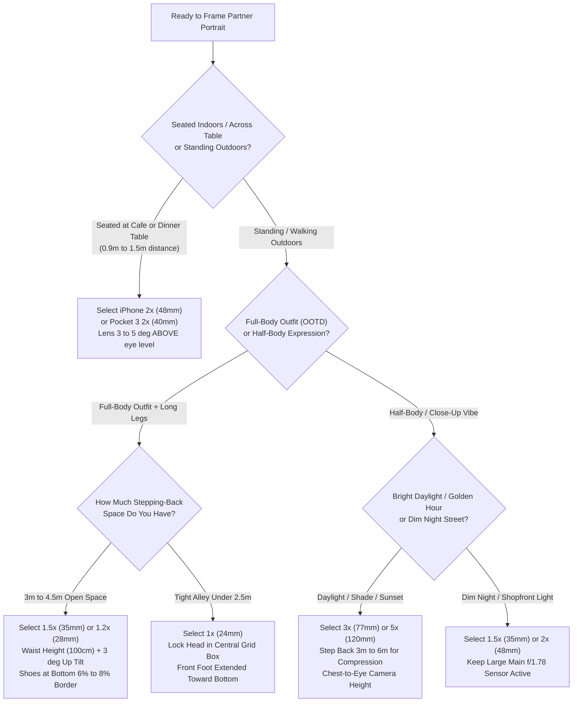
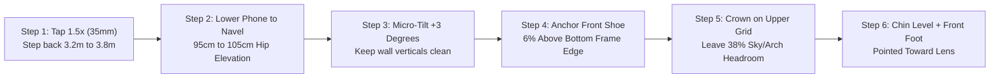

# Optical Flattery Physics: Focal Lengths, Camera Angles and Effortless Proportions on iPhone Pro and Pocket 3

## 1. Why 24mm 1x Distorts Noses Up Close and Stretches Corners

When your partner looks at a close-up `1x` smartphone photo and says *"My nose looks huge and my arms look twice as wide as real life,"* she is not imagining things—she is observing **two exact laws of geometrical optics** working against her simultaneously.

### Law 1: Axial Perspective Distortion Is Pure Subject Distance

A common photography myth claims that wide-angle lenses inherently "distort faces" while telephoto lenses "compress faces." Physically, **perspective magnification depends strictly on the camera-to-subject distance $d$**, while focal length merely determines how tightly the sensor crops the frame at that distance.

On a human face, the tip of the nose sits roughly $\Delta z \approx 12\text{ cm}$ closer to the camera lens than the ears and jawline corners. By similar triangles, the relative magnification $R_{\text{nose/ear}}$ of the nose compared to the jawline is:

$$R_{\text{nose/ear}} = \frac{d}{d - \Delta z}$$

Watch what happens across four real-world shooting distances when framing a head-and-shoulders portrait:

| Lens Choice | Working Distance ($d$) | Nose-to-Ear Ratio ($R$) | Perceived Facial Effect |
| :--- | :--- | :--- | :--- |
| **Front Selfie / Arm's Length (`24mm`)** | `0.48 m` (48 cm) | **$1.33\times$ (+33% nose)** | Nose swells; ears vanish behind cheeks; face looks round and convex |
| **Main `1x (24mm)` Across Small Table** | `0.65 m` (65 cm) | **$1.23\times$ (+23% nose)** | Central features puff outward; jawline recedes and loses definition |
| **`2x (48mm)` Across Café Table** | `1.25 m` (125 cm) | **$1.11\times$ (+11% nose)** | Matches natural human conversational perception; balanced proportions |
| **`3x (77mm)` / `5x (120mm)` Portrait** | `2.60 m to 3.80 m` | **$1.03\times$ to $1.05\times$** | True flattering facial compression; refined nose bridge; sculpted jawline |

**Core Engineering Rule**: Never bring any camera lens closer than **`1.1 meters`** when shooting a tight portrait of her face. Instead of stepping forward with `1x`, stay back at `1.2m to 3.5m` and zoom optically to `2x`, `3x`, or `5x`.

### Law 2: Rectilinear Wide-Angle Edge Stretch (Corner Volume Deformation)

Unlike a fisheye lens, smartphone lenses (`13mm 0.5x`, `24mm 1x`) and the DJI Osmo Pocket 3 (`20mm`) use **rectilinear projection** ($r = f \tan\alpha$) so straight architectural walls stay straight. The mathematical price of keeping straight lines straight on a wide field of view ($\alpha > 30^\circ$ off-axis) is that **3D volumes near the edges and corners of the frame stretch radially by $\sec^2\alpha$**:

$$M_{\text{radial}}(\alpha) = \frac{dr}{d\alpha} \cdot \frac{1}{f} = \sec^2\alpha$$

At the corner of a `24mm (1x)` frame ($\alpha \approx 38^\circ$), $\sec^2(38^\circ) \approx 1.61$—meaning an upper arm, shoulder, hip, or face placed near the frame corner gets stretched **30% to 60% wider**! At `13mm (0.5x)` ($\alpha \approx 55^\circ$), $\sec^2(55^\circ) \approx 3.04$, turning corners into carnival mirrors.

- **The Hard Taboo**: On `0.5x (13mm)`, `Pocket 3 (20mm)`, and `1x (24mm)`, **never place her face, upper arms, or waist in the outer 25% border of the frame**.
- **The Proportional Hack**: Keep her **head, shoulders, and waist inside the central 50% optical sweet cylinder**, while letting **one extended front foot** reach down into the bottom-center border (`bottom 5% to 10%`). Mild vertical rectilinear stretch elongates her calves and shoes by `8% to 12%` cleanly while her face and torso stay 100% distortion-free!

---

## 2. Complete Focal-Length Playbook: iPhone Pro and Osmo Pocket 3

Memorize which focal button owns each date scenario so your thumb hits the right optical perspective in one second:

| Device & Button | Equiv. Focal Length | Ideal Distance | Primary Partner Shot Type | Optical Strength & Critical Guardrail |
| :--- | :--- | :--- | :--- | :--- |
| **iPhone `0.5x`** | `13 mm` (`f/2.2`) | `0.8 m to 1.8 m` | High-angle street editorial; huge cathedral interiors | Dramatic dynamic vibe; **keep face dead-center**; unusable in dim light |
| **Pocket 3 `1x`** | `20 mm` (`f/2.0`, 1-inch) | `1.1 m to 2.2 m` | Walking date vlogs; environmental couple two-shots | Creamy natural depth of field; **never hold closer than 85 cm to her face** |
| **iPhone `1x`** | `24 mm` (`f/1.78`) | `2.2 m to 3.5 m` | Grand architecture full-body; dim candlelit wide scenes | Best low-light photon capture; step back 2.5m+ so face stays small and central |
| **iPhone `1.2x / 1.5x`** | `28 mm / 35 mm` | `2.5 m to 4.2 m` | **Default Full-Body OOTD**; crosswalk street candids | Cuts wide edge stretch by 40%–60% vs `24mm` while keeping 24MP–35MP clarity |
| **Pocket 3 `2x` Zoom** | `40 mm` (4K lossless crop) | `0.9 m to 1.6 m` | Across-the-table café video clips; smiling B-roll | Eliminates `20mm` nose distortion completely for intimate table moments |
| **iPhone `2x`** | `48 mm` (`f/1.78` crop) | `1.1 m to 2.0 m` | **#1 Café, Dinner, and Waist-Up Portrait Workhorse** | Zero facial distortion; clears messy table edges; strong indoor low-light sensor |
| **iPhone `3x / 5x`** | `77 mm / 120 mm` (`f/2.8`) | `2.8 m to 6.5 m` | **Outdoor Half-Body Cinema**; hair backlight; compressed alleys | Melts background crowds; flatters cheekbones; **needs good light** (avoid dark interiors) |

### Four Field Rules for `2x`, `3x`, and `5x`

1. **Make `2x (48mm)` Your Default Indoor & Café Muscle Memory**:
   - The iPhone Camera app always boots into `1x (24mm)`. Whenever you sit across a café, brunch, or restaurant table (`90 cm to 130 cm` apart), **tap `2x` before lifting the phone**. `48mm` matches classic `50mm` prime cinema perspective, crops out stray napkin holders and neighboring diners, and uses the central 12MP quad-pixel region of the large Main `f/1.78` sensor.
2. **Use `3x (77mm)` or `5x (120mm)` Outdoors to Turn Ordinary Streets Into Film Sets**:
   - On a cluttered city sidewalk, `1x` shows parked scooters, trash bins, and ten tourists. Step back `4 to 6 meters` and tap `3x` or `5x`: the narrow `20-degree` angle of view magnifies distant sunlit foliage, arches, or ocean waves into a painterly backdrop right behind her shoulders.
3. **Watch Out for the Silent Telephoto Digital-Crop Fallback**:
   - On iPhone `5x (120mm)`, minimum optical focus distance is roughly **`1.2 meters`**, and in dim evening restaurants iOS often secretly abandons the `f/2.8` telephoto lens and **digitally zooms the `1x` lens 500%**—producing waxy, smeared skin. If indoor light is dim, stay on **`1.5x (35mm)` or `2x (48mm)`** where the large `f/1.78` main sensor stays physically active.
4. **Synthetic Portrait Mode (`f`-Stop Slider) vs True Optical Separation**:
   - Because you enabled `Portraits in Photo Mode: ON` ([00-README.md](00-README.md)), standard Photo mode saves a LiDAR/stereoscopic depth map automatically whenever a person is framed at `1x`, `2x`, or `5x`.
   - **Never dial simulated aperture to `f/1.4` or `f/1.8`!** Aggressive synthetic blur slices off glowing flyaway hair strands, blurs transparent eyeglass rims, and turns wine-glass stems into broken floating artifacts.
   - When a busy café background needs subtle softening in `Photos -> Edit -> Portrait`, set simulated aperture between **`f/4.0 and f/5.6`**—matching the organic optical roll-off of a full-frame `50mm f/2.0` lens with zero cardboard-cutout edges.

---

## 3. The Effortless Long-Leg Formula Without Double Chin

Every boyfriend has heard *"Shoot from lower so my legs look longer!"*—and then overcorrected by **crouching down at knee height (`45 cm`) and tilting the phone `+15 degrees` steeply upward**. That extreme upward angle fails every single time: it looks straight up her nostrils, casts shadow under her chin that creates a fake double chin, makes her ribcage and shoulders look wide and imposing, and tilts background buildings backward like they are falling over.

### The Exact 5-Parameter Full-Body Geometry (显高显腿长零双下巴铁律)

Flattering `172 cm` editorial proportions come from **hip-level elevation + minimal pitch + bottom-border foot anchoring**:

1. **Focal Length (`1.5x 35mm` First, `1.2x 28mm` Second)**:
   - `35mm` keeps architectural verticals clean while preserving subtle lower-frame leg extension.
2. **Camera Height ($h_{\text{cam}} \approx 95\text{ cm to }105\text{ cm}$ — Navel / Belt Height)**:
   - Hold the iPhone right in front of **your belly button / belt buckle**, aligned horizontally with **her hip joint (pelvic line)**. Because the hip is the exact vertical divide between torso and legs, placing the optical axis at hip level projects legs downward cleanly without looking up her nose!
3. **Upward Pitch Angle ($\theta = +2^\circ\text{ to }+4^\circ$ Only)**:
   - Start with the phone **perfectly vertical (`0 degrees`)**, then tilt the top edge backward toward yourself by **barely `2 to 4 degrees`**—so subtle that background walls still look vertical to the naked eye.
4. **9-Grid Vertical Proportion Placement (`脚贴底、头留白`)**:
   - **Bottom Border**: Place the sole of her front shoe in the **bottom `5% to 8%` of the frame** (`1 to 2 finger-widths` of ground visible below the shoe—never leave 25% empty pavement at the bottom, which visually crushes her downward!).
   - **Top Headroom**: Place the crown of her head right around the **upper horizontal 3x3 grid line**, leaving **`35% to 42%` sky, tree canopy, or archway headroom above her**. Generous upper space makes a `160 cm` person read visually effortless and tall (`留白显高挑`).
5. **Her Anti-Double-Chin Counter-Cue**:
   - Whenever your camera sits at waist height, cue her: *"Keep your chin level with the street and project your forehead 1 cm subtly toward me—don't lean your head back!"* Pushing the chin 1 cm forward elongates the sternocleidomastoid neck line and erases any under-chin fold instantly.

### Bonus: The Upside-Down Phone Grip (`倒拿手机法`)

When shooting full-body reflections across rainwater puddles, polished marble floors, or low café tables, **rotate your iPhone 180 degrees upside down** so the triple-camera module sits at the **bottom edge** (`2 cm` above the surface instead of `15 cm` high). Remember to check `0 to +3 degree` tilt carefully—because the lens is lower, keep pitch almost completely vertical (`+1 to +2 degrees`) so buildings stay stately.

### Seated Full-Body Proportions (`坐姿显腿长对角线铁律`)

Outdoor terrace chairs, museum steps, stone seawalls, and park benches trap careless photographers into **thigh foreshortening**: when she sits deep in a chair facing the camera straight-on (`0 degrees`), her thighs point directly along the optical axis ($z$-axis), making legs look `40%` shorter and knees wider!

Apply the **Front-Third + Diagonal Corner Rule** on `1.5x (35mm)` or `2x (48mm)`:
1. **Sit Only on the Front `1/3` Edge of the Seat**: Keeps posture upright, prevents chair cushions from flattening thigh muscles wide, and opens clean torso-to-lap space.
2. **Angle Knees `35 to 45 Degrees` Off-Axis**: Never point knees straight into the lens. Bend the inner support leg back toward the chair leg while extending **one front ankle diagonally toward the bottom-left or bottom-right corner** of the 3x3 grid (diagonal lines across a `3:4` rectangle measure $\sqrt{3^2 + 4^2} = 5$ units vs $4$ vertical units—a pure geometric `+25%` length bonus!).
3. **Seated Camera Elevation (`80 cm to 90 cm`)**: Squat slightly so your lens sits level with her **seated ribcage/lap (`0 deg` pitch)**—shooting standing down at a seated partner crushes her torso into the chair.

---

## 4. Joint-Cutting Taboos and Camera Elevation by Shot Type

Where the frame border intersects the human body determines whether a portrait feels graceful or awkwardly amputated.

### The Golden Rule of Portrait Cropping: Never Slice Joints

Human visual perception infers limb continuation smoothly when a crop cuts across the **middle of a long bone shaft** (thigh, waist, ribcage), but registers jarring visual truncation when a border slices right through an **articulated joint**:

| Framing Type | Exact Crop Border | Ideal Camera Height & Tilt | Flattering Effect & Common Mistake to Avoid |
| :--- | :--- | :--- | :--- |
| **Full-Body OOTD** | Whole shoes + `5%–8%` ground margin | **Navel / Hip (`100 cm`)**, `+3 deg` up | Maximum leg length; **NEVER chop across ankles or heels** |
| **3/4 Editorial ("Cowboy")** | **Mid-thigh** (halfway between hip and knee) | **Lower Chest / Ribcage (`125 cm`)**, `0 deg` level | Slims hips in long coats or dresses; **NEVER chop right through kneecaps** |
| **Waist-Up Half-Body** | Just above hip bone / narrowest waist | **Collarbone / Chin (`140 cm`)**, `0 deg` level | Classic `2x / 3x` street portrait; **avoid slicing wrists or fingertips at bottom edge** |
| **Café Table Close-Up** | Mid-ribcage (including table edge + hands/cup) | **3 to 5 deg ABOVE her eye line**, tilted slightly down | Enlarges eyes, slims V-jawline; **never shoot upward from table surface into nostrils** |

### Always Shoot Native `4:3` (`3:4` Vertical), Never In-Camera `16:9`

An iPhone Pro's physical CMOS sensor has a native **`4:3` aspect ratio** (`8064 x 6048` at 48MP, `4032 x 3024` at 12MP/24MP). Switching the stock camera setting to `16:9` does **not** widen the lens—it simply **throws away 25% of your horizontal pixels** irreversibly at capture time.

- Shoot **100% of vertical portraits in native `3:4`** and horizontal cinema frames in native `4:3`.
- If she wants a tall `9:16` Instagram Story cover or a wide `16:9` cinematic triptych for Xiaohongshu, crop from the full `4:3` master in 3 seconds during post-edit (covered in [03-FLATTERING-LIGHT-COUPLE-SHOTS-AND-30S-EDIT.md](03-FLATTERING-LIGHT-COUPLE-SHOTS-AND-30S-EDIT.md)) so you never lose shoe margin or headroom!

---

## 5. Her Preferred Facial Side and Four 3x3 Grid Composition Templates

### Discovering Her Preferred Cheek (`黄金侧颜与发缝定律`)

Almost every human face has subtle natural asymmetry—one eye opens `1 mm` wider when smiling, one jawline sweeps cleaner, and a side hair part (`三七分 / 侧分`) creates two distinct looks:
- **Open-Part Cheek (Higher Crown Volume)**: The side *away* from where the bulk of hair falls exposes the cheekbone, earring, and eyebrow arch cleanly—ideal for bright café and street candids.
- **Curtain-Draped Cheek (Slimming Contour)**: Shooting slightly across the side with softer hair framing narrows cheek width optically by `10% to 15%`.
- **High-EQ Move**: Notice which cheek she naturally turns toward mirrors or selfies—or ask casually once: *"Do you have a favorite side you like better in photos?"* Remembering her preferred `3/4` cheek forever is a superpower almost zero boyfriends possess.

### Four Foolproof 3x3 Grid Compositions

Use the two vertical and two horizontal 3x3 grid lines on your iPhone / Pocket 3 screen to lock architectural balance in one second:

| Grid Template | Exact Subject Placement on 3x3 Grid | Best Scene & Focal Length | Why It Reads Editorial |
| :--- | :--- | :--- | :--- |
| **Upper-Third Intersection** | Place her **closer eye** right on the **top-left or top-right grid intersection**; give gaze room (`视线留白`) toward the open two-thirds | `2x / 3x / 5x` café, riverfront, or profile look-out | Leaving empty frame space *in the direction she is looking* creates narrative breathing room |
| **Dead-Center Symmetry** | Spine on central vertical axis, head on upper horizontal line, camera yaw `0.0 deg` perpendicular to wall | `1.5x` doorways, Kasbah horseshoe arches, colonnades | Architectural symmetry projects calm elegance when camera stand position is centered to the centimeter |
| **Diagonal Leading Lines** | Stand `30 cm` away from a bridge railing, seawall, or colonnade so its line enters a **corner** and converges straight to her shoulder | `1.5x / 3x` Bund promenade, bridges, tree avenues | Pulls viewer's eye straight through 3D depth onto her face |
| **Minimalist Small-Figure Cinema** | Place her full figure inside **one bottom-third grid box** (`15%` of frame height) against `85%` monumental ocean, desert, or grand façade | `1x / 3x` dramatic architecture, sunset beach, cliffs | High-taste "film still" frame that pairs beautifully beside tight `2x` portraits in a multi-photo post |

---

## 6. Adapting Lens Geometry to Outfits, Stairs, and Horizontal Strips

Different clothing silhouettes and terrain slopes interact with focal lengths in predictable ways—adjust your camera distance and angle to flatter what she is wearing today:

| Outfit or Terrain | Optical Risk | Exact Focal & Elevation Fix |
| :--- | :--- | :--- |
| **Maxi Dress / Long Trench Coat** | Hides ankles completely, risking a heavy "rectangular column" block | Shoot `1.5x (35mm)` at `95 cm` hip height; capture a **walking stride or coat-open waistline** so inner leg separation shows |
| **Shorts / Mini Skirt / Fitted Denim** | Wide `1x` bottom-edge stretch can over-enlarge shoes or calves unnaturally | Step back `3.8 m to 4.5 m` and use **`1.5x` or `2x (48mm)`** for clean, natural thigh-to-ankle taper |
| **Winter Puffer / Chunky Knitwear** | Wide `24mm` perspective inflates sleeve and torso volume by `30%` | Switch to **`2x (48mm)` or `3x (77mm)`**, angle shoulders `45 deg`, unbutton coat to reveal vertical inner top line |
| **Staircases & Sloped Streets (`台阶显腿长`)** | Standing above her on stairs crushes her height downward | Stand **`2 to 3 steps BELOW` her** holding `1.5x / 2x` at your chest (level with her hip!); have her place **one front shoe 1 step lower** than her back foot |

### The Horizontal 3-Frame Cinema Strip (`横构图电影感三联拼图`)

While vertical `3:4` dominates solo OOTD posts, rotating your iPhone **horizontally (`4:3` landscape)** on `2x (48mm)` or `3x (77mm)` unlocks effortless cinema storytelling. Capture three horizontal frames in 20 seconds at the same location so she can stack them vertically into a single `3-panel film strip`:

1. **Top Panel — Wide Environmental Context (`1.5x` or `2x` Horizontal)**: Her small figure walking past a sunlit archway, bridge, or ocean wall (`rule-of-thirds` placement).
2. **Middle Panel — Medium Narrative Expression (`2x` or `3x` Horizontal)**: Waist-up `3/4` profile laughing or looking into café window light with generous gaze space.
3. **Bottom Panel — Sensory Micro-Detail (`3x` or `5x` Horizontal)**: Close-up of her hands holding a warm cup, windswept hair against sunset water, or shoes stepping across cobblestones.

### When High-Angle Downward Framing Intentionally Works (`俯拍大眼V脸创意机位`)

Earlier we banned **lazy `-12 degree` standing eye-level full-body shots** because they shrink legs into dwarf proportions. However, **deliberate steep high-angle framing (`-30 to -45 degrees` downward)** is a classic editorial portrait weapon when executed intentionally:

- **How to Frame It Cleanly**:
  1. Stand one step higher on a staircase, escalator, or café mezzanine—or hold your iPhone `25 cm` above your own head on **`1x (24mm)` or `1.5x (35mm)`** tilted `-35 degrees` down.
  2. **Crop Waist-Up or Tight Half-Body** (or frame her seated cross-legged on a picnic blanket / grass lawn so leg-length comparison disappears completely).
  3. Keep her **eyes and forehead inside the central 40% circle** of the frame while she looks straight up into the lens holding a coffee cup, book, or flower bouquet.
- **Optical Flattery Physics**: Looking upward stretches under-eye skin smooth, opens the upper eyelids wide to catch sky reflections, tapers the lower jaw into a crisp V-contour, and hides any double-chin shadow completely.
- **Horizon Roll Discipline (`0.0 deg` Level Check)**: Whether shooting low at navel height or high from a balcony, keep lateral roll locked at **`0.0 degrees`** using the iOS horizontal level bar—even a `1.5-degree` sideways slant makes oceans look like they are spilling out of the frame.

---

## 7. Five-Second Pre-Shutter Geometry Checklist

Before starting your 3-Second Praise-and-Burst from [00-README.md](00-README.md), run this rapid mental scan in five seconds:

1. **Distance & Focal Check**: Am I at least `1.2 m` away on `2x (48mm)` for half-body, `3m+` on `1.5x (35mm)` for full-body, or `3.5m+` on `3x/5x` for compressed outdoor portraits?
2. **Center-Cylinder Check**: Are her face, shoulders, and arms safely inside the central 60% of the frame (away from wide-angle corner stretch)?
3. **Elevation & Pitch Check**: Is my phone at **navel height (`+3 deg`)** for full-body, or **chest/eye height (`0 to -4 deg`)** for close-ups—with vertical wall lines straight on the 3x3 grid?
4. **Border & Joint Check**: Are both whole shoes cleanly visible `6%` above the bottom border (with `38%` sky/arch headroom on top), OR cropped cleanly mid-thigh/waist without slicing ankles, knees, or wrists?
5. **Hands & Motion Ready**: Does she have a natural triangle anchor or motion cue so she doesn't freeze? Turn next to [02-FIFTEEN-NATURAL-CANDID-POSES-AND-PROMPTS.md](02-FIFTEEN-NATURAL-CANDID-POSES-AND-PROMPTS.md) for 15 zero-awkwardness action prompts across every real date scene.
