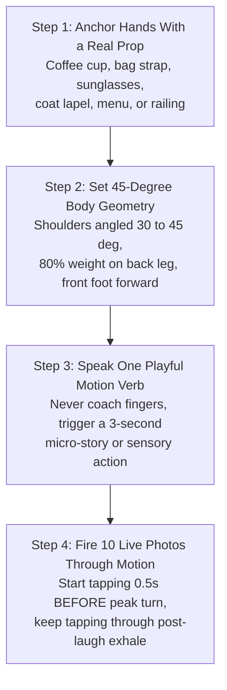
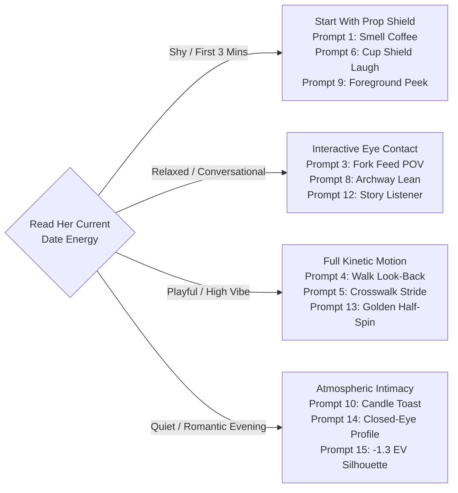

# 15 Zero-Awkwardness Action Prompts Across 5 Real Date Scenes

## 1. Why Finger Micro-Management Fails: Motion Verbs Beat Static Poses

Nothing destroys date-night chemistry faster than robotic anatomical micromanagement: *"Rotate your chin 10 degrees left, drop your right elbow 3 cm, relax your left pinky finger, don't squint..."* Within five seconds of receiving mechanical body-part instructions, any normal human being feels like a stiff mannequin failing an exam.

Great candid energy (*松弛感*) comes from **giving her brain a playful 3-second task while her hands hold a natural prop**, so her conscious mind forgets the lens completely while your iPhone fires **Live Photo + 10-frame rapid bursts** (or your Osmo Pocket 3 rolls `4K 30fps` video).

### Three Effortless Body Mechanics That Flatter Every Frame

Before triggering any prompt below, set up these three painless baseline mechanics in two seconds—never as a lecture, just by how you seat her or hand her a coffee:

1. **The 45-Degree Shoulder Rule (拒绝正面证件照站姿)**:
   - Standing or sitting with both shoulders squared `0 degrees` flat to the lens displays maximum torso width. Have her angle her shoulders and hips **`30 to 45 degrees` away from the camera**, then turn her collarbones and eyes back toward you—instantly slimming shoulder and waist width by `20% to 25%`.
2. **Breathable Arm-to-Waist Triangles (手臂微离身体)**:
   - Pressing bare upper arms flat against the ribcage squashes soft tissue sideways, making arms look `35%` wider. Giving her hands a micro-anchor—holding a warm latte, touching a crossbody bag strap, resting fingertips on a balcony railing, or slipping thumbs into coat pockets—creates clean negative-space triangles between elbow and waist.
3. **80/20 Back-Leg Weight Shift (重心放后腿、前脚微点地)**:
   - Standing evenly `50/50` on both feet locks knees into rigid columns. Cue her: *"Put your weight on your back foot and tap your front shoe half a step toward me."* Her hip drops into a natural S-curve and her front leg elongates straight toward the bottom frame corner (see [01-FOCAL-LENGTHS-ANGLES-AND-PROPORTIONS.md](01-FOCAL-LENGTHS-ANGLES-AND-PROPORTIONS.md)).

### The "Shutter Starts Mid-Sentence" Timing Secret (`话音未落先按快门`)

Beginners wait until *after* they finish speaking a prompt, pause a beat, and then tap the shutter—by which time the genuine micro-reaction has already vanished!

- **Correct Motor Sequence**: Begin tapping `Live Photo` at **`3 taps/second` while you are still on the last three words of your prompt**, and keep tapping for `1.5 seconds` after she reacts.
- **Five Bilingual Everyday Trigger Lines (Keep Ready in Memory)**:
  1. **Look-Away to Look-Back**: *"Look out at that balcony across the street first... okay, now look back at me!"* / *"先看一眼对面那个小阳台……好，现在回头看我！"*
  2. **Walking Hair-Tuck**: *"Walk slowly toward me while tucking one strand of hair behind your ear."* / *"一边慢慢朝我走，一边顺手把耳边碎发别到耳后。"*
  3. **Playful Tease**: *"Look at me like you know I definitely took a wrong turn five minutes ago."* / *"用‘我就知道你刚才带错路了’的眼神看我一眼！"*
  4. **Relaxing Tight Shoulders**: *"Take one deep breath in, drop your shoulders completely on the exhale, and give me a tiny half-smile."* / *"深吸一口气，呼气把肩膀彻底沉下来，浅浅笑一下就好。"*
  5. **Seamless Angle Transition**: *"Love that! Keep your feet right there and just turn your chin toward the window light."* / *"刚刚那张超绝！脚不用动，下巴往窗光那边微转一点点。"*

---

## 2. Scene 1: Specialty Café and Brunch Table (Prompts 1 to 3)

**Optical Setup**: Seat her beside or `45 degrees` to the window (never with a blown-out white street window directly behind her ears). Clear crumpled napkins, QR stickers, and spare phones off the table. Tap **`2x (48mm)`**, lean back `20 cm`, and hold your lens **`3 to 5 degrees` slightly above her eye line** tilted gently down.

### Prompt 1 — The Warm Cup Aroma and Accusatory Side-Glance
- **Hand & Body Anchor**: Shoulders `45 degrees` to the table corner; both hands cradling a ceramic latte cup or Moroccan mint tea glass near collarbone height (keeps arms lifted off the table so triceps never flatten).
- **What You Say While Tapping Shutter**: *"Close your eyes and take in the coffee aroma for one second... okay, now look up at me like you just caught me stealing the best bite of your croissant!"*
- **Why It Works**: Closing eyes resets facial tension to zero; opening them into a playful mock-accusation triggers an instant sparkling smile with natural eye crinkles.

### Prompt 2 — Feather-Light Back-of-Hand Cheek Rest with Menu/Book
- **Hand & Body Anchor**: One elbow resting lightly on the table, turning pages of a hardcover book or café menu with the other hand. **Critical Guardrail**: Have her **barely brush** her cheekbone against the *back* of her fingers with **zero weight resting on the hand**—actually leaning weight onto a palm pushes cheek skin upward into a distorted lump!
- **What You Say While Tapping Shutter**: *"Read that weird dessert description out loud to me, then look up halfway through."*
- **Why It Works**: Speaking parts the lips naturally by `3 to 5 mm` (much softer than tightly pressed lips) and creates effortless diagonal neck lines.

### Prompt 3 — The 3-Frame Boyfriend-POV Brunch Triptych
- **Shot Sequence (15 Seconds Total)**:
  1. **Frame A (`3x 77mm` Tight Detail)**: Her hands pouring milk, drizzling honey, or tearing flaky pastry in window side-light (`3 frames`).
  2. **Frame B (`2x 48mm` Downward Smile)**: Her looking down smiling softly at the plate (`4 frames`).
  3. **Frame C (`2x 48mm` Interactive POV)**: *"Hold a forkful out toward my camera like you're feeding me—wait, don't laugh!"* (`5 frames`, fork softly blurred in foreground, sharp focus locked on her laughing eyes).
- **Why It Works**: Posting these three horizontal or vertical `3:4` frames together tells an intimate story rather than one isolated static portrait.

---

## 3. Scene 2: City Street Walk and Crosswalk Cinema (Prompts 4 to 6)

**Optical Setup**: Switch to **`1.5x (35mm)`** at waist height (`100 cm`) for full-body outfit movement, or **`2x (48mm)`** at chest height for dynamic upper-body candids. Ensure bright daylight keeps shutter speed automatically above `1/250s` so swinging hair stays crisp with just a hint of kinetic life.

### Prompt 4 — The 4-Step Walk-Away and Name-Call Look-Back (`经典街拍回头杀`)
- **Motion Setup**: Point toward an appealing tree-lined vanishing point ahead (Wukang Road plane trees or Rabat's palm-lined Rue des Consuls). Ask her to walk away from you at a relaxed, unhurried pace holding her shoulder bag strap.
- **What You Say While Tapping Shutter**: Let her take **4 calm steps**, start firing your rapid burst **half a second early**, and call out warmly: *"Wait—babe, look at this puppy!"* (or simply call her nickname with a big grin).
- **Why It Works**: Turning the head and upper shoulder back over a walking stride creates maximum S-curve torso twist, swings hair outward in an arc, and catches an unguarded expression before her "posing brain" wakes up.

### Prompt 5 — Diagonal Crosswalk Inverted-V Stride
- **Motion Setup**: Stand across the street corner or `45 degrees` ahead at **`2x (48mm)` or `3x (77mm)`** (navel-to-chest height). Have her walk briskly across the zebra stripes looking *past* you toward a café awning or shopfront (`not` staring into the lens).
- **Burst Timing Secret**: Fire 10 rapid frames across 3 full steps and **pick the frame where both legs form an open inverted "V" mid-stride**—never pick the crossover mid-phase where one leg hides behind the other like a flamingo!

### Prompt 6 — The Playful Paparazzi Cup/Sleeve Shield (Instant Shyness Breaker)
- **When to Use**: During the first two minutes of a date when she feels self-conscious or says *"Stop, I don't know how to pose today!"*
- **What You Say While Tapping Shutter**: Lean into the shyness playfully: *"Okay, pretend I'm obnoxious celebrity paparazzi outside your hotel—block my camera half-laughing with your coffee cup or coat sleeve while walking past me!"*
- **Why It Works**: Giving permission to *hide* 20% of the face removes 100% of camera pressure, producing crinkled, joyful eyes peeking over a cup or cuff.

---

## 4. Scene 3: Wind, Hair, and Architecture in Rabat and Shanghai (Prompts 7 to 9)

**Optical Setup**: Coastal Atlantic breezes in Rabat or riverfront gusts along Shanghai's Bund ruin stiff static hair in two seconds—unless you **align wind direction intentionally** and use architectural arches/doorways as natural frames-within-frames.

### Prompt 7 — The 45-Degree Upwind Ear-Tuck (`迎风撩发法`)
- **Wind Physics Rule**: **Never stand her with wind blowing from behind her neck** (which whips hair straight across her mouth, eyelashes, and lip gloss!). Turn her face **`30 to 45 degrees` INTO the oncoming breeze** so wind sweeps hair *backward* off her cheekbones like a studio fan.
- **What You Say While Tapping Shutter (`2x` or `3x`)**: *"Face the ocean breeze, let the wind catch your hair, and slowly tuck one loose strand behind your ear while looking out at the water."*
- **Why It Works**: Raising one hand to the ear bends the wrist gracefully, exposes the jawline and earring, and turns messy coastal gusts into effortless cinema.

### Prompt 8 — Light Shoulder Lean Inside an Archway or Doorframe
- **Geometry Setup**: Frame a symmetrical horseshoe arch in the Kasbah of the Udayas, a carved cedar doorway, or a Shanghai stone colonnade at **`1.5x (35mm)`** from waist height (`100 cm`, `+3 deg` tilt), keeping shoes `6%` above the bottom border.
- **What You Say While Tapping Shutter**: *"Rest one shoulder lightly against the inside of the arch, tap one foot forward, look down the sunny alley like you're waiting for someone... now glance back at me!"*
- **Why It Works**: Architectural archways create a natural frame-within-a-frame that focuses attention on her silhouette while relaxing spine stiffness.

### Prompt 9 — Compressed `3x / 5x` Foreground Botanical or Glass Peek
- **Optical Setup**: Step back `4 to 6 meters` with **`3x (77mm)` or `5x (120mm)`**. Hold your lens just `15 cm` past overhanging bougainvillea blossoms, sunlit plane-tree leaves, or a café window reflection so foreground colors melt into creamy bokeh across `20%` of the frame edge.
- **What You Say While Tapping Shutter**: *"Adjust your earring or sunglasses slowly and pretend you haven't noticed me across the courtyard yet—okay, now catch my eye and smile!"*
- **Why It Works**: Three depth planes (blurred flowers -> sharp eyes -> compressed distant wall) create unmistakable full-frame depth on a pocket phone.

---

## 5. Scene 4: Candlelit Evening Restaurant and Intimate Dinner (Prompts 10 to 12)

**Critical Low-Light Rule**: **NEVER turn on the iPhone LED flash** (direct tiny flash turns skin oily, flattens noses, and startles neighboring tables). Instead, slide the table candle or warm rechargeable table lamp **`30 to 40 cm` closer to her at a 45-degree angle**, stay on **`1.5x (35mm)` or `2x (48mm)`** (keeping the large `f/1.78` Main sensor active), brace your elbows on the table so `1/15s–1/30s` shutter stays razor-sharp, and slide exposure to **`-0.5 EV`** so warm shadows stay rich instead of noisy grey.

### Prompt 10 — Foreground Glass Clink Across Candlelight
- **Composition**: Hold your own wine, sparkling water, or tea glass near the **bottom-left corner (`25 cm` from your `2x` lens)** so the glass rim blurs into warm golden bokeh, framing her smiling across the table as she raises her glass toward yours.
- **What You Say While Tapping Shutter**: *"Cheers to surviving this week—clink glasses with me and pause for one tiny beat at the clink!"*
- **Why It Works**: Adding that half-second stillness pause at the clink prevents low-light motion blur on her fingers while keeping the boyfriend-POV intimacy warm and alive.

### Prompt 11 — Standing Over-the-Shoulder Dinner Table Return
- **Opportunistic Timing**: When walking back to the table after washing your hands, pause `1.5 meters` behind/beside the table at `2x (48mm)` shooting **down across the warm dishes and candlelight** (`-15 deg` downward angle).
- **What You Say While Tapping Shutter**: Softly say her name as you step up so she turns her head naturally over her shoulder looking up toward you with a welcoming smile.
- **Why It Works**: Looking upward toward a standing camera opens the upper eyelids wide, catches warm candle catchlights in her irises, and carves a razor-clean jawline.

### Prompt 12 — Interlaced-Fingers Story Listener (Eye-Contact Volume Shutter)
- **Technique**: Frame the phone casually at chest height on `2x`, rest your thumb on the **physical Volume-Up button**, look directly into **her eyes (not the screen!)**, and tell a genuinely funny 10-second observation about your day while clicking 6 quiet Live Photos.
- **Why It Works**: Because she is reacting to *your actual eyes and voice* rather than a dead glass rectangle, you capture how she truly looks at you when she is in love.

---

## 6. Scene 5: Sunset Beach, Riverfront, and Silhouette Cinema (Prompts 13 to 15)

**Optical Setup**: Shoot during the **final 35 minutes before sunset** (Corniche de Rabat waves, Suzhou Creek bridges, or rooftop terraces) when low `15-degree` golden rays wrap hair in warm rim light.

### Prompt 13 — Golden-Hour Coat or Skirt Hem Half-Spin
- **Setup**: Backlight her against the low golden sun at **`1.5x (35mm)` or `2x (48mm)`**, lock exposure at **`-0.5 EV`** on her sunlit hair halo.
- **What You Say While Tapping Shutter**: *"Walk three relaxed steps toward the water, then spin halfway back toward me so your coat/skirt catches the golden light!"* Fire a 12-frame rapid burst through the entire turn and post-spin laugh.
- **Why It Works**: Flowing fabric adds dynamic diagonal geometry around her waist and legs while golden rim light outlines every strand of airborne hair.

### Prompt 14 — `3x / 5x` Closed-Eye Sunset Breeze Profile
- **Setup**: Stand `90 degrees` perpendicular to her at **`3x (77mm)` or `5x (120mm)`** (`-0.5 EV`) so low golden sun traces a clean rim highlight down her forehead, eyelashes, nose bridge, and lips.
- **What You Say While Tapping Shutter**: *"Turn toward the sunset, close your eyes, tilt your chin slightly toward the warm breeze, and take one slow deep breath."*
- **Why It Works**: Eliminating direct eye-contact pressure creates timeless, serene editorial stillness that contrasts beautifully alongside smiling candids.

### Prompt 15 — `-1.3 EV` Water-Reflection Silhouette or Loose Hand-Hold Walk
- **Option A (Graphic Silhouette)**: Place her in clean `90-degree` side profile against glowing orange sky or wet sand reflection (gathering hair loosely with one hand so neck and jawline separate cleanly from shoulders), tap the bright sky, and drag exposure down to **`-1.2 to -1.5 EV`**.
- **Option B (Candid Hand-Hold Walk)**: Hold her hand loosely with your own hand entering the bottom edge on `1.2x (28mm)` as she walks half-turned laughing back at you—keep your arm relaxed with a soft bend rather than stiffly hyperextended.

---

## 7. Zero-Prop Hand Rescue and Jawline Micro-Hacks

What if you are standing in an open courtyard, gallery hall, or beach promenade with **zero coffee cups, menus, or railings nearby**, and she says *"Wait, what do I do with my hands?"* Use one of these **five built-in wardrobe anchors** plus two invisible facial tension resets:

| Zero-Prop Anchor | Exact Micro-Action Cue | Optical & Posture Benefit |
| :--- | :--- | :--- |
| **1. Opposite-Wrist / Watch Touch** | Lightly touch her watch face, bracelet, or cuff with the opposite fingers at waist level | Forms a graceful horizontal forearm line + clean elbow-waist gap |
| **2. Coat Lapel / Scarf Pinch** | Hold one trench-coat lapel or scarf edge lightly near the collarbone while walking | Draws eyes upward toward her face; hides chilly wind stiffness |
| **3. Crossbody Bag Strap Hook** | Hook one thumb casually onto her shoulder-bag or crossbody strap at chest height | Prevents arms from hanging dead straight like twin pendulums |
| **4. Thumb-Only Pocket Slip** | Hook **only thumbs** (or four flat fingers) into trouser/skirt pockets, elbows angled slightly back | Avoids stuffing whole fists into pockets, which bulges hip fabric wide! |
| **5. Sunglasses Temple Peek** | Touch one temple of sunglasses perched in hair, or lower frames `1 cm` to peek over the rim | Instant playful editorial energy in bright afternoon sun |

### Two Invisible Facial Micro-Resets (For Non-Smile Editorial Frames)

When shooting calm, moody `3x / 5x` portraits where a big laugh doesn't fit the scene:
- **The `3-mm` Soft Lip Breath**: Clenching teeth together tightens the masseter jaw muscles into a square block. Cue her: *"Breathe out softly through your lips so they part by just a tiny sliver."*
- **The Tongue-on-Palate Jawline Trick (`舌尖轻顶上颚`)**: Resting the flat of the tongue gently against the roof of the mouth (right behind the upper front teeth) contracts the submental floor under the chin by `30%`—carving a razor-clean profile jawline with zero visible effort!

---

## 8. Five Weather, Travel, and Prop Bonus Scripts

Ordinary rain, transit rides, or street snacks turn into signature portraits when you know how to direct the prop cleanly:

1. **Clear Dome Umbrella on a Rainy Night (`雨夜透明伞街拍`, `2x 48mm`, `-0.4 EV`)**:
   - **Why Opaque Umbrellas Fail**: A black or navy umbrella blocks all overhead streetlamp light, plunging her face into murky shadow. Keep a RMB 25 / EUR 4 **crystal-clear dome umbrella** in the car or entryway: warm shopfront and neon light passes straight through the clear canopy onto her cheeks while raindrops sparkle in `2x` bokeh!
   - **Prompt**: *"Rest the umbrella handle on your shoulder, tilt it slightly back toward the neon sign, and hold one palm out like you're testing if the rain stopped."*
2. **Fresh Flower Bouquet Walk (`花束背手走拍与半遮面`, `2x` or `3x`)**:
   - **Two Zero-Cliché Angles**: Skip stiff chest-front graduation poses. Shoot **`2x` from behind** as she walks down a tree-lined sidewalk holding wrapped flowers casually behind her lower back, OR shoot **`3x` tight half-body** as she smells eucalyptus/roses with one laughing eye peeking over the petals.
3. **Train, Ferry, or Taxi Window Reflection (`车窗倒影电影感`, `2x 48mm`)**:
   - **Setup**: Hold your lens `3 cm` from interior window glass angled `35 degrees` forward so passing city lights, bridges, or coastal waves reflect softly across the glass beside her serene `3/4` profile.
4. **Gelato, Pastry, or Night-Market Snack (`美食互动铁律`, `2x`)**:
   - **Hard Timing Rule**: **Always shoot the playful raise, toast, or pre-bite smile—NEVER shoot mid-chew!** Chewing distorts cheek symmetry every single time. Say: *"Hold the gelato cone right next to your cheek and look at me like you aren't sharing a single bite!"*
5. **Shared Wired Earbuds / Over-Ear Headphones (`听歌松弛感`, `2x / 3x`)**:
   - **Setup**: Leaning against a bookstore shelf, airport gate window, or riverfront railing listening to a favorite song together—eyes closed nodding gently to the beat removes 100% of camera performance pressure.

---

## 9. Mood-to-Prompt Selector and Quick Reference Table

Match your prompt to her real-time energy level rather than forcing high-energy spins when she feels quiet or shy:

| # | Date Scene | Prompt Name | Focal & EV | Key Flattery Mechanism |
| :--- | :--- | :--- | :--- | :--- |
| **1–3** | Café & Brunch | Cup Aroma; Cheek Brush; Fork POV Triptych | `2x` (`+3x` detail), `-0.3 EV` | Lifts arms off table; `+4 deg` high lens enlarges eyes |
| **4–6** | Street & Crosswalk | 4-Step Look-Back; V-Stride; Cup Shield | `1.5x` / `2x`, Auto `1/250s+` | Torso S-twist; swinging hair; dissolves shyness |
| **7–9** | Wind & Architecture | Upwind Ear-Tuck; Arch Lean; `5x` Peek | `1.5x` (arch) / `3x–5x` (peek) | Wind sweeps hair *off* face; foreground depth layers |
| **10–12** | Candlelit Dinner | Glass Clink; Over-Shoulder; Volume Burst | `1.5x` / `2x` (`f/1.78`), `-0.5 EV` | Zero flash; candle at `45 deg` `35 cm`; real eye contact |
| **13–15** | Sunset & Beach | Hem Spin; Closed-Eye Profile; Silhouette | `1.5x` / `3x–5x`, `-0.5 to -1.3 EV` | Golden hair halo; clean side-profile contour |

### The 60-Second Three-Shot Combo at Any Travel Landmark

Whenever you arrive at a beautiful landmark (Rabat's Oudayas lookout, Shanghai's Bund colonnades, or a coastal café terrace), run this **3-Prompt, 60-Second Combo** so she gets a complete, varied carousel post in one minute flat:

1. **Seconds 0 to 20 — Full-Body Landmark Anchor (`1.5x 35mm`, Waist Height)**: Run **Prompt 8** (light shoulder lean in archway/balustrade, front shoe `6%` from bottom edge, `6 Live Photos`).
2. **Seconds 20 to 40 — Kinetic Mid-Shot (`2x 48mm`, Chest Height)**: Run **Prompt 4** (walk 4 steps along the promenade and turn back at your voice, `8 Live Photos`).
3. **Seconds 40 to 60 — Compressed Editorial Detail (`3x / 5x`, Eye Level)**: Run **Prompt 7 or 14** (upwind ear-tuck or serene closed-eye profile in rim light, `6 Live Photos`).

Once you have captured natural expression and flattering geometry, turn to [03-FLATTERING-LIGHT-COUPLE-SHOTS-AND-30S-EDIT.md](03-FLATTERING-LIGHT-COUPLE-SHOTS-AND-30S-EDIT.md) to master 3-second light triage, solo-crew couple two-shots, and the 30-second luminous native edit.
