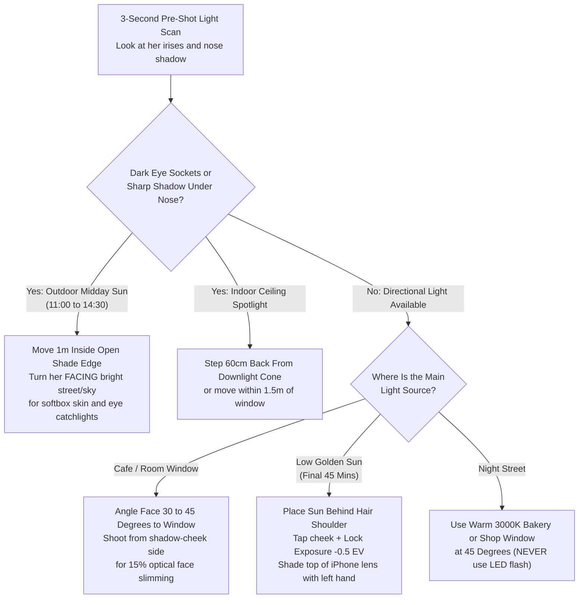
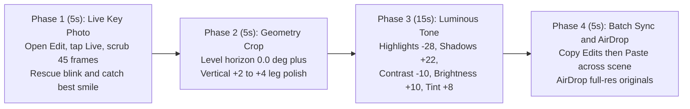

# Reading Light in 3 Seconds, Aesthetic Couple Two-Shots and Natural 30-Second Retouching

## 1. Reading Any Light Environment in 3 Seconds

Optical focal length shapes proportions ([01-FOCAL-LENGTHS-ANGLES-AND-PROPORTIONS.md](01-FOCAL-LENGTHS-ANGLES-AND-PROPORTIONS.md)) and playful motion prompts unlock expression ([02-FIFTEEN-NATURAL-CANDID-POSES-AND-PROMPTS.md](02-FIFTEEN-NATURAL-CANDID-POSES-AND-PROMPTS.md)), but **light direction determines 90% of skin luminosity and eye sparkle (*眼神光*)**. Train yourself to evaluate any indoor or outdoor location in three seconds simply by looking at **her eye sockets and the shadow beneath her nose**.

### Public Enemy #1: Overhead Noon Sun and Ceiling Downlights (`顶光熊猫眼`)

Between `11:00 and 14:30` under clear skies—or indoors directly beneath recessed restaurant/mall ceiling spotlights—light falls vertically at a `75 to 90 degree` elevation angle ($\phi \approx 85^\circ$). Steep vertical light ruins even flawless skin in four simultaneous ways:

1. **Dark Raccoon Eye Sockets**: Brow bones block light from reaching the irises, killing eye catchlights completely.
2. **Harsh Nose-Tip Mustache Shadow**: A sharp dark triangle drops across the upper lip (*philtrum*).
3. **3x Deeper Under-Eye Bags and Nasolabial Folds**: Grazing vertical rays turn tiny `0.5 mm` skin contours into deep dark creases (`泪沟与法令纹放大三倍`).
4. **Oily Forehead & Nose Hotspots**: Specular glare clips the T-zone white while cheeks go muddy.

### Three Instant Rescues When Overhead Light Is Terrible

- **Rescue 1 — The Open-Shade Boundary Rule (`明暗交界向光处`, Best Outdoor Trick)**:
  - Walk her **`0.8 m to 1.5 m` inside the shadow edge** of a building overhang, colonnade, tree canopy, or café umbrella, and turn her **facing OUTWARD toward the bright sunlit street or open sky**. Her skin sits in clean, even shade while the bright `45-degree` sky acts as a giant `10-meter` studio softbox—smoothing skin texture optically and placing crisp white catchlights in both eyes!
- **Rescue 2 — Natural Bounce Reflectors (`白墙与白色餐巾补光`)**:
  - In sunlit alleys (such as Rabat's limewashed white walls) or outdoor brunch patios, stand her `60 cm` beside a sunlit cream/white wall, or lay a white paper menu/linen napkin flat on the table just below frame edge—bouncing `+0.7 EV` of clean upward fill into under-eye shadows.
- **Rescue 3 — The 60-cm Indoor Downlight Step-Back (`避开射灯正下方`)**:
  - In restaurants, museums, or hotel bars, check the ceiling **before** sitting or shooting. If a spotlight beam hits the top of her head, have her slide her chair or step **`60 cm` backward** so the ceiling fixture shifts to a `45-degree` frontal-top angle, illuminating her eyes instead of her forehead.

### The Four Flattering Portrait Light Setups

| Light Setup | Subject-to-Light Geometry | iPhone / Pocket 3 EV | Visual Effect on Face & Vibe |
| :--- | :--- | :--- | :--- |
| **Window 45-Deg Loop / Rembrandt** | `0.8m–1.8m` from window, face angled `30–45 deg` toward glass | `-0.2 to -0.3 EV` | Catchlights in both eyes; soft shadow on camera-side cheek slims face width `15%` |
| **Open-Shade Butterfly Frontal** | Inside shade edge facing bright sky/street straight on (`0 deg`) | `0.0 EV` | Zero lateral pore or laugh-line shadows; luminous, smooth "effortless skin" glow |
| **Golden-Hour Rim Backlight** | Sun `10–25 deg` high behind her hair/shoulder | **Lock `-0.3 to -0.7 EV` on cheek** | Glowing golden hair halo (`逆光发丝光`); creamy cinematic contrast |
| **Blue-Hour Shopfront Practical** | `1.2m` beside warm bakery/florist glass against twilight street | `-0.5 EV` (`1.5x/2x` Main sensor) | Warm `3200K` skin tone against deep `7500K` cobalt street backdrop |

> **The Left-Hand Lens Hood Trick (`手掌遮光罩`)**: Shooting into golden-hour backlight on small sapphire phone lenses often creates milky haze or green internal reflection dots across her chin. Hold your free left palm flat `5 cm` above the top edge of the iPhone (just outside the frame) until the haze snaps back into rich contrast!

### Handling Tough Weather and Tricky Light Traps

| Tricky Light Condition | Why Portraits Usually Fail Here | Exact Field Fix |
| :--- | :--- | :--- |
| **Dappled Tree-Leaf Sun (`斑驳树影花脸`)** | Bright sun spots splatter irregularly across nose and cheeks like skin blotches | Step her `50 cm` into **100% solid leaf shade**, keeping the pretty dappled sun pattern *on the wall behind her* |
| **Flat Grey Overcast Sky (`阴天灰暗脸`)** | Tilting upward includes a blinding white cloud ceiling that forces her face dark grey | Shoot from chest/eye height tilted `-2 deg` downward against brick, trees, or ocean water—exclude the white sky! |
| **Blinding Beach / Coastal Glare (`强光眯眼`)** | Bright sand/water makes her squint tightly within `0.8 seconds` | **Eyes-Closed Burst Trick**: Have her close eyes facing the view; say *"Open and look at me!"* while already firing 8 frames |
| **Green Mall / Subway Fluorescents** | Low-CRI ceiling tubes cast sickly olive-green shadows onto skin | Stand `1m` from a warm lit display case at `2x`; add **`Tint +10` and `Saturation -5`** in post |
| **Mixed Blue Window + Orange Tungsten** | Half her face turns cyan `6500K` while the inner cheek turns orange `2800K` | Switch off the weak table/ceiling bulb for 15 seconds OR turn her fully toward the window so one color temperature dominates |

### Emergency Pitch-Dark Fill: The Warm OLED Screen Softbox Trick (`手机屏幕暖光补光法`)

What if you are at a dim rooftop bar, night beach, or birthday cake table with **zero candles and zero warm shopfront windows**? Still **never fire the rear LED camera flash**. Softness of light depends on the **apparent emitting area** relative to her face:
- **Rear LED Flash (`2 mm` point source)**: Casts razor-sharp black shadows behind her nose and reflects off skin oil like sweat.
- **Second-Phone Warm OLED Screen (`6.7-inch` panel = `80x` larger surface area)**:
  1. On a second phone (hers, or an Apple Watch set to warm screen torch for ultra-tight table shots), open a solid **warm peach/amber screen** (`#FFB878`, or a blank white Notes page with Night Shift warmth dragged to `100%`) at maximum screen brightness.
  2. Hold that glowing warm screen **`30 cm to 40 cm` from her face at a `45-degree` off-axis angle** (`15 cm` slightly above eye level) while shooting with your own iPhone on **`1.5x` or `2x` (`f/1.78` Main sensor, `-0.4 EV`)**.
  3. Result: Creamy, wraparound `3200K` portrait lighting and soft rectangular eye catchlights that look indistinguishable from a portable studio LED panel!
- **Optional Dedicated `60-g` Pocket Magnetic Bi-Color LED (`CRI 96+`)**: If carrying a slim MagSafe frosted fill light on winter night trips, dial color temperature to **`3000K–3400K`** at **`10% to 18%` gentle brightness** (never `100%` blinding white `5600K`) so she never squints and background twilight stays visible.

---

## 2. Framing Aesthetic Couple Two-Shots Without Ruined Stranger Snaps

Front-camera arm's-length selfies place the closest person at `45 cm` ($+35\%$ nose distortion), show a giant extended bicep in the corner, and block 70% of the scenery you traveled to see. Upgrade to these **four high-taste couple two-shot workflows** so both of you exist inside the frame naturally:

### Workflow 1 — DJI Osmo Pocket 3 Solo-Crew Setup (`ActiveTrack 6.0` + 4K Roll)
The Osmo Pocket 3 (`179 g`) with its screw-on Mini Tripod is the ultimate inconspicuous third wheel:
1. Set the Pocket 3 on a café corner table, park bench, stone wall, or bridge ledge (`1.2 m to 2.5 m` away) at chest/waist height; select `1x (20mm)` for full scenery or `1.4x–2.0x` lossless crop for tight table two-shots (`Sharpness -1`, `EV -0.3`).
2. Draw a green tracking box on the `2-inch` screen to engage **`ActiveTrack 6.0`** (or verify composition in 3 seconds on DJI Mimo, then **pocket your phone immediately** so nobody stares awkwardly at a remote screen).
3. Press record (`4K 24/30fps`) and **interact naturally for 20 seconds**—walk past holding hands, clink glasses, brush stray hair off her cheek, or share a real joke. Later, export crisp `3840 x 2160` (`8.3 MP`) candid frame grabs *plus* a living 6-second video clip!

### Workflow 2 — Pocket MagSafe Stand + Rear `1.5x / 2x` + Apple Watch Remote
- Keep a credit-card-thin folding MagSafe stand (`under 85 g`, `5 mm` folded thickness) attached to your iPhone Pro, or snap a magnetic ring mount onto metal lampposts/railings.
- **Elevate Above Table Level**: Setting a mini stand flat on a low café table shoots upward at nostrils; prop the MagSafe stand atop your hardcover menu, camera case, or water glass edge so the lens reaches **chin/collarbone height**.
- Always shoot with the **rear `1.5x (35mm)` or `2x (48mm)` Main camera** (4x sharper and cleaner in low light than the front selfie camera).
- Open **Camera Remote on Apple Watch** to check live framing on your wrist, tap the **`3s` shutter button** (which automatically captures a **10-photo burst**!), lower your wrist naturally during the 3-second countdown, and look at your partner rather than the lens.

### Workflow 3 — The Zero-Fail Stranger Hand-Off Protocol (`路人代拍零翻车公式`)
Handing an unlocked `1x` phone blindly to a random passerby fails 80% of the time. Raise your stranger keeper rate above 90% with three steps:
1. **Pick the Right Photographer**: Look for someone carrying a mirrorless/film camera, or a young friend/couple actively crouching to take aesthetic outfit shots for each other.
2. **Compose and Shoot 1 Template Frame Yourself First**: Place your partner in the exact spot, dial **`1.5x (35mm)`**, align her shoes near the bottom `8%` border with the landmark cleanly framed above, and take **1 reference shot**.
3. **Show the Template + Ask for 5 Taps**: Hand the phone over showing your reference shot for two seconds: *"Excuse me! Could you match this exact framing with our shoes near the bottom edge and tap the button 5 or 6 times? Thank you so much!"* Step right next to her—zero chopped ankles, zero crooked towers.

### Workflow 4 — Natural Couple Interaction Prompts (Zero Rigid Side-by-Side Soldier Pose)

| Couple Scene | Stiff Tourist Pose to Avoid | Natural High-Chemistry Interaction Cue |
| :--- | :--- | :--- |
| **Café / Restaurant** | Sitting 1.2m apart across opposite sides of a wide table | Sit **`90 degrees` adjacent on a corner table (L-shape)** leaning shoulders lightly together |
| **City Street Walk** | Standing frozen side-by-side staring at camera | Walk slowly toward Pocket 3 / stand at `1.5x`, **looking sideways at each other mid-laugh** instead of lens |
| **Ocean / Skyline View** | Double peace-signs blocking scenery | Stand behind/beside her in a warm back-hug (`3/4` profile), both looking out toward sunset water |
| **Boutique / Street Corner** | Awkward stretched-arm front selfie | Shoot rear **`2x (48mm)` into a round street convex mirror** or café window reflection together |

### Couple Wardrobe Color Echoing and Depth-Plane Balance (`情侣合照显和谐三细节`)

1. **Color Echoing Over Identical Uniforms (`同色系呼应胜过同款情侣装`)**: Identical matching graphic tees look dated; instead, **cross-echo one palette tone**—for example, her cream linen dress paired with your off-white shirt + olive trousers, or her burgundy scarf echoed by your warm leather jacket.
2. **Never Let Her Stand `25 cm` Closer to a Wide Lens Than You**: Remember axial perspective math from [01-FOCAL-LENGTHS-ANGLES-AND-PROPORTIONS.md](01-FOCAL-LENGTHS-ANGLES-AND-PROPORTIONS.md)—whoever stands closer to the lens looks wider! Stand in the **exact same focal plane** (or step `8 cm` subtly closer to the lens yourself when hugging from the side) so her face and shoulders stay slender.
3. **Bridging Large Height Differences (`15 cm to 25 cm+` Gap)**: Have her stand **one curb or stair step higher** on street corners, lean together against a bridge railing (which brings heads closer naturally), or frame seated L-corner café shots where eye heights converge effortlessly.

### Pulling Razor-Sharp Stills From Osmo Pocket 3 Couple Video

When pulling `8.3 MP` (`3840 x 2160`) photo stills out of a Pocket 3 `4K` couple video clip, shutter speed determines whether hands and faces look tack-sharp or cinema-blurred:
- **Daylight Without ND Filter (`Auto Shutter 1/250s to 1/1000s`)**: Every single video frame is crisp enough to export directly as a standalone still photograph via DJI Mimo or Final Cut / CapCut *Freeze Frame*.
- **With Magnetic ND Filter On (`180-Degree Cinema Shutter 1/50s`) or Evening Indoor Clips**: Walking strides have smooth cinema motion blur at `1/50s`. Include **two 2-second "micro-pause beats"** inside your 20-second clip (for example, pausing cheek-to-cheek looking at the river, or holding a toast), so those paused frames extract at `100%` razor sharpness while the full clip retains silky cinema motion!
- **Vertical vs Horizontal Framing on Pocket 3**: If she posts primarily to vertical carousels (`3:4` / `9:16`), toggle the Pocket 3 screen into **`3K 9:16 Vertical` mode** (or mount sideways) for dedicated vertical couple rolls, or shoot **`4K 16:9` horizontal** standing 20% wider so center-cropping still leaves full headroom.

---

## 3. Natural 30-Second Retouching: Luminous Polish Without Plastic AI Skin

### Cardinal Rule: Never Apply Heavy AI Beauty Filters Unilaterally

Slapping aggressive third-party "one-click beauty" presets onto your partner's portrait blurs skin pores into wax, erases nose-bridge highlights, warps background tiles around her jawline, and cheapens an expensive optical lens into a 2014 webcam look.

- **Your Job**: Deliver **clean expression rescue, level architectural geometry, and luminous film-like color tone** in 30 seconds inside the native iOS Photos app—preserving 100% of real eyelash sharpness and natural skin texture.
- **Delivery Etiquette**: Always share via **AirDrop** (not compressed chat thumbnails!). If she likes doing subtle personal touch-ups herself afterward, AirDrop gives her full unclipped dynamic range and Live Photo motion data.

### `24MP HEIF + Live Photo` vs `48MP Apple ProRAW`: When to Toggle Each

Many photography guides blindly tell iPhone Pro owners to leave `48MP ProRAW` enabled permanently—a painful mistake for partner date photography:

| Capture Format | File Size & Speed | Live Photo Support | Best Partner Portrait Use Case |
| :--- | :--- | :--- | :--- |
| **`24MP HEIF + Photographic Style`** *(Default 95%)* | `2.5 MB to 4 MB`; instant `4 taps/sec` bursts | **Full `3-second` Live Photo ON** (rescues blinks!) | **Everyday cafés, walking candids, dinner, 15-frame bursts, instant AirDrop** |
| **`48MP ProRAW` (`JPEG-XL Lossless` or `DNG`)** *(Hero 5%)* | `20 MB to 75 MB`; `0.8s` buffer delay per shot | **Disabled** (turning on RAW turns OFF Live Photo!) | **1 or 2 static sunset silhouettes, extreme night dynamic range, or Lightroom prints** |

> **Practical Rule**: Leave **`RAW` toggled OFF** during candid bursts so you never lose `Live Photo` blink-rescue frames or wait 30 seconds AirDropping ten `75 MB` DNG files at dinner. Tap `RAW Max` in the top-right corner **only** for a deliberate, posed landscape-portrait hero frame where you plan a custom Lightroom Mobile grade.

### Step-by-Step 30-Second Native iOS Photos Recipe

1. **Seconds 0 to 5 — Live Photo Blink & Micro-Expression Rescue**:
   - Tap `Edit` -> tap the concentric **`Live`** icon at the bottom -> drag your finger slowly across the 45-frame strip (`1.5s` before and after shutter). Pick the exact `0.03s` frame where eyes sparkle, jawline is crisp, and stray hair clears her face -> tap **`Make Key Photo`**.
2. **Seconds 5 to 10 — Perspective Straighten & Subtle Vertical Lift**:
   - Tap `Crop` -> level crooked street horizons to `0.0 degrees`. On full-body shots, nudge **`Vertical` perspective `+2 to +4`** (subtle architectural keystone correction that adds `3%` clean leg length without visibly distorting pavement).
3. **Seconds 10 to 25 — Universal Luminous Portrait Tone (`清透胶片感参数公式`)**:
   - Apple's default Deep Fusion / Smart HDR pipeline often makes skin look overly contrasty, slightly grey-yellow indoors, or shadowed under the eyes. Apply this balanced baseline curve (adjusting `+/- 5` per scene):

| iOS Photos Slider | Target Value | Exact Optical & Skin-Tone Purpose |
| :--- | :--- | :--- |
| **Exposure (`曝光`)** | `+5 to +12` | Restores airy brightness after shooting safely at `-0.3 EV` |
| **Brilliance (`鲜明度`)** | `+10 to +18` | Gently lifts midtone face clarity (never exceed `+25`, which creates HDR halos) |
| **Highlights (`高光`)** | **`-22 to -35`** | Recovers creamy sky detail, white dress texture, and forehead specular roll-off |
| **Shadows (`阴影`)** | **`+18 to +28`** | Opens up dark hair detail and softens under-eye/neck shadows naturally |
| **Contrast (`对比度`)** | **`-8 to -14`** | Cancels harsh smartphone micro-contrast for a soft, editorial film roll-off |
| **Brightness (`亮度`)** | **`+8 to +14`** | Brightens skin midtones luminously *without* clipping white highlights |
| **Black Point (`黑点`)** | `+4 to +8` | Re-anchors eyelashes, pupils, and dark coats so negative contrast never looks milky |
| **Saturation / Vibrance** | `Sat -4`; `Vib +8` | Prevents orange oversaturated skin while keeping blue skies and foliage rich |
| **Warmth & Tint (`色温/色调`)** | `Warmth -3 to +5`; **`Tint +6 to +11`** | Slight positive magenta `Tint` cancels green tree/LED casts for rosy, healthy skin |
| **Sharpness / Definition** | **`0` (Leave untouched)** | Never add digital edge sharpening to female skin! |

4. **Seconds 25 to 30 — Clean Up Distractions, Batch Paste, and AirDrop**:
   - If a bright neon exit sign, trash bin, or stray passerby photobombs the corner, tap **`Clean Up`** (iOS native object eraser) or Snapseed `Healing` and brush it away in two seconds.
   - Tap top-right `...` -> **`Copy Edits`**, select all remaining keeper frames from the same café or golden-hour spot, tap **`Paste Edits`**, and **AirDrop** the curated gallery while you are still enjoying coffee or dessert together.

### Three Ready-to-Dial Scene Color Variations

Swap the universal slider values slightly when matching three distinct date atmospheres:

| Aesthetic Preset | Key Slider Adjustments (Native iOS Photos) | Ideal Date Scene |
| :--- | :--- | :--- |
| **1. Warm French Café Film (`法式暖调胶片`)** | `Exposure +6`; `Highlights -32`; `Shadows +22`; `Contrast -12`; `Brightness +10`; `Black Point +7`; `Warmth +8`; `Tint +6`; `Saturation -4` | Afternoon specialty cafés, wooden tables, golden plane-tree streets, stone arches |
| **2. Crisp Coastal Clean (`清透冷白海风感`)** | `Exposure +10`; `Brilliance +16`; `Highlights -25`; `Shadows +26`; `Contrast -8`; `Brightness +14`; `Warmth -6`; `Tint +9`; `Vibrance +10` | Rabat Atlantic oceanfront, white medina walls, bright blue skies, summer linen outfits |
| **3. Moody Candlelight Cinema (`暗调烛光电影感`)** | `Exposure -4`; `Highlights -35`; `Shadows +12`; `Contrast +4`; `Black Point +10`; `Warmth +6`; `Tint +5`; `Noise Reduction +15` | Evening bistro dinners, wine bars, warm shopfront windows at twilight |

### The 5-Second Snapseed "Selective" Rescue for Backlit Dark Faces

Sometimes a gorgeous sunset rim-light shot leaves her face `0.7 stops` darker than the glowing sky behind her, and raising global `Exposure` blows out the sunset clouds. Skip global sliders and use **Snapseed (`Tools -> Selective`)** in five seconds:
1. Tap **`+`** and drop a single control point (`B`) right on the center of her cheek; pinch with two fingers so the red radius circle covers **only her face and neck** (excluding the sky).
2. Swipe right to lift **`Brightness +14 to +20`** and **`Structure -5`** (ultra-subtle micro-contrast softening with zero waxy blur).
3. Export as lossless copy—her skin glows as if lit by an invisible cinema bounce board while the golden sky behind her keeps 100% rich orange saturation.

### Six Retouching Mistakes That Ruin Great Portraits

Knowing where to **stop** moving sliders separates high-taste film color from amateur over-processing:

| Over-Editing Mistake | Ugly Artifact Created | Clean Guardrail Limit |
| :--- | :--- | :--- |
| **Cranking `Brilliance` past `+35`** | Radioactive HDR halo around hair; flat grey skin without 3D cheekbone contour | Keep `Brilliance` strictly within **`+8 to +20`**; use `Brightness` for skin glow instead |
| **Pulling Night `Shadows` to `+75`** | Turns rich black evening streets into blotchy purple/green ISO digital noise | At night, cap `Shadows` at **`+12 to +18`** and anchor `Black Point` at **`+6 to +12`** |
| **Pushing `Warmth` past `+25`** | Turns porcelain or olive skin jaundiced yellow-orange; white dresses turn dirty beige | Keep `Warmth` within **`-8 to +10`**; add rosy health via **`Tint +6 to +11`** instead |
| **Global `Saturation +25`** | Lipstick and cheeks clip into neon red while street signs scream louder than her face | Set **`Saturation -4`** paired with **`Vibrance +8 to +12`** (protects skin tones automatically!) |
| **Adding `Sharpness` or `Definition`** | Emphasizes every pore, dry lip line, and stray eyebrow shadow harshly | Keep `Sharpness = 0` and `Definition = 0` on 100% of portraits |
| **Extreme `Vertical` Keystone (`+18`)** | Stretches calves into stilts while tilting floor tiles and café chairs into trapezoids | Cap `Vertical` perspective adjustment at **`+2 to +5`**; get long legs in-camera at navel height! |

---

## 4. End-to-End Boyfriend Camera Pocket Card

Keep these five habits wired together across all four modules ([00-README.md](00-README.md), [01-FOCAL-LENGTHS-ANGLES-AND-PROPORTIONS.md](01-FOCAL-LENGTHS-ANGLES-AND-PROPORTIONS.md), [02-FIFTEEN-NATURAL-CANDID-POSES-AND-PROMPTS.md](02-FIFTEEN-NATURAL-CANDID-POSES-AND-PROMPTS.md), and this guide):

1. **Wipe Lens & Pre-Set Before Calling Her**: Clean rear glass, enable `Live Photo`, lock `2x (48mm)` for cafés/half-body or `1.5x (35mm)` at navel height (`+3 deg` tilt, shoes `6%` above bottom edge) for full-body long legs.
2. **Read Light in 3 Seconds**: Escape `90-degree` overhead raccoon shadows into `1m` open shade facing bright sky, `45-degree` window light, or `-0.5 EV` golden rim backlight.
3. **3-Second Praise-and-Burst**: Peek smiling eyes above the phone, name one specific visual compliment, give a playful motion verb (never finger micromanagement!), and tap **10 to 15 Live Photos** through the post-laugh exhale.
4. **Include Yourself in the Story**: Drop the Osmo Pocket 3 on its Mini Tripod (`ActiveTrack 6.0`) or hand a pre-composed `1.5x` template shot to a camera-carrying passerby for genuine couple two-shots.
5. **Pre-Select, Polish in 30 Seconds, and AirDrop**: Favorite the top 2 winners before handing over the screen, apply the luminous `-Highlights / +Shadows / -Contrast / +Tint` curve, and AirDrop full-resolution Live Photos before dessert arrives.

### Pre-AirDrop Export Verification (3-Second Final Check)

- **Live Photo Badge Active**: Confirm you did not accidentally mute or disable the `Live` toggle if she enjoys picking alternate motion frames or posting Live Photos to Xiaohongshu/RED.
- **Zero Crooked Horizons or Cut Shoes**: Glance at all four frame corners—sky/water horizon at `0.0 deg`, no bright background exit signs touching her head, and full shoe soles cleanly inside the bottom border.
- **Full-Resolution AirDrop Delivery**: Share directly from the iOS Photos share sheet via **AirDrop** (`HEIF / Live Photo` preserved intact) so every date builds a timeless, cinema-grade visual archive of your life together.
