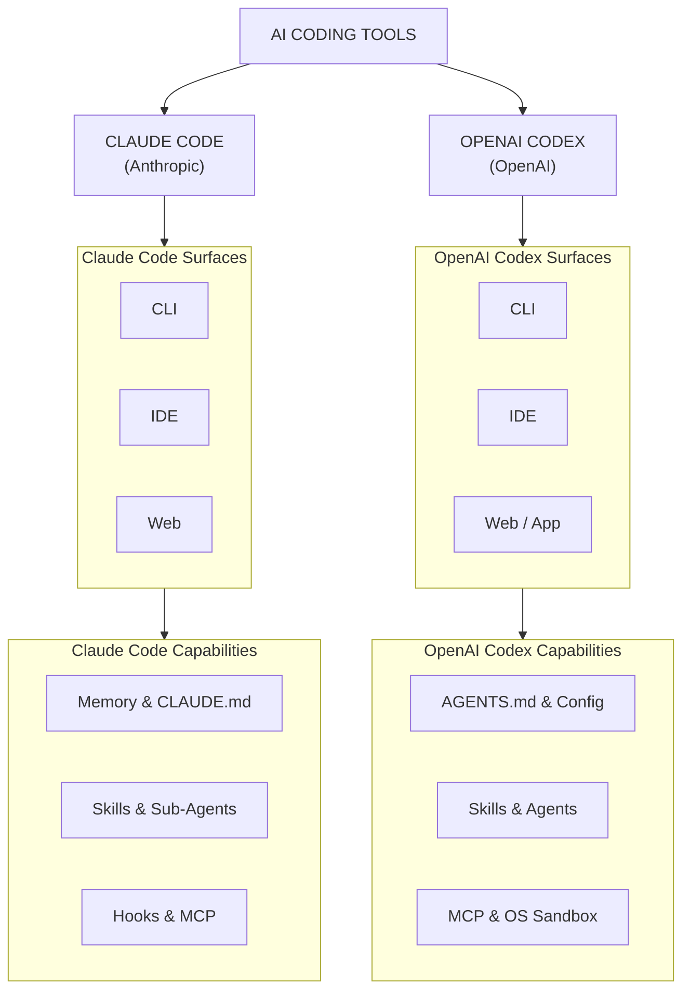

# AI Coding Tools: Comprehensive Guide

## Overview

This directory contains in-depth guides to the most powerful AI coding tools available today: **Claude Code** (Anthropic) and **OpenAI Codex**. These tools represent the frontier of agentic software engineering -- autonomous systems that can read, write, test, debug, and deploy code across entire repositories.

Unlike traditional code assistants that offer line-level suggestions, these tools operate as full coding agents with access to your filesystem, terminal, version control, and external services. Understanding their architecture, configuration, and best practices is essential for modern software engineers.

## Who This Is For

- Software engineers adopting AI coding tools for daily development
- Tech leads evaluating tooling for engineering teams
- Engineers preparing for interviews at companies building or using AI coding agents
- Developers looking to maximize productivity with agentic workflows

## How to Use

1. **Start with a tool guide** -- Read the guide for the tool you use or plan to adopt
2. **Understand the concepts** -- Memory, skills, hooks, MCP, and subagents are shared patterns across tools
3. **Study best practices** -- The comparison guide distills patterns that work across both tools
4. **Practice configuration** -- Set up CLAUDE.md / AGENTS.md, create skills, and configure MCP servers

## Table of Contents

| #  | File | Topic | Key Concepts |
|----|------|-------|--------------|
| 00 | [00-README.md](00-README.md) | This file | Overview, navigation |
| 01 | [01-CLAUDE-CODE.md](01-CLAUDE-CODE.md) | Claude Code (Anthropic) | CLAUDE.md, skills, hooks, MCP, sub-agents, Agent SDK, permissions, best practices |
| 02 | [02-OPENAI-CODEX.md](02-OPENAI-CODEX.md) | OpenAI Codex | AGENTS.md, skills, subagents, MCP, sandbox, approval modes, config.toml, best practices |
| 03 | [03-COMPARISON-AND-BEST-PRACTICES.md](03-COMPARISON-AND-BEST-PRACTICES.md) | Comparison & Best Practices | Side-by-side comparison, shared patterns, workflow optimization, common pitfalls |

## Key Concepts Across Both Tools

| Concept | Claude Code | OpenAI Codex |
|---------|-------------|--------------|
| **Project Instructions** | `CLAUDE.md` | `AGENTS.md` |
| **Configuration** | `settings.json` | `config.toml` |
| **Reusable Workflows** | Skills (`.claude/skills/`) | Skills (`.agents/skills/`) |
| **External Tools** | MCP servers (`.mcp.json`) | MCP servers (`config.toml`) |
| **Task Delegation** | Sub-agents (`.claude/agents/`) | Subagents (`.codex/agents/`) |
| **Lifecycle Automation** | Hooks (PreToolUse, PostToolUse, etc.) | Hooks / Approval policies |
| **Security Model** | Permission modes + sandbox | Sandbox modes + approval policies |
| **Auto Memory** | `~/.claude/projects/*/memory/` | Session transcripts |
| **Non-Interactive** | `claude -p "prompt"` | `codex exec "prompt"` |
| **IDE Integration** | VS Code, JetBrains | VS Code, Cursor, Windsurf |

## Prerequisites

- Familiarity with terminal/command-line workflows
- Basic understanding of how LLMs work (context windows, tokens, prompting)
- Experience with at least one programming language and version control (Git)
