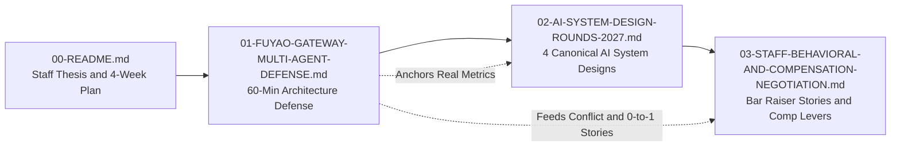
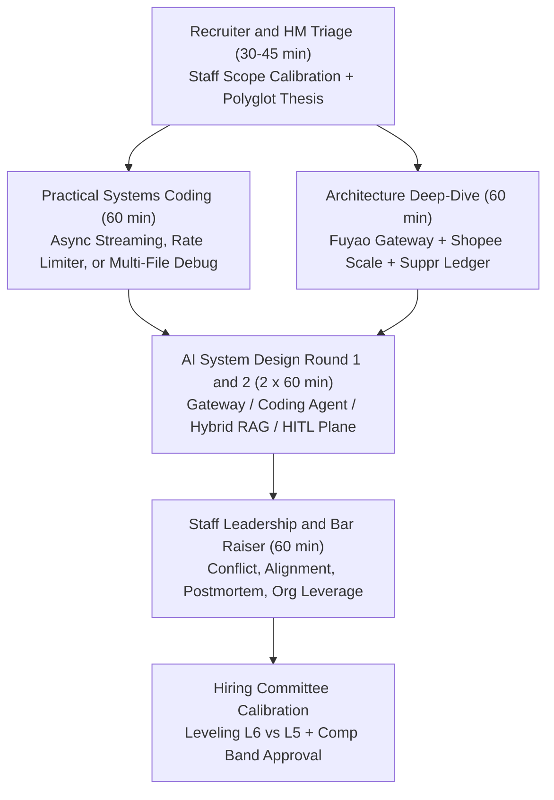
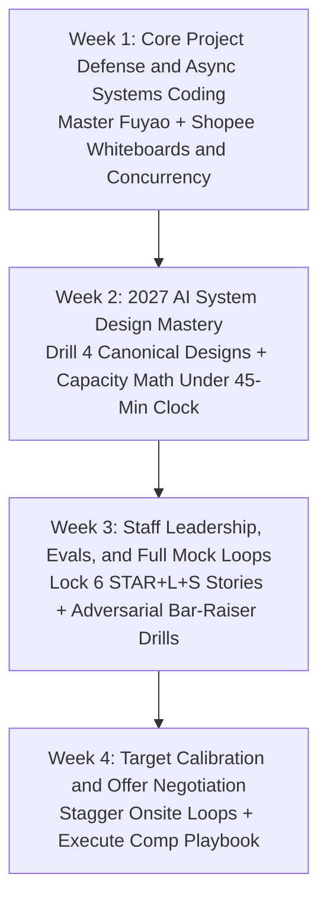

# 2027 Staff & Principal AI Platform Interview Playbook

A tactical, end-to-end interview execution manual engineered for Senior-to-Staff (L6) and Principal (L7) Software & AI Platform Engineering loops in 2027. Rather than treating career transitions across backend, distributed FinTech, cloud-native SaaS, and multi-agent infrastructure as separate chapters, this playbook synthesizes a **9+ year polyglot engineering trajectory** into a single high-leverage Staff narrative.

---

## Curriculum Table of Contents

| Module | File | Core Objective & Interview Signal |
| :--- | :--- | :--- |
| **00** | [00-README.md](00-README.md) | **2027 Staff Playbook Overview**: How 2027 L6 loops differ from CRUD loops, unifying a 9+ YoE polyglot arc into a Staff thesis, competency gap matrix, and a 4-week sprint schedule |
| **01** | [01-FUYAO-GATEWAY-MULTI-AGENT-DEFENSE.md](01-FUYAO-GATEWAY-MULTI-AGENT-DEFENSE.md) | **Project Deep-Dive Defense**: Whiteboarding Fuyao LLM Gateway, Responses API SSE backpressure, workspace isolation, HITL Copilot AST guardrails, OTel + CloudWatch EMF, and S3 versioned artifacts |
| **02** | [02-AI-SYSTEM-DESIGN-ROUNDS-2027.md](02-AI-SYSTEM-DESIGN-ROUNDS-2027.md) | **2027 AI System Design Rounds**: 4 complete Staff designs with capacity math & trade-offs (Cloud SWE Agent, 50k RPS AI Gateway, Hybrid RAG + Memory, HITL Tool Execution Plane) |
| **03** | [03-STAFF-BEHAVIORAL-AND-COMPENSATION-NEGOTIATION.md](03-STAFF-BEHAVIORAL-AND-COMPENSATION-NEGOTIATION.md) | **Behavioral Matrix & Comp Negotiation**: STAR+L+S scripts for technical conflict, cross-team alignment, incidents, 0-to-1 ambiguity, plus Foreign MNC / Singapore / Global offer negotiation |



---

## 1. How 2027 L6/Staff Loops Differ from Legacy CRUD Loops

Between 2021 and 2024, most Senior/Staff backend loops followed a predictable script: two medium-hard LeetCode trees/graphs, designing Twitter or Uber with Kafka + Redis + sharded MySQL, and recounting a microservice migration.

In **2027**, foundation models write boilerplate CRUD services in seconds. Hiring committees at Foreign MNCs, frontier AI labs, and global tech hubs have recalibrated L6+ rubrics around **stateful non-deterministic systems, token unit economics, multi-agent safety boundaries, and cross-team platform leverage**.

### Legacy Backend Loop vs. 2027 AI Platform Staff Loop

| Evaluation Dimension | Legacy CRUD / Microservice Loop (2021-2024) | 2027 Staff AI & Platform Loop | What Separates L6 Pass from L5 Down-Level |
| :--- | :--- | :--- | :--- |
| **Coding & Implementation** | Isolated algorithmic puzzles in 35 minutes; minimal I/O or concurrency | Async streaming state machines, bounded backpressure queues, retry/fallback middleware, multi-file codebase debugging | Writing race-free cancellation, clean timeout propagation, deterministic tests, and explicit memory bounds |
| **System Design Core** | Stateless HTTP -> Redis -> RDBMS read replicas -> Kafka | Long-lived SSE/WebSocket streams, KV-cache prefix affinity, durable multi-turn agent state, hybrid vector + lexical search | Quantifying **TTFT**, **ITL**, prompt-cache hit economics, and decoupling 60-second LLM streams from DB connection pools |
| **Failure Mode Analysis** | HTTP 5xx retries, circuit breakers, dead-letter queues | Model refusals, silent context truncation, tool-call hallucination, prompt injection, mid-stream SSE disconnect | Designing **two-phase token/credit reservation**, AST-level tool guardrails, and deterministic replay without double-execution |
| **Security & Multi-Tenancy** | JWT validation, RBAC middleware, parameterized SQL | Egress-isolated sandboxes, credential vault substitution, row-level tenant isolation across embeddings & S3 artifacts | Proving how a compromised or prompt-injected agent **cannot** exfiltrate sibling workspace data or raw credentials |
| **Observability & FinOps** | RED metrics (Rate, Errors, Duration) + basic Jaeger traces | W3C trace propagation across async agent hops, token spend per actor/tenant, cache-read ratio, eval regression gates | Tying observability directly to **unit economics** (cost per completed task, not cost per API call) and automated quality gates |
| **Architecture Defense** | Explaining the boxes you owned inside one team | Defending *build vs. buy*, schema/SDK evolution across multiple consumer teams, and organizational governance | Showing how your platform primitive eliminated duplicated effort across 3+ engineering teams without becoming a bottleneck |



---

## 2. Synthesizing a 9+ YoE Polyglot Arc into One Cohesive Staff Narrative

A common trap for experienced engineers who have worked across **Java, Python, Golang, and TypeScript** in five companies is narrating their resume chronologically like a laundry list ("First I used Java at Huawei, then Python/Go at Shopee, then Go/React at Tarro, then Java 21 at WildData, now Python/FastAPI/React for Kunpeng/Fuyao"). Interviewers hear fragmentation.

At the Staff level, you reframe those exact five chapters as **progressive mastery of every layer required to build enterprise-grade AI platforms**. Modern AI platforms fail not because engineers cannot call an LLM endpoint, but because they lack distributed database discipline, financial ledger rigor, async worker orchestration, and developer SDK ergonomics—all four of which you built in production before uniting them in **Fuyao**.

### The 5-Chapter Compounding Systems Matrix

| Era & Role | Core Engineering Achievement | Quantified Anchor | How It Powers Your 2027 Staff AI Platform Credibility |
| :--- | :--- | :--- | :--- |
| **1. Developer Infra Foundations**<br/>*Huawei (2017-2019)*<br/>Java / Spring Boot | Built **CodeHubEdge** integration middleware; dissected GitLab internals and optimized core Git repo operations (create, commit, hooks) | **+30%** repository operation efficiency; published deep source-code analyses | Demonstrates early **developer-tooling DNA** and comfort reading/modifying large upstream open-source codebases—directly relevant to coding agents and CI/CD governance |
| **2. High-QPS FinTech & DB Internals**<br/>*Shopee (2019-2023)*<br/>Python / Go / React | Scaled core **Billing Platform**; re-architected connection pooling, query paths, and transaction lifetimes; led weekly code reviews & 5 tech talks | DB connections **4k -> 1k (-75%)**; throughput **2k -> 5k QPS (+150%)**; **-30%** deploy defects | Proves battle-tested mastery of **Little's Law, connection-pool starvation, and financial correctness**—the exact discipline needed to keep 45s LLM SSE streams from exhausting PostgreSQL pools |
| **3. Edge-Cloud Resilience & Migration**<br/>*Tarro (2023-2024)*<br/>Go / Gin / TypeScript | Built POS ordering APIs; overhauled receipt-printing state machines across unreliable store networks; migrated legacy menu data | **-50%** printing error rate; **-30%** menu retrieval latency | Proves ability to tame **flaky real-world I/O boundaries** via idempotency, state machines, and zero-downtime schema migration |
| **4. 0-to-1 Commercial AI SaaS**<br/>*WildData — Suppr (2024-2026)*<br/>Java 21 / Kafka / K8s | Built **Suppr** AI research platform on K8s (TKE/Helm/Orbit CD); Kafka async pipelines + SSE for search/translation/reports; **freeze/consume/rollback** point ledger + idempotent WeChat/Alipay callbacks | End-to-end 0-to-1 production AI SaaS commercialization | Bridges **distributed FinTech + AI workloads**: long-running async AI jobs paired with two-phase credit reservation so failed LLM runs never leak revenue or double-charge users |
| **5. Enterprise Multi-Agent Data Plane**<br/>*Cognizant -> Apple Kunpeng / Fuyao (2026-Present)*<br/>Python / FastAPI / React / OTel | Architected **Fuyao** LLM gateway & data plane for **Kunpeng** supply-chain agents: Responses API SSE, `FuyaoChatModel` (LangGraph), isolated workspaces, **HITL Studio Copilot** (Pydantic + SQL DDL guardrails), OTel + CloudWatch EMF, S3 versioning, 4-phase TanStack Query console migration | Unified enterprise multi-agent control & data plane | The **culmination thesis**: operating at Staff scope across SDK (`apple-fuyao-sdk`), gateway data plane, governance control plane, observability, and operator console |

### Ready-to-Deliver Pitch Scripts

#### The 60-Second Executive Pitch (Recruiter / VP Intro)
> "Over the past nine-plus years, my career has compounded along one clear axis: building high-throughput, financially accurate distributed platforms and evolving them into enterprise multi-agent AI infrastructure. I started in developer tooling at Huawei optimizing Git repository middleware by 30%, then spent nearly four years at Shopee scaling core billing APIs from 2,000 to 5,000 QPS while cutting database connections from 4,000 down to 1,000. From there, I served as Technical Partner at WildData building Suppr—a commercial K8s-native AI research SaaS combining Kafka async pipelines, SSE streaming, and freeze-consume-rollback billing ledgers. Most recently, supporting Apple's Kunpeng multi-agent supply-chain ecosystem, I architected Fuyao: the unified AI data plane and LLM gateway powering Responses API SSE streaming, LangGraph agent isolation, OpenTelemetry cost/latency attribution, and a human-in-the-loop Studio Copilot protected by Pydantic and SQL DDL guardrails. What I bring at the Staff level is the ability to design AI platforms that don't just demo well, but hold up under production concurrency, strict security governance, and real unit economics."

#### The 3-Minute Hiring Manager Deep Framing ("Why Polyglot?")
When an interviewer asks why your stack spans Go, Python, Java 21, and TypeScript/React:
1. **State the Staff principle**: *"At L6, languages are runtime trade-off curves, not identities."*
2. **Map runtime to workload**:
   - **Go (Shopee, Tarro)** when tail latency, goroutine memory footprint ($2\text{--}4\text{ KB}$ stack), and high-fanout network proxies dominate.
   - **Java 21 + Spring Boot 3 (WildData, Huawei)** when strict domain modeling, transactional multi-service sagas, Kafka consumer ecosystems, and JVM Virtual Threads accelerate complex commercial SaaS delivery.
   - **Python + FastAPI (Fuyao, Shopee)** when sitting directly in the AI SDK/agent ecosystem (`LangChain`, `LangGraph`, `Pydantic`, AST parsers, OpenTelemetry instrumentation) where rapid control-plane iteration and native SDK parity matter—paired with strict async non-blocking discipline so the event loop never stalls.
   - **TypeScript + React + TanStack Query (Fuyao Studio, Tarro, Shopee)** because a platform's adoption ceiling is determined by its operator UX and self-service governance console; owning the full vertical eliminates cross-team handoff stalls.

### Cross-Domain Pivot Cheat Sheet (Turning Any Prompt into Your Home Turf)

Whenever an interviewer probes an unfamiliar domain, anchor on the universal distributed-systems invariant you have already proven in production:

| If the Interviewer Probes... | Bridge Immediately To... | Concrete Production Invariant You Cite |
| :--- | :--- | :--- |
| **Database contention, deadlocks, or pool exhaustion** | **Shopee Billing (`4k -> 1k` DB, `2k -> 5k` QPS)** + **Fuyao 3-Phase SSE Split** | Little's Law ($L = \lambda \times W$): shrinking transaction hold time $W$ by moving network I/O and validation outside `BEGIN...COMMIT`, paired with `SET LOCAL` under PgBouncer transaction pooling |
| **Distributed transactions, double-charging, or webhook retries** | **WildData Suppr (`Freeze -> Consume -> Rollback`)** + **WeChat/Alipay Idempotency** | Two-phase quota reservation with deterministic idempotency keys and dead-letter rollback sagas—identical to enterprise LLM token budget enforcement |
| **Unsafe AI actions, prompt injection, or enterprise governance** | **Fuyao Studio HITL Copilot** | Never trust system prompts for security: enforce strict Pydantic schemas + `sqlglot` AST validation + intersection RBAC + cryptographic dry-run diff sign-off |
| **Observability cardinality or multi-hop debugging** | **Fuyao OpenTelemetry + CloudWatch EMF** | Propagate W3C `traceparent` + `baggage` across SDK/gateway/agent hops; emit structured EMF logs so high-cardinality `actor_id` stays queryable without exploding metric time-series |
| **Legacy modernization without halting feature delivery** | **Fuyao Studio 4-Phase React/TanStack Query** + **Tarro Menu Migration (`-30%` latency)** | Strangler-fig route-by-route cutover backed by OpenAPI contract codegen, keyset cursor pagination, and shadow verification |

---

## 3. The 2027 Undefeatable Competency Matrix

Based on your current portfolio (`Fuyao`, `Suppr`, `Shopee Billing`) and 2027 market compensation data, you already hold rare cross-over leverage: **Full-Stack + High-QPS Distributed Billing + Production Multi-Agent Gateway**. To lock in top-decile L6/Staff offers (or global remote principal roles), sharpen the following six high-premium deltas:

| Skill Domain | Your Current Baseline | 2027 Staff+ "Undefeatable" Bar | Concrete Proof Point to Articulate in Interviews |
| :--- | :--- | :--- | :--- |
| **1. LLM Gateway & Prefix-Cache Economics** | Responses API SSE streaming & `FuyaoChatModel` | Quantifying KV-cache prefix stability (`tools -> system -> messages`), mid-conversation system injection without cache invalidation, and EWMA TTFT-aware routing | Explain how a single unstable timestamp in a system prompt drops cache hit rate from 85% to 0%, multiplying multi-turn agent input costs by $5\times\text{--}10\times$ |
| **2. Durable Agent Execution & State** | LangGraph integration + Kafka async workers | Checkpointed continuation state machines (surviving pod restarts & multi-hour HITL approvals with zero idle compute) + append-only preserved thinking histories | Contrast holding an ASGI worker open vs. serializing graph checkpoints to Postgres/Redis and resuming via event-driven triggers |
| **3. Sandbox & Egress Security** | Workspace isolation + Pydantic/SQL DDL guardrails | MicroVM isolation (Firecracker/gVisor), **vault credential substitution at egress proxy**, and pre-filter RBAC in RAG | Walk through why environment variables inside an agent container leak via prompt injection, whereas MITM proxy header substitution keeps secrets out of the sandbox |
| **4. Systematic AI Evals & Hillclimbing** | Production observability (OTel + CloudWatch EMF) | Offline golden datasets (train/val/test split to prevent rubric overfitting), deterministic AST/state graders over naive LLM-as-judge, shadow replay gates | Show how every prompt, model, or `effort` tier change is gated on **cost-per-verified-outcome** vs. latency ($p_{95}$ TTFT) |
| **5. High-Throughput DB & Storage Internals** | Shopee 4k->1k DB connections, S3 versioning, cursor pagination | `pgvector` / HNSW vs. DiskANN memory math, PgBouncer transaction pooling, MVCC bloat under high-churn agent checkpoints | Derive exact RAM and connection-pool formulas on the whiteboard using Little's Law ($L = \lambda \times W$) |
| **6. Executive RFC & Organizational Leverage** | 4-phase console migration, weekly code reviews (-30% defects), 5 tech talks | Writing 3-page Architecture Decision Records (ADRs) with explicit *non-goals*, migration phases, and TCO models that align 3+ skeptical tech leads | Frame technical choices in engineering-months saved, incident blast-radius reduction, and unit margin protection |

### 2027 Practical AI & Systems Coding Round Playbook

Over 60% of 2027 Staff loops replace at least one LeetCode round with a **60-minute Practical Systems Implementation** round. Drill these four high-frequency archetypes until you can write them bug-free with unit tests in 35 minutes:

1. **Async Streaming Frame Parser & Multiplexer (Python `asyncio` / TypeScript)**:
   - Parse arbitrary TCP byte chunks (`b"data: {\"delta\": \"hel"`, `b"lo\"}\n\ndata: [DONE]\n\n"`) across chunk boundaries without dropping multi-byte UTF-8 characters (`codecs.getincrementaldecoder("utf-8")`), handle `: comment` heartbeats, enforce bounded queue backpressure, and cancel cleanly on `asyncio.CancelledError`.
2. **Hierarchical Token-Bucket / Sliding-Window Rate Limiter (Go / Python)**:
   - Enforce **dual-constraint quotas** (both `requests_per_minute` and `tokens_per_minute` across `org_id` and `workspace_id`) with thread-safe `sync.Mutex` or `asyncio.Lock` locally and explain how to lift the exact state transition into an atomic **single-RTT Redis Lua script** to eliminate TOCTOU race conditions.
3. **Resilient DAG / Tool-Execution Runner with Concurrency Cap & Retries**:
   - Given a dependency graph of async agent tool tasks, schedule ready nodes up to `max_concurrency = K` (`asyncio.Semaphore`), distinguish retryable errors (`429`, `503` with exponential backoff + full jitter) from non-retryable `400` validation errors, and propagate fail-fast cancellation to downstream dependents.
4. **In-Memory Versioned KV Store with TTL & Cursor Scan**:
   - Implement `put(key, val, ttl_ms)`, `get(key, at_version)`, and `scan(prefix, cursor, limit)` in clean, idiomatic Python or Go—testing edge cases (expired keys skipped during cursor scan, monotonic version binary search via `bisect_right`).

```python
import bisect
from dataclasses import dataclass


@dataclass(frozen=True)
class VersionedEntry:
    version: int
    value: str | None
    expires_at_ms: int | None


class SnapshotKVStore:
    """Staff coding round archetype: MVCC point-in-time KV with O(log V) lookup."""

    def __init__(self) -> None:
        self._seq = 0
        self._history: dict[str, list[VersionedEntry]] = {}
        self._versions: dict[str, list[int]] = {}

    def put(self, key: str, value: str, now_ms: int, ttl_ms: int | None = None) -> int:
        self._seq += 1
        exp = (now_ms + ttl_ms) if ttl_ms is not None else None
        entry = VersionedEntry(version=self._seq, value=value, expires_at_ms=exp)
        self._history.setdefault(key, []).append(entry)
        self._versions.setdefault(key, []).append(self._seq)
        return self._seq

    def get(self, key: str, now_ms: int, at_version: int | None = None) -> str | None:
        vers = self._versions.get(key)
        if not vers:
            return None
        target_v = self._seq if at_version is None else at_version
        idx = bisect.bisect_right(vers, target_v) - 1
        if idx < 0:
            return None
        entry = self._history[key][idx]
        if entry.expires_at_ms is not None and now_ms >= entry.expires_at_ms:
            return None
        return entry.value
```

---

## 4. High-Intensity 4-Week Staff Interview Prep Sprint

Use this structured 28-day cadence to convert passive knowledge into crisp, under-pressure whiteboard execution. Aim for **2.5 hours on weekdays** and **5 hours per weekend day** (~22.5 hours/week, 90 hours total).



### Week 1: Architecture Defense & Systems Coding Precision
- **Primary Reading**: [01-FUYAO-GATEWAY-MULTI-AGENT-DEFENSE.md](01-FUYAO-GATEWAY-MULTI-AGENT-DEFENSE.md)
- **Daily Afternoon/Evening Blocks**:
  - **Days 1-2**: Draw the Fuyao Control Plane + Data Plane diagram from a blank canvas in under **6 minutes** while speaking out loud. Memorize every latency boundary, queue bound, and failure path.
  - **Days 3-4**: Code from scratch in Python (`asyncio`) and Go: (1) a bounded SSE streaming proxy with upstream retry, heartbeat frames, and clean client disconnect cancellation; (2) a distributed sliding-window / token-bucket rate limiter backed by Redis Lua scripts.
  - **Days 5-6**: Drill the Shopee Billing (`4k -> 1k` DB connections, `2k -> 5k` QPS) and WildData Suppr (`freeze/consume/rollback` ledger) deep-dives so you can pivot seamlessly if a backend-heavy interviewer probes relational locking, MVCC, or Kafka consumer rebalancing.
  - **Day 7 (Timed Audit)**: Record a 45-minute solo presentation of Fuyao + 15 minutes answering the 10 adversarial follow-ups in Module 01 without looking at notes.

### Week 2: 2027 AI System Design & Quantitative Capacity Math
- **Primary Reading**: [02-AI-SYSTEM-DESIGN-ROUNDS-2027.md](02-AI-SYSTEM-DESIGN-ROUNDS-2027.md)
- **Daily Afternoon/Evening Blocks**:
  - **Days 8-9**: Drill **Design 1 (Cloud SWE Coding Agent)** and **Design 2 (50k RPS Multi-Tenant AI Gateway)**. Practice writing capacity formulas first before drawing a single box.
  - **Days 10-11**: Drill **Design 3 (Production Hybrid RAG + Agent Memory)** and **Design 4 (HITL Governance & Safe Tool Execution Plane)**. Focus on ACL security trimming, TOCTOU prevention, and durable checkpointing.
  - **Days 12-13**: Coding maintenance—solve 8 high-signal systems-flavored data structure problems (LRU/LFU with TTL, weighted round-robin router, DAG topological task scheduler with concurrency cap, streaming JSON/SSE frame parser, keyset pagination cursor encoder).
  - **Day 14 (Timed Audit)**: Run two back-to-back 45-minute mock System Design sessions using a strict timer (5 min requirements & math -> 10 min high-level API & diagram -> 22 min deep-dives -> 8 min failure modes & FinOps).

### Week 3: Staff Behavioral Rubric, Eval Governance & Full Mock Loops
- **Primary Reading**: [03-STAFF-BEHAVIORAL-AND-COMPENSATION-NEGOTIATION.md](03-STAFF-BEHAVIORAL-AND-COMPENSATION-NEGOTIATION.md)
- **Daily Afternoon/Evening Blocks**:
  - **Days 15-17**: Rehearse all 6 flagship **STAR+L+S** stories out loud in both **3-minute crisp mode** and **6-minute deep-probe mode**. Eliminate passive `"we"` phrasing where `"I architected / I aligned / I authored"` is accurate, while crediting partner teams fairly.
  - **Days 18-19**: Prepare your **AI Eval & Observability mini-playbook**: be ready to design an offline + shadow evaluation harness for any AI product the interviewing company builds (grading rubric, determinism vs. LLM judge bias, regression thresholds).
  - **Days 20-21 (Full Simulation)**: Simulate a 4-round Staff virtual onsite (Coding -> AI System Design -> Fuyao Architecture Defense -> Staff Behavioral) with only 10-minute breaks to train cognitive stamina.

### Week 4: Pipeline Sequencing, Executive Presence & Negotiation Execution
- **Primary Reading**: Compensation & Negotiation sections of [03-STAFF-BEHAVIORAL-AND-COMPENSATION-NEGOTIATION.md](03-STAFF-BEHAVIORAL-AND-COMPENSATION-NEGOTIATION.md)
- **Execution Protocol**:
  - **Cluster your loops**: Schedule Tier-2 "warm-up" loops 5–7 business days ahead of Tier-1 target companies so final-round decisions land within the same **10-day decision window**.
  - **Pre-Onsite Research Dossier (45 min per target company)**: Read their latest 3 engineering blog posts, identify their primary cloud/model stack (AWS Bedrock vs. GCP Vertex vs. Azure Foundry vs. self-hosted vLLM), and prepare 3 bespoke Director/VP questions.
  - **Zero Early Anchoring**: Use the deflection scripts in Module 03 during recruiter screens so your leveling performance in the onsite loop—not your prior base salary—sets the compensation band.

---

## 5. Pre-Interview Readiness Gate Checklist

Before stepping into any Staff/L6 onsite loop, verify every item below passes without hesitation:

- [ ] **Whiteboard Speed**: Can draw and narrate the Fuyao Unified Data Plane + HITL Copilot architecture in 6 minutes flat, naming exact protocols, failure modes, and boundaries.
- [ ] **Little's Law & Pool Math**: Can prove mathematically why Shopee's `4,000 -> 1,000` DB connection reduction *increased* throughput from `2,000 -> 5,000 QPS`, and apply the exact same formula to FastAPI + PostgreSQL under long-lived LLM SSE streams.
- [ ] **Token & Cache Economics**: Can compute monthly LLM spend, prompt-cache savings, and SSE connection RAM for a 50,000 RPS gateway without a calculator.
- [ ] **Guardrail Depth**: Can write a working Pydantic strict validator + `sqlglot` AST DDL checker from memory and explain why regex SQL filtering fails in adversarial agent environments.
- [ ] **Story Agility**: Can pivot any of the 6 core career stories to answer conflict, ambiguity, failure postmortem, or cross-team influence prompts in under 180 seconds.
- [ ] **Comp Discipline**: Have written target walk-away, realistic target, and stretch anchor numbers in `CNY`, `SGD`, and `USD` across Base, RSU, and Sign-On components before taking the first HR call.

---

### Continue to Module 01
Proceed to [01-FUYAO-GATEWAY-MULTI-AGENT-DEFENSE.md](01-FUYAO-GATEWAY-MULTI-AGENT-DEFENSE.md) to master your 60-minute Staff Architecture Deep-Dive.
