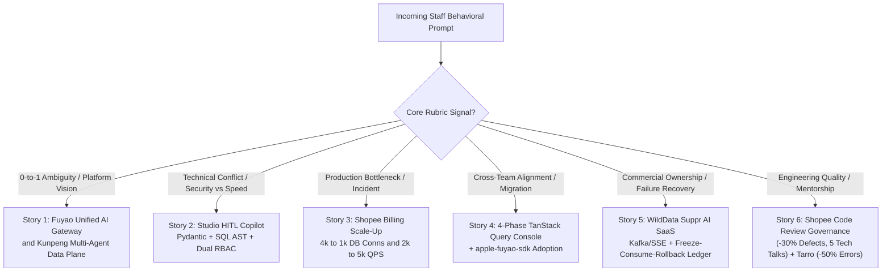
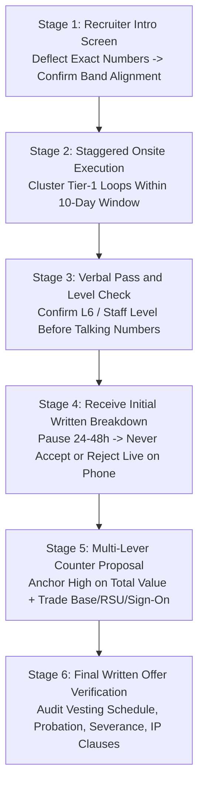

# Staff+ Behavioral Story Matrix & 2027 Compensation Negotiation

Technical brilliance gets you to the final hiring committee; **Staff behavioral calibration and disciplined negotiation** determine whether you walk away with an L5 Senior offer or a **top-of-band L6/Staff package (+35% to +65% higher Total Compensation)**.

This module converts your 9+ years across **Kunpeng/Fuyao, WildData Suppr, Tarro, Shopee, and Huawei** into high-signal **STAR+L+S** narratives tailored to Principal/Bar-Raiser rubrics, followed by a tactical 2027 compensation playbook for Foreign MNC FTEs, Singapore/Global relocation, and top AI labs.

> **Navigation**: [00-README.md](00-README.md) | Prev: [02-AI-SYSTEM-DESIGN-ROUNDS-2027.md](02-AI-SYSTEM-DESIGN-ROUNDS-2027.md) | **Current: Module 03**

---

## 1. The Staff+ Behavioral Bar: STAR+L+S Over Plain STAR

Standard `STAR` (Situation, Task, Action, Result) passes L4/L5 interviews because it proves reliable task execution. At **L6/Staff**, plain `STAR` often triggers a **down-level** because candidates spend 70% of their time describing code they wrote rather than **organizational trade-offs, alignment across skeptical stakeholders, and systemic mechanisms left behind**.

Upgrade every answer to **STAR+L+S** (3 minutes crisp delivery; 5 minutes with follow-ups):

| Segment | Target Time | What Hiring Committees Score at L6+ |
| :--- | :--- | :--- |
| **S — Situation & Org Scope** | **20 sec** | Multi-team blast radius, business/revenue stakes, and why existing patterns were failing |
| **T — Tension & Competing Priorities** | **25 sec** | Why this was *hard*: velocity vs. security, autonomy vs. standardization, latency vs. financial accuracy |
| **A — Architectural & Org Action** | **75 sec** | Your RFC/trade-off matrix, how you won buy-in without formal authority, and the key technical invariant you designed |
| **R — Quantified Business Result** | **25 sec** | Concrete metrics (QPS, DB connections, defect drop, latency, engineering-months saved across teams) |
| **L — Level-Up Lesson** | **15 sec** | Candid retrospective nuance—what you would sequence earlier at 10x scale |
| **S — Systemic Mechanism** | **20 sec** | What durable guardrail, SDK, review cadence, or OTel gate remained so the problem *stayed* solved without your heroics |

---

## 2. Master Career Story Routing Matrix

Never memorize 25 separate stories. Master **6 canonical high-leverage stories** and route any Bar-Raiser question to the strongest primary + backup pair.

### Coverage Cross-Reference Table

| Canonical Story | 0-to-1 Ambiguity | Technical Conflict | Cross-Team Alignment | Incident / Bottleneck | Quality & Culture |
| :--- | :---: | :---: | :---: | :---: | :---: |
| **S1: Fuyao Unified AI Gateway & Workspace Isolation** | **Primary** | Secondary | **Primary** | — | — |
| **S2: Fuyao HITL Copilot & SQL AST Guardrails** | Secondary | **Primary** | Secondary | — | Secondary |
| **S3: Shopee Billing (4k->1k DB, 2k->5k QPS)** | — | Secondary | — | **Primary** | Secondary |
| **S4: Fuyao Studio 4-Phase Migration & SDK Rollout** | — | Secondary | **Primary** | — | **Primary** |
| **S5: WildData Suppr (Kafka/SSE + Credit Ledger)** | **Primary** | — | — | Secondary | — |
| **S6: Shopee Weekly Reviews (-30% Bugs) & Tarro POS** | — | — | Secondary | Secondary | **Primary** |

---

## 3. Four Flagship Verbatim STAR+L+S Scripts

### Template A: Technical Conflict & Principled Trade-Offs
**Prompts Covered**: *"Tell me about a severe technical disagreement with a senior peer or security/product lead."* / *"Tell me about balancing speed of innovation with enterprise risk."*

- **Situation & Tension (45s)**:
  > "While building Fuyao Studio for Apple's Kunpeng multi-agent ecosystem, product stakeholders wanted an autonomous natural-language Copilot capable of provisioning resources, updating OAuth connectors, and modifying RBAC policies immediately so supply-chain teams could onboard agents in minutes instead of filing infra tickets. Conversely, security and platform leads pushed to restrict the Copilot to read-only documentation Q&A, arguing that an LLM generating SQL DDL or RBAC changes created an unacceptable prompt-injection and privilege-escalation vector. Both sides were deadlocked."
- **Architectural & Organizational Action (75s)**:
  > "Instead of picking a watered-down compromise, I wrote a concise RFC reframing the problem: *non-deterministic intent synthesis is safe if and only if execution is gated by deterministic verification and cryptographic human sign-off*. I prototyped a 4-stage pipeline in two days to make the debate concrete:
  > 1. Inject caller-scoped live registry state so the LLM synthesizes a typed JSON `ActionPlan` rather than running freeform commands.
  > 2. Validate proposals through strict Pydantic schemas plus an AST-level PostgreSQL DDL inspector blocking `DROP`, `TRUNCATE`, multi-statement payloads, and raw `GRANT` escalations.
  > 3. Enforce intersection RBAC—bounding actions by *both* the human operator's permissions and the Copilot's role ceiling.
  > 4. Render a canonicalized dry-run diff in React Studio tied to an optimistic registry version lock before execution.
  > Walking both security and product leads through 50 adversarial prompt-injection test cases failing deterministically at the AST/RBAC gate shifted the conversation from opinion to proof."
- **Result, Lesson & Systemic Mechanism (40s)**:
  > "Both leads signed off within the sprint. Onboarding governance tasks dropped from multi-day ticket queues to under two minutes of safe self-service review with zero security incidents. **Lesson**: When senior engineers deadlock between velocity and safety, prose arguments rarely win—a deterministic threat-model matrix paired with an executable guardrail prototype breaks the stalemate immediately. **Systemic Mechanism**: That AST + HITL dry-run pattern became the mandatory template for all mutating control-plane tools across Fuyao."

---

### Template B: Cross-Team Alignment Without Formal Authority
**Prompts Covered**: *"Tell me about driving an architectural standard or migration across multiple teams."* / *"How do you modernize legacy architecture while shipping features?"*

- **Situation & Tension (45s)**:
  > "Across Kunpeng and Fuyao, agent consumer teams and Fuyao Studio engineers were moving fast under tight deadlines. On the SDK/backend side, teams wanted custom artifact endpoints and ad-hoc streaming wrappers; on Fuyao Studio Console, imperative `useEffect` fetches and scattered state slices caused UI race conditions whenever high-volume agent artifacts updated. A 'stop-the-world' rewrite or top-down mandate would have been rejected by partner leads protecting their quarterly roadmaps."
- **Architectural & Organizational Action (75s)**:
  > "I aligned teams using an **adoption-by-ergonomics** strategy across both layers:
  > - First, for backend and agent teams, I packaged W3C OpenTelemetry trace/baggage propagation, keyset cursor pagination, S3 object versioning, and `FuyaoChatModel` LangGraph streaming directly into `apple-fuyao-sdk`. Instead of asking three teams to write 400 lines of boilerplate telemetry and pagination code, adopting our standard **deleted** code from their repos and gave them out-of-the-box CloudWatch EMF latency/cost dashboards.
  > - Second, for Fuyao Studio Console, I authored a **4-phase Strangler-Fig migration plan** to React + TanStack Query: Phase 1 generated typed OpenAPI contracts and query-key factories; Phase 2 migrated read-heavy artifact/registry views using `useInfiniteQuery` over our new backend cursors; Phase 3 wired HITL mutations with optimistic rollback and SSE cache invalidation; Phase 4 retired legacy stores. Every phase shipped behind route boundaries with zero feature freeze."
- **Result, Lesson & Systemic Mechanism (40s)**:
  > "All downstream agent workflows converged onto `apple-fuyao-sdk` and keyset pagination without missing a single product milestone, cutting redundant console network calls by over 60% and eliminating stale-policy UI bugs. **Lesson**: Cross-team mandates breed workarounds; making the paved road the *lowest-friction* path wins voluntary adoption. **Systemic Mechanism**: OpenAPI-to-TypeScript schema checks and OTel baggage propagation were embedded directly into CI templates so new microservices inherit them on day one."

---

### Template C: High-Severity Bottleneck & Production Scale Redesign
**Prompts Covered**: *"Tell me about the hardest production scaling bottleneck or outage risk you resolved."* / *"Tell me about diving deep into system internals."*

- **Situation & Tension (45s)**:
  > "At Shopee, our core Billing Platform sat on the critical path of merchant settlements and promotional campaigns. During mega-sale traffic spikes, our API hit a hard wall at **2,000 QPS** while saturating **4,000 database connections**, triggering lock-wait cascades, elevated p99 latencies, and severe incident risk during peak checkout windows. Naively adding more application pods actually made throughput *worse* by amplifying DB connection thrashing."
- **Architectural & Organizational Action (75s)**:
  > "Rather than vertically scaling database hardware as a band-aid, I led a root-cause profiling investigation across Python/Django, Go services, and MySQL/PostgreSQL internals:
  > 1. Applying **Little's Law** ($L = \lambda \times W$), I proved that 75% of connection hold time wasn't SQL execution—it was application code holding open transactions across synchronous validation RPCs and unbatched row-by-row writes.
  > 2. I redesigned the billing write path to pre-validate outside transactions, coalesced batch inserts, eliminated N+1 ORM lookups via covering composite indexes, and tuned connection pool sizing + PgBouncer/pool lifetimes to match actual CPU core concurrency rather than pod count.
  > 3. We rolled out the refactored hot path behind shadow traffic comparison and canary percentages to guarantee 100% cent-for-cent financial parity."
- **Result, Lesson & Systemic Mechanism (40s)**:
  > "Database connections dropped **75% from 4,000 down to 1,000**, while sustained API throughput **more than doubled from 2,000 to 5,000 QPS** with flat tail latency across major shopping festivals. **Lesson**: High connection counts are almost always a symptom of transaction boundary leaks, not insufficient DB capacity—a lesson I later applied directly when decoupling 60-second LLM SSE streams from PostgreSQL pools in Fuyao. **Systemic Mechanism**: I instituted **weekly architectural code reviews** focused on transaction scope and query plans—reducing deployment defects by **30%**—and delivered **5 engineering tech talks** to codify these performance patterns across teams."

---

### Template D: 0-to-1 Ambiguity & End-to-End Commercial Ownership
**Prompts Covered**: *"Tell me about taking an ambiguous 0-to-1 product from concept to production."* / *"Tell me about designing for business unit economics, not just tech."*

- **Situation & Tension (45s)**:
  > "Joining WildData as Technical Partner to build **Suppr**—an AI-powered academic literature search, document translation, and deep research report platform—we started with a high-level business goal and zero infrastructure. The core tension was architectural and financial: translating 80-page PDFs and generating multi-stage research reports takes 30 seconds to several minutes, upstream LLM APIs fail or time out unpredictably, and users were paying real money via WeChat Pay and Alipay. Synchronous HTTP requests would time out, while naive upfront point deduction would cause angry chargebacks whenever an upstream AI job failed."
- **Architectural & Organizational Action (75s)**:
  > "I architected the entire stack on Tencent Cloud Kubernetes (TKE, EdgeOne, Helm, Orbit CD) around three decoupled pillars:
  > 1. **Independent API vs. Worker Autoscaling**: Stateless Java 21 / Spring Boot 3 API pods handled low-latency search and SSE progress streams, while heavy PDF translation and report synthesis ran on Kafka-backed worker pools scaled on consumer lag.
  > 2. **Two-Phase Point Ledger (`Freeze -> Consume -> Rollback`)**: Before enqueueing a Kafka AI job, we atomically *froze* user credits in MySQL/Redis; only upon verified S3 artifact delivery did the ledger *consume* the frozen balance, whereas dead-letter failures triggered automatic *rollback* refunds.
  > 3. **Idempotent Payment Webhooks**: Engineered state-machine transitions keyed on upstream transaction IDs with distributed locks so duplicate WeChat Pay / Alipay retry callbacks could never double-mint credits."
- **Result, Lesson & Systemic Mechanism (40s)**:
  > "We launched Suppr from zero to a revenue-generating commercial SaaS serving thousands of researchers with zero ledger discrepancies across payment retries and model outages. **Lesson**: In commercial AI products, **billing state machines and async job idempotency** are first-class product features, not back-office afterthoughts. **Systemic Mechanism**: Standardized Helm/Orbit CD deployment pipelines and dead-letter reconciliation jobs allowed small engineering headcount to operate multi-service K8s infrastructure with minimal on-call toil."

---

### Bar-Raiser Adversarial Follow-Up Drills
Be ready when a Principal Bar-Raiser interrupts with:
1. **"What specifically did *you* do versus the rest of the team?"**
   - *Rule*: Never hide behind `"we"`. Answer crisply: *"Three engineers owned individual domain connectors and UI views; **I personally** authored the Responses API SSE backpressure engine, the Pydantic + SQL AST guardrail validator, and the 4-phase TanStack Query migration RFC, and reviewed the PRs establishing the pattern."*
2. **"Tell me about a mistake or architectural call you got wrong."**
   - *High-Signal Answer*: Pick a **real technical trade-off**, never a fake humblebrag (*"I worked too hard"*). Example: *"Early in Fuyao Studio Copilot, we injected dynamic registry metadata into the system prompt for simplicity, which inadvertently invalidated upstream prompt caches as workspace sizes grew. Catching that in our OTel/EMF token metrics taught me to treat prompt-prefix ordering (`tools -> system -> volatile user context`) as a first-class architectural contract from day one."*

---

## 4. High-Leverage Reverse-Interview Questions (Staff Signal)

The questions you ask in the final 5 minutes reveal your operating altitude.

| Interviewer Persona | High-Signal Question to Ask | What Red Flags Sound Like |
| :--- | :--- | :--- |
| **Peer Staff / Principal Engineer** | *"What is the biggest cross-team architectural bottleneck in your AI/platform stack right now that nobody has had the bandwidth or mandate to untangle?"* | Vague answers or "we don't really have tech debt"—signals either low candor or siloed IC scope |
| **Hiring Manager** | *"Looking 6 months out, what concrete organizational or platform outcome separates a 'solid L6 hire' from an 'exceptional L6 hire' in this role?"* | Pure feature-ticket velocity answers instead of platform adoption, reliability, or cross-team leverage |
| **Director / VP of Engineering** | *"How do you currently govern the trade-off between product teams moving fast with their own LLM prompts/vendors versus standardizing on shared platform guardrails and unit economics?"* | No FinOps visibility or every product team building shadow gateways with zero executive backing |

---

## 5. 2027 Compensation Landscape & Negotiation Playbook

### 2027 Target Market Benchmarks (9+ YoE Senior+ / Staff AI & Platform)

> *Note: Figures below reflect 2027 total annual compensation ranges (Base + Target Bonus + Annualized Liquid Equity) for strong L5+ / L6 Staff AI Platform & Full-Stack Infrastructure profiles. Always evaluate **post-tax + hourly-adjusted purchasing power**.*

| Employment Track | Typical Base Range | Annualized Equity / Bonus | Total Annual Comp (TC) | Core Structural Pros & Watchouts |
| :--- | :--- | :--- | :--- | :--- |
| **1. Tier-1 Foreign MNC FTE (Shanghai / Beijing)** *(US/EU Cloud, AI, FinTech, Hardware R&D)* | `CNY 750k to 1.15M` | `CNY 350k to 850k` (Public USD RSUs + 13–15m + Bonus) | `CNY 1.15M to 2.0M+` | Liquid USD public stock, 12% full supplemental housing fund, sustainable 40–45h engineering culture, strong `N+1`/`N+3` legal protections |
| **2. Top China Frontier AI Lab / Big Tech (P8 / 3-2)** *(Foundation Model Labs & Mega-Platforms)* | `CNY 850k to 1.30M` | `CNY 400k to 1.10M` (Cash bonus + RSUs / Options) | `CNY 1.30M to 2.40M` | Highest domestic cash upside & massive GPU/QPS scale; **discount pre-IPO paper options by 50%–70%** and divide TC by actual weekly hours (55–65h) |
| **3. Singapore Regional HQ FTE (EP Relocation)** *(Global FinTech, AI Infra, Regional Big Tech)* | `SGD 180k to 250k` | `SGD 60k to 150k` (RSU + AWS/Bonus) | `SGD 240k to 400k` | **11%–15% effective income tax** (massive net-cash retention advantage), global mobility hub; factor in `SGD 4k to 5.5k/month` housing cost |
| **4. Global Remote Staff IC (USD via EOR / Contractor)** *(US/Global AI Startups & DevTools, Series B–D)* | `USD 170k to 240k` | `USD 40k to 120k` (Equity / Profit Share) | `USD 210k to 340k` | Geographic arbitrage + async ownership; scrutinize runway (>24 months cash) and liquid base vs. illiquid early-stage options |

### Risk-Adjusted & Tax-Adjusted Valuation Formula

Never compare raw headline numbers across tracks. Compute **Risk-Adjusted Net Annual Value ($\text{NAV}$)** before choosing:

$$\text{NAV} = \left(\text{Base} + \text{Guaranteed Months} + \frac{\text{SignOn}}{2}\right)(1 - \tau) + (\text{Bonus} \times p_{\text{payout}})(1 - \tau) + (\text{Equity}_{\text{yr}} \times d_{\text{liquidity}})(1 - \tau_{\text{eq}})$$

Where:
- $\tau$: Effective income tax rate ($\approx 0.13$ in Singapore vs. $\approx 0.28\text{--}0.35$ blended in Shanghai/Beijing after housing-fund & special deductions).
- $d_{\text{liquidity}}$: Liquidity discount factor = **$1.0$** for public NYSE/NASDAQ RSUs, **$0.65$** for late-stage liquid tender-offer unicorns, and **$0.25\text{--}0.40$** for early pre-IPO options without secondary buybacks.

---

### End-to-End Negotiation State Machine

---

### Word-for-Word Scripts for High-Pressure Scenarios

#### Scenario 1: Early Recruiter Pressing for Current Salary & Expected Package
*Context*: In China and APAC markets, recruiters routinely ask for current base/payslips on call #1. Giving a hard target too early either prices you out before they see your Staff value or caps your offer at `+15%` over current pay instead of top-of-band L6.

> **Script**:
> *"Right now my priority is making sure there's a strong mutual match at the Staff / Senior+ platform scope—especially around LLM gateway infrastructure and distributed systems scale. My current structure mixes base, project incentives, and benefits that don't map 1-to-1 to a direct FTE RSU package, so I prefer to let the interview loop calibrate my exact level first. That said, to make sure we're respectful of each other's time, could you share the approved total compensation band for this level?"*
>
> *(If pressed a second time for a concrete number)*:
> *"For the roles I'm actively interviewing for at the Staff AI Platform tier, total annual packages are clustering in the `[insert top-quartile market range, e.g., CNY 1.5M to 1.9M / SGD 280k to 340k]` range depending on the cash-to-RSU mix. I'm very flexible on structure—base, RSUs, and sign-on—for the right architectural scope."*

#### Scenario 2: Defending Against a "Senior+ (High L5)" Down-Level Offer
*Context*: The team loved you, wants to hire you immediately, and pitches *"High L5 with fast-track promo to L6 in 12 months."* (In reality, internal promos usually take 18–30 months due to quota caps.)

> **Script**:
> *"I really enjoyed meeting the team and I'm excited about the roadmap around [specific platform problem]. Looking closely at the scope we discussed with [Hiring Manager/Director]—specifically owning cross-team gateway standards, multi-agent governance, and mentoring across teams—that maps directly to the multi-team platform scope I'm already delivering on Fuyao and Kunpeng. Re-entering at L5 creates a structural gap in both mandate and equity band. What specific signal from the loop held back an L6 calibration? I'd gladly do a focused 30-minute architectural follow-up with [Director/Principal] if needed so we can land cleanly at L6 from day one."*

#### Scenario 3: Countering When Base Salary Hits the HR Band Ceiling
*Context*: Foreign MNCs often have rigid HR base-salary caps per grade, **but** have 25%–50% discretionary headroom in **initial RSU grant** and **Year-1 / Year-2 Sign-On Bonuses** (which require only VP/Finance one-time approval, not permanent payroll band exceptions).

> **Script**:
> *"Thank you for putting together a strong initial offer—the team and technical direction are my top choice. Looking at the overall market and a competing AI infrastructure opportunity I'm evaluating near `[Anchor X]`, there's roughly a `[15%–20%]` gap in Year-1 and Year-2 total value. I completely understand `[Base Y]` is near the top of the base band for this grade. If we can keep base at `[Base Y]`, increase the initial RSU grant by `[USD 40k–60k]` over four years, and add a `[CNY 150k / SGD 25k]` Year-1 sign-on bonus to bridge transition timing, I am ready to sign this week and withdraw from my other loops."*

#### Scenario 4: Handling Exploding Deadlines ("You have 48 hours to decide")
> **Script**:
> *"Choosing my next 4-to-5-year engineering home is a major commitment, and I never sign an offer I'm not 100% committed to honoring. I have a final executive round wrapping up on `[Date + 5 business days]`. Extending our decision date to `[Next Tuesday]` lets me close out my obligations professionally and make a fully informed commitment without rushing. Can we align on `[Next Tuesday]` at 5 PM?"*

---

## 6. Pre-Signature Contract & Relocation Audit Checklist

Before signing any final employment agreement (China Foreign MNC FTE, Singapore EP, or Global EOR), verify every clause in writing:

- [ ] **Equity Vesting Mechanics**: Confirm cliff length (**0-month cliff** or **1-year cliff**? Front-loaded `35/30/20/15` vs. even `25/25/25/25` vs. back-loaded `5/15/40/40`?), grant price date, and annual refresher eligibility date (ensure joining in Q4 does not forfeit the next cycle's refresher!).
- [ ] **Sign-On Clawback Terms**: Ensure sign-on clawback is **pro-rated monthly** over 12 months (never a 100% cliff clawback at month 11) and waived in the event of involuntary layoff/role elimination.
- [ ] **China FTE Specifics**: Verify base x guaranteed months (`12m` vs. `13m`/`14m` written in contract vs. "discretionary"), probation salary parity (`100%` pay during probation, not `80%`), social insurance & housing fund contribution base (uncapped up to city statutory ceiling at `12% + 12%`), and non-compete scope (avoid broad 24-month industry-wide non-competes paid at 30% base).
- [ ] **Singapore Relocation Specifics**: Confirm employer sponsorship of **Employment Pass (EP)** + Dependant's Pass if applicable, one-way business/economy flight + shipping allowance, 30 days serviced-apartment temporary housing, and tax equalization / local entity payroll start date.
- [ ] **IP & Personal Open-Source Carve-Out**: Ensure your personal GitHub portfolio (`yongjinhuang.github.io`) and prior open-source repositories are listed on the **Prior Inventions Disclosure Exhibit** before day one.

---

### Return to Playbook Hub
Review the complete 4-week sprint schedule and readiness gates in [00-README.md](00-README.md), or revisit technical architecture drills in [01-FUYAO-GATEWAY-MULTI-AGENT-DEFENSE.md](01-FUYAO-GATEWAY-MULTI-AGENT-DEFENSE.md) and [02-AI-SYSTEM-DESIGN-ROUNDS-2027.md](02-AI-SYSTEM-DESIGN-ROUNDS-2027.md).
