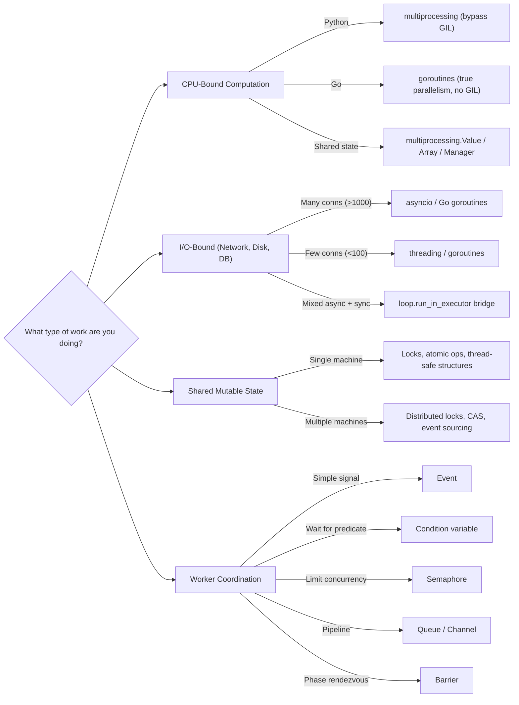

# Concurrency & Multithreading Interview Preparation

A comprehensive, deep-dive guide to concurrency and multithreading for software engineering
interviews. All primary code examples are in Python, with Go comparisons where concurrency
patterns diverge significantly between the two languages.

---

## Why Concurrency Is Critical for 2026 Interviews

Concurrency has moved from a "nice to know" topic to a **core requirement** at every level:

1. **Multi-core is the default.** Every production server has dozens of cores. Interviewers
   expect you to write code that actually uses them.
2. **Async-first architectures.** Modern web frameworks (FastAPI, Go net/http, Node.js) are
   built around async I/O. You will be asked how they work internally.
3. **Distributed systems are concurrent systems.** Every system design question involves
   concurrent access to shared resources (databases, caches, queues).
4. **AI/ML workloads.** GPU scheduling, data pipeline parallelism, and model serving all
   require deep concurrency understanding.
5. **LeetCode added concurrency problems.** Problems like "Print in Order" and "Fizz Buzz
   Multithreaded" appear in real interviews at FAANG companies.

```
Concurrency shows up in EVERY interview stage:
+-------------------+----------------------------------------------+
| Stage             | How Concurrency Appears                      |
+-------------------+----------------------------------------------+
| Coding            | Thread-safe data structures, LeetCode conc.  |
| System Design     | Race conditions, distributed locks, queues   |
| Low-Level Design  | Thread-safe singletons, concurrent caches    |
| Behavioral        | "Tell me about a concurrency bug you fixed"  |
+-------------------+----------------------------------------------+
```

---

## Table of Contents

| #   | File                                                                    | Topics                                                                                                                | Difficulty   |
| --- | ----------------------------------------------------------------------- | --------------------------------------------------------------------------------------------------------------------- | ------------ |
| 01  | [Fundamentals](./01-FUNDAMENTALS.md)                                    | Process vs thread vs coroutine, concurrency vs parallelism, Amdahl's law, memory models, OS scheduling                | Beginner     |
| 02  | [Synchronization Primitives](./02-SYNCHRONIZATION-PRIMITIVES.md)        | Mutex, RLock, Semaphore, Condition, Barrier, Event, ReadWriteLock, spinlock vs mutex, optimistic vs pessimistic       | Intermediate |
| 03  | [Classic Problems](./03-CLASSIC-PROBLEMS.md)                            | Dining Philosophers, Sleeping Barber, Cigarette Smokers, H2O, LeetCode concurrency problems                           | Intermediate |
| 04  | [Deadlock, Livelock & Starvation](./04-DEADLOCK-LIVELOCK-STARVATION.md) | Coffman conditions, detection algorithms, prevention strategies, Banker's algorithm, priority inversion               | Intermediate |
| 05  | [Thread-Safe Data Structures](./05-THREAD-SAFE-DATA-STRUCTURES.md)      | Blocking queue, concurrent hashmap, atomic counter, thread-safe singleton, CAS, lock-free stack, concurrent LRU cache | Advanced     |
| 06  | [Async Programming Deep Dive](./06-ASYNC-PROGRAMMING.md)                | Event loop internals, structured concurrency, TaskGroup, error handling, backpressure, async pipelines                | Advanced     |
| 07  | [Go Concurrency Model](./07-GO-CONCURRENCY.md)                          | Goroutines, channels, select, sync package, fan-in/fan-out, context, race detector                                    | Advanced     |
| 08  | [Distributed Concurrency](./08-DISTRIBUTED-CONCURRENCY.md)              | Distributed locks, optimistic/pessimistic concurrency, 2PC, sagas, CRDTs, leader election                             | Advanced     |
| 09  | [Interview Questions](./09-INTERVIEW-QUESTIONS.md)                      | 30 curated questions (Easy/Medium/Hard) with key points, follow-ups, code skeletons                                   | All Levels   |

---

## Prerequisite

This guide assumes you have read the introductory concurrency material in
[Low-Level Design: Concurrency Patterns](../low-level-design/10-CONCURRENCY-PATTERNS.md),
which covers basic threading, asyncio, producer-consumer, reader-writer locks, and the GIL.
The files here go significantly deeper and broader.

---

## Recommended Study Order

### If you have 1 week

```
Day 1:  01-FUNDAMENTALS.md          (build the mental model)
Day 2:  02-SYNCHRONIZATION.md       (know every primitive cold)
Day 3:  03-CLASSIC-PROBLEMS.md      (practice implementation)
Day 4:  04-DEADLOCK.md              (understand failure modes)
Day 5:  05-THREAD-SAFE-DS.md        (design-level questions)
Day 6:  06-ASYNC + 07-GO            (modern patterns)
Day 7:  08-DISTRIBUTED + 09-QUESTIONS (system design bridge + practice)
```

### If you have 3 days

```
Day 1:  01-FUNDAMENTALS + 02-SYNCHRONIZATION
Day 2:  03-CLASSIC-PROBLEMS + 04-DEADLOCK
Day 3:  09-INTERVIEW-QUESTIONS (with references back to other files)
```

### If you have 1 day

```
Morning:   01-FUNDAMENTALS (Quick Reference only)
           02-SYNCHRONIZATION (Quick Reference only)
Afternoon: 04-DEADLOCK (Coffman conditions + prevention strategies)
           09-INTERVIEW-QUESTIONS (all 30 questions)
```

---

## How to Use These Files

1. **Read the conceptual explanation first.** Understand _why_ before memorizing _how_.
2. **Type out the code examples.** Do not copy-paste. Typing builds muscle memory.
3. **Draw the ASCII diagrams yourself.** Redraw the thread interaction diagrams on paper.
4. **Solve each problem before reading the solution.** Cover the solution with your hand.
5. **Focus on the Gotchas sections.** These are the mistakes interviewers look for.
6. **Use the Quick Reference tables for last-minute review.** Print them if needed.

---

## Key Differences from the LLD Concurrency File

The existing `low-level-design/10-CONCURRENCY-PATTERNS.md` provides a solid introduction.
These files extend it in the following ways:

```
+-----------------------------------+-----------------------------------+
| LLD File (Intro)                  | This Guide (Deep Dive)            |
+-----------------------------------+-----------------------------------+
| Basic Lock, RLock, Semaphore      | ALL primitives + Barrier, Event,  |
|                                   | spinlock, CAS, optimistic locking |
+-----------------------------------+-----------------------------------+
| One producer-consumer example     | 10 classic problems with multiple |
|                                   | solution approaches each          |
+-----------------------------------+-----------------------------------+
| Deadlock briefly mentioned        | Full Coffman conditions, detect,  |
|                                   | prevent, avoid + livelock +       |
|                                   | starvation + priority inversion   |
+-----------------------------------+-----------------------------------+
| Basic asyncio examples            | Event loop internals, structured  |
|                                   | concurrency, backpressure,        |
|                                   | exception groups, async pipelines |
+-----------------------------------+-----------------------------------+
| Go-style via Python queues        | Full Go concurrency: goroutines,  |
|                                   | channels, select, context, sync   |
+-----------------------------------+-----------------------------------+
| No distributed concurrency        | Distributed locks, 2PC, sagas,    |
|                                   | CRDTs, leader election            |
+-----------------------------------+-----------------------------------+
| No thread-safe data structures    | 7 data structures with multiple   |
|                                   | locking strategies                |
+-----------------------------------+-----------------------------------+
```

---

## Quick Reference: Concurrency Decision Tree



---

## Notation Used in This Guide

- `# WRONG:` and `# BUG:` mark code with intentional bugs for learning
- `# CORRECT:` and `# FIX:` mark the corrected version
- `[Thread-1]`, `[Thread-2]` label which thread executes each line
- `-->` shows causation or data flow
- `||| ` marks lines that execute in parallel
- Time flows left-to-right in ASCII timing diagrams
