# Data Engineering Fundamentals

Data engineering is the discipline of designing, building, and maintaining the infrastructure and systems that enable the collection, storage, transformation, and serving of data at scale. Data engineers build the pipelines and architectures that make data available, reliable, and useful for analysts, data scientists, and business stakeholders. This guide covers the foundational concepts every data engineer must understand.

---

## Table of Contents

1. [What Is Data Engineering?](#1-what-is-data-engineering)
2. [The Data Engineer Role](#2-the-data-engineer-role)
3. [ETL vs ELT](#3-etl-vs-elt)
4. [Batch vs Streaming Processing](#4-batch-vs-streaming-processing)
5. [Lambda Architecture](#5-lambda-architecture)
6. [Kappa Architecture](#6-kappa-architecture)
7. [Data Mesh](#7-data-mesh)
8. [Medallion Architecture](#8-medallion-architecture)
9. [Data Modeling](#9-data-modeling)
10. [Data Quality](#10-data-quality)
11. [Data Lineage and Cataloging](#11-data-lineage-and-cataloging)
12. [Modern Data Stack](#12-modern-data-stack)
13. [Common Interview Questions](#13-common-interview-questions)
14. [Quick Reference](#14-quick-reference)

---

## 1. What Is Data Engineering?

Data engineering sits at the intersection of software engineering and data science. It focuses on the practical application of data collection, storage, and processing at scale.

### Core Responsibilities

- **Data Ingestion**: Collecting data from diverse sources (APIs, databases, files, streams)
- **Data Transformation**: Cleaning, enriching, and reshaping data for downstream use
- **Data Storage**: Designing and managing data warehouses, lakes, and lakehouses
- **Data Pipeline Orchestration**: Scheduling and monitoring data workflows
- **Data Quality**: Ensuring accuracy, completeness, and reliability of data
- **Infrastructure**: Managing the compute and storage systems that underpin data platforms

### The Data Lifecycle

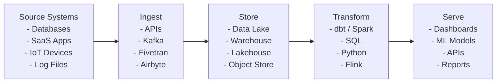

---

## 2. The Data Engineer Role

### Data Engineer vs Related Roles

| Aspect | Data Engineer | Data Scientist | Data Analyst | Analytics Engineer |
|--------|--------------|----------------|--------------|-------------------|
| Focus | Pipelines & infra | Models & ML | Reports & insights | Transform & model |
| Tools | Spark, Kafka, Airflow | Python, R, TensorFlow | SQL, Tableau, Excel | dbt, SQL, Looker |
| Output | Reliable data systems | Predictions & models | Dashboards & reports | Clean data models |
| Skills | Software eng, distributed systems | Math, statistics, ML | Business acumen, SQL | SQL, data modeling |

### Career Progression

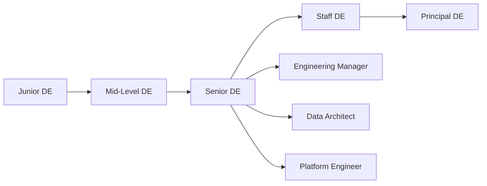

### Key Skills

1. **SQL** - Advanced queries, window functions, CTEs, query optimization
2. **Python** - Data processing, scripting, PySpark
3. **Distributed Systems** - Spark, Kafka, Flink
4. **Cloud Platforms** - AWS, GCP, Azure
5. **Data Modeling** - Dimensional modeling, normalization
6. **Orchestration** - Airflow, Dagster, Prefect
7. **Infrastructure as Code** - Terraform, CloudFormation
8. **Version Control** - Git, CI/CD pipelines

---

## 3. ETL vs ELT

### ETL (Extract, Transform, Load)

Traditional approach where data is transformed before loading into the target system.

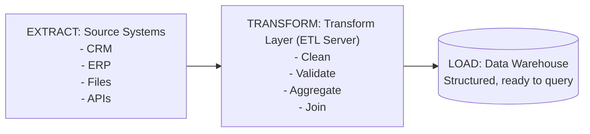

**When to use ETL:**
- Data must be cleaned before storage (compliance, PII removal)
- Limited storage capacity in target system
- Transformation logic is stable and well-understood
- Legacy systems with fixed schemas

### ELT (Extract, Load, Transform)

Modern approach where raw data is loaded first, then transformed using the target system's compute power.

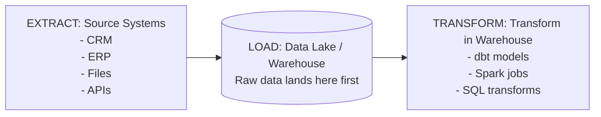

**When to use ELT:**
- Cloud data warehouses with elastic compute (Snowflake, BigQuery)
- Need to preserve raw data for future use cases
- Schema and transformation logic may evolve
- Multiple teams need different transformations of the same data

### Comparison Table

| Feature | ETL | ELT |
|---------|-----|-----|
| Transform location | Separate server | Target system |
| Storage cost | Lower (only transformed data) | Higher (raw + transformed) |
| Compute cost | ETL server cost | Warehouse compute |
| Flexibility | Lower | Higher |
| Data availability | Slower | Faster (raw available immediately) |
| Compliance | Easier (filter before load) | Harder (raw data in warehouse) |
| Scalability | Limited by ETL server | Scales with warehouse |
| Modern fit | Legacy | Cloud-native |

---

## 4. Batch vs Streaming Processing

### Batch Processing

Data is collected over a period and processed as a group.

```
Time ──────────────────────────────────────────>

│ Events accumulate │ Events accumulate │ Events accumulate │
│ ................. │ ................. │ ................. │
│                   │                   │                   │
└──── Process ──────┘──── Process ──────┘──── Process ──────┘
      Batch 1             Batch 2             Batch 3
    (e.g., hourly)      (e.g., hourly)      (e.g., hourly)
```

**Characteristics:**
- High throughput, high latency
- Easier to implement and debug
- Better for historical analysis
- Tools: Spark (batch mode), Hive, MapReduce

### Streaming Processing

Data is processed as it arrives, event by event or in micro-batches.

```
Time ──────────────────────────────────────────>

Event ─> Process ─> Output
  Event ─> Process ─> Output
    Event ─> Process ─> Output
      Event ─> Process ─> Output
        Event ─> Process ─> Output
```

**Characteristics:**
- Low latency (milliseconds to seconds)
- More complex to implement
- Better for real-time use cases
- Tools: Kafka Streams, Flink, Spark Structured Streaming

### Comparison

| Feature | Batch | Streaming |
|---------|-------|-----------|
| Latency | Minutes to hours | Milliseconds to seconds |
| Throughput | Very high | Moderate to high |
| Complexity | Lower | Higher |
| Error handling | Easier (replay whole batch) | Harder (need checkpointing) |
| Cost | Lower (can use spot instances) | Higher (always-on infra) |
| Use cases | Reports, ML training, backfills | Fraud detection, monitoring, recommendations |
| State management | Simple | Complex |

---

## 5. Lambda Architecture

The Lambda Architecture combines batch and streaming processing to balance latency, throughput, and fault tolerance.

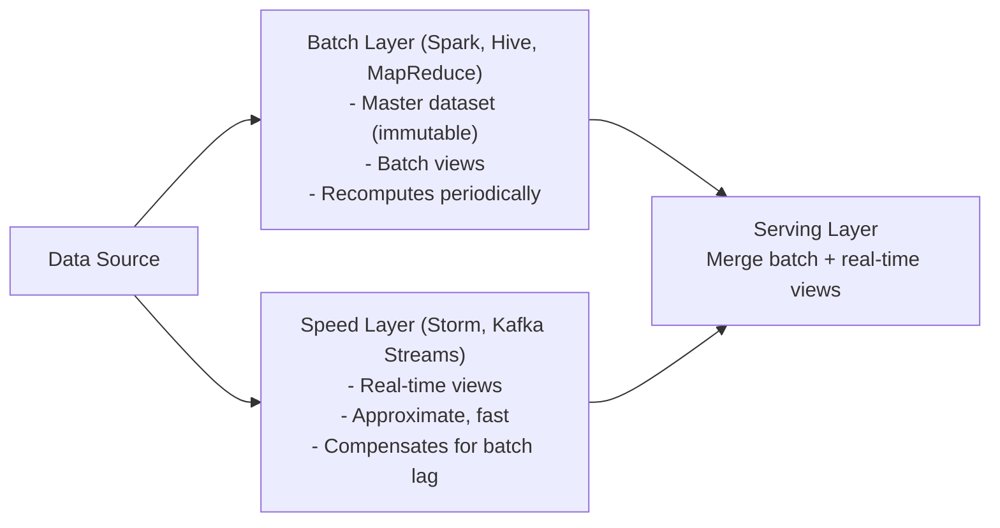

### Three Layers

1. **Batch Layer**: Stores the immutable master dataset. Periodically recomputes batch views. Provides complete and accurate results.
2. **Speed Layer**: Processes only recent data in real-time. Provides approximate views that compensate for the batch layer's latency.
3. **Serving Layer**: Merges batch views and speed layer views to serve queries. Indexes batch views for low-latency access.

### Pros and Cons

| Pros | Cons |
|------|------|
| Fault tolerant | Complex (maintain two codebases) |
| Handles both batch and real-time | Code duplication between layers |
| Reprocessing capability | Operational overhead |
| Accurate + low latency | Debugging is harder |

---

## 6. Kappa Architecture

The Kappa Architecture simplifies Lambda by using a single streaming layer for all processing.

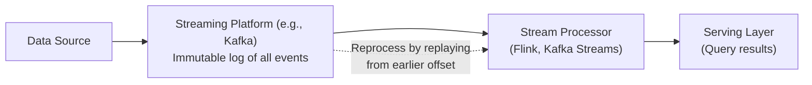

### Key Principles

1. Everything is a stream
2. Reprocessing is done by replaying the immutable log
3. Single processing pipeline for both real-time and historical
4. State is derived from the stream

### Lambda vs Kappa

| Feature | Lambda | Kappa |
|---------|--------|-------|
| Codebases | Two (batch + stream) | One (stream only) |
| Complexity | Higher | Lower |
| Reprocessing | Batch layer recomputes | Replay stream from offset |
| Accuracy | Batch layer is source of truth | Stream is source of truth |
| Use cases | Mixed batch + real-time | Primarily event-driven |
| Adoption | Declining | Growing |

---

## 7. Data Mesh

Data Mesh is a sociotechnical approach to data architecture that decentralizes data ownership to domain teams.

### Four Principles

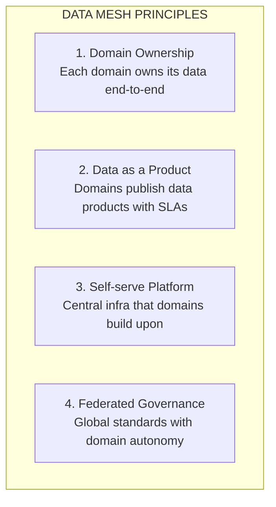

### Domain-Oriented Ownership

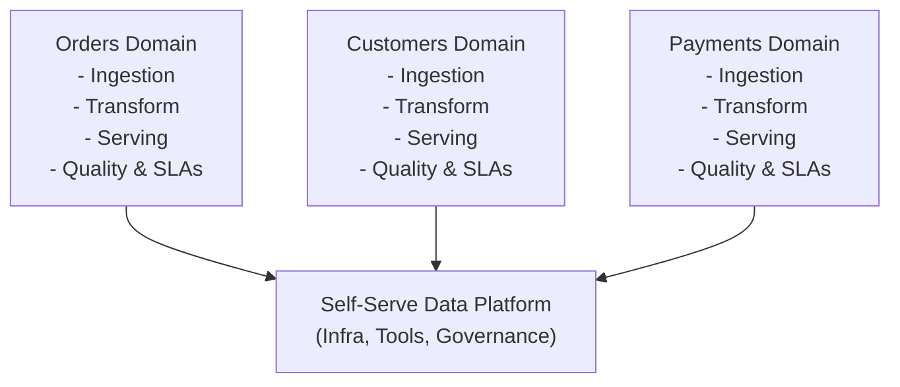

### When Data Mesh Makes Sense

- Large organizations with many domains
- Centralized data team is a bottleneck
- Domains have distinct data expertise
- Organization values autonomy

### When Data Mesh Does NOT Make Sense

- Small teams (fewer than 50 engineers)
- Simple data needs
- Limited domain expertise
- Early-stage companies

---

## 8. Medallion Architecture

The Medallion Architecture (popularized by Databricks) organizes data into three layers of increasing quality.

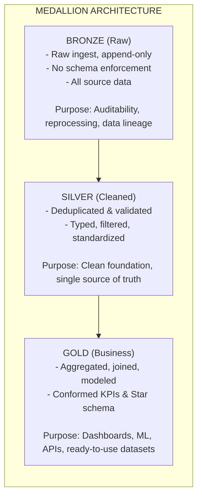

### Layer Details

#### Bronze (Raw Layer)
- Exact copy of source data
- Append-only with metadata (ingestion timestamp, source)
- Minimal or no transformations
- Supports full reprocessing

#### Silver (Cleaned Layer)
- Deduplicated and validated
- Data types enforced
- Null handling and filtering applied
- Conformed naming conventions
- Slowly changing dimensions tracked

#### Gold (Business Layer)
- Business-level aggregations
- Star schema or denormalized models
- KPI calculations
- Ready for consumption by BI tools, ML models, and APIs
- Optimized for query performance

### Implementation Example

```sql
-- Bronze: Raw ingestion
CREATE TABLE bronze.orders AS
SELECT
    *,
    current_timestamp() AS _ingested_at,
    input_file_name() AS _source_file
FROM raw_orders_landing;

-- Silver: Cleaned and validated
CREATE TABLE silver.orders AS
SELECT
    CAST(order_id AS BIGINT) AS order_id,
    CAST(customer_id AS BIGINT) AS customer_id,
    CAST(order_date AS DATE) AS order_date,
    CAST(total_amount AS DECIMAL(10,2)) AS total_amount,
    UPPER(TRIM(status)) AS status,
    _ingested_at
FROM bronze.orders
WHERE order_id IS NOT NULL
  AND total_amount > 0;

-- Gold: Business aggregation
CREATE TABLE gold.daily_revenue AS
SELECT
    order_date,
    COUNT(DISTINCT order_id) AS total_orders,
    COUNT(DISTINCT customer_id) AS unique_customers,
    SUM(total_amount) AS revenue,
    AVG(total_amount) AS avg_order_value
FROM silver.orders
WHERE status = 'COMPLETED'
GROUP BY order_date;
```

---

## 9. Data Modeling

### Star Schema

The star schema consists of a central fact table surrounded by dimension tables.

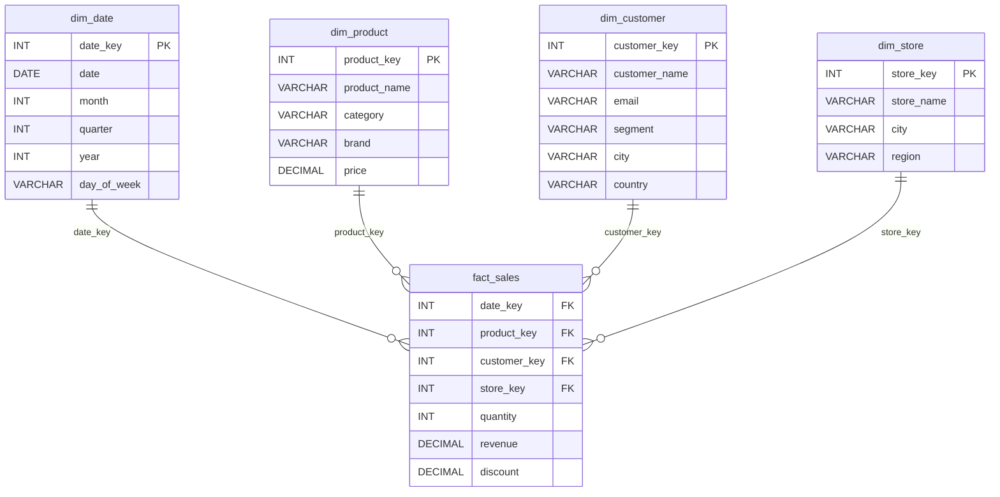

**Pros:** Simple queries, fast aggregations, easy to understand
**Cons:** Data redundancy in dimensions, denormalized

### Snowflake Schema

Normalized version of star schema where dimensions are further broken into sub-dimensions.

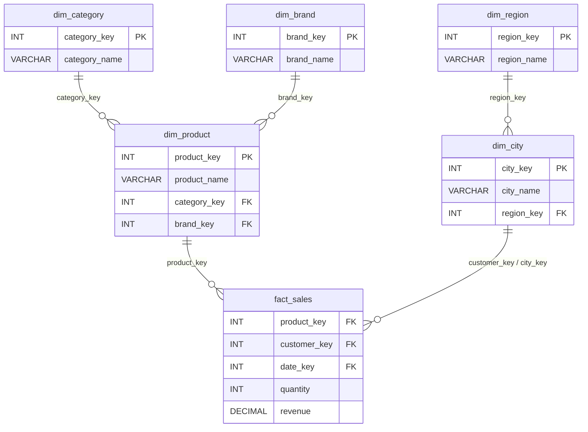

**Pros:** Less storage, normalized (no redundancy), easier to maintain
**Cons:** More complex queries (many joins), slower query performance

### Data Vault

Enterprise-scale modeling methodology designed for agility and auditability.

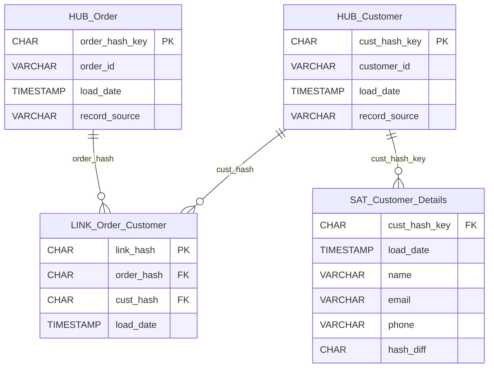

**Three building blocks:**
1. **Hubs**: Business keys (core entities)
2. **Links**: Relationships between hubs
3. **Satellites**: Descriptive attributes with history

**Pros:** Handles change well, full audit trail, parallel loading, scalable
**Cons:** Complex, many joins for queries, requires business vault for consumption

### Comparison

| Feature | Star Schema | Snowflake Schema | Data Vault |
|---------|------------|-----------------|------------|
| Normalization | Denormalized | Normalized | Specialized |
| Query complexity | Simple | Moderate | Complex |
| Query performance | Fast | Slower | Slowest (raw) |
| Storage | Higher | Lower | Moderate |
| Flexibility | Lower | Moderate | Highest |
| Audit trail | Limited | Limited | Full |
| Best for | BI / reporting | Storage-sensitive | Enterprise DW |

---

## 10. Data Quality

### Six Dimensions of Data Quality

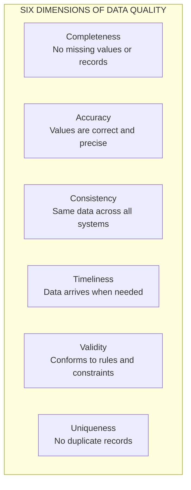

### Data Quality Checks Example

```sql
-- Completeness: Check for NULLs
SELECT
    COUNT(*) AS total_rows,
    COUNT(email) AS non_null_emails,
    ROUND(COUNT(email) * 100.0 / COUNT(*), 2) AS completeness_pct
FROM customers;

-- Uniqueness: Check for duplicates
SELECT customer_id, COUNT(*)
FROM customers
GROUP BY customer_id
HAVING COUNT(*) > 1;

-- Validity: Check format constraints
SELECT COUNT(*)
FROM customers
WHERE email NOT LIKE '%@%.%';

-- Consistency: Cross-system check
SELECT
    a.total_orders,
    b.total_orders,
    a.total_orders - b.total_orders AS discrepancy
FROM warehouse.order_summary a
JOIN source_system.order_summary b ON a.date = b.date
WHERE a.total_orders != b.total_orders;

-- Timeliness: Check freshness
SELECT
    MAX(updated_at) AS last_update,
    CURRENT_TIMESTAMP - MAX(updated_at) AS staleness
FROM orders;
```

### Data Quality Tools

| Tool | Type | Key Feature |
|------|------|-------------|
| Great Expectations | Open source | Expectation-based testing |
| dbt tests | Open source | SQL-based assertions |
| Soda | Open source + cloud | YAML-based checks |
| Monte Carlo | Commercial | Automated anomaly detection |
| Datafold | Commercial | Data diff and regression testing |

---

## 11. Data Lineage and Cataloging

### Data Lineage

Data lineage tracks the flow of data from source to destination, showing how data is transformed at each step.

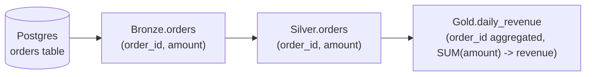

**Why lineage matters:**
- Impact analysis (what breaks if a source changes?)
- Root cause analysis (where did bad data come from?)
- Compliance (GDPR, CCPA - where does PII flow?)
- Documentation (how is this metric calculated?)

### Data Catalog

A data catalog is a centralized inventory of data assets with metadata.

**Key features:**
- Search and discovery
- Business glossary
- Data ownership
- Usage statistics
- Quality scores
- Access controls

**Popular tools:**
- **Apache Atlas** - Open source, Hadoop ecosystem
- **DataHub** (LinkedIn) - Open source, modern
- **Amundsen** (Lyft) - Open source, search-first
- **Atlan** - Commercial, collaborative
- **Alation** - Commercial, ML-powered

---

## 12. Modern Data Stack

The Modern Data Stack (MDS) is a collection of cloud-native tools that work together to handle the full data lifecycle.

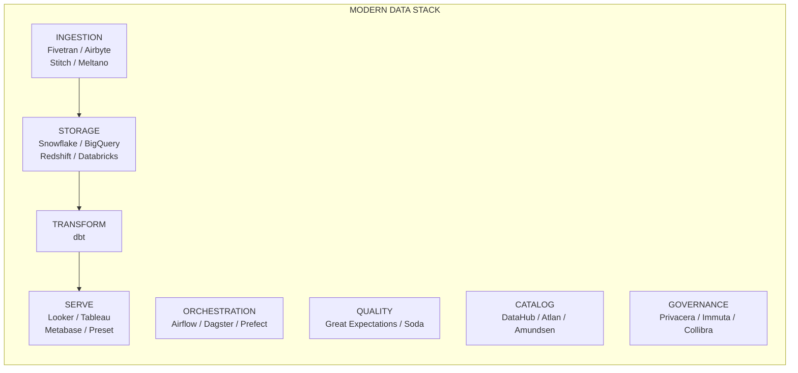

### Key Characteristics

1. **Cloud-native**: Fully managed services, no infrastructure to manage
2. **Modular**: Best-of-breed tools at each layer
3. **SQL-centric**: SQL is the primary interface for transformation
4. **ELT-first**: Load first, transform in the warehouse
5. **Version-controlled**: dbt models and configs in Git
6. **Observable**: Built-in monitoring, alerting, and lineage

---

## 13. Common Interview Questions

### Conceptual Questions

**Q: What is the difference between a data warehouse and a data lake?**
A: A data warehouse stores structured, processed data in a schema-on-write approach, optimized for BI queries. A data lake stores raw data in any format (structured, semi-structured, unstructured) using a schema-on-read approach, optimized for flexibility and scalability. Data lakehouses combine both: open file formats on object storage with warehouse-like features (ACID transactions, schema enforcement).

**Q: When would you choose batch over streaming processing?**
A: Choose batch when: latency requirements are hours or more, the use case is historical analysis or reporting, cost is a concern, and data volumes are very large but infrequent. Choose streaming when: latency must be seconds or less, the use case is real-time (fraud detection, monitoring, recommendations), and events need immediate response.

**Q: Explain the medallion architecture and when you would use it.**
A: The medallion architecture organizes data into three layers: Bronze (raw ingestion, append-only), Silver (cleaned, deduplicated, validated), and Gold (business-level aggregations and models). Use it when you need clear data quality progression, auditability, and reprocessing capability. It works especially well with lakehouse platforms like Databricks and Delta Lake.

**Q: What is data mesh and what problems does it solve?**
A: Data mesh decentralizes data ownership to domain teams. It solves the bottleneck problem of centralized data teams, enables domain expertise in data modeling, and treats data as a product with SLAs. It requires organizational maturity and is best for large organizations with distinct domains.

### Design Questions

**Q: Design a data pipeline for an e-commerce platform.**
A: Key considerations:
1. Sources: transactional DB (orders, customers), clickstream (Kafka), third-party APIs (payments, shipping)
2. Ingestion: CDC from DB via Debezium, Kafka for events, scheduled API pulls
3. Storage: Data lake (S3/GCS) with Delta Lake format, medallion architecture
4. Transform: dbt for SQL transforms, Spark for complex processing
5. Orchestration: Airflow for scheduling and monitoring
6. Serving: Snowflake/BigQuery for BI, feature store for ML
7. Quality: Great Expectations for validation, Monte Carlo for monitoring
8. Governance: Column-level encryption for PII, RBAC for access control

**Q: How would you handle late-arriving data?**
A: Strategies include:
1. Watermarks in streaming (Flink/Spark) to define acceptable lateness
2. Incremental models in dbt with merge strategy to update existing records
3. Event time vs processing time distinction in storage
4. Reprocessing windows to catch late data
5. SCD Type 2 for dimensional changes

**Q: How do you ensure idempotency in data pipelines?**
A: Techniques include:
1. Use MERGE/UPSERT instead of INSERT for loads
2. Design transformations to be deterministic (same input = same output)
3. Use natural keys or deterministic surrogate keys
4. Implement "delete and replace" patterns for batch loads
5. Track pipeline runs with metadata (run_id, timestamps)

---

## 14. Quick Reference

### Architecture Decision Guide

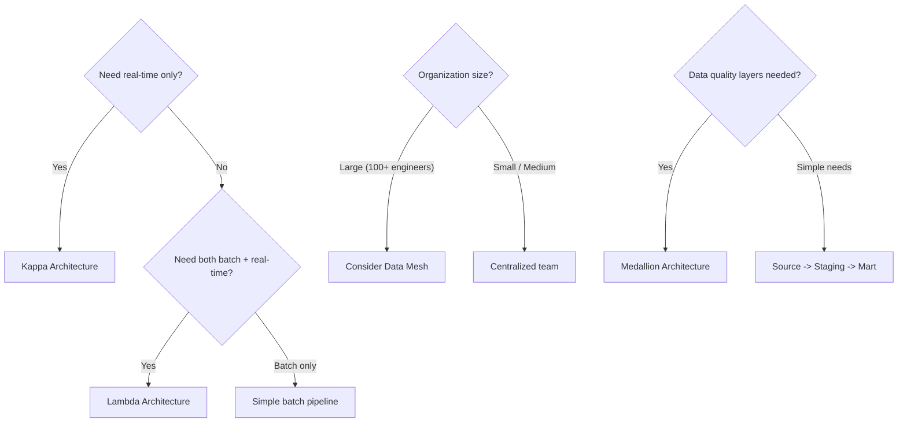

### Key Metrics to Track

| Metric | Description | Target |
|--------|-------------|--------|
| Pipeline SLA | % of pipelines completing on time | > 99% |
| Data freshness | Time since last update | Varies by use case |
| Data quality score | % of quality checks passing | > 95% |
| Pipeline failures | Number of failures per week | Trending down |
| Cost per pipeline | Cloud costs per pipeline run | Within budget |
| Time to insight | Time from event to available data | Varies |

### Essential SQL for Data Engineers

```sql
-- Window functions
SELECT
    customer_id,
    order_date,
    amount,
    SUM(amount) OVER (PARTITION BY customer_id ORDER BY order_date) AS running_total,
    ROW_NUMBER() OVER (PARTITION BY customer_id ORDER BY order_date DESC) AS recency_rank,
    LAG(amount) OVER (PARTITION BY customer_id ORDER BY order_date) AS prev_amount
FROM orders;

-- CTE with recursive
WITH RECURSIVE date_spine AS (
    SELECT DATE '2024-01-01' AS dt
    UNION ALL
    SELECT dt + INTERVAL '1 day'
    FROM date_spine
    WHERE dt < DATE '2024-12-31'
)
SELECT dt FROM date_spine;

-- MERGE / UPSERT
MERGE INTO target t
USING source s ON t.id = s.id
WHEN MATCHED THEN UPDATE SET t.value = s.value
WHEN NOT MATCHED THEN INSERT (id, value) VALUES (s.id, s.value);
```
