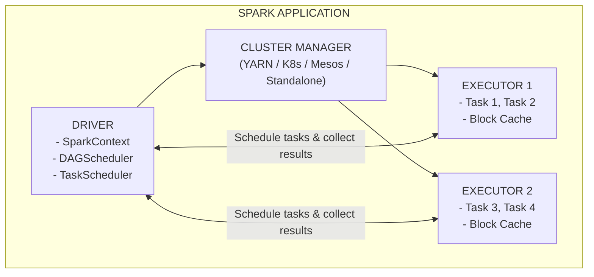
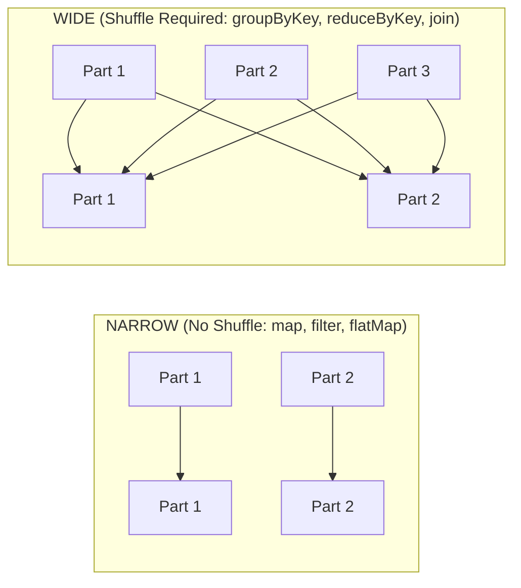
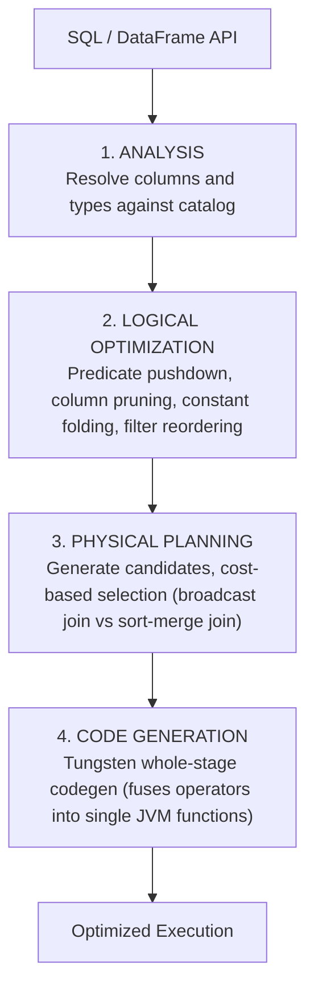
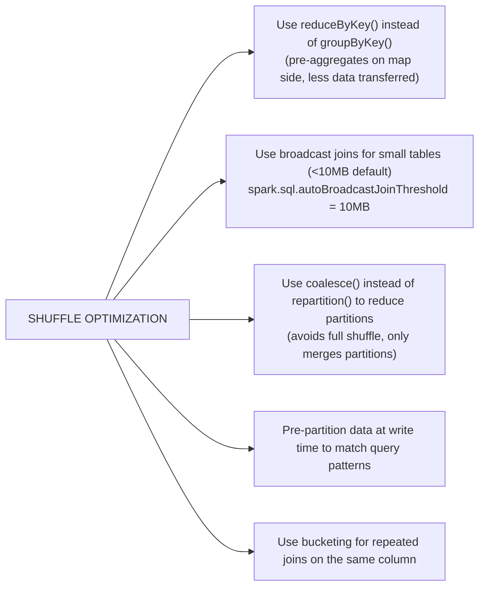
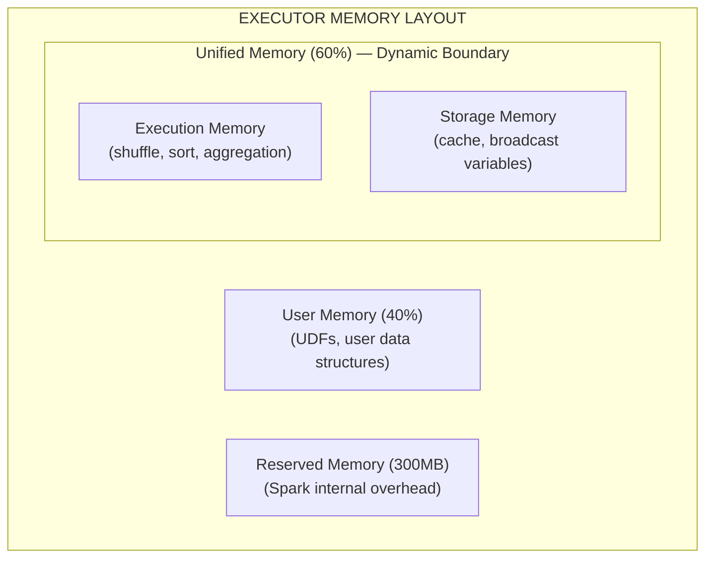

# Apache Spark

A comprehensive guide to Apache Spark, the unified analytics engine for large-scale data
processing. Covers architecture, RDDs, DataFrames, Spark SQL, Structured Streaming,
performance tuning, and PySpark -- essential knowledge for data engineering interviews.

---

## Table of Contents

1. [Overview & History](#1-overview--history)
2. [Architecture](#2-architecture)
3. [RDDs](#3-rdds)
4. [DataFrames & Datasets](#4-dataframes--datasets)
5. [Spark SQL & Catalyst Optimizer](#5-spark-sql--catalyst-optimizer)
6. [Structured Streaming](#6-structured-streaming)
7. [Partitioning & Shuffling](#7-partitioning--shuffling)
8. [Caching & Persistence](#8-caching--persistence)
9. [PySpark](#9-pyspark)
10. [Performance Tuning](#10-performance-tuning)
11. [Common Interview Questions](#11-common-interview-questions)
12. [Quick Reference](#12-quick-reference)

---

## 1. Overview & History

Apache Spark is a unified analytics engine for large-scale data processing. Originally
developed at UC Berkeley's AMPLab in 2009, open-sourced in 2010, donated to Apache in 2013.

**Key advantages over MapReduce:**
- In-memory processing (10-100x faster)
- Unified engine for batch, streaming, SQL, ML, and graph
- Rich APIs in Python, Scala, Java, R, SQL
- Lazy evaluation with DAG optimization

---

## 2. Architecture



**Driver**: Runs `main()`, creates SparkContext, builds DAG, schedules tasks.
**Executors**: Worker processes that run tasks and store cached data.
**Cluster Managers**: YARN (Hadoop integration), Kubernetes (containerized), Standalone (simple).

### Execution Flow

1. User code creates transformations (lazy)
2. An action triggers DAG construction
3. DAGScheduler splits DAG into stages at shuffle boundaries
4. TaskScheduler distributes tasks to executors
5. Executors execute tasks and return results

---

## 3. RDDs

**Resilient Distributed Datasets** -- the foundational abstraction in Spark.

### Properties
- **Immutable**: Cannot be modified after creation
- **Distributed**: Partitioned across cluster nodes
- **Resilient**: Fault-tolerant via lineage (recompute lost partitions)
- **Lazy**: Transformations are not executed until an action is called

### Transformations vs Actions

| Transformations (Lazy) | Actions (Trigger Execution) |
|------------------------|-----------------------------|
| `map()`, `flatMap()` | `collect()`, `count()` |
| `filter()`, `distinct()` | `first()`, `take(n)` |
| `groupByKey()`, `reduceByKey()` | `reduce()`, `foreach()` |
| `join()`, `union()` | `saveAsTextFile()` |
| `repartition()`, `coalesce()` | `countByKey()` |

### Narrow vs Wide Transformations



- **Narrow**: Each parent partition maps to at most one child partition (no shuffle)
- **Wide**: Each parent partition may contribute to multiple child partitions (shuffle)
- Wide transformations create **stage boundaries** in the DAG

---

## 4. DataFrames & Datasets

### Comparison

| Feature | RDD | DataFrame | Dataset |
|---------|-----|-----------|---------|
| **Type Safety** | Compile-time | Runtime | Compile-time |
| **Optimization** | None (manual) | Catalyst + Tungsten | Catalyst + Tungsten |
| **API** | Functional | SQL-like | Functional + SQL |
| **Schema** | No | Yes (named columns) | Yes (typed) |
| **Languages** | All | All | Scala/Java only |
| **Performance** | Slowest | Fast | Fast |
| **When to Use** | Low-level control | Most workloads | Type-safe Scala/Java |

### DataFrame Operations

```python
# Read data
df = spark.read.parquet("s3://bucket/data/")

# Transformations
result = (df
    .filter(col("age") > 25)
    .groupBy("department")
    .agg(
        count("*").alias("count"),
        avg("salary").alias("avg_salary")
    )
    .orderBy(desc("avg_salary"))
)

# Write data
result.write.mode("overwrite").parquet("s3://bucket/output/")
```

---

## 5. Spark SQL & Catalyst Optimizer

### Catalyst Optimization Pipeline



### Key Optimizations

- **Predicate Pushdown**: Filters pushed down to data source (e.g., Parquet column pruning)
- **Column Pruning**: Only read columns that are needed
- **Broadcast Join**: Small table broadcast to all executors (avoid shuffle)
- **Whole-Stage Codegen**: Fuse multiple operators into single function

### Adaptive Query Execution (AQE)

Enabled by default since Spark 3.2. Uses **runtime statistics** to optimize:

1. **Dynamic Join Strategy**: Switches sort-merge to broadcast join at runtime
2. **Dynamic Partition Coalescing**: Combines small post-shuffle partitions
3. **Skew Join Optimization**: Splits skewed partitions into smaller tasks

AQE can yield up to **8x speedup** on TPC-DS benchmarks.

---

## 6. Structured Streaming

### Processing Models

| Model | Latency | Guarantee | Use Case |
|-------|---------|-----------|----------|
| **Micro-batch** (default) | ~100ms | Exactly-once | Most streaming workloads |
| **Continuous** (experimental) | ~1ms | At-least-once | Ultra-low latency |

### Core Concepts

```python
# Read from Kafka
stream_df = (spark.readStream
    .format("kafka")
    .option("kafka.bootstrap.servers", "localhost:9092")
    .option("subscribe", "events")
    .load()
)

# Transform
processed = (stream_df
    .selectExpr("CAST(value AS STRING)")
    .withWatermark("timestamp", "10 minutes")
    .groupBy(window("timestamp", "5 minutes"))
    .count()
)

# Write to console
query = (processed.writeStream
    .outputMode("update")
    .format("console")
    .trigger(processingTime="1 minute")
    .start()
)
```

### Output Modes

| Mode | Description | Use Case |
|------|-------------|----------|
| **Append** | Only new rows written | No aggregations, or with watermark |
| **Complete** | Entire result table | Aggregations on bounded data |
| **Update** | Only changed rows | Aggregations, most flexible |

### Watermarks

Handle late data by defining how long to wait:

```python
df.withWatermark("event_time", "10 minutes")
```

Data arriving more than 10 minutes late will be dropped.

---

## 7. Partitioning & Shuffling

### What Causes Shuffles

- `groupByKey()`, `reduceByKey()`
- `join()` (unless broadcast)
- `repartition()`
- `distinct()`
- `sort()` / `orderBy()`

### Optimization Strategies



### Partition Count Guidelines

- Default: `spark.sql.shuffle.partitions = 200`
- Rule of thumb: 2-4x number of cores in cluster
- Each partition should be **128MB-200MB** for optimal performance
- Too few partitions → OOM, poor parallelism
- Too many partitions → task scheduling overhead, small file problem

---

## 8. Caching & Persistence

### Storage Levels

| Level | Space | CPU | In Memory | On Disk | Serialized |
|-------|-------|-----|-----------|---------|------------|
| `MEMORY_ONLY` | High | Low | Yes | No | No |
| `MEMORY_ONLY_SER` | Low | High | Yes | No | Yes |
| `MEMORY_AND_DISK` | High | Medium | Partial | Partial | No |
| `MEMORY_AND_DISK_SER` | Low | High | Partial | Partial | Yes |
| `DISK_ONLY` | Low | High | No | Yes | Yes |

### When to Cache

- DataFrame used **multiple times** in the same job
- After **expensive transformations** (joins, aggregations)
- **Do NOT cache** if used only once or data fits in memory easily

### Broadcast Variables

```python
# Small lookup table broadcast to all executors
lookup = spark.sparkContext.broadcast({"US": "United States", "UK": "United Kingdom"})

# Use in UDF or map
df.withColumn("country_name", udf(lambda code: lookup.value.get(code, "Unknown"))("country_code"))
```

### Accumulators

```python
error_count = spark.sparkContext.accumulator(0)

def process_row(row):
    if row["status"] == "error":
        error_count.add(1)

df.foreach(process_row)
print(f"Errors: {error_count.value}")
```

---

## 9. PySpark

### UDF Performance Hierarchy (Fastest to Slowest)

| UDF Type | Speed | Why |
|----------|-------|-----|
| **Native Spark SQL** | Fastest | Runs in JVM, Catalyst-optimized |
| **Pandas UDF (vectorized)** | 10-100x faster than pickled | Arrow-based columnar transfer |
| **Arrow-optimized UDF** | ~1.6x faster than pickled | Spark 3.5+, avoids pickle |
| **Traditional Python UDF** | Slowest | Pickle serialization, row-by-row |

### Pandas UDF Example

```python
from pyspark.sql.functions import pandas_udf
import pandas as pd

@pandas_udf("double")
def normalize(series: pd.Series) -> pd.Series:
    return (series - series.mean()) / series.std()

df.withColumn("normalized_value", normalize("value"))
```

### Enable Arrow

```python
spark.conf.set("spark.sql.execution.arrow.pyspark.enabled", "true")
```

---

## 10. Performance Tuning

### Key Configuration

| Config | Default | Recommendation |
|--------|---------|----------------|
| `spark.sql.shuffle.partitions` | 200 | 2-4x cores, 128-200MB per partition |
| `spark.sql.autoBroadcastJoinThreshold` | 10MB | Increase for larger lookup tables |
| `spark.sql.adaptive.enabled` | true | Keep enabled (AQE) |
| `spark.serializer` | Java | Use `org.apache.spark.serializer.KryoSerializer` |
| `spark.memory.fraction` | 0.6 | Tune for cache-heavy workloads |
| `spark.default.parallelism` | Total cores | Set explicitly |

### Data Skew Solutions

1. **Salting**: Add random prefix to skewed keys, aggregate, then remove prefix
2. **AQE Skew Join**: Automatic in Spark 3.2+ with AQE enabled
3. **Broadcast join**: If one side is small enough
4. **Custom partitioner**: Control data distribution

### Memory Management



Execution and storage share memory dynamically. When one needs more, it borrows from the other.

---

## 11. Common Interview Questions

**Q: What is the difference between narrow and wide transformations?**
Narrow: each parent partition maps to at most one child (map, filter). Wide: parent partition maps to multiple children, requiring shuffle (groupBy, join).

**Q: Why are DataFrames preferred over RDDs?**
DataFrames benefit from Catalyst optimization and Tungsten code generation, resulting in significantly better performance. They also provide a higher-level API.

**Q: What causes a shuffle and how do you minimize it?**
Shuffles happen during wide transformations (groupBy, join, repartition). Minimize with: broadcast joins, reduceByKey over groupByKey, pre-partitioning, bucketing.

**Q: Explain AQE and its benefits.**
Adaptive Query Execution uses runtime statistics to optimize: dynamic join switching, partition coalescing, and skew join optimization. Up to 8x speedup.

**Q: How does Spark handle fault tolerance?**
Through RDD lineage -- if a partition is lost, Spark recomputes it from the lineage graph (DAG). For streaming, checkpointing saves state to reliable storage.

**Q: What is the difference between cache() and persist()?**
`cache()` = `persist(MEMORY_ONLY)`. `persist()` allows specifying storage levels (MEMORY_AND_DISK, DISK_ONLY, etc.).

**Q: How do you handle data skew in Spark?**
Salting (add random prefix to skewed keys), AQE skew join (automatic), broadcast join, custom partitioning.

**Q: Explain watermarks in Structured Streaming.**
Watermarks define how long to wait for late data. Events arriving after the watermark threshold are dropped. This allows Spark to bound state growth in stateful aggregations.

---

## 12. Quick Reference

### Essential Spark Submit

```bash
spark-submit \
  --master yarn \
  --deploy-mode cluster \
  --num-executors 10 \
  --executor-memory 8g \
  --executor-cores 4 \
  --conf spark.sql.shuffle.partitions=400 \
  --conf spark.sql.adaptive.enabled=true \
  app.py
```

### Key APIs

```python
# Read
df = spark.read.format("parquet").load("path")
df = spark.read.format("kafka").option("subscribe", "topic").load()

# Transform
df.select().filter().groupBy().agg()

# Write
df.write.mode("overwrite").partitionBy("date").parquet("path")

# Streaming
df = spark.readStream.format("kafka").load()
query = df.writeStream.format("parquet").start()
```
