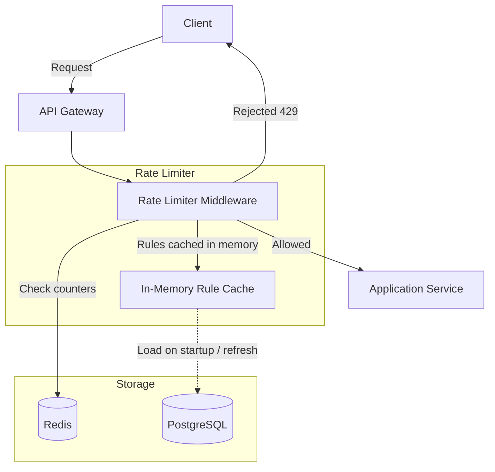
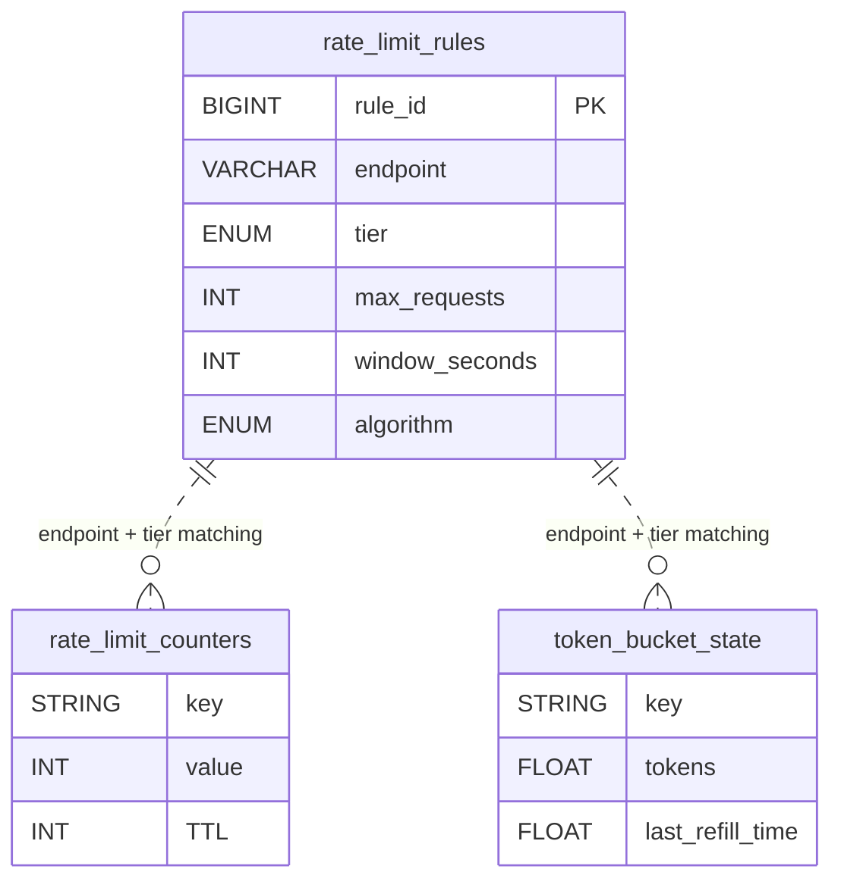
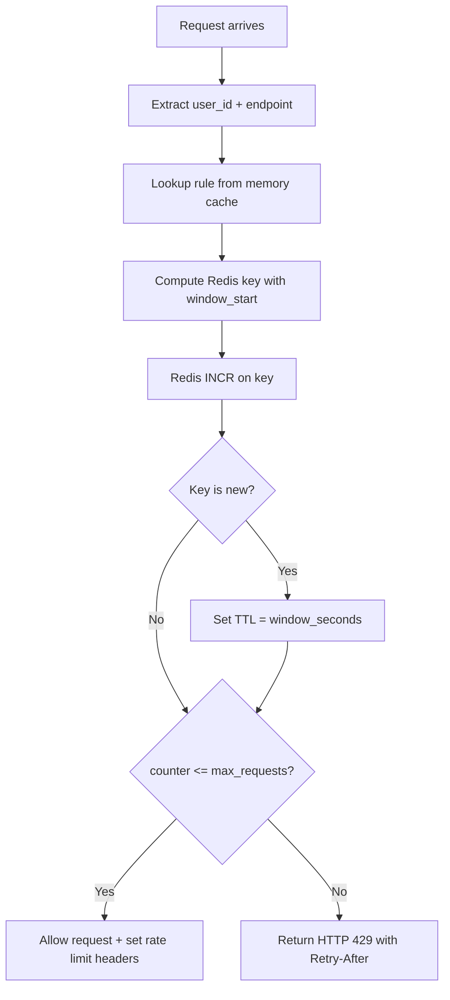
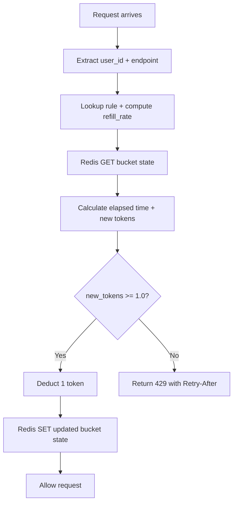

# Data Model: Rate Limiter

A rate limiter controls how many requests a user can make within a time window. The data model spans two storage systems: a relational database for rule configuration and Redis for real-time counter tracking. Redis is essential because rate limiting must be evaluated on every single request with sub-millisecond latency.

## High-Level Architecture

## Table Responsibilities

| Table/Structure         | Purpose                             | Storage    | Key Characteristic                         |
| ----------------------- | ----------------------------------- | ---------- | ------------------------------------------ |
| **rate_limit_rules**    | Define limits per endpoint and tier | PostgreSQL | Read on startup, cached in memory          |
| **rate_limit_counters** | Track request counts per window     | Redis      | High-frequency reads/writes, auto-expiring |
| **token_bucket_state**  | Track token bucket algorithm state  | Redis      | Atomic operations for token math           |

## Detailed Field Descriptions

### rate_limit_rules (PostgreSQL)

| Field          | Type                                                 | Description                                                                                            |
| -------------- | ---------------------------------------------------- | ------------------------------------------------------------------------------------------------------ |
| rule_id        | BIGINT, PK                                           | Unique rule identifier.                                                                                |
| endpoint       | VARCHAR(255)                                         | API path pattern (e.g., `/api/v1/shorten`). Supports wildcards like `/api/*` for broad rules.          |
| tier           | ENUM('free','pro','enterprise')                      | User tier this rule applies to. Combined with endpoint to form the lookup key.                         |
| max_requests   | INT                                                  | Maximum allowed requests within the window. E.g., 100 requests.                                        |
| window_seconds | INT                                                  | Length of the time window. E.g., 60 for "100 requests per minute."                                     |
| algorithm      | ENUM('fixed_window','sliding_window','token_bucket') | Which algorithm to apply. Different endpoints may need different algorithms based on traffic patterns. |

**Why store algorithm per rule?** Login endpoints may use fixed windows (simple, strict), while API endpoints use token buckets (smoother, allows bursts). One size does not fit all.

### rate_limit_counters (Redis)

| Field | Type          | Description                                                                                                                    |
| ----- | ------------- | ------------------------------------------------------------------------------------------------------------------------------ |
| key   | STRING        | Pattern: `rate:{user_id}:{endpoint}:{window_start}`. The window_start timestamp ensures each time window gets its own counter. |
| value | INT           | Number of requests made in this window. Incremented atomically via INCR.                                                       |
| TTL   | INT (seconds) | Set to `window_seconds` on first INCR. Auto-deletes when the window expires, preventing unbounded memory growth.               |

**Why include `window_start` in the key?** For fixed-window limiting, each window needs a separate counter. The window_start (e.g., timestamp floored to the minute) naturally partitions counters by time.

**Sliding Window Variant:** For sliding window, use a Redis Sorted Set instead:

- Key: `rate:{user_id}:{endpoint}`
- Members: request timestamps (or UUIDs)
- Score: timestamp
- Count requests by ZRANGEBYSCORE over `[now - window, now]`
- ZREMRANGEBYSCORE to prune old entries

### token_bucket_state (Redis)

| Field            | Type                     | Description                                                                                                            |
| ---------------- | ------------------------ | ---------------------------------------------------------------------------------------------------------------------- |
| key              | STRING                   | Pattern: `bucket:{user_id}:{endpoint}`. One bucket per user-endpoint combination.                                      |
| tokens           | FLOAT (stored as string) | Current number of available tokens. Decremented on each request. Can be fractional due to refill math.                 |
| last_refill_time | FLOAT (epoch seconds)    | Timestamp of last token refill. Used to calculate how many tokens to add: `elapsed * (max_requests / window_seconds)`. |

**Why FLOAT for tokens?** The refill rate is often fractional (e.g., 1.67 tokens/sec for 100/min). Storing as float avoids rounding errors that would accumulate over time.

## ER Diagram

> **Note:** Redis structures are not relational tables. They are key-value pairs with no FK relationships. The connection to rate_limit_rules is logical (via endpoint + tier matching), not enforced by constraints.

## Data Flow

### Fixed Window Algorithm

### Token Bucket Algorithm

**Why token bucket over fixed window?** Fixed window has a boundary problem: a user could make 100 requests at 11:59:59 and 100 more at 12:00:01, effectively doubling their rate. Token bucket smooths this by tracking a continuous refill rate.

**Why Redis for counters?** Rate limiting runs on every request. Even a 5ms database query would be unacceptable at scale. Redis INCR is atomic and completes in <1ms. The TTL auto-expires old windows, so no cleanup job is needed.

**Why cache rules in memory?** Rules change infrequently (maybe a few times per day). Loading them from PostgreSQL on every request would be wasteful. The service loads rules on startup and refreshes periodically or via pub/sub notifications.
