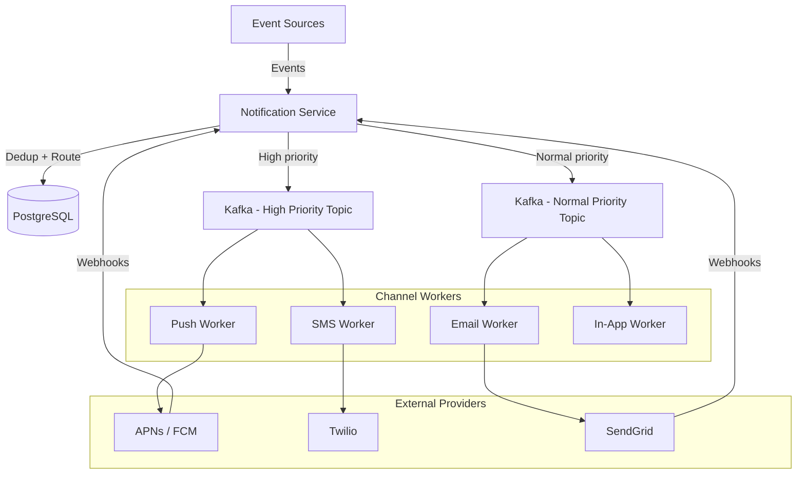
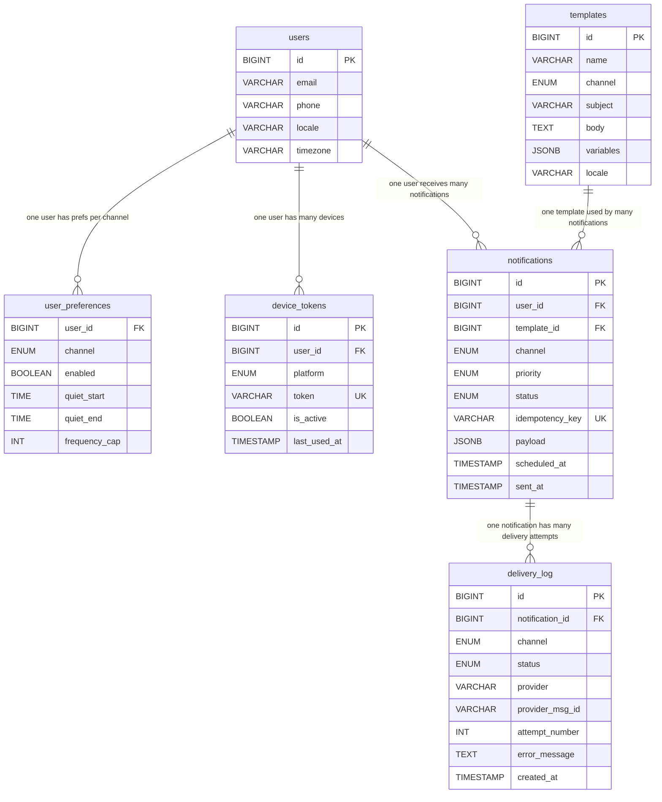
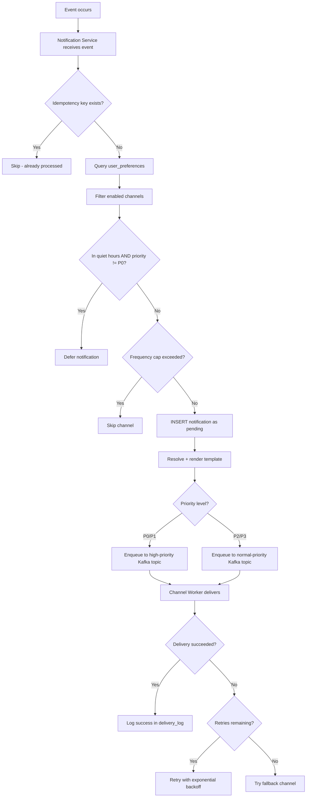

# Data Model: Notification System

A notification system delivers messages across multiple channels (push, SMS, email, in-app) while respecting user preferences, quiet hours, and rate limits. The data model must support reliable delivery with exactly-once semantics, multi-channel routing, and detailed delivery tracking for debugging and analytics.

## High-Level Architecture

## Table Responsibilities

| Table                | Purpose                                | Storage    | Key Characteristic                  |
| -------------------- | -------------------------------------- | ---------- | ----------------------------------- |
| **users**            | Core user info with locale/timezone    | PostgreSQL | Joined on every notification send   |
| **user_preferences** | Per-channel opt-in/out and quiet hours | PostgreSQL | Checked before every send           |
| **device_tokens**    | Push notification device registrations | PostgreSQL | Multiple devices per user           |
| **notifications**    | Central notification record            | PostgreSQL | Idempotency key prevents duplicates |
| **delivery_log**     | Per-attempt delivery tracking          | PostgreSQL | Append-only audit trail             |
| **templates**        | Channel-specific message templates     | PostgreSQL | Versioned, multi-locale             |

## Detailed Field Descriptions

### users (PostgreSQL)

| Field    | Type         | Description                                                                                                         |
| -------- | ------------ | ------------------------------------------------------------------------------------------------------------------- |
| id       | BIGINT, PK   | User identifier.                                                                                                    |
| email    | VARCHAR(255) | Email address for email channel delivery.                                                                           |
| phone    | VARCHAR(20)  | Phone number for SMS channel delivery. Must include country code.                                                   |
| locale   | VARCHAR(10)  | User's language preference (e.g., `en-US`, `zh-CN`). Determines which template locale to use.                       |
| timezone | VARCHAR(50)  | IANA timezone (e.g., `America/New_York`). Critical for quiet hours calculation — must convert to user's local time. |

**Why store timezone?** Quiet hours are defined in the user's local time. A notification at 2am PST is 10am GMT. Without the user's timezone, we cannot enforce quiet hours correctly.

### user_preferences (PostgreSQL)

| Field         | Type                                | Description                                                                                    |
| ------------- | ----------------------------------- | ---------------------------------------------------------------------------------------------- |
| user_id       | BIGINT, FK → users.id               | Which user this preference belongs to.                                                         |
| channel       | ENUM('push','sms','email','in_app') | Which notification channel this row configures. One row per channel per user.                  |
| enabled       | BOOLEAN, DEFAULT true               | Master on/off switch for this channel. Respects user opt-out.                                  |
| quiet_start   | TIME, NULLABLE                      | Start of quiet hours (e.g., 22:00). No notifications during quiet hours unless priority is P0. |
| quiet_end     | TIME, NULLABLE                      | End of quiet hours (e.g., 08:00). Can span midnight (22:00–08:00).                             |
| frequency_cap | INT, NULLABLE                       | Max notifications per hour on this channel. Prevents notification fatigue. Null means no cap.  |

**Why per-channel preferences?** Users often want email for weekly digests but not for every like. They may want push for messages but not for marketing. Per-channel control reduces unsubscribes.

### device_tokens (PostgreSQL)

| Field        | Type                         | Description                                                                                                              |
| ------------ | ---------------------------- | ------------------------------------------------------------------------------------------------------------------------ |
| id           | BIGINT, PK                   | Unique token record identifier.                                                                                          |
| user_id      | BIGINT, FK → users.id, INDEX | Which user owns this device. One user may have multiple devices (phone + tablet + web).                                  |
| platform     | ENUM('iOS','Android','Web')  | Determines which push provider to use: APNs for iOS, FCM for Android, Web Push for browsers.                             |
| token        | VARCHAR(500), UNIQUE         | Device-specific push token from the OS. Changes when the user reinstalls the app. UNIQUE constraint prevents duplicates. |
| is_active    | BOOLEAN, DEFAULT true        | Set to false when APNs/FCM reports the token as invalid. Avoids repeatedly sending to dead tokens.                       |
| last_used_at | TIMESTAMP                    | Last time this token successfully received a push. Used to prune stale tokens (e.g., tokens unused for 90 days).         |

**Why track `is_active`?** Push providers (APNs, FCM) report invalid tokens. Without tracking this, we would waste resources sending to millions of expired tokens, slowing down delivery and increasing provider costs.

### notifications (PostgreSQL)

| Field           | Type                                                             | Description                                                                                                                                                                  |
| --------------- | ---------------------------------------------------------------- | ---------------------------------------------------------------------------------------------------------------------------------------------------------------------------- |
| id              | BIGINT, PK                                                       | Unique notification identifier.                                                                                                                                              |
| user_id         | BIGINT, FK → users.id, INDEX                                     | Target recipient.                                                                                                                                                            |
| template_id     | BIGINT, FK → templates.id                                        | Which template to render. Separating content from delivery logic allows non-engineers to update notification text.                                                           |
| channel         | ENUM('push','sms','email','in_app')                              | Delivery channel. A single event may create multiple notification records (one per channel).                                                                                 |
| priority        | ENUM('P0','P1','P2','P3')                                        | P0: security alerts (bypass quiet hours). P1: transactional (order confirmation). P2: social (someone liked your post). P3: marketing (weekly digest).                       |
| status          | ENUM('pending','queued','sent','delivered','failed','cancelled') | Current lifecycle state. Updated as the notification progresses through the pipeline.                                                                                        |
| idempotency_key | VARCHAR(255), UNIQUE                                             | Caller-provided dedup key (e.g., `like:{post_id}:{user_id}`). UNIQUE constraint ensures the same event does not create duplicate notifications even if the producer retries. |
| payload         | JSONB                                                            | Template variables (e.g., `{"actor": "Alice", "post_title": "My Trip"}`). Stored for debugging and replay.                                                                   |
| scheduled_at    | TIMESTAMP, NULLABLE                                              | Future send time. Null means send immediately. Used for digest emails or timezone-aware scheduling.                                                                          |
| sent_at         | TIMESTAMP, NULLABLE                                              | When the notification was actually dispatched to the provider. Null if not yet sent.                                                                                         |

**Why `idempotency_key`?** In distributed systems, producers may retry on timeout. Without an idempotency key, a retry could send the same notification twice. The UNIQUE constraint ensures exactly-once creation.

### delivery_log (PostgreSQL)

| Field           | Type                                                           | Description                                                                                                                           |
| --------------- | -------------------------------------------------------------- | ------------------------------------------------------------------------------------------------------------------------------------- |
| id              | BIGINT, PK                                                     | Log entry identifier.                                                                                                                 |
| notification_id | BIGINT, FK → notifications.id, INDEX                           | Which notification this attempt is for.                                                                                               |
| channel         | ENUM('push','sms','email','in_app')                            | Channel used for this attempt. Redundant with notifications.channel but useful for querying without joining.                          |
| status          | ENUM('sent','delivered','opened','clicked','bounced','failed') | Outcome of this attempt. More granular than notifications.status. "opened" and "clicked" come from tracking pixels and link wrapping. |
| provider        | VARCHAR(50)                                                    | Which provider handled delivery (e.g., APNs, FCM, Twilio, SendGrid). Useful for debugging provider-specific issues.                   |
| provider_msg_id | VARCHAR(255)                                                   | Provider's message ID for cross-referencing with their dashboard/logs.                                                                |
| attempt_number  | INT                                                            | Which retry attempt this is (1, 2, 3...). Used to detect persistent failures and trigger fallback channels.                           |
| error_message   | TEXT, NULLABLE                                                 | Provider error details on failure (e.g., "InvalidRegistration"). Null on success.                                                     |
| created_at      | TIMESTAMP                                                      | When this attempt occurred.                                                                                                           |

**Why a separate delivery_log?** A notification may require multiple attempts (retries on failure, fallback to another channel). Storing each attempt as a separate log entry creates a complete audit trail. The notification table tracks the final state; the delivery_log tracks the journey.

### templates (PostgreSQL)

| Field     | Type                                | Description                                                                                                                                  |
| --------- | ----------------------------------- | -------------------------------------------------------------------------------------------------------------------------------------------- |
| id        | BIGINT, PK                          | Template identifier.                                                                                                                         |
| name      | VARCHAR(100)                        | Human-readable template name (e.g., `order_confirmation`).                                                                                   |
| channel   | ENUM('push','sms','email','in_app') | Which channel this template is for. The same logical notification may have different templates per channel (short for push, long for email). |
| subject   | VARCHAR(255), NULLABLE              | Email subject line or push title. Null for SMS (no subject). Supports variable interpolation: `"{{actor}} liked your post"`.                 |
| body      | TEXT                                | Template body with variable placeholders. Push: short text. Email: full HTML. SMS: 160 chars.                                                |
| variables | JSONB                               | Schema of expected variables (e.g., `{"actor": "string", "post_title": "string"}`). Used for validation before rendering.                    |
| locale    | VARCHAR(10), DEFAULT 'en'           | Language of this template. Multiple rows for the same name + channel but different locales.                                                  |

## ER Diagram

## Data Flow

### Sending a Notification

**Why priority-based queues?** A security alert (P0: "Someone logged in from a new device") must not wait behind 100K marketing emails (P3). Separate Kafka topics with dedicated consumer groups ensure high-priority notifications are processed within seconds.

**Why fallback channels?** If push fails (token expired), the system can fall back to SMS or email. The delivery_log tracks each attempt, so the system knows which channels have been tried and avoids duplicating across channels.

**Why defer during quiet hours instead of dropping?** Dropping means the user never sees the notification. Deferring queues it for delivery when quiet hours end, ensuring nothing is lost while respecting the user's preferences.
