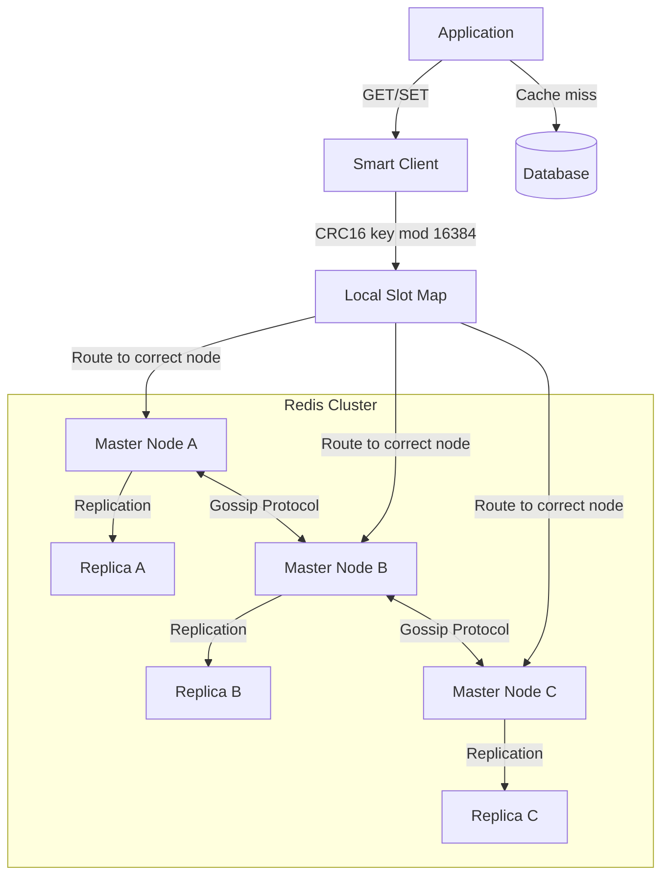
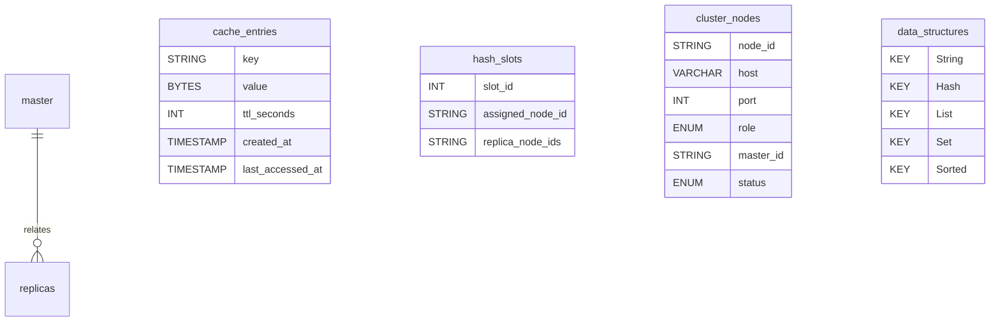
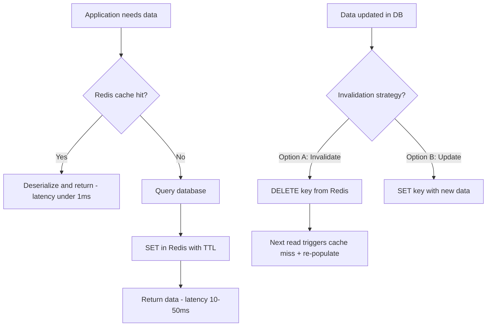
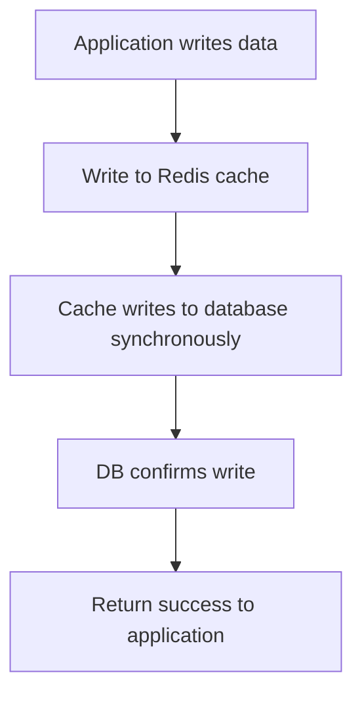
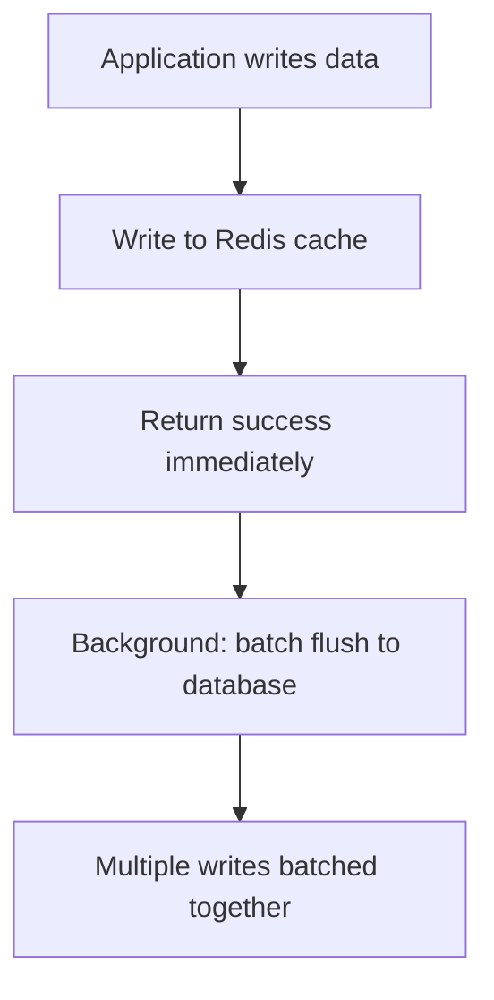
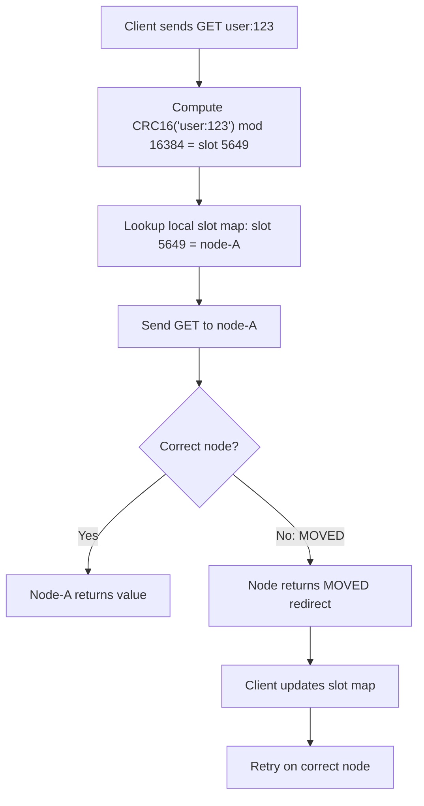

# Data Model: Distributed Cache (Redis)

A distributed cache sits between the application and database to reduce latency and database load. The data model covers both the cached data structures and the cluster management metadata needed to shard data across nodes. Redis uses hash slots (0-16383) to deterministically map keys to nodes, enabling horizontal scaling without a central coordinator.

## High-Level Architecture

## Table Responsibilities

| Structure           | Purpose                                                  | Storage                | Key Characteristic                               |
| ------------------- | -------------------------------------------------------- | ---------------------- | ------------------------------------------------ |
| **cache_entries**   | Application data (key-value pairs)                       | Redis (in-memory)      | Sub-millisecond access, TTL-based eviction       |
| **hash_slots**      | Key-to-node mapping (sharding)                           | Redis Cluster metadata | 16384 slots distributed across masters           |
| **cluster_nodes**   | Cluster topology and health                              | Redis Cluster metadata | Gossip protocol keeps nodes in sync              |
| **data_structures** | Redis native types (String, Hash, List, Set, Sorted Set) | Redis (in-memory)      | Each type optimized for specific access patterns |

## Detailed Field Descriptions

### cache_entries

| Field            | Type                    | Description                                                                                                                                                                            |
| ---------------- | ----------------------- | -------------------------------------------------------------------------------------------------------------------------------------------------------------------------------------- |
| key              | STRING                  | Cache key (e.g., `user:12345`, `session:abc`). Naming convention uses colons as namespace separators. The key is hashed (CRC16) to determine which of the 16384 hash slots it maps to. |
| value            | BYTES                   | Serialized data (JSON, MessagePack, Protobuf). Redis stores values as byte strings. The application handles serialization/deserialization.                                             |
| ttl_seconds      | INT                     | Time-to-live. After TTL expires, Redis lazily deletes the key on next access or actively prunes it via periodic sampling. Critical for cache freshness.                                |
| created_at       | TIMESTAMP (app-managed) | Not native to Redis. Applications embed this in the value or use a separate metadata hash. Used for debugging stale data.                                                              |
| last_accessed_at | TIMESTAMP (app-managed) | Used by LRU/LFU eviction policies. Redis tracks access patterns internally for its eviction algorithm.                                                                                 |

**Why TTL over manual invalidation?** TTL provides a safety net: even if the application forgets to invalidate after a database update, the stale data expires automatically. This is defense-in-depth against stale cache issues.

### hash_slots

| Field            | Type          | Description                                                                                                                                |
| ---------------- | ------------- | ------------------------------------------------------------------------------------------------------------------------------------------ |
| slot_id          | INT (0–16383) | One of 16384 hash slots. Each key maps to exactly one slot via `CRC16(key) % 16384`. This fixed number allows pre-computed routing tables. |
| assigned_node_id | STRING        | The master node responsible for this slot. Clients cache slot-to-node mappings for direct routing (no proxy needed).                       |
| replica_node_ids | STRING[]      | Replica nodes that hold copies of this slot's data. Used for failover: if the master goes down, a replica is promoted.                     |

**Why 16384 slots?** It balances granularity vs. overhead. Fewer slots (e.g., 100) would cause uneven distribution when adding nodes. More slots (e.g., 1M) would increase the gossip protocol's metadata size. 16384 fits in a compact bitmap for gossip messages.

### cluster_nodes

| Field     | Type                                  | Description                                                                                                                   |
| --------- | ------------------------------------- | ----------------------------------------------------------------------------------------------------------------------------- |
| node_id   | STRING                                | 40-character hex string, globally unique. Generated on node creation, persists across restarts.                               |
| host      | VARCHAR                               | IP address or hostname of the node.                                                                                           |
| port      | INT                                   | Redis port (default 6379). Cluster bus uses port + 10000 (16379) for node-to-node gossip.                                     |
| role      | ENUM('master','replica')              | Masters handle reads and writes for their slots. Replicas replicate from a master and serve reads (if configured).            |
| master_id | STRING, NULLABLE                      | If this node is a replica, which master it replicates. Null for masters.                                                      |
| status    | ENUM('ok','fail','pfail','handshake') | Current health status. `pfail` = possibly failed (suspected by one node). `fail` = confirmed by majority (triggers failover). |

### data_structures

Redis supports five core data structures, each optimized for different access patterns:

| Structure      | Key → Value               | Best For                       | Example Use Case                                |
| -------------- | ------------------------- | ------------------------------ | ----------------------------------------------- |
| **String**     | key → single value        | Simple caching, counters       | `user:123:name → "Alice"`, `page:views → 50482` |
| **Hash**       | key → {field: value, ...} | Object caching                 | `user:123 → {name: "Alice", email: "a@b.com"}`  |
| **List**       | key → [val1, val2, ...]   | Queues, recent items           | `recent:posts → [post_id_1, post_id_2, ...]`    |
| **Set**        | key → {val1, val2, ...}   | Unique collections, membership | `post:123:likers → {user_1, user_2}`            |
| **Sorted Set** | key → {val: score, ...}   | Rankings, time-series          | `leaderboard → {alice: 950, bob: 820}`          |

**Why multiple data structures instead of just strings?** Each structure supports atomic operations tailored to its use case. A Sorted Set's ZINCRBY atomically updates a leaderboard score. Doing this with strings would require GET, deserialize, modify, serialize, SET — a non-atomic read-modify-write prone to race conditions.

## ER Diagram

## Data Flow

### Cache-Aside (Most Common Pattern)

**Why invalidate (delete) instead of update?** In concurrent systems, a stale read can overwrite a newer cache value. Invalidation is safer: the next reader fetches fresh data from the database. The brief cache miss is an acceptable tradeoff for consistency.

### Write-Through

### Write-Behind (Write-Back)

### Cluster Key Routing

**Why client-side routing?** A proxy-based approach adds a network hop on every request. Client-side routing (smart clients) sends requests directly to the correct node, halving latency. The slot map is cached locally and updated only on MOVED redirections or periodic refresh.
