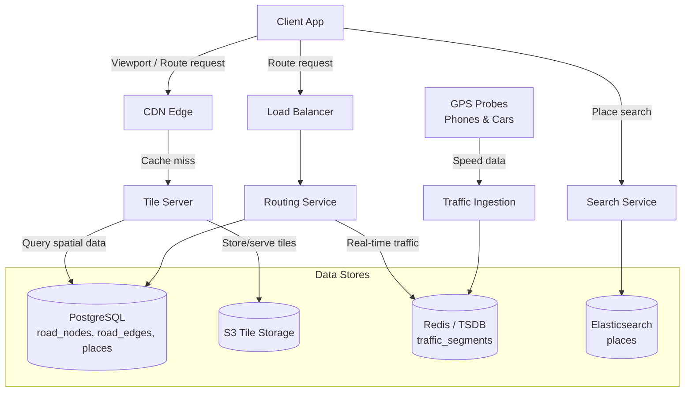
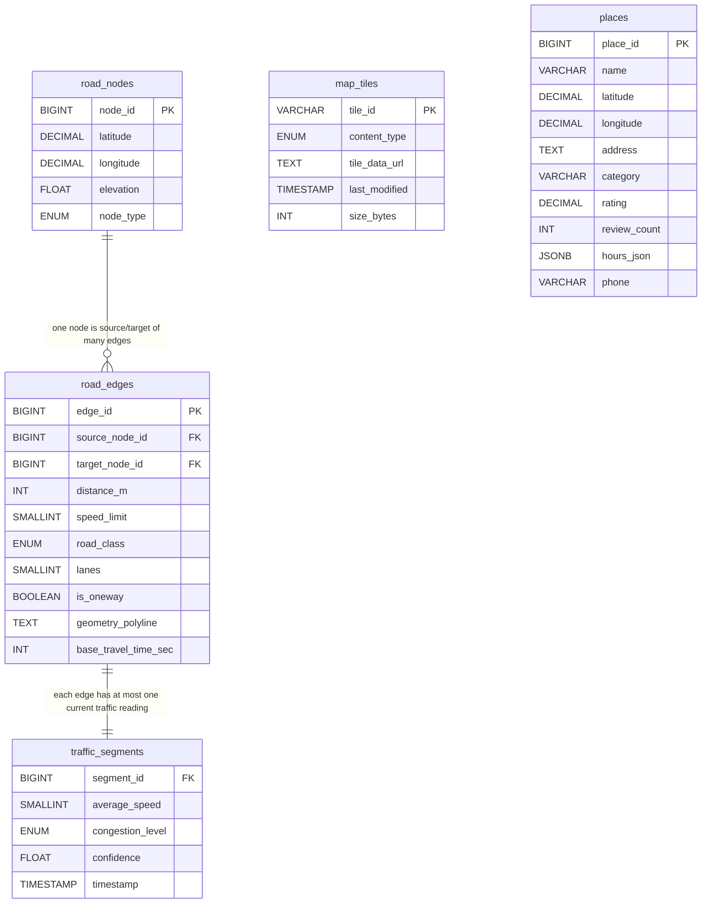
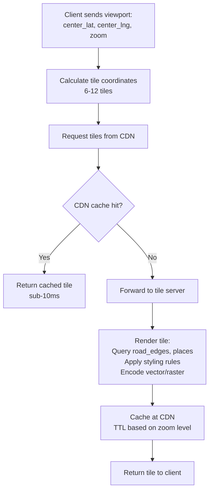
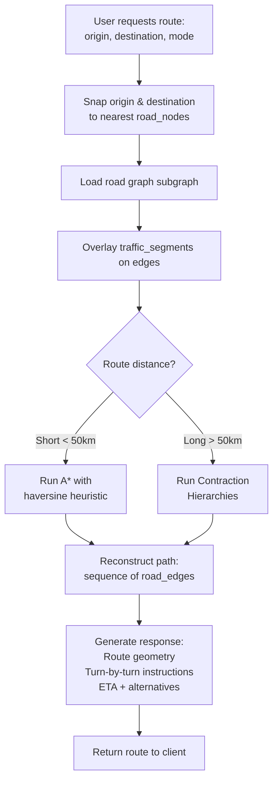

# Data Model: Google Maps / Navigation

A mapping and navigation service renders map tiles for visual display and computes optimal routes between locations. The data model must represent the road network as a weighted directed graph, serve pre-rendered map tiles at multiple zoom levels via CDN, and overlay real-time traffic data for accurate ETAs. The system serves billions of tile requests per day and computes millions of routes, demanding extreme read optimization.

## High-Level Architecture

## Table Responsibilities

| Table                | Purpose                                         | Storage                    | Key Characteristic                                      |
| -------------------- | ----------------------------------------------- | -------------------------- | ------------------------------------------------------- |
| **map_tiles**        | Pre-rendered map imagery at various zoom levels | S3 + CDN                   | Billions of tiles, served from edge caches              |
| **road_nodes**       | Intersection and waypoint coordinates           | PostgreSQL                 | Graph vertices for routing algorithms                   |
| **road_edges**       | Road segments connecting nodes                  | PostgreSQL                 | Graph edges with weights (distance, time, restrictions) |
| **traffic_segments** | Real-time speed data overlaid on road edges     | Redis / time-series DB     | Updated every 30-60 seconds from probe data             |
| **places**           | Points of interest (businesses, landmarks)      | PostgreSQL + Elasticsearch | Full-text searchable, linked to coordinates             |

## Detailed Field Descriptions

### map_tiles

| Field         | Type                     | Description                                                                                                                                                                                               |
| ------------- | ------------------------ | --------------------------------------------------------------------------------------------------------------------------------------------------------------------------------------------------------- |
| tile_id       | VARCHAR(30), PK          | Composite key encoding zoom_level + x + y in the tile grid (e.g., "z14/x8192/y5461"). Using a string key enables direct CDN URL mapping: `/tiles/{tile_id}.png`.                                          |
| content_type  | ENUM('vector', 'raster') | Whether the tile contains vector data (client-side rendering, smaller, zoomable) or raster data (pre-rendered image, larger, fixed zoom). Mobile clients prefer vector tiles; satellite view uses raster. |
| tile_data_url | TEXT                     | S3 URL to the tile content. Tiles are stored in S3 and served through a CDN. The URL includes a content hash for cache-busting when the tile is updated.                                                  |
| last_modified | TIMESTAMP                | When the tile was last re-rendered. Used for conditional GET (If-Modified-Since) to avoid transferring unchanged tiles.                                                                                   |
| size_bytes    | INT                      | Tile file size. Used for bandwidth estimation and alerting on anomalously large tiles (rendering bugs).                                                                                                   |

**Why a tiling system instead of rendering on demand?** Rendering a map region involves compositing roads, labels, terrain, buildings, and styling. This takes 50-500ms per tile. Pre-rendering and caching makes tile serving a simple CDN lookup (sub-10ms). The trade-off is storage: ~100 billion tiles at all zoom levels, but most are ocean/desert and can be shared.

**Why both vector and raster tiles?** Vector tiles are 5-10x smaller and allow client-side styling (dark mode, custom colors) and smooth zooming. But they require GPU rendering on the client. Raster tiles work on any device. Satellite/aerial imagery must be raster since it is photographic.

### road_nodes

| Field     | Type                                                                 | Description                                                                                                                                                             |
| --------- | -------------------------------------------------------------------- | ----------------------------------------------------------------------------------------------------------------------------------------------------------------------- |
| node_id   | BIGINT, PK                                                           | Unique identifier for this point in the road network. Global road networks have ~500M nodes.                                                                            |
| latitude  | DECIMAL(9,6)                                                         | Geographic latitude. 6 decimal places provide ~11cm precision, sufficient for road-level accuracy.                                                                      |
| longitude | DECIMAL(9,6)                                                         | Geographic longitude. Together with latitude, defines the node's position.                                                                                              |
| elevation | FLOAT, NULLABLE                                                      | Elevation in meters above sea level. Important for accurate ETA calculation (uphill is slower) and 3D rendering. Nullable for flat areas where elevation is irrelevant. |
| node_type | ENUM('intersection', 'signal', 'stop', 'ramp', 'roundabout', 'toll') | What kind of node this is. Signal and stop nodes add expected delay to the routing cost function. Ramp and roundabout nodes affect turn costs.                          |

**Why model the road network as a graph?** Routing is fundamentally a shortest-path problem on a weighted graph. Dijkstra's algorithm and its variants (A\*, Contraction Hierarchies) operate on nodes (intersections) and edges (road segments). This graph representation maps directly to these algorithms.

### road_edges

| Field                | Type                                                                        | Description                                                                                                                                                     |
| -------------------- | --------------------------------------------------------------------------- | --------------------------------------------------------------------------------------------------------------------------------------------------------------- |
| edge_id              | BIGINT, PK                                                                  | Unique edge identifier.                                                                                                                                         |
| source_node_id       | BIGINT, FK -> road_nodes                                                    | Starting node of this road segment. The direction matters for one-way streets.                                                                                  |
| target_node_id       | BIGINT, FK -> road_nodes                                                    | Ending node of this road segment. For two-way roads, a reverse edge also exists.                                                                                |
| distance_m           | INT                                                                         | Physical length of the segment in meters. Used as edge weight for "shortest distance" routing.                                                                  |
| speed_limit          | SMALLINT                                                                    | Posted speed limit in km/h. Used to compute `base_travel_time_sec` and as a fallback when no traffic data is available.                                         |
| road_class           | ENUM('motorway', 'trunk', 'primary', 'secondary', 'residential', 'service') | Road hierarchy. Higher-class roads are preferred for long-distance routing. Contraction Hierarchies exploit this to shortcut through highways.                  |
| lanes                | SMALLINT                                                                    | Number of lanes. Affects capacity and speed estimation in congestion models.                                                                                    |
| is_oneway            | BOOLEAN                                                                     | Whether traffic flows only from source to target. One-way streets have a single edge; two-way streets have two edges (one per direction).                       |
| geometry_polyline    | TEXT                                                                        | Encoded polyline of the segment's shape (Google Polyline encoding). Used for rendering the route on the map. Edges are not always straight lines between nodes. |
| base_travel_time_sec | INT                                                                         | Expected traversal time under free-flow conditions. Pre-computed as `distance_m / (speed_limit * 1000/3600)`. Updated by historical traffic patterns.           |

**Why `base_travel_time_sec` instead of computing it at query time?** The routing algorithm evaluates millions of edges per query. Pre-computing the travel time avoids a division operation per edge. More importantly, the base time can incorporate historical patterns (e.g., "this highway is typically 20% slower than the speed limit during rush hour") beyond a simple speed-limit calculation.

### traffic_segments

| Field            | Type                                         | Description                                                                                                                                                                      |
| ---------------- | -------------------------------------------- | -------------------------------------------------------------------------------------------------------------------------------------------------------------------------------- |
| segment_id       | BIGINT, FK -> road_edges                     | Maps to a road edge. Traffic data is overlaid on the road graph at query time.                                                                                                   |
| average_speed    | SMALLINT                                     | Current average speed in km/h on this segment. Derived from probe data (GPS traces from phones, connected cars).                                                                 |
| congestion_level | ENUM('free', 'slow', 'congested', 'blocked') | Human-readable congestion classification. Used for color-coding the map (green/yellow/red/black).                                                                                |
| confidence       | FLOAT                                        | Statistical confidence in the speed estimate (0.0-1.0). Low confidence (few probes) means the speed estimate is unreliable; the router should fall back to base_travel_time_sec. |
| timestamp        | TIMESTAMP, INDEX                             | When this measurement was taken. Traffic data older than 5 minutes is stale and should be refreshed or discarded.                                                                |

**Why overlay traffic as a separate layer?** The road graph (nodes + edges) changes rarely (road construction, new streets). Traffic changes every minute. Keeping them separate means the road graph can be cached aggressively (hours/days) while traffic data is refreshed continuously. The routing algorithm merges them at query time: `effective_time = distance_m / average_speed` if confidence is high, else `base_travel_time_sec`.

### places

| Field        | Type                   | Description                                                                                                       |
| ------------ | ---------------------- | ----------------------------------------------------------------------------------------------------------------- |
| place_id     | BIGINT, PK             | Unique place identifier.                                                                                          |
| name         | VARCHAR(255), NOT NULL | Place name (e.g., "Central Park", "Starbucks"). Full-text indexed in Elasticsearch for autocomplete search.       |
| latitude     | DECIMAL(9,6)           | Place location latitude. Used for rendering pins on the map and as routing origin/destination.                    |
| longitude    | DECIMAL(9,6)           | Place location longitude.                                                                                         |
| address      | TEXT                   | Formatted street address. Returned in search results and used for geocoding validation.                           |
| category     | VARCHAR(100), INDEX    | Place type (restaurant, park, gas_station, hospital, etc.). Enables filtered search ("gas stations near me").     |
| rating       | DECIMAL(2,1)           | Average user rating. Displayed on the map and used for search result ranking.                                     |
| review_count | INT                    | Total reviews. Displayed alongside rating as a credibility signal.                                                |
| hours_json   | JSONB                  | Operating hours. JSONB for flexible representation (holidays, seasonal hours). Used to filter "open now" results. |
| phone        | VARCHAR(20)            | Contact phone number. Displayed in place details.                                                                 |

## ER Diagram

## Data Flow

### Map Rendering (Read Path)

### Route Calculation (Read Path)

**Why Contraction Hierarchies over plain A\*?** A\* explores nodes proportional to the geographic distance between origin and destination. For a cross-country route, this means millions of node evaluations. Contraction Hierarchies pre-compute "shortcut edges" that skip intermediate nodes on highways, reducing query time from seconds to milliseconds. The trade-off is a preprocessing step that takes hours, but this is done offline.

**Why snap to nearest node?** Users click on arbitrary map locations, which may be in the middle of a block or on a building. The routing algorithm operates on the road graph, so we must first find the nearest road node (typically within 50m). This is a spatial nearest-neighbor query using an R-tree or geohash index on road_nodes.
