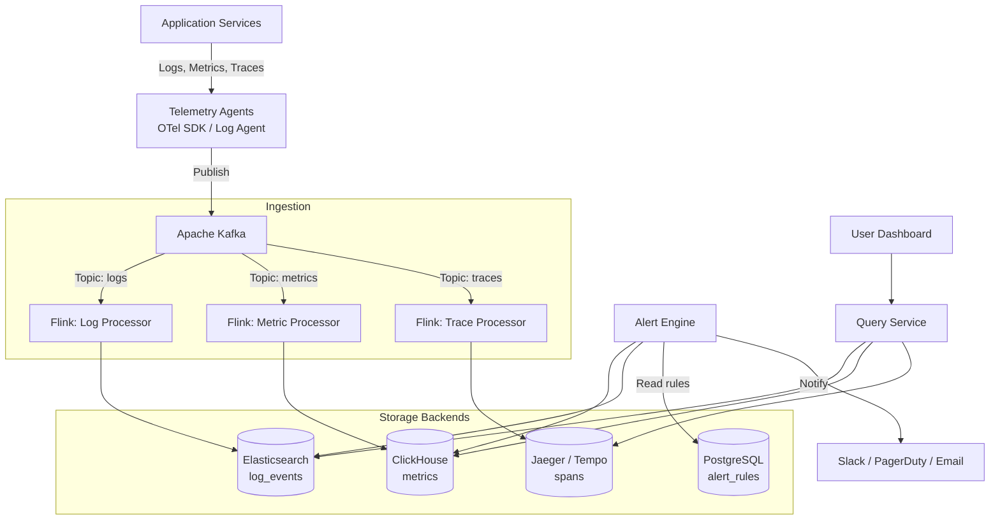
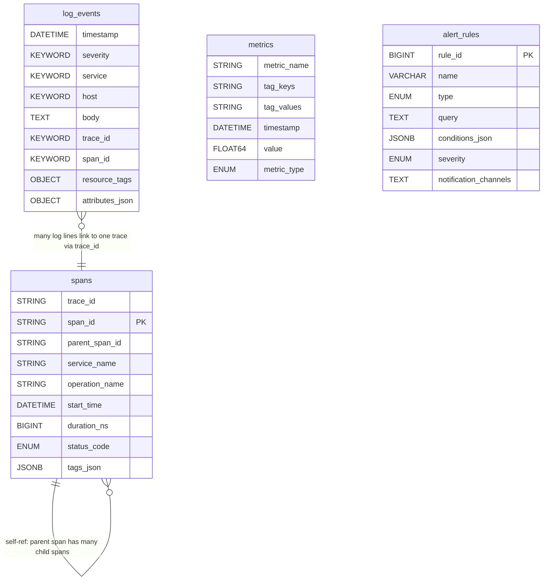
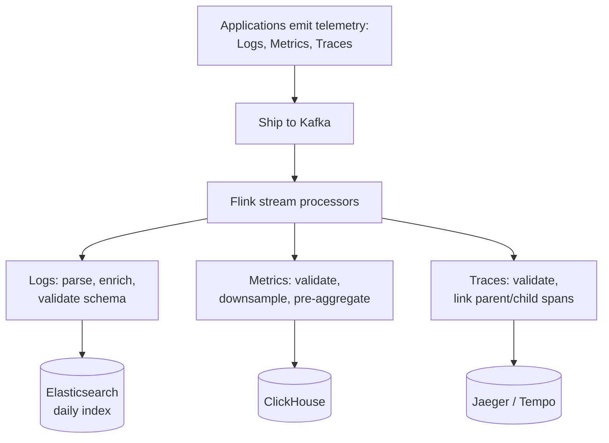
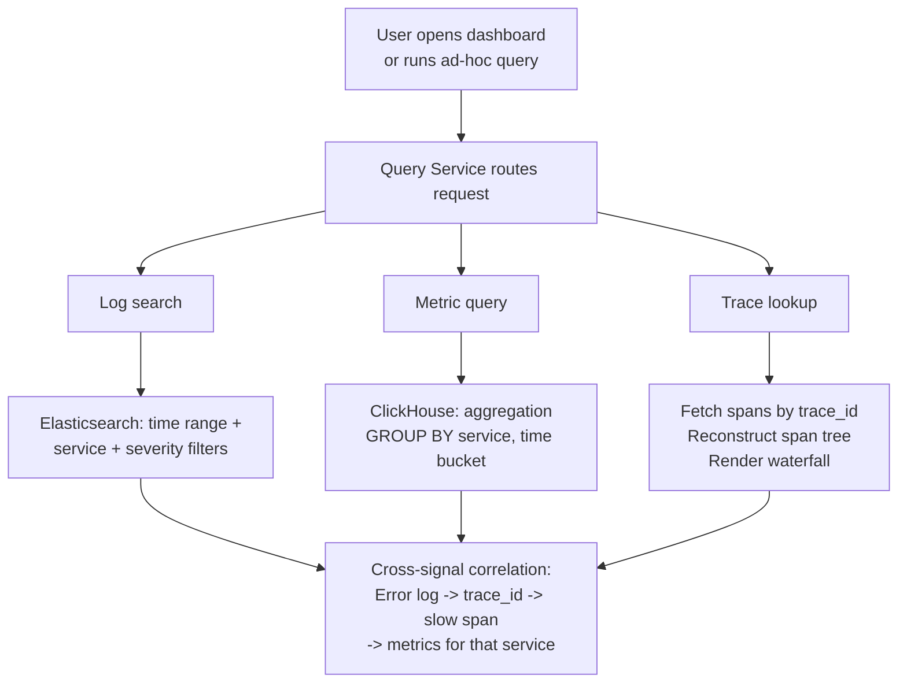
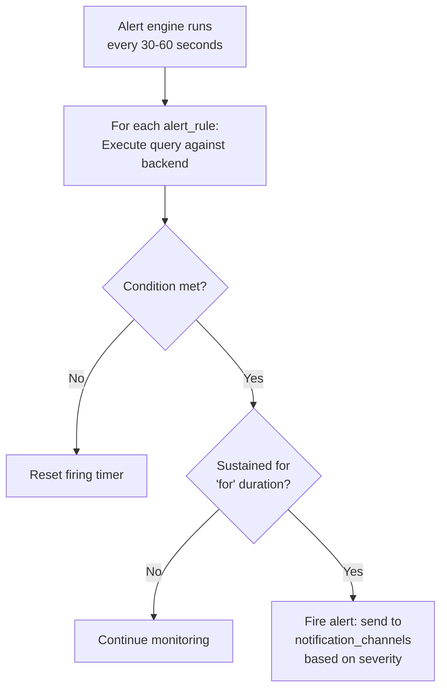

# Data Model: Distributed Logging (ELK/Datadog)

A distributed logging system collects, stores, and queries three pillars of observability: logs (events), metrics (measurements), and traces (request flows). The data model must handle massive write throughput (millions of events per second), support flexible querying across heterogeneous schemas, and correlate signals across the three pillars via trace IDs. Each pillar uses a purpose-built storage backend optimized for its access patterns.

## High-Level Architecture

## Table Responsibilities

| Table           | Purpose                            | Storage               | Key Characteristic                     |
| --------------- | ---------------------------------- | --------------------- | -------------------------------------- |
| **log_events**  | Structured application log entries | Elasticsearch         | Full-text searchable, schema-on-read   |
| **metrics**     | Time-series numerical measurements | ClickHouse / InfluxDB | High-cardinality tag-based aggregation |
| **spans**       | Distributed trace segments         | Jaeger / Tempo        | Tree-structured request flows          |
| **alert_rules** | Monitoring alert definitions       | PostgreSQL            | Low-volume, high-value configuration   |

## Detailed Field Descriptions

### log_events (Elasticsearch)

| Field           | Type            | Description                                                                                                                                                                       |
| --------------- | --------------- | --------------------------------------------------------------------------------------------------------------------------------------------------------------------------------- |
| timestamp       | DATETIME, INDEX | When the event occurred. Primary sort dimension. Elasticsearch indices are typically rolled daily (logs-2024-01-15) for efficient retention management.                           |
| severity        | KEYWORD, INDEX  | Log level: DEBUG, INFO, WARN, ERROR, FATAL. Keyword type (not text) because we filter on exact values, not search within them.                                                    |
| service         | KEYWORD, INDEX  | Which microservice emitted this log (e.g., "payment-api", "user-service"). Enables scoping queries to a single service.                                                           |
| host            | KEYWORD, INDEX  | Hostname or container ID. Used to identify problematic instances ("all errors from host-42 in the last hour").                                                                    |
| body            | TEXT            | The log message content. Full-text indexed for free-form search ("connection refused", "timeout exceeded"). TEXT type enables tokenization and fuzzy matching.                    |
| trace_id        | KEYWORD, INDEX  | Distributed trace correlation ID. The critical link between logs and traces. When investigating a failed request, query all logs with this trace_id to see the full story.        |
| span_id         | KEYWORD         | Specific span within the trace. Enables pinpointing which operation within a request generated this log.                                                                          |
| resource_tags   | OBJECT          | Infrastructure metadata (cloud region, availability zone, kubernetes namespace, pod name). Structured as an object for nested filtering.                                          |
| attributes_json | OBJECT          | Application-specific structured data (user_id, order_id, request_path, etc.). Schema varies by service. Elasticsearch's dynamic mapping handles this without pre-defined schemas. |

**Why Elasticsearch over PostgreSQL?** Log data is semi-structured (each service logs different fields), requires full-text search (grep-like queries over message bodies), and arrives at rates that would overwhelm a traditional RDBMS. Elasticsearch's inverted index provides sub-second full-text search, its dynamic mapping handles schema evolution, and its cluster architecture distributes storage across many nodes.

**Why daily index rollover?** Logs have strong time-based access patterns (most queries are for "last 1 hour" or "last 24 hours"). Daily indices enable efficient retention: deleting a 30-day-old index is O(1) compared to deleting individual rows. Index-per-day also enables hot/warm/cold tiering (recent indices on SSD, older on HDD).

### metrics (ClickHouse / Time-Series DB)

| Field       | Type                                  | Description                                                                                                                                                            |
| ----------- | ------------------------------------- | ---------------------------------------------------------------------------------------------------------------------------------------------------------------------- |
| metric_name | STRING, INDEX                         | What is being measured (e.g., "http_request_duration_seconds", "cpu_utilization_percent"). Follows naming conventions (lowercase, underscores, unit suffix).           |
| tag_keys    | STRING[]                              | Dimension names (e.g., ["service", "method", "status_code"]). Tags enable slicing and dicing: "p99 latency for service=payment-api, method=POST, status_code=200".     |
| tag_values  | STRING[]                              | Corresponding dimension values (e.g., ["payment-api", "POST", "200"]). Parallel array with tag_keys for efficient storage.                                             |
| timestamp   | DATETIME, INDEX                       | When the measurement was taken. Typically 10-60 second resolution. Indexed for time-range queries.                                                                     |
| value       | FLOAT64                               | The measured value. Interpretation depends on metric_type (gauge: instantaneous value; counter: cumulative; histogram: bucket boundary).                               |
| metric_type | ENUM('gauge', 'counter', 'histogram') | How to interpret the value. Gauges can go up or down (CPU usage). Counters only increase (total requests). Histograms track value distributions (latency percentiles). |

**Why ClickHouse over Elasticsearch for metrics?** Metrics queries are almost exclusively aggregations over time ranges (AVG, P99, SUM, rate). ClickHouse's columnar storage compresses numeric time-series data 10-50x better than Elasticsearch and executes aggregation queries 10-100x faster. Elasticsearch excels at text search but is inefficient for pure numeric aggregation.

**Why parallel arrays for tags instead of JSONB?** ClickHouse's array functions operate directly on native arrays, enabling efficient tag-based filtering without JSON parsing overhead. The parallel array pattern (`tag_keys[indexOf(tag_keys, 'service')]`) is a ClickHouse best practice for high-cardinality label sets.

### spans (Trace Backend)

| Field          | Type                         | Description                                                                                                                                                                                    |
| -------------- | ---------------------------- | ---------------------------------------------------------------------------------------------------------------------------------------------------------------------------------------------- |
| trace_id       | STRING, INDEX                | Globally unique trace identifier. All spans belonging to the same request share this ID. Typically a 128-bit hex string (32 chars).                                                            |
| span_id        | STRING, PK                   | Unique identifier for this span. Each operation within a trace gets its own span.                                                                                                              |
| parent_span_id | STRING, NULLABLE, INDEX      | The span that initiated this one. Null for the root span. Creates a tree structure representing the request's call graph.                                                                      |
| service_name   | STRING, INDEX                | Which service executed this span. Enables service-level latency analysis and dependency mapping.                                                                                               |
| operation_name | STRING, INDEX                | What operation was performed (e.g., "HTTP GET /api/users", "PostgreSQL SELECT", "Redis GET").                                                                                                  |
| start_time     | DATETIME                     | When the operation started. Nanosecond precision enables accurate waterfall visualization.                                                                                                     |
| duration_ns    | BIGINT                       | How long the operation took in nanoseconds. The core measurement for latency analysis. Nanosecond precision is necessary to capture sub-millisecond operations (cache lookups, serialization). |
| status_code    | ENUM('OK', 'ERROR', 'UNSET') | Whether the operation succeeded. ERROR spans are highlighted in trace visualizations and drive error rate metrics.                                                                             |
| tags_json      | JSONB                        | Operation-specific metadata (HTTP status code, database query, error message, user_id). JSONB because tags vary widely across operation types.                                                 |

**Why nanosecond precision for duration?** In a microservices architecture, a single request may involve 50+ spans. Many are sub-millisecond (cache lookups, serialization, queue operations). Millisecond precision would show these as "0ms," making it impossible to identify which sub-millisecond operations add up to noticeable latency.

**Why tree structure (parent_span_id) instead of flat list?** A request flows through multiple services: API gateway -> auth service -> user service -> database. The parent-child relationship captures this causality. The waterfall visualization that engineers use for debugging depends on this tree structure to show which operations are sequential vs. parallel.

### alert_rules

| Field                 | Type                                        | Description                                                                                                                                                                      |
| --------------------- | ------------------------------------------- | -------------------------------------------------------------------------------------------------------------------------------------------------------------------------------- |
| rule_id               | BIGINT, PK                                  | Unique alert rule identifier.                                                                                                                                                    |
| name                  | VARCHAR(255), NOT NULL                      | Human-readable rule name (e.g., "Payment API Error Rate > 5%"). Shown in alert notifications and dashboards.                                                                     |
| type                  | ENUM('threshold', 'anomaly', 'composite')   | Alert type. Threshold: triggers when a metric crosses a fixed value. Anomaly: triggers when a metric deviates from its baseline. Composite: combines multiple conditions.        |
| query                 | TEXT, NOT NULL                              | The monitoring query to evaluate (e.g., "rate(http_errors_total{service='payment-api'}[5m])"). Executed periodically by the alert engine.                                        |
| conditions_json       | JSONB                                       | Trigger conditions (e.g., {"operator": ">", "value": 0.05, "for": "5m"}). The "for" duration prevents alerting on transient spikes. JSONB because conditions vary by alert type. |
| severity              | ENUM('info', 'warning', 'critical', 'page') | Alert urgency. Determines notification channel: info -> Slack, warning -> Slack + email, critical -> PagerDuty, page -> phone call.                                              |
| notification_channels | TEXT[]                                      | Where to send alerts (Slack channel IDs, email addresses, PagerDuty service keys). Multiple channels enable escalation.                                                          |

**Why separate alert_rules from the metrics/logs storage?** Alert rules are configuration, not telemetry data. They change infrequently, need transactional guarantees (no partial updates), and have a fundamentally different access pattern (read by the alert engine every evaluation cycle, updated by humans via UI). PostgreSQL is the right fit for this small, relational dataset.

## ER Diagram

## Data Flow

### Ingestion Pipeline

### Query Flow

### Alert Evaluation

**Why Kafka as the ingestion bus?** Telemetry data is fire-and-forget from the application's perspective. Kafka decouples producers (applications) from consumers (storage backends), provides durability (data survives consumer downtime), and enables replay (re-process data if a consumer bug is fixed). Without Kafka, a slow Elasticsearch cluster would cause back-pressure on applications, potentially causing outages in the systems being monitored.

**Why three separate storage backends instead of one?** Each pillar has fundamentally different access patterns. Logs need full-text search (Elasticsearch). Metrics need fast numeric aggregation (ClickHouse). Traces need efficient tree reconstruction (span-optimized storage). Using one system for all three would mean mediocre performance for everything. The trade-off is operational complexity (three systems to manage), mitigated by the unified query service layer.
