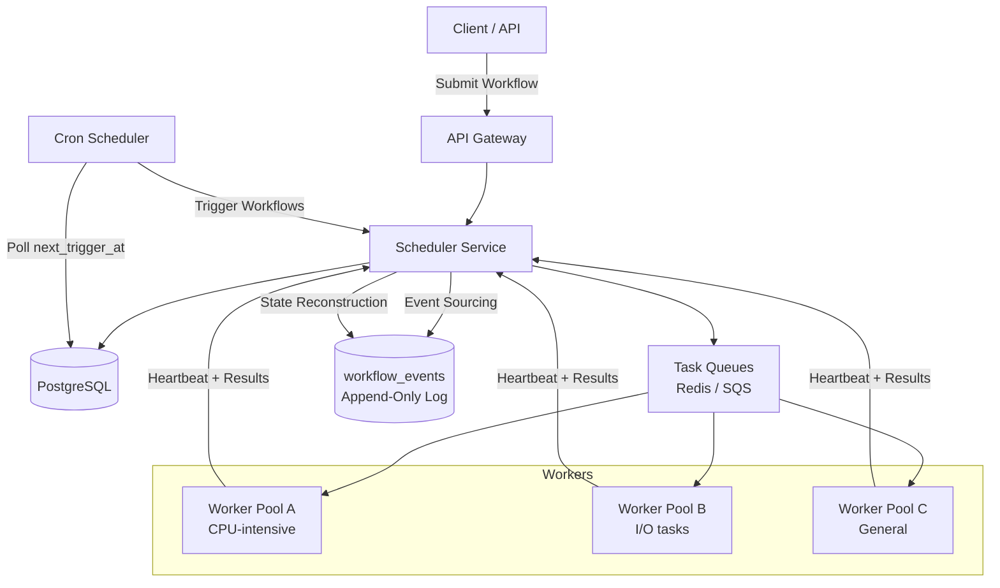
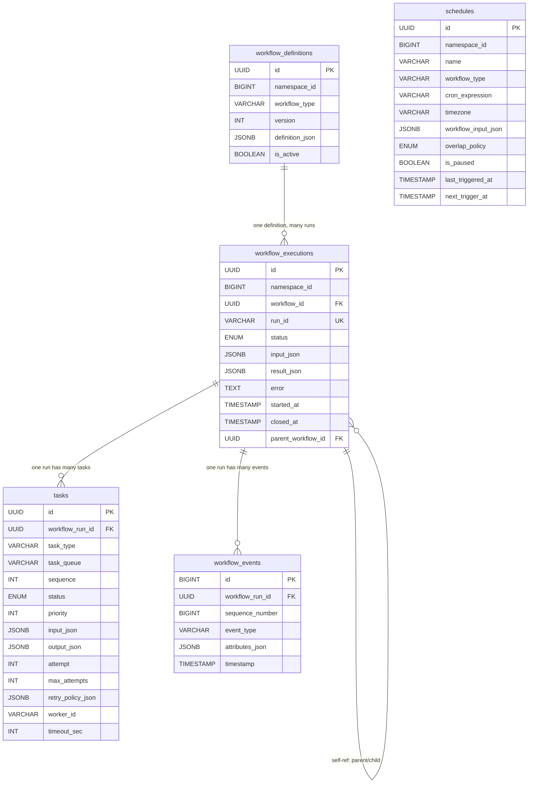
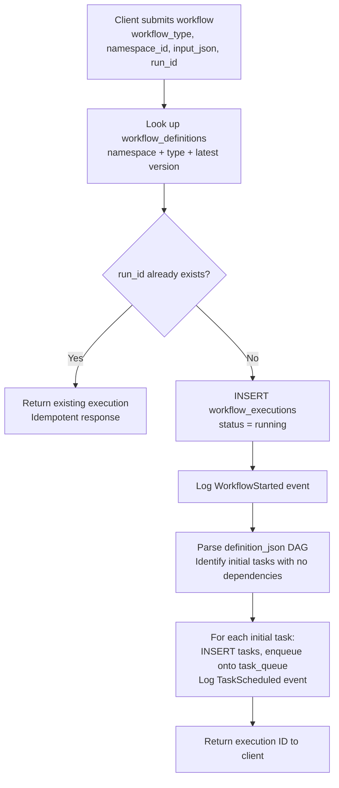
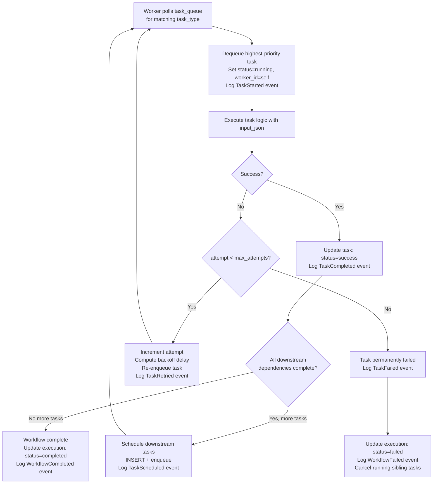
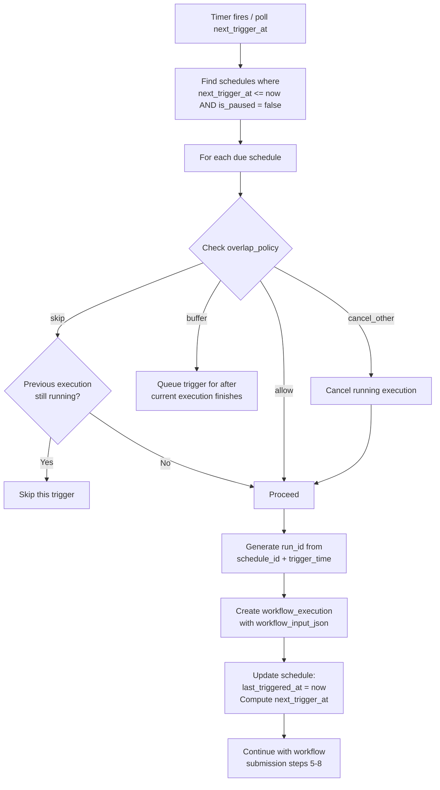

# Data Model: Distributed Task Scheduler (Temporal/Airflow)

A distributed task scheduler orchestrates complex workflows composed of interdependent tasks across a fleet of workers. The data model must represent workflow DAGs (Directed Acyclic Graphs), track execution state reliably through failures and retries, and maintain a complete event history for debugging and replay. The core design principle is event sourcing: the workflow's state is derived from an append-only event log, enabling full auditability and deterministic replay.

## High-Level Architecture

## Table Responsibilities

| Table                    | Purpose                                     | Storage                                     | Key Characteristic                    |
| ------------------------ | ------------------------------------------- | ------------------------------------------- | ------------------------------------- |
| **workflow_definitions** | Workflow templates (DAG structure)          | PostgreSQL                                  | Versioned blueprints, rarely modified |
| **workflow_executions**  | Running or completed workflow instances     | PostgreSQL                                  | State-machine driven lifecycle        |
| **tasks**                | Individual task units within a workflow run | PostgreSQL                                  | Independently schedulable, retryable  |
| **workflow_events**      | Append-only event history per execution     | PostgreSQL (partitioned by workflow_run_id) | Event-sourced state reconstruction    |
| **schedules**            | Cron-based workflow triggers                | PostgreSQL                                  | Drives periodic workflow creation     |

## Detailed Field Descriptions

### workflow_definitions

| Field           | Type                  | Description                                                                                                                                                                                              |
| --------------- | --------------------- | -------------------------------------------------------------------------------------------------------------------------------------------------------------------------------------------------------- |
| id              | UUID, PK              | Unique workflow definition identifier.                                                                                                                                                                   |
| namespace_id    | BIGINT, INDEX         | Tenant/team namespace for multi-tenancy isolation. Different teams can have workflows with the same name without conflict. Indexed for "list all workflows in my namespace" queries.                     |
| workflow_type   | VARCHAR(255), INDEX   | Workflow name/type (e.g., "order-processing", "data-pipeline-etl"). Together with namespace_id, this is the human-readable identifier.                                                                   |
| version         | INT, NOT NULL         | Definition version number. When the DAG structure changes, a new version is created. In-progress executions continue using their original version, while new executions use the latest.                  |
| definition_json | JSONB                 | The workflow DAG structure: tasks, dependencies, timeouts, retry policies, input/output mappings. JSONB because workflow structures vary widely. Contains the graph of tasks and their dependency edges. |
| is_active       | BOOLEAN, DEFAULT true | Whether new executions can be created from this definition. Deactivating a workflow prevents new runs without affecting in-progress ones.                                                                |

**Why version workflow definitions?** A running workflow may take hours or days. If the definition changes mid-execution, applying the new definition could corrupt state (e.g., a task that was removed is still running). Versioning ensures each execution runs against a stable, immutable definition. This is the same principle as "immutable deployments" in infrastructure.

**Why JSONB for definition?** Workflow DAGs are inherently flexible: some have 3 tasks, others have 300. Tasks can run in parallel, have conditional branches, loops (via sub-workflows), and complex retry policies. A rigid relational schema would require dozens of tables. JSONB captures this complexity in a single, queryable column.

### workflow_executions

| Field              | Type                                                             | Description                                                                                                                                                                                                     |
| ------------------ | ---------------------------------------------------------------- | --------------------------------------------------------------------------------------------------------------------------------------------------------------------------------------------------------------- |
| id                 | UUID, PK                                                         | Unique execution identifier. Used as the primary correlation key across all related tables.                                                                                                                     |
| namespace_id       | BIGINT, INDEX                                                    | Inherited from the workflow definition. Used for access control and listing executions per team.                                                                                                                |
| workflow_id        | UUID, FK -> workflow_definitions                                 | Which workflow definition this is an instance of. Combined with version, determines the DAG structure.                                                                                                          |
| run_id             | VARCHAR(64), UNIQUE                                              | Idempotency key for the execution. If a workflow is triggered twice with the same run_id, the second trigger returns the existing execution. Prevents duplicate runs from cron race conditions or retry storms. |
| status             | ENUM('running', 'completed', 'failed', 'cancelled', 'timed_out') | Execution lifecycle state. Terminal states (completed, failed, cancelled, timed_out) are immutable. Running executions are monitored by a timeout watchdog.                                                     |
| input_json         | JSONB                                                            | Input parameters passed when the workflow was started (e.g., {"order_id": 12345, "priority": "high"}). Stored for debugging ("what inputs caused this failure?") and replay.                                    |
| result_json        | JSONB, NULLABLE                                                  | Output of the workflow upon successful completion. Null for failed/running workflows. Consumed by the caller or parent workflow.                                                                                |
| error              | TEXT, NULLABLE                                                   | Error message if the workflow failed. Null for successful executions. Provides the first-level diagnosis before diving into task-level errors.                                                                  |
| started_at         | TIMESTAMP, INDEX                                                 | When the execution began. Indexed for "running workflows older than X hours" monitoring queries.                                                                                                                |
| closed_at          | TIMESTAMP, NULLABLE                                              | When the execution reached a terminal state. Null while running. Used to calculate total execution duration.                                                                                                    |
| parent_workflow_id | UUID, FK -> workflow_executions, NULLABLE                        | If this workflow was spawned by another workflow (child workflow / sub-workflow pattern). Null for top-level executions. Creates a tree of workflow executions for complex orchestration.                       |

**Why `run_id` as an idempotency key?** Consider a cron schedule that fires every hour. If the scheduler crashes right after triggering a workflow but before recording that it fired, the next scheduler instance would trigger the same workflow again. The run_id (derived from the schedule + trigger time) ensures only one execution is created per intended trigger.

**Why `parent_workflow_id`?** Large workflows are often decomposed into smaller sub-workflows for modularity and reusability. A "deploy-to-production" workflow might call "run-tests", "build-artifacts", and "rollout" as child workflows. The parent reference enables tracing the full execution tree and propagating cancellation from parent to children.

### tasks

| Field             | Type                                                                                   | Description                                                                                                                                                                                         |
| ----------------- | -------------------------------------------------------------------------------------- | --------------------------------------------------------------------------------------------------------------------------------------------------------------------------------------------------- |
| id                | UUID, PK                                                                               | Unique task identifier.                                                                                                                                                                             |
| workflow_run_id   | UUID, FK -> workflow_executions, INDEX                                                 | Which workflow execution this task belongs to. Indexed for "get all tasks for this execution" queries.                                                                                              |
| task_type         | VARCHAR(255)                                                                           | What kind of work this task performs (e.g., "send-email", "process-payment", "run-query"). Workers register to handle specific task types.                                                          |
| task_queue        | VARCHAR(255), INDEX                                                                    | Which queue this task is placed on for worker consumption. Enables routing different task types to different worker pools (e.g., CPU-intensive tasks to beefy machines, I/O tasks to smaller ones). |
| sequence          | INT                                                                                    | Position in the DAG execution order. Used for UI display and debugging ("task 3 of 7 failed").                                                                                                      |
| status            | ENUM('pending', 'scheduled', 'running', 'success', 'failed', 'cancelled', 'timed_out') | Task lifecycle state. `pending` means dependencies not yet met. `scheduled` means placed on a queue. `running` means a worker has claimed it.                                                       |
| priority          | INT, DEFAULT 0                                                                         | Task priority within the queue. Higher values are dequeued first. Enables urgent workflows to jump ahead of background batch processing.                                                            |
| input_json        | JSONB                                                                                  | Task input parameters, derived from the workflow definition and outputs of upstream tasks.                                                                                                          |
| output_json       | JSONB, NULLABLE                                                                        | Task output, available after successful completion. Fed as input to downstream tasks.                                                                                                               |
| attempt           | INT, DEFAULT 1                                                                         | Current attempt number. Starts at 1, incremented on each retry. Used for logging and to determine if max_attempts has been reached.                                                                 |
| max_attempts      | INT, DEFAULT 3                                                                         | Maximum retry attempts before marking the task as permanently failed. Derived from the retry_policy in the workflow definition.                                                                     |
| retry_policy_json | JSONB                                                                                  | How to retry: backoff strategy (fixed, exponential), initial interval, maximum interval, non-retryable error types. JSONB because retry policies are complex and vary per task type.                |
| worker_id         | VARCHAR(255), NULLABLE                                                                 | Which worker is currently executing this task. Null when not running. Used for worker health monitoring: if the worker dies, the task is re-scheduled.                                              |
| timeout_sec       | INT                                                                                    | Maximum execution time. If a task runs longer than this, it is presumed stuck and will be cancelled and retried. Prevents resource leaks from hung tasks.                                           |

**Why a separate `task_queue` field?** Different task types have different resource requirements. A video transcoding task needs GPUs, while a send-email task needs minimal resources. Task queues enable routing tasks to appropriate worker pools without coupling the scheduler to worker infrastructure. Workers poll their specific queue and only pick up tasks they can handle.

**Why track `worker_id`?** Without it, the system cannot distinguish between "task is running on worker-5" and "task was running but worker-5 crashed." The heartbeat mechanism works by checking: is worker_id non-null AND has the worker sent a heartbeat recently? If the worker goes silent, the task is re-scheduled on a different worker.

### workflow_events (Append-Only)

| Field           | Type                                   | Description                                                                                                                                                                                                           |
| --------------- | -------------------------------------- | --------------------------------------------------------------------------------------------------------------------------------------------------------------------------------------------------------------------- |
| id              | BIGINT, PK                             | Auto-incrementing event identifier.                                                                                                                                                                                   |
| workflow_run_id | UUID, FK -> workflow_executions, INDEX | Which execution this event belongs to. Indexed for loading the complete event history.                                                                                                                                |
| sequence_number | BIGINT                                 | Monotonically increasing within a workflow execution. Ensures event ordering even if timestamps are not perfectly ordered (clock skew).                                                                               |
| event_type      | VARCHAR(100), INDEX                    | What happened: "WorkflowStarted", "TaskScheduled", "TaskStarted", "TaskCompleted", "TaskFailed", "TaskRetried", "WorkflowCompleted", "WorkflowFailed", "TimerFired", "SignalReceived".                                |
| attributes_json | JSONB                                  | Event-specific data. For "TaskCompleted": the output. For "TaskFailed": the error message and stack trace. For "TimerFired": the timer ID and scheduled time. JSONB because each event type has different attributes. |
| timestamp       | TIMESTAMP                              | When the event occurred. Used for timeline visualization and debugging.                                                                                                                                               |

**Why event sourcing?** The workflow's current state can always be reconstructed by replaying events from the beginning. This provides: (1) complete audit trail for compliance, (2) debugging capability (replay the exact sequence of events that led to a failure), (3) durability (if the scheduler crashes, it reconstructs state from events on restart), and (4) the foundation for Temporal's "deterministic replay" model where workflow code is re-executed against the event history.

**Why `sequence_number` in addition to `id`?** The auto-incrementing `id` is global across all workflows. `sequence_number` is per-workflow and starts at 1 for each execution. This makes it easier to reason about ("the failure happened at event 47 of 200") and is required for deterministic replay (the replay engine steps through events by sequence number).

### schedules

| Field               | Type                                            | Description                                                                                                                                                                                                                                                 |
| ------------------- | ----------------------------------------------- | ----------------------------------------------------------------------------------------------------------------------------------------------------------------------------------------------------------------------------------------------------------- |
| id                  | UUID, PK                                        | Unique schedule identifier.                                                                                                                                                                                                                                 |
| namespace_id        | BIGINT, INDEX                                   | Tenant namespace. A team's schedules are isolated from other teams.                                                                                                                                                                                         |
| name                | VARCHAR(255)                                    | Human-readable schedule name (e.g., "nightly-data-sync", "hourly-report").                                                                                                                                                                                  |
| workflow_type       | VARCHAR(255)                                    | Which workflow definition to trigger. Must match a workflow_definitions.workflow_type in the same namespace.                                                                                                                                                |
| cron_expression     | VARCHAR(100)                                    | Standard cron expression (e.g., "0 0 \* \* _" for midnight daily, "_/15 \* \* \* \*" for every 15 minutes). Parsed by the scheduler to compute next_trigger_at.                                                                                             |
| timezone            | VARCHAR(50)                                     | IANA timezone for cron evaluation (e.g., "America/New_York"). Critical because "midnight" means different things in different timezones. Without this, DST transitions cause missed or duplicate triggers.                                                  |
| workflow_input_json | JSONB                                           | Default input parameters passed to each triggered workflow. Can be overridden per-trigger.                                                                                                                                                                  |
| overlap_policy      | ENUM('skip', 'allow', 'buffer', 'cancel_other') | What to do when a trigger fires while the previous execution is still running. `skip`: do not start a new one. `allow`: run concurrently. `buffer`: queue and start after the current one finishes. `cancel_other`: cancel the running one and start fresh. |
| is_paused           | BOOLEAN, DEFAULT false                          | Whether the schedule is currently paused. Pausing prevents triggers without deleting the schedule configuration.                                                                                                                                            |
| last_triggered_at   | TIMESTAMP, NULLABLE                             | When the last execution was triggered. Null if never triggered. Used for "catch up" logic: if the scheduler was down for 2 hours, should it fire the missed triggers?                                                                                       |
| next_trigger_at     | TIMESTAMP, INDEX                                | When the next trigger should fire. Pre-computed from cron_expression and timezone. Indexed so the scheduler can efficiently find "all schedules where next_trigger_at <= now()".                                                                            |

**Why `overlap_policy`?** A nightly data sync scheduled at midnight might take 2 hours. If yesterday's run is still going at midnight, what happens? Without an explicit policy, you get unpredictable behavior. `skip` is safest for idempotent jobs. `cancel_other` is best for "always want the latest." `buffer` provides guaranteed sequential execution. This is a common interview discussion point because it reveals understanding of distributed scheduling edge cases.

**Why `timezone` on the schedule?** A cron expression "0 9 \* \* MON-FRI" (9am weekdays) must be evaluated in the business's timezone, not UTC. Daylight saving time transitions mean the UTC offset changes twice a year. Without a timezone, schedules would drift by an hour or fire twice/skip during DST transitions.

## ER Diagram

## Data Flow

### Submitting a Workflow (Write Path)

### Task Execution (Worker Loop)

### Cron Schedule Trigger

**Why enqueue tasks onto a separate task_queue instead of having workers query the tasks table directly?** Direct polling of the tasks table by thousands of workers would create extreme contention (hot rows, lock conflicts). A message queue (Redis, SQS, or Temporal's built-in task queue) provides efficient fan-out, visibility timeouts (task auto-requeues if the worker crashes), and priority ordering without database contention.

**Why event sourcing for workflow state?** Consider a scheduler crash during step 11. On restart, the scheduler replays workflow_events to reconstruct the exact state: which tasks completed, which are running, which are pending. Without event sourcing, the scheduler would need complex logic to infer state from the tasks table, which is error-prone (was this task "running" because it is actually running, or because the worker crashed?). Events provide an authoritative, ordered record of what happened.
