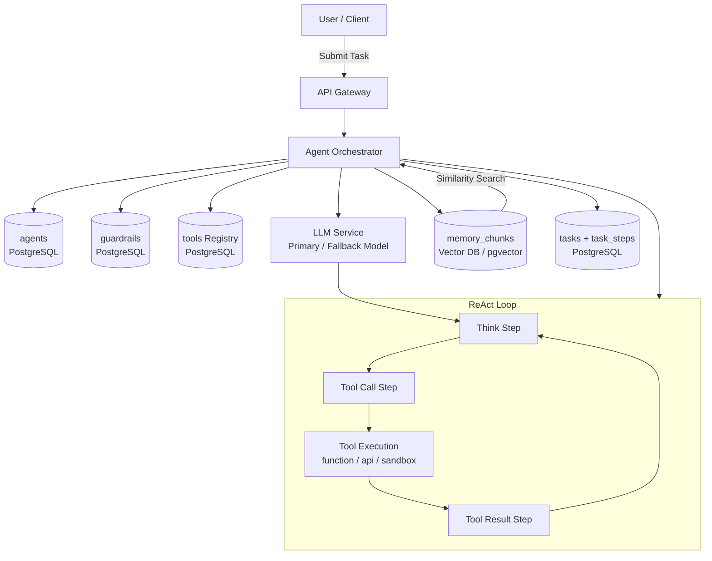
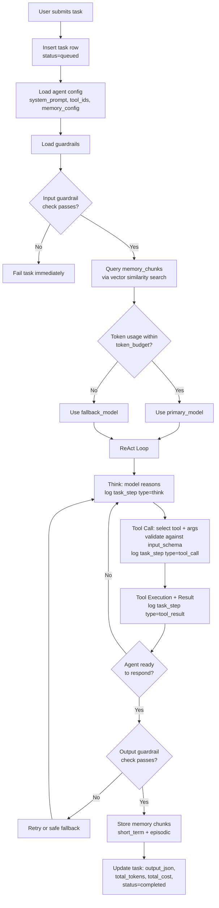

# Data Model: AI Agent Orchestration Platform

An AI agent orchestration platform manages the lifecycle of autonomous agents that use LLMs and tools to complete complex tasks. The data model must track agent configurations, task execution with full step-level observability, tool invocations, vector-based memory, and safety guardrails -- all while maintaining token and cost accounting.

## High-Level Architecture

---

## Data Flow

1. **User submits task** -- A new row is inserted into `tasks` with status=queued, capturing input_json and linking to the target agent_id.

2. **Agent initialization** -- The orchestrator loads the agent config (system_prompt, tool_ids, memory_config) and the associated guardrails.

3. **Input guardrail check** -- The user's input is validated against `guardrails.input_rules_json` (prompt injection detection, topic filtering). Rejected inputs fail the task immediately.

4. **Memory retrieval** -- The system queries `memory_chunks` using vector similarity search on the input embedding, filtered by agent_id and memory_type. Top-k results are injected into the context window.

5. **Model selection** -- If the estimated token usage fits within `token_budget`, use `primary_model`. Otherwise, fall back to `fallback_model`. This is logged in each task_step.

6. **ReAct loop execution** -- The agent enters a think-act-observe loop:

   - **Think**: Model reasons about the next action → logged as task_step (step_type=think)
   - **Tool call**: Model selects a tool and provides arguments → logged as task_step (step_type=tool_call), validated against tool's input_schema_json
   - **Tool result**: Tool executes and returns result → logged as task_step (step_type=tool_result)
   - Loop repeats until the agent decides to respond

7. **Output guardrail check** -- The final response is validated against `guardrails.output_rules_json` (toxicity, PII detection). Failed checks trigger retry or safe fallback.

8. **Memory storage** -- Key information from the task is embedded and stored in `memory_chunks` (short_term for session context, episodic as a task summary).

9. **Task completion** -- The task row is updated with output_json, total_tokens (summed from all task_steps), total_cost (computed from tokens x model pricing), and status=completed.

---

## Interview Discussion Points

**Q: Why not embed the tool definitions directly in the agent record?**
Decoupling tools from agents enables tool reuse across agents, independent versioning, and centralized rate limiting. A "web_search" tool used by 50 agents should have one definition, not 50 copies.

**Q: How do you handle agent versioning for A/B tests?**
The `version` field on agents allows multiple versions to coexist. Tasks reference a specific agent_id+version, so you can compare performance metrics (tokens, latency, success rate) across versions.

**Q: Why use a vector database for memory instead of a relational table?**
Memory retrieval is fundamentally a similarity search problem ("find memories relevant to this query"), not an exact-match lookup. Vector databases with ANN indexes (HNSW, IVF) provide sub-millisecond retrieval at scale.

**Q: How do you prevent runaway costs?**
Three layers: (1) token_budget per task triggers model fallback, (2) rate_limit per tool prevents excessive tool calls, (3) total_cost tracking on tasks enables per-user spending alerts and hard caps.
