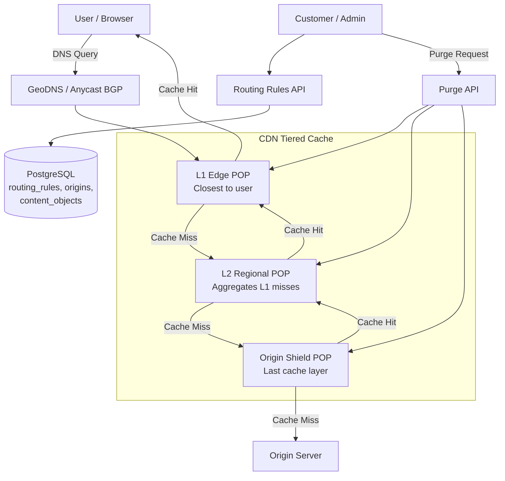
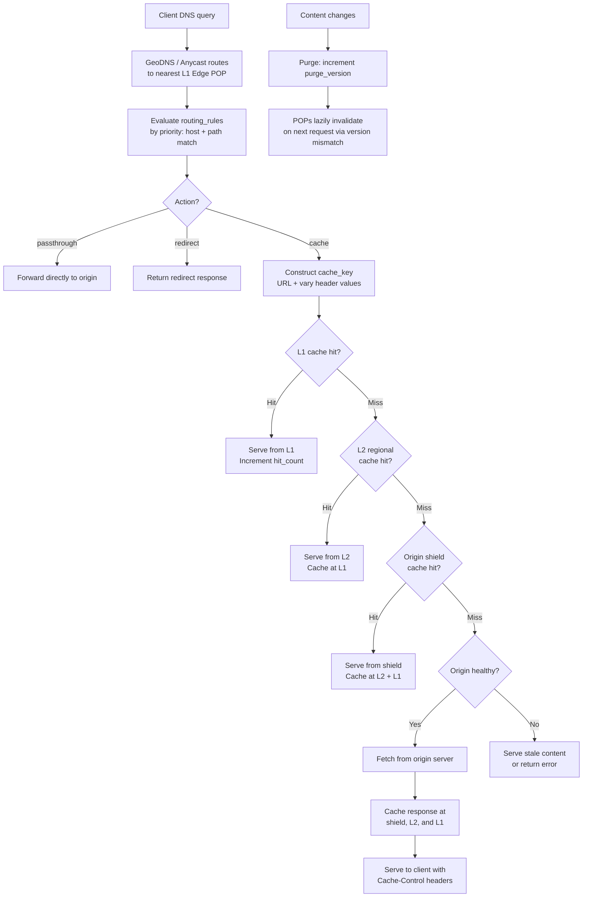

# Data Model: Content Delivery Network (Cloudflare)

A CDN accelerates content delivery by caching content at edge locations close to users. The data model must capture content metadata, cache state across hundreds of edge POPs (Points of Presence), routing rules, and origin server health. The tiered caching architecture (L1 edge, L2 regional, origin shield) is a key design choice that reduces origin load.

## High-Level Architecture

---

## Data Flow

1. **DNS resolution** -- Client makes a DNS query. GeoDNS (or anycast BGP) routes the query to the nearest L1 edge POP based on the client's geographic location and the POP's anycast_prefix.

2. **Request arrives at edge** -- The L1 edge POP receives the HTTP request. It evaluates `routing_rules` in priority order, matching on host and path to determine the action (cache, passthrough, redirect, edge_function).

3. **Cache lookup (L1)** -- If action=cache, the POP constructs the cache_key from the URL + vary header values and looks up `edge_cache_entries` for this POP. If found and not expired (or is_stale=true with stale-while-revalidate), serve it. Increment hit_count.

4. **L2 regional fallback** -- On L1 miss, the request is forwarded to the L2 regional POP (determined by edge_pops.tier). The L2 POP performs the same cache lookup. This aggregation layer prevents many L1 misses from all hitting the origin.

5. **Origin shield** -- On L2 miss, the request reaches the origin_shield POP. This is the last cache layer. A miss here means the content truly is not cached anywhere in the CDN.

6. **Origin fetch** -- On origin shield miss, the CDN fetches from the `origins` server. If `is_healthy=false`, it either serves stale content or returns an error. On success, it populates the content_objects metadata (etag, size, content_type).

7. **Cache population** -- The response is cached at each tier it passed through (origin shield, L2, L1), creating `edge_cache_entries` at each POP with appropriate TTLs derived from content_objects.ttl_seconds or routing_rules.ttl_override.

8. **Cache invalidation** -- When content changes, a purge request increments `purge_version` on the content_object. POPs lazily invalidate: on the next request, they compare their cached purge_version against the current one and treat mismatches as cache misses. Tag-based purging invalidates all content_objects matching a given tag.

9. **Response to client** -- The content is served with appropriate Cache-Control headers. The client and any intermediate proxies can cache based on these headers.

---

## Interview Discussion Points

**Q: Why tiered caching instead of every POP going directly to origin?**
If you have 300 edge POPs and a popular asset expires, 300 simultaneous origin requests create a thundering herd. Tiered caching funnels these through ~20 L2 POPs and then a single origin shield, so the origin sees 1 request instead of 300. This is the most critical scalability feature of a CDN.

**Q: How does cache invalidation work at scale?**
Two strategies: (1) TTL-based expiration -- set short TTLs for dynamic content, long TTLs for static assets. (2) Active purge -- increment purge_version for immediate invalidation. Tag-based purging enables invalidating groups of related content with a single operation.

**Q: Why is the cache_key per-POP rather than global?**
Each POP manages its own cache independently. A global cache would require distributed consensus (slow) and would not reflect geographic locality. The cache_key includes vary header values so the same URL can have multiple cache entries (e.g., gzip vs brotli).

**Q: How do you handle cache stampede (thundering herd at a single POP)?**
Request coalescing: when multiple concurrent requests arrive at a POP for the same uncached URL, only one request goes to the next tier. The others wait and are served from the cache entry that the first request populates. This is implemented at the POP level, not in the data model, but is critical to mention.
