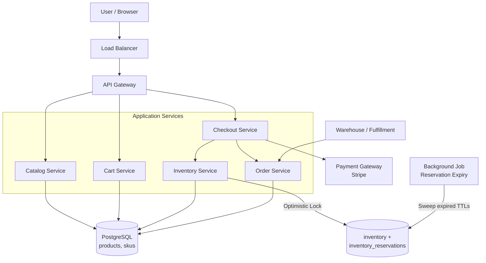
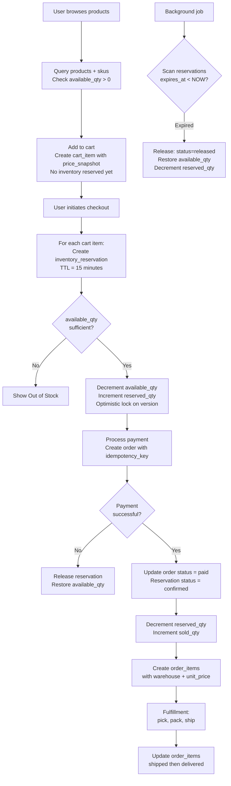

# Data Model: E-commerce Inventory & Orders (Amazon)

An e-commerce inventory system must handle the critical challenge of selling physical goods without overselling. The core tension is between showing accurate availability to millions of concurrent browsers while ensuring that checkout does not sell more units than exist. This model uses a reservation-based pattern with TTLs to hold inventory during checkout without permanently locking it.

## High-Level Architecture

---

## Data Flow

1. **Browse products** -- Users query products and skus. Inventory availability (available_qty > 0) is checked to show "In Stock" or "Out of Stock."

2. **Add to cart** -- A cart_items row is created with the current price_snapshot_cents. No inventory is reserved yet (carts are long-lived; reserving here would lock stock for days).

3. **Checkout initiated** -- The system attempts to reserve inventory for each cart item by creating `inventory_reservations` with a 15-minute TTL. The inventory record's `reserved_qty` is incremented and `available_qty` is decremented, using the optimistic lock version. If available_qty is insufficient, the item is shown as "Out of Stock."

4. **Payment processing** -- The payment processor authorizes the charge. The order is created with status=pending_payment and the idempotency_key prevents duplicate orders.

5. **Payment confirmed** -- On successful payment:

   - Order status updated to paid
   - Reservation status updated to confirmed
   - Inventory: reserved_qty decremented, sold_qty incremented
   - Order_items created with the confirmed warehouse and unit_price

6. **Reservation expiry** -- A background job periodically scans for reservations where `expires_at < NOW()` and status=active. Expired reservations are released: reservation status set to released, inventory available_qty incremented, reserved_qty decremented.

7. **Fulfillment** -- Warehouse picks, packs, and ships items. Order_items status updated to shipped, then delivered. Order status follows the latest item status.

8. **Cancellation** -- If an order is cancelled before shipping, inventory is restored: available_qty incremented, sold_qty decremented. Refund is issued via the payment processor.

---

## Interview Discussion Points

**Q: Why not reserve inventory when adding to cart?**
Carts are long-lived (days to weeks). Reserving at cart-add time would lock inventory for extended periods, causing phantom stock-outs. Reservation should only happen during the short checkout window (10-15 minutes).

**Q: How do you handle flash sales with 10,000 concurrent buyers for 100 items?**
Optimistic locking on the inventory version field. All 10,000 users can read concurrently. When they attempt to reserve, only updates where the version matches succeed. Failed attempts retry with fresh data. For extreme cases, use Redis atomic decrements as a fast pre-check before hitting the database.

**Q: Why store price in cents as INT instead of DECIMAL?**
Floating-point arithmetic causes rounding errors (0.1 + 0.2 = 0.30000000000000004). Cents as integers eliminate this entirely. All monetary calculations are exact. Display formatting (inserting the decimal point) is a presentation concern.

**Q: What if the price changes between cart add and checkout?**
The cart stores price_snapshot_cents at add time. At checkout, compare snapshot against current SKU price. If different, notify the user and let them confirm. Some businesses honor the lower price; others always use current price. The snapshot enables both policies.
