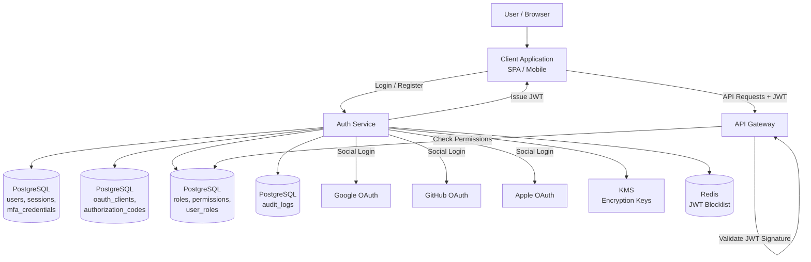
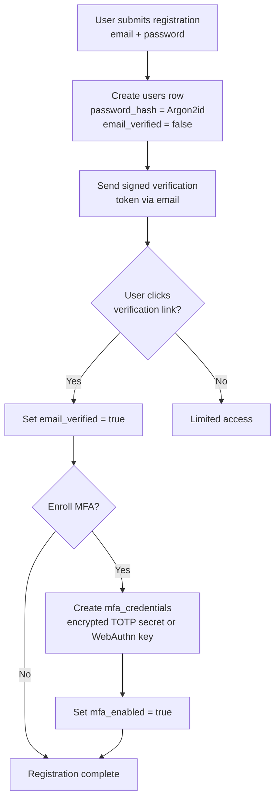
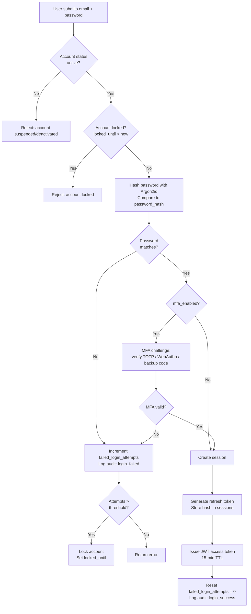
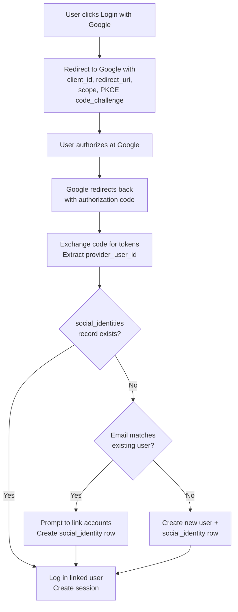
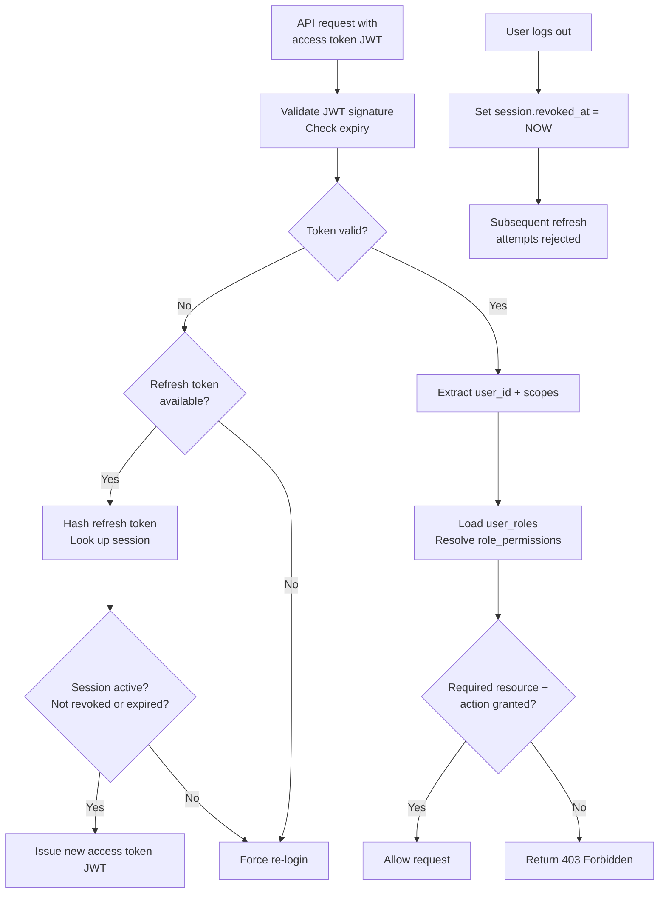

# Data Model: Authentication & SSO (OAuth/OIDC)

An authentication system manages user identity, credentials, sessions, and authorization. This model implements OAuth 2.0 / OpenID Connect with support for social login, multi-factor authentication (MFA), and role-based access control (RBAC). Every security-sensitive field uses hashing or encryption, and every action is audit-logged. The design prioritizes defense in depth: even if one layer is compromised, others still protect the user.

## High-Level Architecture

---

## Data Flow

### Registration Flow

1. **User registers** -- A new `users` row is created with email, password_hash (Argon2id), email_verified=false, status=active.

2. **Email verification** -- A signed verification token is emailed to the user. On click, email_verified is set to true. Unverified users may have limited access.

3. **MFA enrollment (optional)** -- User enrolls a TOTP app or WebAuthn key. A `mfa_credentials` row is created with the encrypted secret. `users.mfa_enabled` is set to true.

### Login Flow

4. **Credential check** -- User submits email and password. The system loads the user, checks `status` (not suspended/deactivated), checks `locked_until` (not locked). If `failed_login_attempts` exceeds threshold (e.g., 5), the account is locked for a duration.

5. **Password verification** -- The submitted password is hashed with Argon2id and compared to `password_hash`. On failure, `failed_login_attempts` is incremented and an audit_log entry is created (event_type=login_failed).

6. **MFA challenge** -- If `mfa_enabled=true`, the user must provide a second factor. The system loads `mfa_credentials` and verifies the TOTP code, WebAuthn assertion, or backup code. Audit logged.

7. **Session creation** -- On success, a `sessions` row is created. The refresh token is generated, hashed, and stored as `refresh_token_hash`. An access token (JWT, short-lived, 15-minute TTL) is issued. `failed_login_attempts` is reset to 0.

### Social Login Flow

8. **OAuth redirect** -- User clicks "Login with Google." The system redirects to Google with client_id, redirect_uri, scope, and a PKCE code_challenge.

9. **Authorization callback** -- Google redirects back with an authorization code. The system exchanges it for tokens, extracts the provider_user_id, and looks up `social_identities`. If found, log in the linked user. If not found, create a new user and social_identity.

### API Authorization Flow

10. **Token validation** -- Each API request includes an access token (JWT). The system validates the signature, checks expiry, and extracts user_id and scopes.

11. **Permission check** -- The system loads the user's roles (via `user_roles`), resolves permissions (via `role_permissions` and `permissions`), and checks if the required resource+action is granted.

12. **Token refresh** -- When the access token expires, the client sends the refresh token. The system hashes it, looks up the matching session, verifies it is not revoked or expired, and issues a new access token.

### Logout Flow

13. **Session revocation** -- The session's `revoked_at` is set to NOW(). Subsequent refresh attempts with this session's token are rejected. The client discards its tokens.

14. **All events audit-logged** -- Every step above generates an `audit_logs` entry with event_type, user context, IP, and user_agent.

---

## Interview Discussion Points

**Q: Why not store the access token in the database?**
Access tokens are JWTs that are validated by signature, not by database lookup. This is stateless verification -- every API request does NOT hit the database. Only refresh tokens (long-lived) are tracked in sessions for revocation.

**Q: How do you handle token revocation if JWTs are stateless?**
Short TTL (15 minutes) means revocation takes effect within 15 minutes at most. For immediate revocation, maintain a small in-memory blocklist (Redis) of revoked JWT IDs (jti) that is checked on each request. The blocklist only needs to hold tokens for their remaining TTL.

**Q: Why RBAC instead of ABAC (Attribute-Based Access Control)?**
RBAC is simpler to reason about and audit. For most applications, the combination of roles and fine-grained permissions (resource + action) is sufficient. ABAC adds context-aware rules (e.g., "can edit only their own orders") which can be layered on top of RBAC at the application level.

**Q: How do you handle account linking (user has both password and Google login)?**
The `social_identities` table supports multiple providers per user. When a user with an existing password account logs in via Google for the first time, and the email matches, prompt them to link accounts (after verifying ownership of both). This creates a social_identities row linked to their existing user_id.
