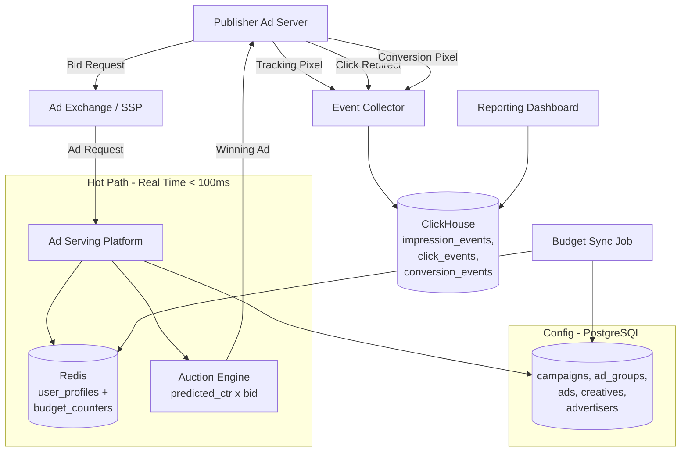
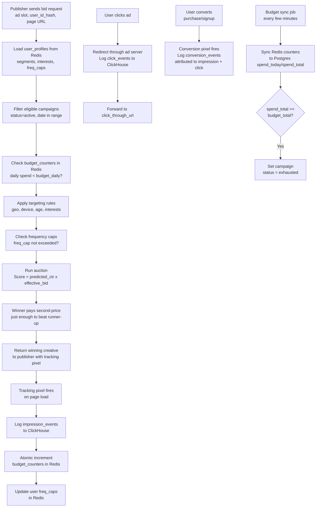

# Data Model: Ad Serving & Real-Time Bidding

An ad serving platform matches advertisers' ads with publisher inventory in real time, typically within 100ms. The data model spans the full lifecycle: campaign configuration, real-time auction mechanics, event tracking (impressions, clicks, conversions), and budget enforcement. Hot-path data (user profiles, budget counters) lives in Redis, while event analytics uses a columnar store like ClickHouse for fast aggregation over billions of rows.

## High-Level Architecture

---

## Data Flow

1. **Publisher sends ad request** -- A user loads a webpage. The publisher's ad server sends a bid request to the ad exchange with the ad slot dimensions, user_id_hash, page URL, and user consent flags.

2. **Load user profile** -- The system reads the `user_profiles` from Redis to get the user's interest segments, behavioral data, and current frequency cap counters.

3. **Filter eligible campaigns** -- Query campaigns where status=active, date range includes today, and budget is not exhausted. Check `budget_counters` in Redis to verify daily spend has not exceeded budget_daily.

4. **Apply targeting** -- For eligible campaigns, check ad_groups targeting rules: does the user's geo, device, and age match? Are they in the required interest segments? Has the frequency cap been reached (check freq_caps in user_profiles)?

5. **Run auction** -- For all eligible ads, compute the ranking score: `predicted_ctr x effective_bid`. The highest score wins. In a second-price auction, the winner pays just enough to beat the second-highest bid.

6. **Serve creative** -- The winning ad's creative is returned to the publisher. A tracking pixel URL is embedded for impression confirmation.

7. **Log impression** -- When the tracking pixel fires, an `impression_events` row is written to ClickHouse. The `budget_counters` in Redis are atomically incremented (spend += auction_price, impressions += 1). The user's freq_caps in user_profiles are updated.

8. **Track clicks** -- If the user clicks the ad, a redirect through the ad server logs a `click_events` row before forwarding to the click_through_url.

9. **Track conversions** -- A conversion pixel or server-to-server callback fires when the user completes an action (purchase, signup). A `conversion_events` row is written, attributed to the original impression and click.

10. **Budget sync** -- Periodically (every few minutes), Redis budget_counters are synced back to campaigns.spend_today and spend_total in Postgres. If spend_total >= budget_total, the campaign status is set to exhausted.

11. **Reporting** -- Dashboards query ClickHouse to aggregate impression, click, and conversion events by campaign, ad_group, ad, date, geo, and device. CTR, CPC, CPA, and ROAS are computed on the fly.

---

## Interview Discussion Points

**Q: Why separate ClickHouse and Postgres?**
Postgres handles the relational campaign configuration (hundreds of rows, complex relationships). ClickHouse handles billions of event rows with columnar compression and fast aggregations. Using Postgres for events would collapse under the write volume; using ClickHouse for campaign config would be awkward for transactional updates.

**Q: Why second-price auction instead of first-price?**
Second-price auctions encourage bidders to bid their true value (it is the dominant strategy). First-price auctions incentivize bid shading, which is harder to optimize. Google and most exchanges have moved to first-price auctions for transparency, but the data model supports both -- it is the auction logic, not the schema, that determines pricing.

**Q: How do you prevent budget overspend?**
Redis atomic counters are checked before each auction. If incrementing spend would exceed the daily budget, the campaign is excluded from the auction. Because Redis operations are atomic, concurrent auctions cannot both read "under budget" and both increment past the limit. A small overspend margin (e.g., 1%) is acceptable in practice.

**Q: How do you handle frequency capping at scale?**
Each user's freq_caps in Redis is a hash map of campaign_id to impression count. The frequency window is enforced by TTL on the hash field or by including a time bucket in the key. At 100K auctions/second, this must be sub-millisecond, which is why Redis (not a database) is essential.
