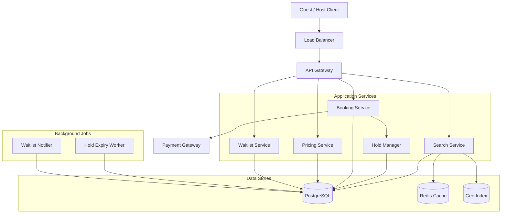
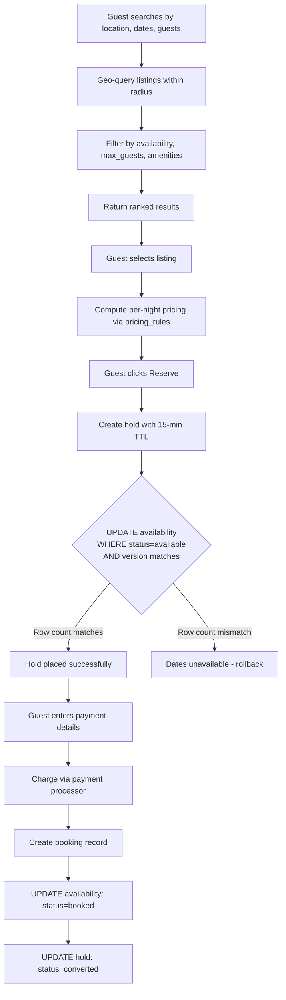
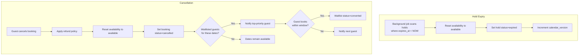

# Data Model: Booking & Reservation (Airbnb)

A booking and reservation system must solve the double-booking problem: two guests should never be able to book the same listing for overlapping dates. The core design uses a per-date availability model with optimistic locking, a short-lived hold mechanism to protect inventory during checkout, and pricing rules that allow dynamic pricing based on season, day of week, and demand. The waitlist feature captures demand for fully booked dates.

---

## High-Level Architecture

---

## Data Flow

1. **Search listings** -- Guest searches by location (geo-query on lat/lng within radius), dates (check availability rows for status=available across the date range), guest count (max_guests >= requested), and filters (amenities, property_type).

2. **View listing details** -- Load the listing record with pricing. For each date in the requested range, apply pricing_rules in priority order: check for price_override on the specific availability row first, then matching pricing_rules (seasonal > weekend > early_bird), finally fall back to base_price.

3. **Place hold** -- When the guest clicks "Reserve":

   - Create a `holds` row with a 15-minute expires_at
   - UPDATE all `availability` rows for the date range: SET status='held', hold_id=X WHERE status='available' AND calendar_version matches
   - If affected row count does not equal the number of dates, another user grabbed a date -- rollback and show "dates unavailable"
   - Store the full price breakdown in price_snapshot_json

4. **Complete payment** -- Guest enters payment details and confirms:

   - Charge the guest via the payment processor
   - Create a `bookings` row with all pricing details and idempotency_key
   - UPDATE `availability` rows: SET status='booked', booking_id=X, hold_id=NULL
   - UPDATE `holds` row: SET status=converted

5. **Hold expiry** -- A background job runs every minute, scanning for holds where `expires_at < NOW()` and status=active:

   - UPDATE `availability` rows: SET status='available', hold_id=NULL, increment calendar_version
   - UPDATE `holds` row: SET status=expired

6. **Cancellation** -- If a confirmed booking is cancelled:

   - Apply refund policy based on cancellation_policy and time until checkin
   - UPDATE `availability` rows: SET status='available', booking_id=NULL
   - UPDATE `bookings` row: SET status=cancelled
   - Query `waitlist_entries` for matching listing_id and overlapping dates
   - Notify top-priority waitlisted guests; set notified_at and status=notified

7. **Waitlist conversion** -- Notified guest has a time window (e.g., 4 hours) to book. If they do, waitlist status=converted. If they do not, notify the next guest.

### Search and Booking Flow

### Hold Expiry and Cancellation Flow

---

## Interview Discussion Points

**Q: Why per-date rows instead of a single booking range with overlap checks?**
Per-date rows make availability checks O(1) per date (primary key lookup). Overlap detection with ranges requires checking `NOT EXISTS (SELECT 1 FROM bookings WHERE listing_id=X AND checkin < :checkout AND checkout > :checkin)` which is harder to index correctly and more prone to race conditions under concurrency.

**Q: How do you handle time zones?**
Checkin and checkout are DATE (not TIMESTAMP) because hospitality operates on dates, not times. The listing's timezone determines when "check-in on Oct 15" actually starts. Storing dates avoids time zone conversion bugs.

**Q: What if the hold expires while the user is entering their credit card?**
The payment flow should extend the hold if the user is actively progressing (e.g., extend by 5 minutes when payment form is submitted). If it truly expires, the booking attempt fails gracefully with a "dates no longer available" message.

**Q: Why not use database-level locks (SELECT FOR UPDATE) on availability?**
Database locks create contention. If 100 users are viewing the same popular listing, SELECT FOR UPDATE would serialize them. Optimistic locking with calendar_version allows all 100 to read concurrently; only the two who try to hold overlapping dates will conflict, and only one will succeed.
