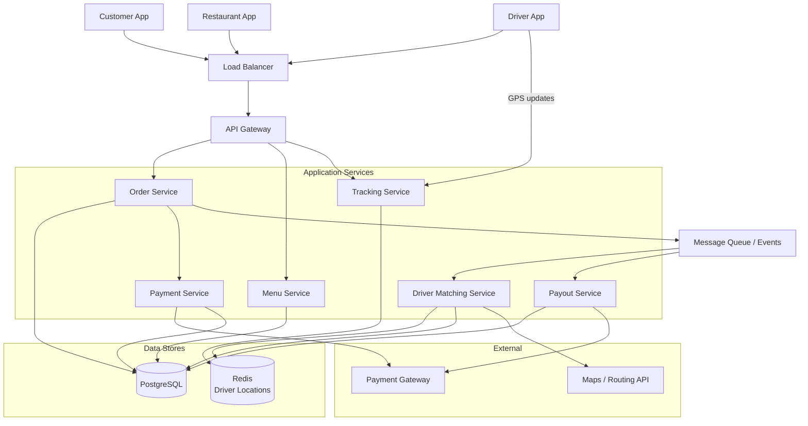
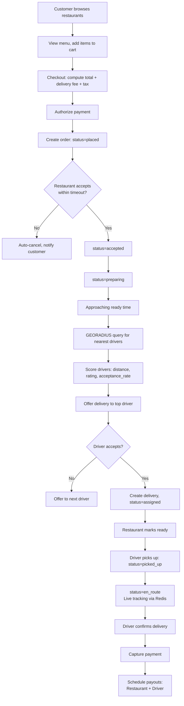
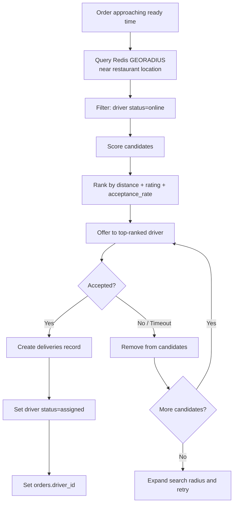

# Data Model: Food Delivery (DoorDash/Uber Eats)

A food delivery platform coordinates three parties in real time: customers ordering food, restaurants preparing it, and drivers delivering it. The data model must handle menu management with real-time availability, order lifecycle across multiple status transitions, driver matching using geospatial queries, live location tracking, and split payments to restaurants and drivers. The core challenge is coordinating these three independent actors with different incentives and constraints.

---

## High-Level Architecture

---

## Data Flow

1. **Customer browses** -- Customer opens the app. The system queries `restaurants` near the customer's location using a geo-query on the `location` field, filtered by is_open=true AND accepting_orders=true. Results are ranked by distance, rating, and cuisine match.

2. **Menu selection** -- Customer views a restaurant's `menu_items` where is_available=true. They add items with customizations to the cart.

3. **Checkout** -- The system computes the total: sum of order_items (price_cents x quantity + customization prices) + delivery_fee (distance-based) + tax. Payment is authorized (payments.status=authorized).

4. **Order placed** -- An `orders` row is created with status=placed. `order_items` rows capture name_snapshot, price_snapshot, and customizations_json.

5. **Restaurant accepts** -- The restaurant app shows the new order. Restaurant sets status=accepted. If the restaurant does not respond within a timeout (e.g., 5 minutes), the order is auto-cancelled and the customer is notified.

6. **Preparation** -- Restaurant sets status=preparing. The ETA is computed: avg_prep_minutes + estimated driving time from restaurant to customer (based on delivery_address distance).

7. **Driver matching** -- When the order is approaching ready (e.g., 5 minutes before expected ready time), the system queries `driver_locations` in Redis using GEORADIUS to find the nearest available drivers (status=online). The matching algorithm considers distance, driver rating, and acceptance_rate. The selected driver is offered the delivery.

8. **Driver assigned** -- When a driver accepts, a `deliveries` row is created. Driver status changes to assigned. `orders.driver_id` is set.

9. **Pickup** -- Restaurant sets status=ready. Driver navigates to the restaurant. Upon arrival and pickup, status changes to picked_up. Driver location updates continue streaming to Redis every 3-5 seconds.

10. **En route** -- Status changes to en_route. The customer sees live driver location on a map, powered by polling `driver_locations` from Redis.

11. **Delivered** -- Driver confirms delivery. Status changes to delivered. Payment is captured (payments.status=captured). Driver status returns to online.

12. **Payouts scheduled** -- Two `payouts` rows are created:
    - Restaurant: subtotal - (subtotal x commission_rate)
    - Driver: base_pay + distance_bonus + tip
    - Payouts are scheduled per the settlement frequency (daily for drivers, weekly for restaurants).

### Order Lifecycle Flow

### Driver Matching Flow

---

## Interview Discussion Points

**Q: Why snapshot item names and prices instead of just referencing the menu_item?**
Restaurants frequently update menus (rename items, change prices, mark items unavailable). An order record must be self-contained -- if you look at an order from 6 months ago, you need to see exactly what was ordered and at what price. A foreign key to a potentially changed menu_item would show incorrect data.

**Q: How do you handle the driver matching problem?**
The matching algorithm balances multiple objectives: minimize customer wait time (nearest driver), maximize driver utilization (batching nearby pickups), and maintain fairness (rotate among available drivers). Redis GEORADIUS finds candidates; the ranking algorithm scores them. This is one of the most valuable IP in food delivery platforms.

**Q: Why authorize payment at order time but capture at delivery?**
If the restaurant cancels or is out of items, the customer should not be charged. Authorization holds the funds without transferring them. Capture only happens on successful delivery. This is standard for two-sided marketplaces where fulfillment is not guaranteed at order time.

**Q: How do you compute accurate delivery ETAs?**
ETA = restaurant prep time (avg_prep_minutes, adjusted for current order volume) + driver travel time to restaurant + driver travel time to customer. Travel times use real-time traffic data. The ETA is updated continuously as driver_locations stream in. Accurate ETAs are critical for customer satisfaction and are a major competitive differentiator.
