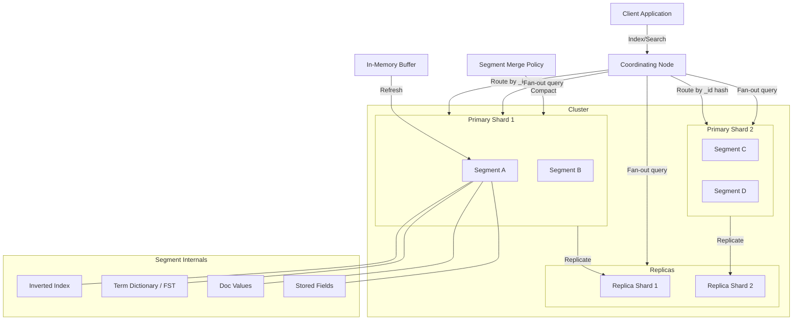
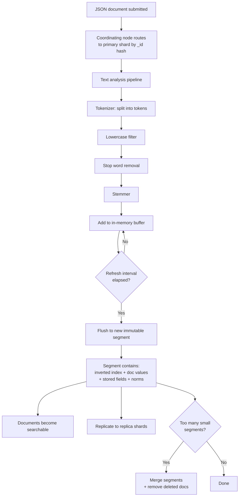
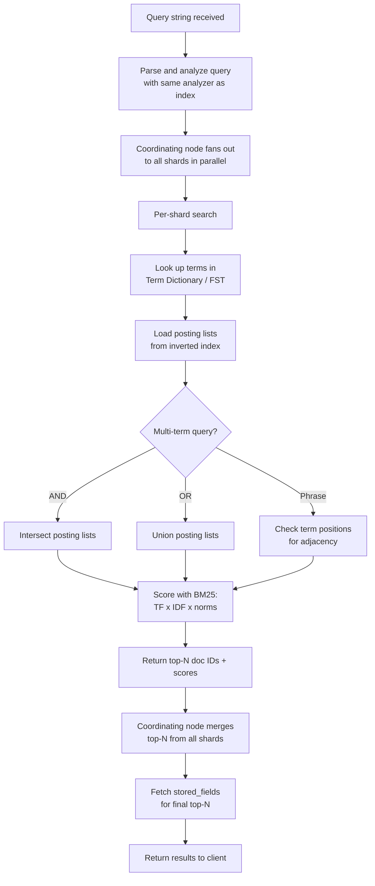

# Data Model: Search Engine (Elasticsearch)

A search engine's data model is fundamentally different from relational databases. Instead of tables with rows, it uses inverted indexes that map terms to documents, enabling full-text search in milliseconds across billions of documents. This model covers the core Lucene-based structures that power Elasticsearch: inverted indexes, term dictionaries, doc values, stored fields, and the segment-based architecture that makes writes and reads concurrent without locking.

---

## High-Level Architecture

---

## Data Flow

### Indexing (Write Path)

1. **Document ingested** -- A JSON document is submitted to the index API. The coordinating node routes it to the correct primary shard based on a hash of the document's \_id.

2. **Text analysis** -- For each text field, the configured analyzer processes the content:

   - **Tokenizer**: splits "The quick brown fox" into ["The", "quick", "brown", "fox"]
   - **Lowercase filter**: ["the", "quick", "brown", "fox"]
   - **Stop word filter**: ["quick", "brown", "fox"] (removes "the")
   - **Stemmer**: ["quick", "brown", "fox"] (or ["run", "shoe"] from "running shoes")

3. **In-memory buffer** -- Analyzed terms and their positions are added to an in-memory buffer (the "indexing buffer"). The document's \_source is also buffered.

4. **Refresh (new segment)** -- Every refresh_interval (default 1 second), the in-memory buffer is flushed to a new, small, immutable segment on disk. The segment contains the inverted index, doc values, stored fields, and norms for the buffered documents. After refresh, new documents become searchable.

5. **Segment merging** -- Over time, many small segments accumulate. A background merge policy combines small segments into larger ones, physically removes deleted documents (those marked in live_docs), and optimizes the data layout. This is similar to LSM-tree compaction. Merging is the only time data is physically rewritten.

6. **Replication** -- After the primary shard writes the segment, the operation is replicated to all replica shards for fault tolerance and read throughput.

### Querying (Read Path)

7. **Query parsing** -- The query string (e.g., "running shoes size 10") is parsed and analyzed using the same analyzer as the indexed field. This ensures "running" is stemmed to "run" to match indexed "run."

8. **Shard fan-out** -- The coordinating node sends the query to all shards (primary or replica) in parallel. Each shard searches independently.

9. **Per-shard search** -- On each shard:

   - Look up each query term in the **term_dictionary** (FST) to get the block_offset
   - Load the **posting list** from the **inverted_index** at that offset
   - For multi-term queries, intersect or union posting lists (AND/OR)
   - For phrase queries, check term **positions** for adjacency

10. **Scoring with BM25** -- Each matching document is scored:

    - **TF (term frequency)**: how often the term appears in the document
    - **IDF (inverse document frequency)**: how rare the term is across all documents
    - **Field length normalization (norms)**: shorter fields score higher (a match in a 5-word title is more relevant than in a 5000-word body)

11. **Top-N per shard** -- Each shard returns its top-N scored documents (only doc_ids and scores, not full documents).

12. **Coordinating node merge** -- The coordinating node merges top-N results from all shards, re-sorts globally, and takes the final top-N. If sorting by a field (e.g., price), **doc_values** are used instead of BM25 scores.

13. **Fetch phase** -- For the final top-N documents, **stored_fields** (\_source) are fetched from the relevant shards and returned to the client.

### Indexing (Write Path) Flow

### Querying (Read Path) Flow

---

## Interview Discussion Points

**Q: Why inverted index instead of a B-tree?**
B-trees are optimized for exact match and range queries on structured data. Full-text search requires finding documents containing ANY of the query terms, ranked by relevance. An inverted index directly maps terms to documents, making this O(1) per term lookup + O(K) for K matching documents. A B-tree would require scanning all documents.

**Q: What is the trade-off with refresh_interval?**
Lower refresh_interval (e.g., 100ms) means near-real-time search but creates many small segments, increasing merge overhead. Higher refresh_interval (e.g., 30s) means better write throughput and fewer segments but documents are not searchable for up to 30 seconds. For logging use cases, 30s is fine. For e-commerce product search, 1s is typical.

**Q: How does Elasticsearch handle updates?**
Documents are immutable within segments. An "update" is actually a delete (mark in live_docs) + re-index (write to a new segment). This is why updates are more expensive than inserts, and why partial updates still reindex the entire document.

**Q: Why does Elasticsearch use BM25 instead of TF-IDF?**
BM25 improves on TF-IDF by adding term frequency saturation (diminishing returns beyond a certain TF) and configurable document length normalization. In practice, BM25 produces better ranking for most use cases and is the default since Elasticsearch 5.0.

**Q: How does sharding affect search accuracy?**
IDF (inverse document frequency) is computed per-shard, not globally. If term distribution is uneven across shards, scores may be slightly inaccurate. This is usually negligible for large indices but can matter for small ones. A `dfs_query_then_fetch` search type computes global IDF at the cost of an extra round trip.
