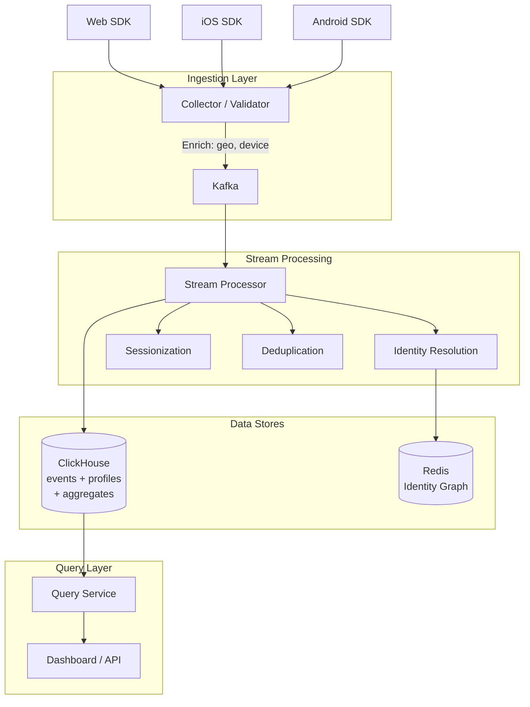
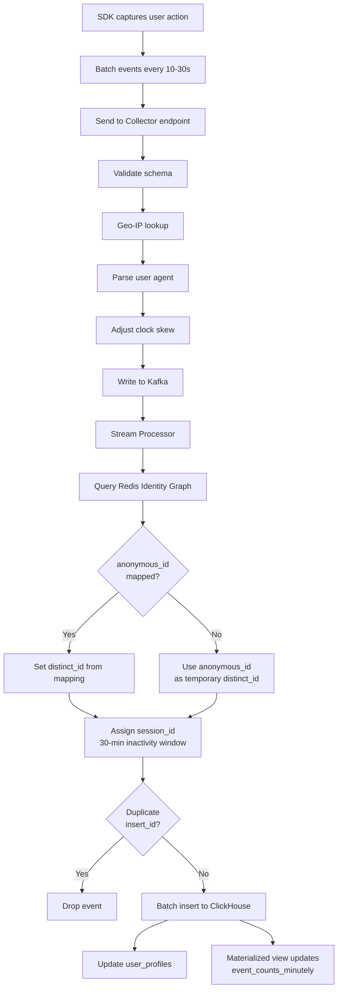
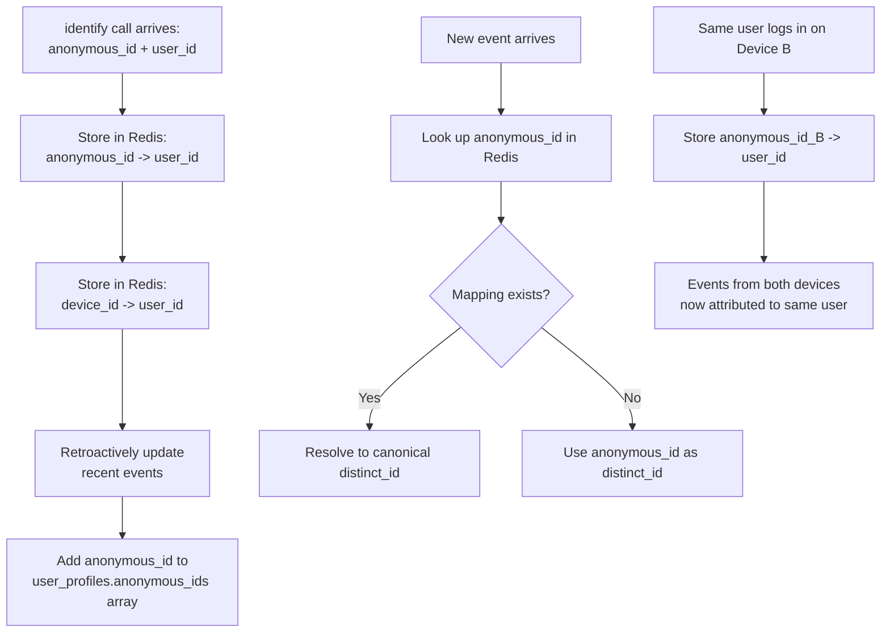

# Data Model: Analytics Platform (Mixpanel/Amplitude)

A product analytics platform ingests billions of user events, resolves user identities across devices, and enables querying patterns like funnels, retention, and cohort analysis. The data model is optimized for append-heavy writes with ClickHouse's columnar engine, uses Redis for real-time identity resolution, and pre-aggregates common metrics to serve dashboards without scanning raw events. The core challenge is linking anonymous activity (before login) to identified users (after login) across multiple devices.

---

## High-Level Architecture

---

## Data Flow

1. **Client SDK sends event** -- The SDK (web, iOS, Android) captures a user action and sends it to the collector endpoint with anonymous_id, device_id, event_name, properties, and a client-generated insert_id. Events are batched and sent every 10-30 seconds.

2. **Collector validates and enriches** -- The collector server:

   - Validates the event schema (required fields, types)
   - Performs geo-IP lookup to derive country/region/city
   - Parses user agent for device_info
   - Adjusts event_time for obvious clock skew (rejects events from the future)
   - Writes the event to Kafka for downstream processing

3. **Identity resolution** -- The stream processor queries the `identity_graph` in Redis:

   - If anonymous_id has a mapping, set distinct_id to the mapped value
   - If no mapping exists, use anonymous_id as a temporary distinct_id
   - When an `identify` call arrives (linking anonymous_id to a known user), update Redis and retroactively update recent events

4. **Sessionization** -- The stream processor groups events into sessions:

   - Events from the same distinct_id within 30 minutes of inactivity are assigned the same session_id
   - A gap of >30 minutes starts a new session
   - This is computed in the stream processor, not in the database

5. **Deduplication** -- Events with duplicate (project_id, insert_id) are dropped. This handles SDK retries. ClickHouse's ReplacingMergeTree provides eventual deduplication during compaction as a safety net.

6. **Write to ClickHouse** -- Deduplicated, enriched events are batch-inserted into the `events` table. ClickHouse handles millions of inserts per second with columnar compression.

7. **User profile update** -- The stream processor updates `user_profiles`:

   - Update last_seen_at and total_events
   - Merge new traits from `identify` or `set_profile` calls
   - Add newly discovered anonymous_ids to the array
   - ClickHouse ReplacingMergeTree handles deduplication on (project_id, distinct_id)

8. **Pre-aggregation** -- Materialized views in ClickHouse continuously aggregate new events into `event_counts_minutely`:

   - Group by (project_id, event_name, minute_bucket)
   - Increment count
   - Merge into unique_users HyperLogLog sketch
   - AggregatingMergeTree merges partial aggregates during background compaction

9. **Experiment tracking** -- When a user is assigned to an experiment variant, an `experiment_assignments` row is written. When the user completes the conversion goal (detected from events), converted=true and converted_at are set.

10. **Query service** -- Analysts and dashboards query the data:
    - **Simple metrics** (event counts, unique users): query event_counts_minutely
    - **Funnels** (step 1 → step 2 → step 3 conversion): query raw events, window-function by distinct_id
    - **Retention** (% of users who return in week 2, 3, 4): query events grouped by first_seen cohort
    - **Cohort analysis**: query user_profiles for trait-based segments, then join with events
    - **Experiment results**: query experiment_assignments, compute conversion rate per variant, run statistical significance test

### Event Ingestion Pipeline

### Identity Resolution Flow

---

## Interview Discussion Points

**Q: Why ClickHouse instead of Postgres or BigQuery?**
ClickHouse is purpose-built for analytics: columnar storage compresses 10-100x, vectorized query execution scans billions of rows in seconds, and MergeTree engines handle millions of inserts per second without write amplification. Postgres would collapse under this write volume. BigQuery works but has query latency (seconds, not milliseconds) and cost-per-query pricing that becomes expensive for interactive dashboards.

**Q: How does identity resolution handle merging two identified users?**
If user_123 and user_456 turn out to be the same person (e.g., same email detected), you perform an identity merge: choose a canonical ID, update all identity_graph mappings, and asynchronously update historical events. This is the hardest part of identity resolution and can create cascading merges.

**Q: Why HyperLogLog instead of exact unique counts?**
For a query like "unique users who viewed the homepage in the last 30 days," exact counting requires holding all distinct_ids in memory (potentially millions). HLL provides ~2% accuracy with 12 KB. For dashboard-level analytics, this is more than sufficient. When exact counts are needed (e.g., billing), use exact COUNT(DISTINCT) on smaller result sets.

**Q: How do you handle late-arriving events?**
Events can arrive hours or days late (mobile app in offline mode). The event_time (client timestamp) is used for analytics queries, not the insertion time. Pre-aggregated tables need to handle re-aggregation: when a late event arrives for a past minute_bucket, the aggregate is updated. AggregatingMergeTree handles this naturally by merging partial aggregates.

**Q: How do you ensure data freshness for dashboards?**
The pipeline is real-time: events flow through Kafka → stream processor → ClickHouse with end-to-end latency of 1-5 seconds. Pre-aggregated tables are updated continuously via materialized views. Dashboard queries hit pre-aggregated tables for <100ms response times.
