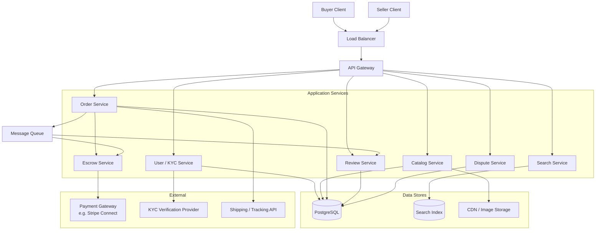
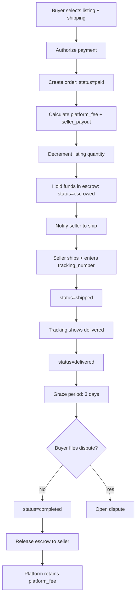
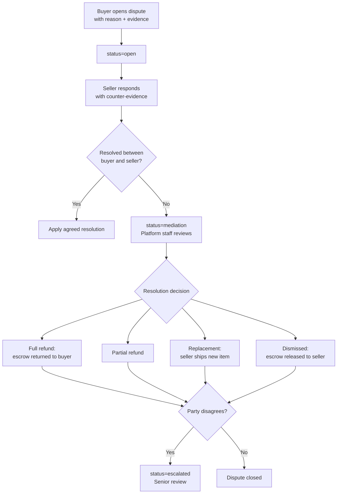

# Data Model: Marketplace (Airbnb/Etsy/eBay)

A two-sided marketplace connects buyers and sellers, earning revenue by facilitating transactions. The data model must handle the full lifecycle: seller onboarding with KYC verification, hierarchical product categorization, listing management with quality scoring, payment escrow for trust, bilateral reviews, and dispute resolution. The core design challenge is building trust between strangers through escrow, reviews, and seller tiers.

---

## High-Level Architecture

---

## Data Flow

1. **Seller onboarding** -- User registers and requests seller access. KYC verification progresses through levels: email verification (level 1), government ID upload (level 2), address verification (level 3), business documentation (level 4). Each level unlocks higher selling limits. A `seller_profiles` row is created.

2. **Listing creation** -- Seller selects a leaf category, which determines the available attributes (from allowed_attributes_json). They fill in title, description, condition, price, and category-specific attributes. Photos are uploaded and assigned display_order. Shipping options are configured. The listing starts as draft, then published to active.

3. **Quality scoring** -- The platform computes quality_score based on: number of photos (min 3 for high score), description word count (>100 words), price competitiveness (compared to similar listings), seller rating, and historical conversion rate. Quality_score influences search ranking.

4. **Discovery** -- Buyers browse by category tree or search by keywords. Results are ranked by a combination of quality_score, relevance, seller tier, view_count, and quantity_sold. Filters apply on category attributes, price range, condition, shipping destination, and seller rating.

5. **Purchase** -- Buyer selects a listing and shipping option. Payment is authorized through the payment processor. An `orders` row is created with status=paid. The platform_fee and seller_payout are calculated and locked. Listing quantity is decremented.

6. **Escrow** -- Payment funds are held in escrow (status=escrowed). The seller is notified to ship. This is the critical trust mechanism: the buyer's money is held by the platform, not sent to the seller.

7. **Shipping** -- Seller ships the item and enters the tracking_number. Order status changes to shipped. The buyer can track delivery.

8. **Delivery confirmation** -- When tracking shows delivered, or the buyer confirms receipt, status changes to delivered. A grace period (e.g., 3 days) begins for the buyer to inspect the item.

9. **Escrow release** -- After the grace period without dispute, status changes to completed. Escrow is released: seller_payout is transferred to the seller's payout_account_id. Platform retains platform_fee as revenue.

10. **Bilateral reviews** -- Both buyer and seller are prompted to leave reviews. Reviews are held until both parties submit (or the review window closes), then revealed simultaneously. Seller's avg_rating and review_count are updated. Tier re-evaluation may occur.

11. **Dispute flow** -- If the buyer is unhappy (item not received, not as described, damaged):
    - Buyer opens a dispute (status=open) with reason and evidence (photos, messages)
    - Seller responds with counter-evidence (tracking proof, listing photos)
    - If unresolved, status changes to mediation and platform staff reviews
    - Resolution options: full_refund (escrow returned to buyer), partial_refund, replacement (seller ships new item), dismissed (escrow released to seller)
    - If either party disagrees, dispute can be escalated

### Purchase and Escrow Flow

### Dispute Resolution Flow

---

## Interview Discussion Points

**Q: Why escrow instead of direct payment to sellers?**
Without escrow, the marketplace has no leverage over the transaction. If a buyer pays a seller directly and the item never arrives, the platform cannot intervene. Escrow gives the platform control: funds are released only after successful delivery. This is what makes strangers willing to transact.

**Q: How do you prevent review manipulation?**
Several mechanisms: (1) Reviews require a completed order (no fake reviews without a purchase). (2) Bilateral reveal prevents retaliation. (3) Anomaly detection flags suspicious patterns (many 5-star reviews from new accounts). (4) Review text is checked for incentivized language ("seller offered me a discount for 5 stars").

**Q: How does the category hierarchy scale?**
The self-referencing tree with depth and is_leaf flags supports any depth. For performance, the full category tree is cached (it changes infrequently). Breadcrumb navigation (Electronics > Computers > Laptops > Gaming) is computed by walking parent_id up to root. Category-specific attributes enable structured filtering without schema changes.

**Q: How do you handle multi-currency?**
Each listing has its own currency. At checkout, the platform converts to the buyer's preferred currency using current exchange rates. The order stores the original listing currency and price for the seller, plus the converted amount for the buyer. Exchange rate risk is managed by the platform.

**Q: Why seller tiers instead of just ratings?**
Ratings alone do not capture the full picture. A seller with a 4.8 rating but 3 sales is very different from one with 4.7 and 10,000 sales. Tiers combine multiple signals (rating, volume, response rate, dispute rate) into a single, actionable badge that buyers understand. Tiers also give the platform levers to incentivize desired behavior (lower fees for top-rated sellers).
