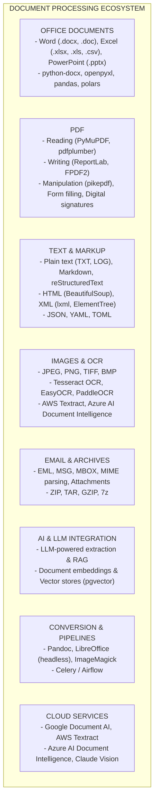
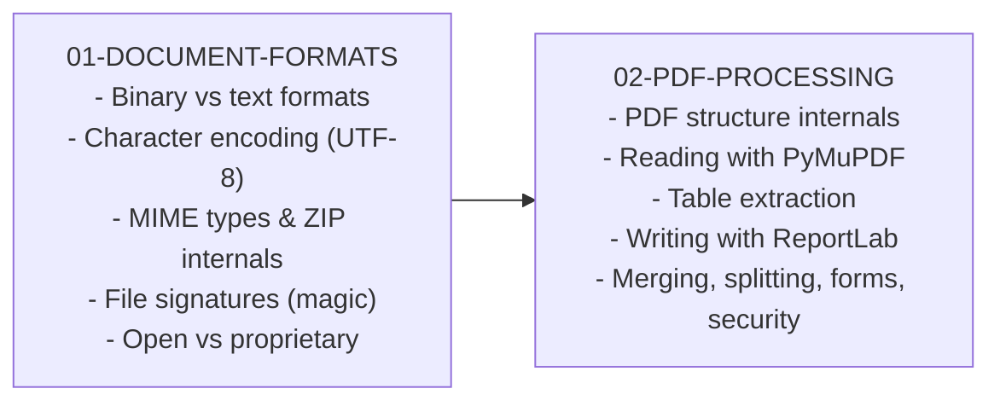
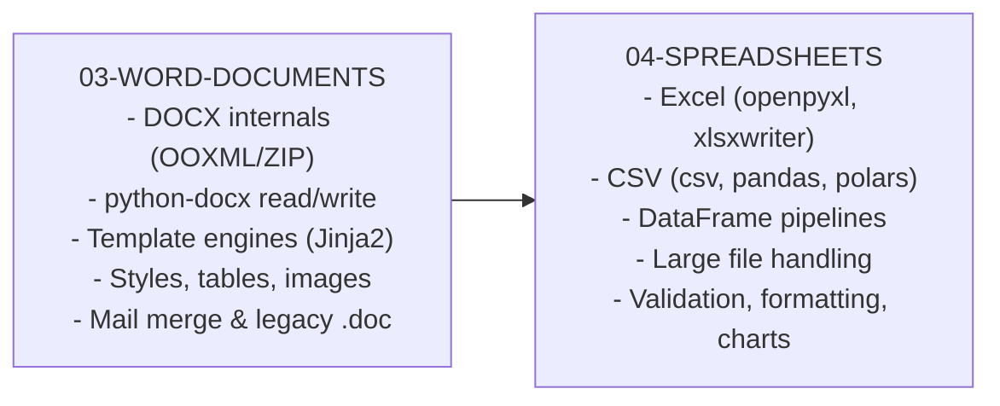
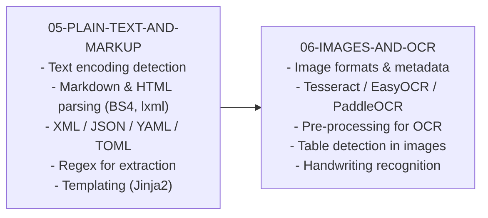
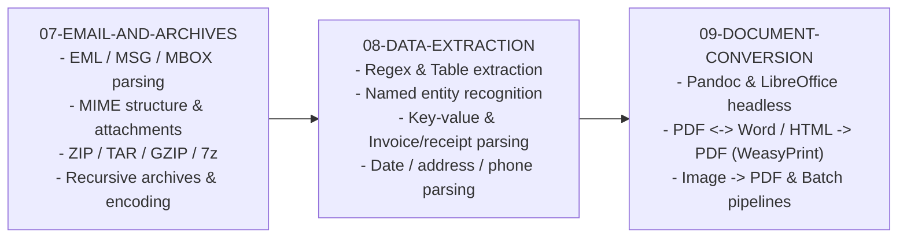
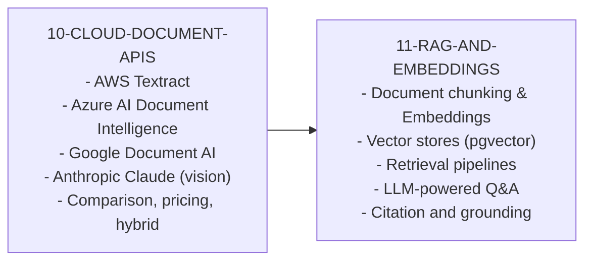
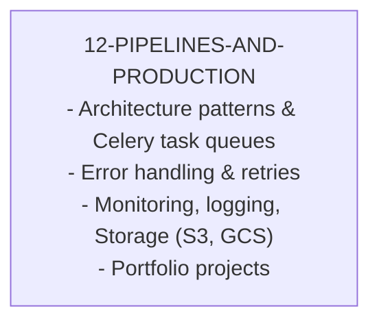
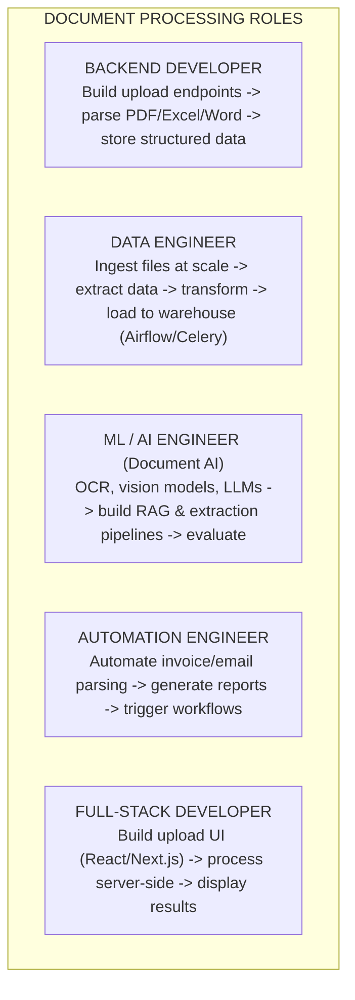
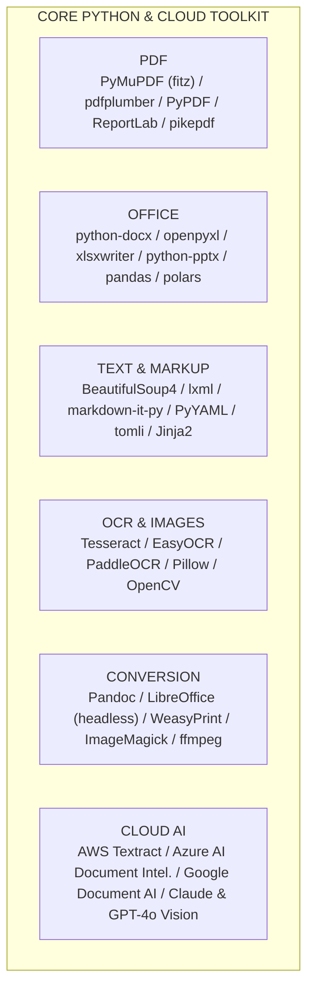

# Document Processing: From Zero to Expert

## Why This Guide Exists

Document processing is one of the most universally needed skills in software engineering, yet it is rarely taught as a cohesive discipline. Every business runs on documents — contracts in PDF, reports in Word, data in Excel, receipts as scanned images, emails with attachments. The ability to programmatically read, extract, transform, and generate documents across all these formats is what separates manual data entry from automated pipelines that process thousands of files per hour.

This guide takes you from understanding file formats at the binary level to building production-grade document processing pipelines that integrate OCR, NLP, cloud AI services, and LLM-powered extraction. You will learn Python-first (the dominant language for document processing), with practical code for every format you will encounter in the real world.

---

## The Document Processing Landscape

---

## Learning Path Overview

### Phase 1: Foundations (Chapters 01-02)

**Goal**: Understand how document file formats work at the binary level, and master the most important format in business: PDF.

You cannot process documents reliably without understanding:

- **What** a file format actually contains at the byte level
- **Why** PDF extraction is hard (it is a page-description language, not a data format)
- **How** character encoding works (UTF-8 vs Latin-1 vs Windows-1252)
- **When** to use which library (PyMuPDF vs pdfplumber vs PyPDF)

### Phase 2: Office Documents (Chapters 03-04)

**Goal**: Master the Microsoft Office formats that dominate business workflows.

### Phase 3: Text, Markup & Media (Chapters 05-06)

**Goal**: Handle the full spectrum of text-based formats and extract text from images.

### Phase 4: Specialized Formats & Conversion (Chapters 07-09)

**Goal**: Handle email, archives, and convert between any document formats.

### Phase 5: Cloud AI & LLM Integration (Chapters 10-11)

**Goal**: Leverage cloud services and LLMs for intelligent document understanding.

### Phase 6: Production Pipelines (Chapter 12)

**Goal**: Build production-grade document processing systems.

---

## How the Roles Break Down

---

## Recommended Resources

### Books

| Book                                      | Author             | Focus                                       |
| ----------------------------------------- | ------------------ | ------------------------------------------- |
| _Automate the Boring Stuff with Python_   | Al Sweigart        | Python automation basics (PDF, Excel, Word) |
| _Python for Data Analysis_                | Wes McKinney       | pandas for data processing                  |
| _Natural Language Processing with Python_ | Bird, Klein, Loper | NLP for text extraction                     |
| _PDF Explained_                           | John Whitington    | PDF format internals                        |
| _Designing Data-Intensive Applications_   | Martin Kleppmann   | Pipeline architecture                       |

### Online Resources

| Resource                     | Type           | Level        |
| ---------------------------- | -------------- | ------------ |
| PyMuPDF documentation        | Official docs  | All          |
| python-docx documentation    | Official docs  | Beginner     |
| openpyxl documentation       | Official docs  | Beginner     |
| pandas user guide            | Official docs  | All          |
| Tesseract OCR wiki           | Official docs  | Intermediate |
| AWS Textract developer guide | Official docs  | Intermediate |
| LangChain document loaders   | Framework docs | Intermediate |

---

## Essential Tools & Platforms

---

## What Makes Document Processing Hard

1. **Format inconsistency** — The same "PDF" can be a text-based document, a scanned image, a form, or a mix of all three. No single library handles every case
2. **Encoding nightmares** — Documents from different systems use different character encodings (UTF-8, Latin-1, Windows-1252, Shift-JIS). Wrong detection means garbled text
3. **Layout complexity** — Tables, multi-column layouts, headers/footers, and floating images make positional text extraction unreliable
4. **Quality degradation** — Scanned documents have noise, skew, low resolution, and handwriting that OCR engines struggle with
5. **Scale challenges** — Processing 10 files is easy; processing 10 million files requires queues, parallelism, storage management, and error recovery
6. **Proprietary formats** — Some formats (legacy .doc, .xls, Visio, CAD) have poor open-source support and require commercial tools or format conversion
7. **Security concerns** — Documents can contain malware, macros, embedded scripts, and metadata leaks. Processing untrusted files requires sandboxing
8. **Ever-changing standards** — PDF 2.0, OOXML strict vs transitional, new image formats (AVIF, WebP) — the standards keep evolving

The rest of this guide will teach you how to handle each of these challenges, starting from the fundamentals of how file formats work.
