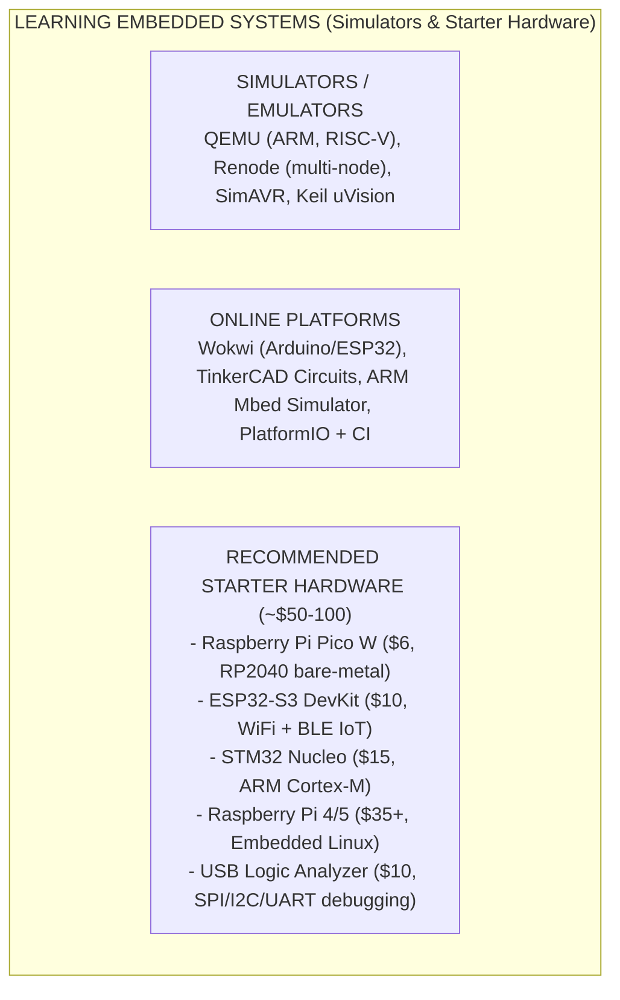
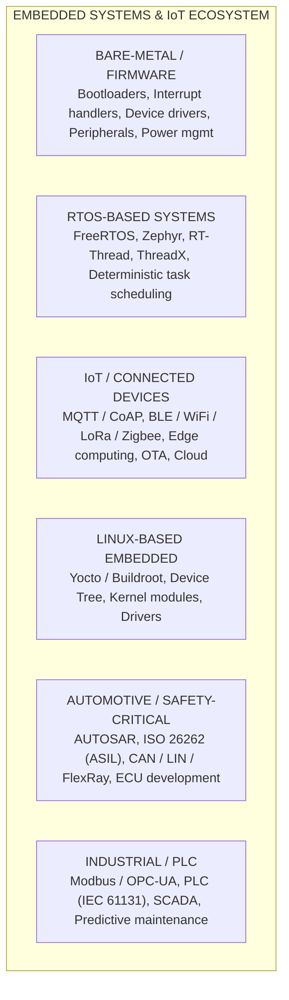
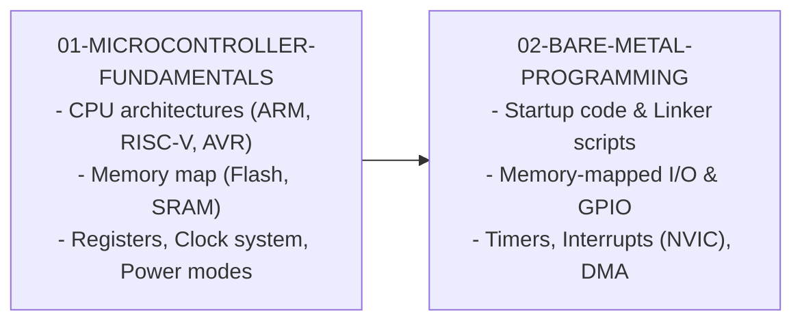
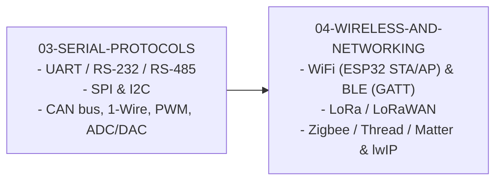
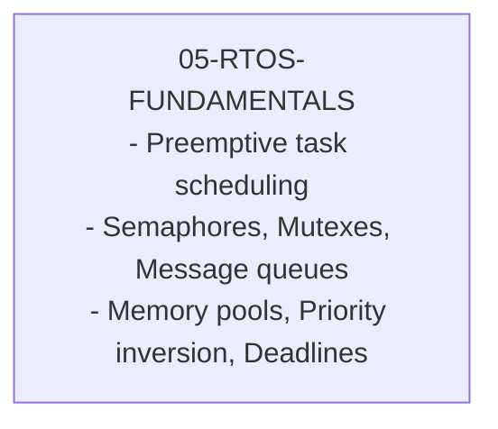
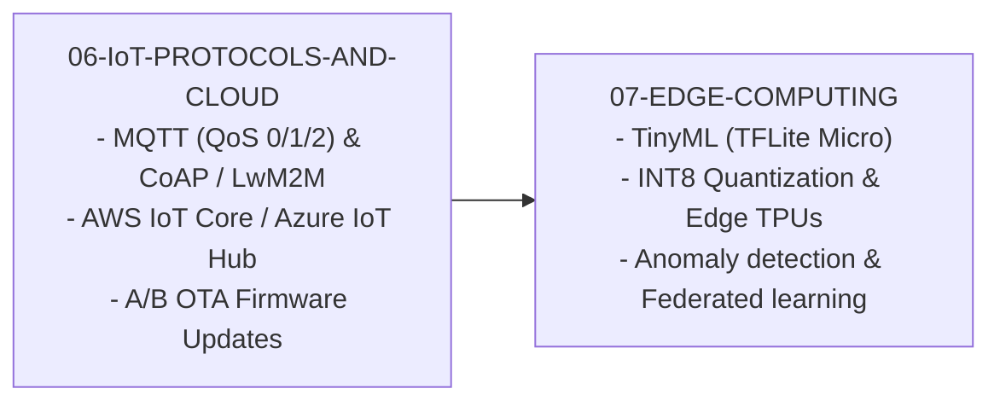
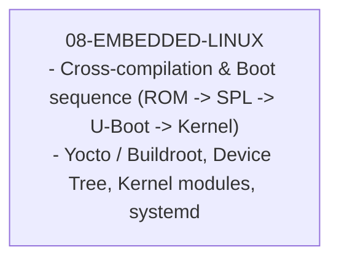
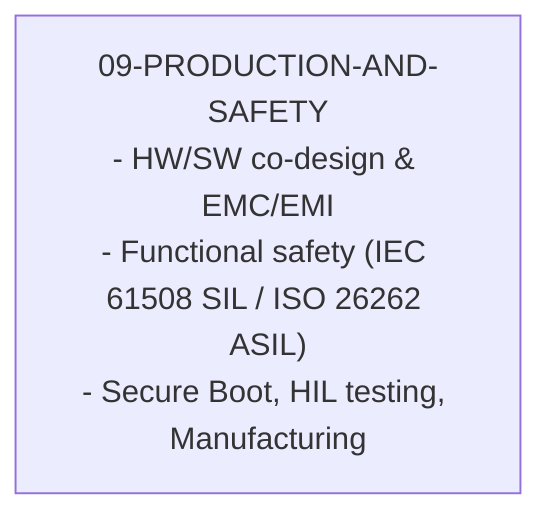

# Embedded Systems & IoT: From Zero to Expert

## Why This Guide Exists

Embedded systems are everywhere -- your microwave, your car's engine controller, your smartwatch, industrial PLCs, medical devices, satellites. Over 98% of all processors manufactured go into embedded systems, not desktop computers or servers. Yet most software engineers have never written code that runs without an operating system, never debugged a timing issue with an oscilloscope, and never thought about what happens when `malloc` fails and there is no swap space.

This guide takes you from zero embedded experience to understanding and building production-grade embedded and IoT systems. Whether you want to build a smart home sensor network on a Raspberry Pi or write firmware for a medical device, this guide gives you the foundation.

---

## Do I Need Hardware?

**Short answer**: Not to start, but eventually yes.

Start with chapters 01-03 using simulators. Buy hardware when you reach chapter 04.

---

## The Embedded & IoT Landscape

---

## Learning Path Overview

### Phase 1: Hardware Foundations (Chapters 01-02)

**Goal**: Understand how microcontrollers work and how software interacts with hardware.

### Phase 2: Communication & Protocols (Chapters 03-04)

**Goal**: Master the protocols that connect embedded systems to the world.

### Phase 3: RTOS & Concurrency (Chapter 05)

**Goal**: Write reliable concurrent firmware using real-time operating systems.

### Phase 4: IoT Architecture (Chapters 06-07)

**Goal**: Build connected systems that communicate with the cloud.

### Phase 5: Embedded Linux (Chapter 08)

**Goal**: Build Linux-based embedded systems (Raspberry Pi and beyond).

### Phase 6: Production & Safety (Chapter 09)

**Goal**: Ship embedded products that are reliable, secure, and certifiable.

---

## How to Use This Guide

Each chapter follows a consistent structure:

1. **Conceptual Foundation** -- What is it and why does it matter?
2. **Hardware Context** -- What physical components are involved?
3. **Implementation** -- Working code in C / MicroPython / Rust
4. **Hands-On Lab** -- Practical exercises (with simulator alternatives)
5. **Interview Questions** -- What you will be asked about this topic

The guide targets software engineers with strong programming skills but zero embedded experience. C is the dominant language in embedded (used in ~70% of firmware), so most code examples are in C, with MicroPython alternatives for rapid prototyping on Raspberry Pi Pico and ESP32.
