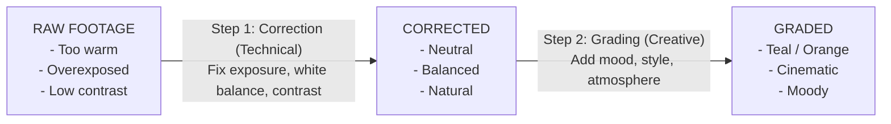
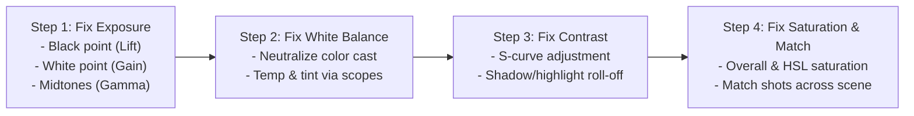
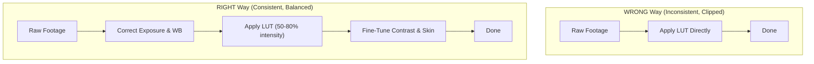
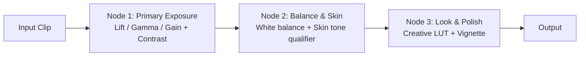
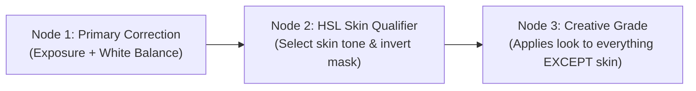

# Color Grading & Correction

A comprehensive guide to understanding color in video, correcting footage to look
natural, and grading it to create a mood or style. Color is what separates amateur-looking
video from professional, cinematic content.

---

## Table of Contents

1. [Color Correction vs Color Grading](#1-color-correction-vs-color-grading)
2. [Color Theory for Video](#2-color-theory-for-video)
3. [Color Spaces and Bit Depth](#3-color-spaces-and-bit-depth)
4. [Reading Scopes](#4-reading-scopes)
5. [The Color Correction Workflow](#5-the-color-correction-workflow)
6. [Color Grading Techniques](#6-color-grading-techniques)
7. [LUTs (Look-Up Tables)](#7-luts-look-up-tables)
8. [DaVinci Resolve Color Page](#8-davinci-resolve-color-page)
9. [Skin Tone Correction](#9-skin-tone-correction)
10. [Common Color Looks and How to Achieve Them](#10-common-color-looks-and-how-to-achieve-them)

---

## 1. Color Correction vs Color Grading

These are two distinct steps that are often confused.



| Aspect      | Color Correction                      | Color Grading                          |
| ----------- | ------------------------------------- | -------------------------------------- |
| Goal        | Accurate, neutral image               | Stylized, emotional image              |
| Process     | Technical: fix exposure, WB, contrast | Creative: add mood, color palette      |
| Order       | First                                 | Second (after correction)              |
| Skill       | Learn the rules                       | Break the rules creatively             |
| Consistency | Match all clips to look uniform       | Apply a unified style across all clips |

## 2. Color Theory for Video

### 2.1 The Color Wheel

```
                    Yellow
                   🟡
              ╱          ╲
         Green              Orange
        🟢                    🟠
        │                       │
        │       CENTER          │
        │       (white)         │
        🔵                    🔴
         Cyan               Red
              ╲          ╱
                   🟣
                  Magenta/
                  Purple

    Complementary colors are opposite each other:
    - Orange ↔ Teal/Cyan  (most popular cinematic look)
    - Purple ↔ Green
    - Yellow ↔ Blue
```

### 2.2 Color Harmony in Video

| Harmony       | Description                | Feel                   | Example                      |
| ------------- | -------------------------- | ---------------------- | ---------------------------- |
| Complementary | Two opposite colors        | Dynamic, high contrast | Teal + Orange (blockbusters) |
| Analogous     | Adjacent colors on wheel   | Harmonious, calm       | Blue + Cyan + Green (nature) |
| Triadic       | Three evenly spaced colors | Vibrant, energetic     | Red + Yellow + Blue          |
| Monochromatic | Shades of one color        | Unified, moody         | Sepia tones, blue tones      |

### 2.3 Color Psychology

| Color           | Emotion/Feeling                  | Usage Example                   |
| --------------- | -------------------------------- | ------------------------------- |
| Blue/Teal       | Cold, sad, corporate, technology | Night scenes, corporate videos  |
| Orange/Warm     | Energy, warmth, nostalgia        | Sunset scenes, food, lifestyle  |
| Green           | Nature, growth, toxicity, Matrix | Nature docs, sci-fi             |
| Red             | Danger, passion, urgency         | Action, romance, horror         |
| Yellow          | Joy, energy, caution             | Summer, comedy, travel          |
| Purple          | Luxury, mystery, creativity      | Beauty, fashion, sci-fi         |
| Desaturated     | Gritty, serious, documentary     | Drama, war, thriller            |
| High saturation | Fun, playful, youthful           | Children's content, pop culture |

## 3. Color Spaces and Bit Depth

### 3.1 What You Need to Know

| Concept     | Simple Explanation                            | Practical Impact                           |
| ----------- | --------------------------------------------- | ------------------------------------------ |
| Color space | Range of colors your footage can contain      | Rec.709 = standard, Rec.2020 = wider       |
| Bit depth   | How many shades between black and white       | 8-bit = 256 shades, 10-bit = 1,024 shades  |
| Log profile | Flat, desaturated image that preserves detail | More room for grading, requires correction |
| RAW         | Unprocessed sensor data                       | Maximum flexibility, huge files            |

### 3.2 Bit Depth Visual

```
8-bit (256 shades per channel):
█████████████████████████████████
Visible banding in gradients (sky, shadows)

10-bit (1,024 shades per channel):
█████████████████████████████████████████████████████████████████████
Smooth gradients, much better for grading

12-bit+ (4,096+ shades):
Professional cinema, maximum latitude
```

### 3.3 Log vs Standard Profiles

```
Standard profile (Rec.709):         Log profile (S-Log, C-Log, V-Log):
┌──────────────────────┐            ┌──────────────────────┐
│                      │            │                      │
│  ████  Punchy        │            │  ░░░░  Flat, grey    │
│  ████  Contrasty     │            │  ░░░░  Low contrast  │
│  ████  Ready to use  │            │  ░░░░  Needs grading │
│                      │            │                      │
└──────────────────────┘            └──────────────────────┘
  Good for: Quick turnaround          Good for: Maximum grading flexibility
  Bad for: Limited grading room        Bad for: Requires color work
```

> **For beginners**: Shoot in standard color profile (not Log). Log profiles require
> color grading knowledge and 10-bit recording to avoid banding. Start with standard,
> learn grading fundamentals, then graduate to Log.

## 4. Reading Scopes

Scopes are objective measurement tools that show you what the colors in your image
actually look like — your monitor may lie, but scopes do not.

### 4.1 Waveform (Luma)

Shows brightness from left to right, matching your image position.

```
100% ┬─ ─ ─ ─ ─ ─ ─ ─ ─ ─ ─ ─ ─ ─ CLIP (too bright)
     │        ╱╲
     │       ╱  ╲     ╱╲
 75% │      ╱    ╲   ╱  ╲
     │     ╱      ╲ ╱    ╲
 50% │    ╱        X      ╲
     │   ╱        ╱ ╲      ╲
 25% │  ╱        ╱   ╲      ╲
     │ ╱        ╱     ╲      ╲
  0% ┴─ ─ ─ ─ ─ ─ ─ ─ ─ ─ ─ ─ CLIP (too dark)

     ◄──── Left of image ──── Right of image ────►

     Bright areas = high on waveform
     Dark areas = low on waveform
     Target: Keep between 0% and 100%
     Ideal: Darkest shadows ~5%, brightest highlights ~90-95%
```

### 4.2 Vectorscope

Shows color saturation and hue on a circular graph. The further from center, the more
saturated the color.

```
                    Yl (Yellow)
                       │
              Rd ──────┼────── Gr (Green)
             (Red)     │
                       │
              Mg ──────┼────── Cy (Cyan)
           (Magenta)   │
                       │
                    Bl (Blue)

     Center = no color (grey/white)
     Further from center = more saturated

     Skin tone line: runs from center toward
     the area between Red and Yellow (~11 o'clock)
     ALL skin tones (regardless of ethnicity) fall
     on this same line — only the brightness differs
```

### 4.3 Parade (RGB)

Shows individual Red, Green, and Blue channel waveforms side by side.

```
     Red          Green          Blue
100% ┬──────    ┬──────      ┬──────
     │  ╱╲      │   ╱╲       │
 75% │ ╱  ╲     │  ╱  ╲      │    ╱╲
     │╱    ╲    │ ╱    ╲     │   ╱  ╲
 50% │      ╲   │╱      ╲    │  ╱    ╲
     │       ╲  │        ╲   │ ╱      ╲
 25% │        ╲ │         ╲  │╱        ╲
  0% ┴────────  ┴──────────  ┴──────────

     If Red is higher than Green and Blue: image is too warm
     If Blue is higher: image is too cool
     Balanced white: all three channels align at the same level
```

## 5. The Color Correction Workflow

### 5.1 Step-by-Step



### 5.2 Exposure Correction

| Problem       | Scope Indicator                  | Fix                                        |
| ------------- | -------------------------------- | ------------------------------------------ |
| Underexposed  | Waveform clustered at bottom     | Raise Lift (shadows) and Gain (highlights) |
| Overexposed   | Waveform touching top (clipping) | Lower Gain, recover highlights             |
| Low contrast  | Waveform compressed in middle    | Expand: lower Lift, raise Gain             |
| High contrast | Waveform touching both extremes  | Compress: raise Lift, lower Gain           |

### 5.3 White Balance Correction

```
Too warm (orange):              Correct:                Too cool (blue):
┌──────────────────┐          ┌──────────────────┐    ┌──────────────────┐
│  R > G > B       │          │  R ≈ G ≈ B       │    │  B > G > R       │
│  on RGB parade   │  ────►   │  balanced on      │    │  on RGB parade   │
│                  │          │  RGB parade       │    │                  │
└──────────────────┘          └──────────────────┘    └──────────────────┘
Fix: Add blue/cyan             Neutral whites           Fix: Add red/warmth
     (lower color temp)                                 (raise color temp)
```

### 5.4 Shot Matching

When you have multiple clips from different cameras, angles, or times, you need to match
them so they look consistent.

```
Before matching:                     After matching:
Clip A: 🟠 (warm)                    Clip A: ⚪ (neutral)
Clip B: 🔵 (cool)        ────►      Clip B: ⚪ (neutral)
Clip C: 🟢 (green tint)             Clip C: ⚪ (neutral)

Pick one clip as reference, match all others to it.
DaVinci Resolve has "Shot Match" feature for this.
```

## 6. Color Grading Techniques

### 6.1 The Three-Way Color Correction

The primary tool in color grading: independently color the Shadows (Lift), Midtones
(Gamma), and Highlights (Gain).

```
Shadows (Lift):        Midtones (Gamma):      Highlights (Gain):
Affects dark areas     Affects mid-tones      Affects bright areas

Common grade:          Common grade:          Common grade:
Push toward teal/blue  Keep neutral or warm   Push toward orange/warm
(cool shadows)         (natural skin)         (warm highlights)

Result: The classic "teal and orange" cinematic look
```

### 6.2 Curves

Curves offer the most precise control over tonal range and color.

```
Output                          Output
  ▲                               ▲
  │        ╱                      │      ●
  │      ╱                        │     ╱
  │    ╱    ← Raised midtones     │   ╱
  │  ╱       (brighter image)     │  ╱   ● ← S-curve
  │╱                              │╱  ●     (more contrast)
  ├──────────► Input              ├──────────► Input
     Linear (no change)               S-curve (contrast boost)


  Red/Green/Blue individual curves:
  - Raise Red curve in highlights = warm highlights
  - Raise Blue curve in shadows = cool shadows
  - This is how many cinematic looks are built
```

### 6.3 HSL Qualification

Target specific colors for adjustment without affecting the rest of the image.

```
Original image:                  After HSL qualification:
┌──────────────────────┐         ┌──────────────────────┐
│  🟢 Green tree       │         │  🟢 More vivid green │
│  🔵 Blue sky         │  ──►    │  🔵 Deeper blue sky  │
│  🧑 Person (neutral) │         │  🧑 Person UNCHANGED │
│  🟤 Brown ground     │         │  🟤 Brown ground     │
└──────────────────────┘         └──────────────────────┘

Select the green hue → boost saturation
Select the blue hue → shift toward deeper blue
Skin tones left untouched
```

### 6.4 Power Windows (Masks)

Apply grading to only a specific area of the frame.

```
┌──────────────────────────────┐
│                              │
│        ┌──────────┐          │
│        │ Brighter │ ← Oval   │
│        │  Face    │   mask   │
│        │          │          │
│        └──────────┘          │
│   (rest of frame darker)    │
│                              │
└──────────────────────────────┘

Use cases:
- Brighten a face in a dark scene
- Darken edges (vignette)
- Draw attention to specific area
- Fix uneven lighting
```

## 7. LUTs (Look-Up Tables)

### 7.1 What Is a LUT?

A LUT is a mathematical formula that maps input colors to output colors. Think of it
as a "color filter preset" but more precise.

```
Input Color  ────►  LUT  ────►  Output Color

R: 180, G: 120, B: 90  ──►  R: 200, G: 100, B: 70
(original warm tone)          (shifted to orange/teal look)

Every possible color gets mapped to a new value.
```

### 7.2 Types of LUTs

| Type              | Purpose                        | When to Apply                         |
| ----------------- | ------------------------------ | ------------------------------------- |
| **Technical LUT** | Convert Log footage to Rec.709 | First step, on Log footage only       |
| **Creative LUT**  | Apply a stylistic look         | After correction, as a starting point |
| **Camera LUT**    | Camera-specific Log conversion | Matches specific camera profiles      |

### 7.3 How to Use LUTs Correctly



### 7.4 Recommended Free LUT Packs

| Source                     | Style              | Notes                             |
| -------------------------- | ------------------ | --------------------------------- |
| DaVinci Resolve built-in   | Various            | Included with software            |
| Blackmagic Film to Rec.709 | Natural conversion | For Blackmagic camera Log footage |
| SmallHD Movie Look Pack    | Cinematic          | Free download from SmallHD        |
| Ground Control Free LUTs   | Various cinematic  | Popular free pack                 |
| Lutify.me free pack        | Various styles     | Sample pack of their premium LUTs |

> **Warning**: Do not just slap a LUT on your footage and call it done. LUTs are a
> starting point. Always correct first, apply LUT, then fine-tune.

## 8. DaVinci Resolve Color Page

### 8.1 Node-Based Grading

DaVinci Resolve uses nodes (like a processing pipeline) instead of stacked layers.
Each node applies one adjustment, and they chain together.



### 8.2 Essential Color Page Tools

| Tool               | What It Does                              | When to Use                      |
| ------------------ | ----------------------------------------- | -------------------------------- |
| **Primary Wheels** | Lift/Gamma/Gain (shadows/mids/highlights) | Every clip                       |
| **Curves**         | Precise tonal and color control           | Fine-tuning, creative looks      |
| **Qualifier**      | Select specific colors (HSL)              | Skin tone fixes, sky enhancement |
| **Power Windows**  | Mask specific areas                       | Localized adjustments            |
| **Tracker**        | Track moving objects for masks            | Moving subjects                  |
| **Color Warper**   | Remap specific colors visually            | Creative color shifts            |

### 8.3 Quick Grade Workflow in Resolve

```
Node 1: Exposure & Contrast
  - Use Lift/Gamma/Gain wheels
  - Watch the waveform scope
  - Target: shadows at ~5%, highlights at ~90-95%

Node 2: White Balance
  - Use Temperature and Tint sliders
  - Watch the RGB Parade
  - Target: R, G, B channels aligned for neutral whites

Node 3: Creative Grade (optional)
  - Apply a LUT or manual color push
  - Cool shadows (push Lift toward blue)
  - Warm highlights (push Gain toward orange)

Node 4: Skin Tone Fix (optional)
  - Use Qualifier to isolate skin
  - Adjust saturation and hue
  - Check vectorscope for skin tone line

Node 5: Vignette (optional)
  - Add circular power window
  - Slightly darken edges
  - Softness: high (subtle effect)
```

## 9. Skin Tone Correction

### 9.1 The Skin Tone Line

Regardless of ethnicity, all skin tones fall on the same line on the vectorscope
(roughly between Red and Yellow, at about 11 o'clock position).

```
Vectorscope:

         Yl
          │
    Rd────┼────Gr
    │   ╱ │
    │  ╱  │
    │ ╱ ← Skin tone line (all ethnicities)
    │╱    │
    Mg────┼────Cy
          │
         Bl

Light skin: closer to center (less saturated)
Dark skin: same angle, different brightness
All skin: same hue angle on vectorscope
```

### 9.2 Common Skin Tone Problems

| Problem         | Vectorscope Shows           | Fix                                |
| --------------- | --------------------------- | ---------------------------------- |
| Too warm/orange | Skin dots shifted toward Yl | Reduce warmth (lower color temp)   |
| Too cool/pale   | Skin dots shifted toward Cy | Add warmth (raise color temp)      |
| Too saturated   | Skin dots far from center   | Reduce saturation on skin hue      |
| Green/sick cast | Skin dots shifted toward Gr | Add magenta (tint adjustment)      |
| Uneven tone     | Skin dots scattered         | Use qualifier to isolate and unify |

### 9.3 Protecting Skin Tones While Grading

When applying a creative grade, protect skin tones so people still look natural:



## 10. Common Color Looks and How to Achieve Them

### 10.1 Teal and Orange (Hollywood Blockbuster)

The most popular cinematic look. Teal in the shadows, orange in the highlights
(complementary colors).

```
Settings:
- Lift (Shadows): Push toward Teal/Cyan
- Gamma (Midtones): Slightly warm
- Gain (Highlights): Push toward Orange/Warm
- Saturation: 85-110%
- Contrast: Slightly raised

Used in: Transformers, Mad Max, Marvel films
```

### 10.2 Desaturated / Bleach Bypass

Muted colors, raised blacks, gritty feel.

```
Settings:
- Saturation: 40-60%
- Lift (Shadows): Raise (milky blacks)
- Contrast: Moderate
- Highlight rolloff: Soft (creamy whites)

Used in: Saving Private Ryan, Se7en, The Matrix
```

### 10.3 Warm Vintage / Film Emulation

Golden, nostalgic look reminiscent of old film.

```
Settings:
- Color temperature: Warm (+15-25)
- Highlights: Push toward yellow/amber
- Shadows: Push toward brown/warm
- Saturation: Slightly reduced (80-90%)
- Add subtle film grain
- Soften highlights slightly

Used in: Wes Anderson films, indie films, travel vlogs
```

### 10.4 Clean and Bright (YouTube Standard)

Natural, well-lit, slightly enhanced look for most YouTube content.

```
Settings:
- Exposure: Correct, slightly bright
- Contrast: Moderate (natural)
- Saturation: 100-115% (slightly boosted)
- Skin tones: Warm, healthy
- Whites: Clean, neutral
- Shadows: Not crushed (detail visible)

Used in: Most tech YouTubers, lifestyle vlogs, tutorials
```

### 10.5 Dark and Moody

Low-key, atmospheric look with deep shadows.

```
Settings:
- Overall exposure: Slightly under
- Shadows: Deep, crushed blacks
- Highlights: Controlled, not too bright
- Saturation: Reduced (60-80%)
- Cool color temperature
- Vignette: Moderate

Used in: Horror, thriller, night photography, dramatic vlogs
```

---

**Previous**: [04 - Video Editing Tools](04-VIDEO-EDITING-TOOLS.md)
**Next**: [06 - Motion Graphics & Effects](06-MOTION-GRAPHICS-EFFECTS.md)
